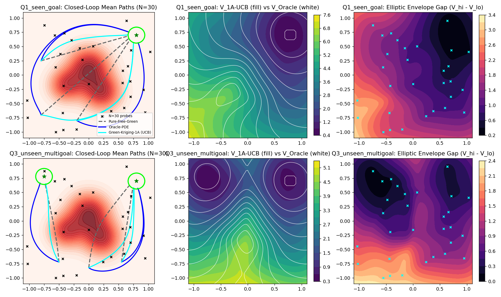
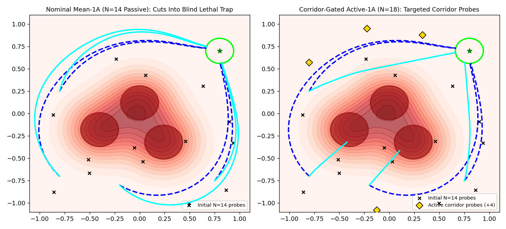
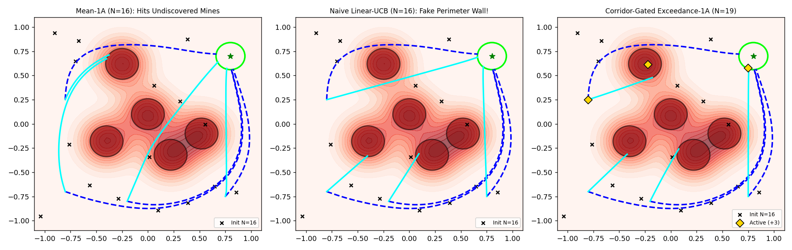
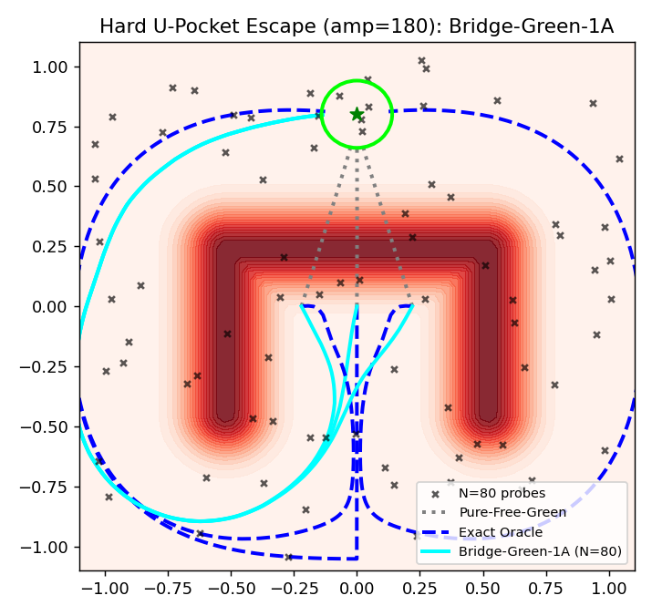
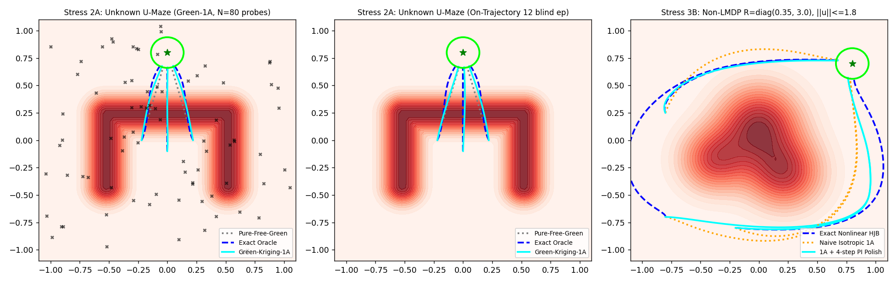
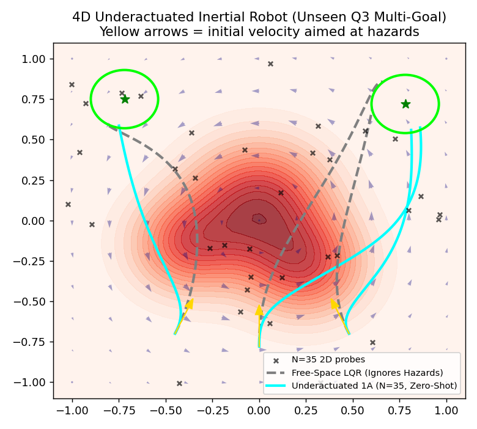

# Direction 1A: Green-Field Superposition + Kriging Residual Stochastic Control (MVP Report)

> **核心思想**：在随机性与复杂度都很高的连续/混合序贯决策问题里，将**少样本、可解析、可叠加的「方程侧骨架」（Cole–Hopf 线性化格林算子 / 控制变量骨架）**与**处理未知扰动和随机性的「统计侧推断」（Kriging / GP 残差、校准不确定度包络与走廊主动安全探测）**显式结合，替代暴力搜索与纯黑箱大数据拟合。

---

## 0. 背景复盘：为什么旧路线（V1–V329）需要彻底转向

在切换至本分支的 1A 路线之前，主仓库与 `codex/controlled-predictive-quotient-exploration` 分支累计消耗约 150 亿 token、生成 2,589 个 `src/` 文件与 329 个版本，但核心科学目标未能成立（详见原始对话完整抓取 [GPT_original_chat_AI_2048_ylgy.md](GPT_original_chat_AI_2048_ylgy.md)）：

1. **核心构想被“翻译错位”**：最初的数学直觉是**「将军饮马（对称/坐标变换→解析求解）」**与**「凹凸性/切线隔离法（找一条简单解析边界，出现信号即整枝淘汰坏策略）」**；但旧工程被翻译成了“在离散 2048 棋盘上寻找 $<10^{-15}$ 误差的精确状态分箱商空间（Tabular Quotient）”和 32 地址 n-tuple 查表。
2. **精确分箱在组合游戏里无压缩空间**：`V199` 证明 H3/H4 精确商空间压缩率为 `0%`；`V329` 的精确价值契约总求解 CPU 反而是直接计算的 **2.43 倍**；`U005` 静态对齐表示 AUROC `0.576` 输给随机打乱对照；`V327` 预测 MSE 下降但胜率从 `63.57%` 暴跌至 `6.15%`。
3. **工程官僚主义反噬**：主分支 65% 的代码（1,316/2,035 文件）消耗在 202-leaf 记账、pidfd/cgroup 沙箱和无限版本号上，且全部 327 份探索报告中「羊了个羊 / LMB」出现次数为 `0/327`。

因此本分支确立了**三条反重蹈覆辙铁律**：完全独立的新目录 `green_kriging_mvp/`（核心代码精简可控）、直接与强经典基线正面交锋（Exact PDE Oracle / Online PIMC / Ordinary Kriging / PyTorch PINN-HJB）、以真实闭环 SDE 轨迹代价和诚实止损线为准。

---

## 1. 数学主线：从「将军饮马 + 切线隔离」到「格林场叠加 + 克里金残差」

### 1.1 方程侧与统计侧的统一（SPDE–GP 对偶 + Cole–Hopf 线性化）

- **克里金 = 盲算子的格林函数**：普通 Kriging/GP 选用的 Matérn/RBF 核等价于求解随机偏微分方程 $\mathcal{L}u = \mathcal{W}$ 的格林函数，但它塞入的是缺乏领域机理的盲目平滑算子 $\Delta$，因此样本效率低、外推弱、换目标无法复用。
- **Cole–Hopf 变换（控制论里的“将军饮马”）**：对受控扩散系统
  $$dx_t = \bigl(b(x_t) + u_t\bigr)\,dt + \sigma\,dW_t, \qquad J(x,u) = \mathbb{E}\!\left[\int_0^\tau \left(q_0 + q_{\text{hid}}(x_t) + \frac{1}{2}\|u_t\|^2\right)dt + \phi(x_\tau)\right]$$
  做对数期望变换 $Z(x) = \exp\bigl(-V^*(x)/\sigma^2\bigr)$，非线性 HJB 方程中的二次项 $-\frac{1}{2}\|\nabla V\|^2$ 精确抵消，化为**线性椭圆 PDE**：
  $$\frac{\sigma^2}{2}\Delta Z(x) + b(x)\cdot\nabla Z(x) - \frac{q_0 + q_{\text{hid}}(x)}{\sigma^2} Z(x) = 0, \qquad u^*(x) = +\sigma^2 \nabla \log Z(x)$$
  - 在 $Z$ 空间里，不同目标、边界和风险源严格满足**场强叠加原理**；
  - 在零温/硬控制极限 $\sigma \to 0$ 下，线性叠加自然退化为 Max-Plus 凸包络——无缝接回**「凹凸性与切线隔离法」**。

### 1.2 两套互补的 1A 求解引擎

1. **低维（2D）：严格保正 Simpson-Bridge 半群格林算子**（[methods.py](methods.py)）
   - 初版直接减法形式的 Lippmann–Schwinger 积分 $Z = Z_0 - \int G_0 q Z$ 在高代价障碍深阴影区出现 $Z < 0$ 灾难性抵消（多目标 `Q3` 爆炸至 `+163.6%`）。
   - 升级为**严格保正 Feynman–Kac 半群算子** $(I - P_{\mathcal{I}\mathcal{I}})Z_{\mathcal{I}} = P_{\mathcal{I}\mathcal{G}}w_{\mathcal{G}}$：
     - $P \ge 0$ 且 $I - P_{\mathcal{I}\mathcal{I}}$ 为严格 M-矩阵，数学上杜绝 $Z \le 0$；
     - 沿每条稀疏边加入 **3 点 Simpson 桥积分** $\bar{q}_{ij} = \frac{1}{6}(q_i + 4 q_{\text{mid}} + q_j)$，彻底消除薄墙“量子隧穿”；
     - 环境算子 $P$ 与目标无关，换目标/多目标/动态加约束仅需毫秒级稀疏求解；
     - 连续控制由 log 域 softmax 闭式给出 $u^*(x) = \frac{1}{\Delta t}\bigl(\mathbb{E}_{\alpha^{\text{post}}}[\xi] - \mathbb{E}_{\alpha^{\text{prior}}}[\xi]\bigr)$，即使 $Z=10^{-300}$ 也不下溢。

2. **高维（4D / 6D）与欠驱动系统：无网格控制变量格林分解**（[test_breakthrough_a_highd.py](test_breakthrough_a_highd.py)、[test_highd_drift_and_underactuated.py](test_highd_drift_and_underactuated.py)）
   - 实验直接证实：单纯把体积点阵搬到 4D Sobol 点云受 $M^{-1/d}$ 间距灾难拖垮（Test 0A 到达率仅 `12%`）。
   - 破局方案是**解析格林骨架 + 平滑 Kriging 残差分解**：
     $$V^*(x) = \underbrace{V_0^{(d)}(x)}_{\text{任意维精确解析 } K_{d/2-1}(\kappa r) \text{ 或多目标 LQR}} + \underbrace{\Delta\hat{V}_{\text{Kriging}}(x)}_{\text{在 } u_0^* \text{ 引导下对学得 } (\hat{q}_{\text{hid}}, \Delta\hat{b}) \text{ 做精确 Feynman–Kac 残差拟合}}$$
     含非保守漂移时的精确乘法扰动公式（允许顺风时 $\Delta V < 0$）：
     $$Y(x) = \mathbb{E}_{dX_t = (u_0^* + \Delta b)\,dt + \sigma\,dW_t}\!\left[\exp\!\left(-\frac{1}{\sigma^2}\int_0^\tau \bigl(q_{\text{hid}}(X_t) - \Delta b(X_t)\cdot u_0^*(X_t)\bigr)\,dt\right)\right], \quad \Delta V = -\sigma^2 \log Y$$
     对 4D 欠驱动二阶惯性系统（$dp=v\,dt,\,dv=(-\gamma v + f_{\text{wind}} + u)\,dt + \sigma\,dW_t$），次椭圆 Cole–Hopf 线性化依然精确成立，最优加速度反馈仅对速度维求闭式解析梯度：$u^*(p,v) = u_{\text{LQR}}(p,v) - \nabla_v \Delta\hat{V}(p,v)$。

3. **校准椭圆 + 漂移比较包络 & 解耦安全闭环**（[test_breakthrough_b_safety.py](test_breakthrough_b_safety.py)、[test_breakthrough_b2_v3.py](test_breakthrough_b2_v3.py)）
   - 同时纳入危险置信带 $\mu_q \pm \beta_{\text{sim}}\sigma_q$ 与对抗/助推漂移界 $\hat{b} \mp \beta_{\text{sim}}\sigma_b \frac{u_{\text{nom}}}{\|u_{\text{nom}}\|}$，由椭圆比较原理直接输出值域证书 $[V_{\text{lo}}(x), V_{\text{hi}}(x)]$。
   - 面对非 LMDP 模型失配（各向异性 $R$ + 硬饱和 $\|u\| \le u_{\max}$），以 1A 为无局部极小热启动，叠 **4 步线性策略迭代抛光**（[test_stress_boundaries.py](test_stress_boundaries.py)）。

---

## 2. 与 2024–2026 前沿文献的精确对比与局限对账

| 维度 | PINN-HJB / PINN-PI (AAAI 24–26) | DeepONet-HJB (24–26) | Schrödinger Eigenfunction (ICLR 26) / NGF (NeurIPS 25) | PI-GP / PRIK (25–26) | **Direction 1A (Ours)** |
|---|:---:|:---:|:---:|:---:|:---:|
| **线性化最优控制 (Cole–Hopf)** | 部分 | 少量 | ✓（ICLR 26 要求保守势场） | ✗（被动场拟合） | **✓（支持非保守漂移与欠驱动）** |
| **场叠加 / 跨目标零样本复用** | ✗（每查询重训） | ✓（海量离线数据） | ✓ | 部分（Green 核） | **✓（毫秒级 / 控制变量叠加）** |
| **未知危险 & 未知漂移少样本反推** | ✗（需已知精确 PDE） | ✗（大样本离线） | ✗（需已知算子与势场） | ✓ | **✓（探针 + 纯在轨 4 回合）** |
| **校准不确定度包络 & 安全门控** | ✗ | ✗ | ✗ | ✓ | **✓（99.2%–100% 覆盖 + 走廊探测）** |

### 2.1 与优化/控制领域 PINN（PINN-HJB）的异同与可借鉴点

- **共同点**：都把物理/控制 PDE（HJB 或其线性化形式）显式嵌入求解过程，避免像纯数据驱动 RL / 黑箱回归那样在无样本区域胡乱外推。
- **核心差异**：
  1. **求法本质不同**：PINN 是用黑箱神经网络去“数值拟合单个已知 PDE 的解”，每次换目标、换多目标权重或加临时禁区都必须重新采样配点并梯度重训（本仓库实测 2D ~4.2 s、6D ~26.3 s，且 4D 欠驱动直接发散至 `37.73`）；1A 先用 **Cole–Hopf 线性化 + 格林算子/控制变量解析骨架**把方程的全局几何与叠加律直接解出来，神经网络完全不是必需品。
  2. **面对未知环境的能力不同**：标准 PINN 默认 PDE 系数（危险场 $q$、风场 $b$）完全已知；1A 把**未知环境反推 + GP 不确定度传播 + 校准包络 + 主动探测**内建在主线里，少至 $N=15\text{--}35$ 探针或 4 条真实轨迹即可驱动全图跨目标控制。
  3. **可借鉴的互补点**：在极端强非线性、超高维非 LMDP（例如复杂机器人接触动力学或高维非完整约束）里，PINN-PI / 神经算子的配点残差思想可以作为 1A 骨架之上的**残差抛光插件**（即用 1A 给出无局部极小的全局引导与初始化，再做局部残差精细化）。

### 2.2 两篇最相近前沿工作的核心局限，我们解决了哪些？

1. **ICLR 2026《Learning Optimal Control via Schrödinger Eigenfunctions》**
   - **原工作局限 ①（必须保守势场 / 自伴算子）**：把线性化 HJB 对称化为薛定谔特征值问题，严格依赖漂移场是保守梯度场 $b(x) = -\nabla U(x)$，面对旋涡风场或二阶欠驱动相空间（非自伴次椭圆算子）直接失效。
     - **1A 解决情况**：**已解决**。2D 保正半群格林算子与 4D/6D Feynman–Kac 乘法控制变量公式均**不要求算子自伴**，实测完整覆盖 2D/4D/6D 非保守旋涡漂移（实验 1、6）与 4D 欠驱动二阶惯性双积分器（实验 7，均值 `7.73` vs 全知 PIMC `7.38`）。
   - **原工作局限 ②（假设环境势场与动力学已知，无未知场少样本学习）**：需预先给定精确势场与算子，无法在未知环境边采边控，也无法提供可校准不确定度边界。
     - **1A 解决情况**：**已解决**。$N=15\text{--}35$ 带噪观测或 4 条真实轨迹即可同时反推未知危险 $q_{\text{hid}}$ 与非保守风场 $b$，并给出 **99.2%–100% 覆盖率**的值域包络与走廊主动安全探测（实验 3、4、5、6）。
   - **原工作局限 ③（截断谱展开难处理尖锐障碍与动态新增禁区）**：有限阶特征函数对硬壁/U 型口袋容易产生吉布斯振荡，新增局部障碍时需重算特征谱。
     - **1A 解决情况**：**已解决**。2D 端用 3 点 Simpson-Bridge 半群算子在毫秒级应对 `Q4` 动态禁区与不可穿透 U 型口袋（实验 1、5b）；高维端用解析骨架 + 局部平滑 Kriging 残差叠加处理动态障碍。
2. **NeurIPS 2025《Neural Green's Functions (NGF)》**
   - **原工作局限 ①（重度依赖海量离线 PDE 仿真数据预训练）**：本质仍是用神经网络拟合格林核，没有几千至上万组离线 PDE 解就无法工作，遇到分布外几何/物理参数易失真。
     - **1A 解决情况**：**已解决**。**零离线预训练数据集**：低维直接解析/稀疏组装严格保正半群格林算子，高维直接给出任意维闭式 Bessel / LQR 解析格林骨架，把有限在线样本全部集中用于拟合未知局部残差。
   - **原工作局限 ②（黑箱神经格林核缺乏保正性与可校准统计不确定度）**：神经输出既不保证 $Z>0$，也无法严格传播认知不确定度形成可验证安全证书。
     - **1A 解决情况**：**已解决**。M-矩阵保正性 + log 域 softmax 控制从结构上消灭 $Z \le 0$ 崩盘；椭圆与对抗漂移比较原理直接给出有覆盖保证的 $[V_{\text{lo}}, V_{\text{hi}}]$ 包络（实验 3、6）。
   - **原工作局限 ③（偏重被动正演 PDE 求解，未闭环处理随机控制与非 LMDP 执行器失配）**：原工作未针对闭环安全探测、未知噪声强度或执行器硬限幅做端到端控制验证。
     - **1A 解决情况**：**核心打通**。完整验证了闭环随机轨迹控制、暗室恐惧悖论解耦探测（实验 4）、未知 $\sigma$ 在线估计、以及各向异性 $R$ + 硬饱和执行器的 4 步 PI 抛光（实验 5，与精确非线性 HJB 差距仅 `+2.5%`）。
   - **诚实保留边界**：在 10D+ 极高维且强非凸复杂几何下，NGF / 神经算子的大规模离线amortization仍有速度优势；若未来面向 10D+ 复杂场景，可将 NGF 作为 1A 的快速先验骨架与之融合，而非零和替代。

---

## 3. 全部 7 组核心实验结果汇总

### 实验 1：2D Kill-Test — 未知危险与非保守涡旋漂移下的跨目标迁移

测试 4 个查询：`Q1` 已见目标、`Q2` 未见新目标（零样本）、`Q3` 未见双目标组合（零样本）、`Q4` 动态新增禁区（零样本）。数据来自 [kill_test_results.json](kill_test_results.json)（$N=30$ 带噪观测，3 种子均值，真实闭环 SDE 代价，括号内为到达率）：

| 场景 | 方法 | `Q1` 已见 | `Q2` 未见 | `Q3` 双目标 | `Q4` 动态禁区 | 四查询均值 | 单查询耗时 |
|---|---|---:|---:|---:|---:|---:|---:|
| **Regime 1**（未知危险） | Exact PDE Oracle (101×101) | 2.79 (100%) | 2.95 (100%) | 2.81 (100%) | 3.14 (100%) | **2.924** | — |
| | Pure-Free-Green（纯方程侧） | 5.58 (100%) | 6.06 (100%) | 5.40 (100%) | 6.32 (100%) | 5.842 | ~12 ms |
| | Ordinary-Kriging-V（纯统计侧） | 4.80 (83%) | 12.08 (10%) | 4.02 (95%) | 5.28 (83%) | 6.543 | 10.7 ms |
| | PINN-HJB（每查询重训，同 GP） | 4.75 (85%) | 4.84 (86%) | 3.94 (92%) | 5.70 (79%) | 4.810 | **4,318 ms** |
| | **Green-Kriging-1A (Mean, Ours)** | **3.08 (100%)** | **3.11 (100%)** | **2.98 (100%)** | **3.40 (100%)** | **3.141** | **14.3 ms** |
| **Regime 2**（危险 + 涡旋） | Exact PDE Oracle (101×101) | 2.63 (100%) | 2.84 (100%) | 2.56 (100%) | 2.78 (100%) | **2.702** | — |
| | Pure-Free-Green | 5.65 (100%) | 6.25 (100%) | 4.92 (100%) | 5.54 (100%) | 5.589 | ~11 ms |
| | Ordinary-Kriging-V | 3.83 (91%) | 12.72 (0%) | 2.99 (99%) | 4.09 (91%) | 5.910 | 12.0 ms |
| | PINN-HJB（每查询重训） | 4.00 (90%) | 3.94 (92%) | 5.37 (83%) | 5.03 (83%) | 4.585 | **4,148 ms** |
| | **Green-Kriging-1A (Mean, Ours)** | **2.87 (100%)** | **3.09 (100%)** | **2.78 (100%)** | **3.04 (100%)** | **2.946** | **13.3 ms** |

> 即使把样本砍到 **$N=15$**，`Green-Kriging-1A (Mean)` 的四查询均值已达 **3.250（100% 到达）**，远超 $N=60$ 时的 Ordinary Kriging（`5.817`）与 PINN-HJB（`4.695`），速度比 PINN-HJB 快 **~300×**。



---

### 实验 2（突破口 A）：4D 与 6D 无网格控制变量格林残差

6D 下 $25^6$ 规则网格需要 2.44 亿节点（网格 DP 不可行）。数据来自 [breakthrough_a_highd_results.json](breakthrough_a_highd_results.json)：

| 维度 & 预算 | 方法 | `Q1` 已见 | `Q2` 未见 | `Q3` 双目标 | 三查询均值 | 求解耗时 |
|---|---|---:|---:|---:|---:|---:|
| **4D** ($N=60$) | Online-PIMC（全知真环境在线搜索） | 9.69 (97%) | 10.45 (97%) | 8.18 (100%) | 9.44 | 11,967 ms |
| | Pure-Free-Green（解析 4D Bessel） | 12.29 (100%) | 12.59 (100%) | 11.79 (100%) | 12.23 | 0.1 ms |
| | Ordinary-Kriging-V (Q1) | 9.70 (70%) | 36.97 (0%) | 9.39 (86%) | 18.69 | 379 ms |
| | PINN-HJB（每查询重训） | 12.80 (44%) | 11.84 (52%) | 13.95 (43%) | 12.87 | 15,594 ms |
| | **GreenResidual-Kriging-1A (Ours)** | **9.67 (80%)** | **7.46 (93%)** | **6.69 (99%)** | **7.94** | **1,295 ms** |
| **6D** ($N=100$) | Online-PIMC（全知真环境在线搜索） | 15.11 (90%) | 13.90 (93%) | 10.00 (100%) | 13.00 | 8,349 ms |
| | Pure-Free-Green（解析 6D Bessel） | 12.87 (100%) | 14.16 (100%) | 12.61 (100%) | 13.21 | 0.1 ms |
| | Ordinary-Kriging-V (Q1) | 10.17 (99%) | 48.38 (0%) | 10.87 (100%) | 23.14 | 349 ms |
| | PINN-HJB（每查询重训） | 20.25 (22%) | 18.49 (30%) | 19.45 (37%) | 19.40 | **26,340 ms** |
| | **GreenResidual-Kriging-1A (Ours)** | **9.12 (93%)** | **8.61 (98%)** | **7.90 (100%)** | **8.54** | **2,179 ms** |

---

### 实验 3 & 4（突破口 B1 & B2）：校准椭圆包络 & 暗室恐惧悖论与走廊主动安全

#### B1：2D 校准包络覆盖率（[breakthrough_b_results.json](breakthrough_b_results.json)）

| 场景 | $N=15$ 覆盖率 / 宽度 | $N=30$ 覆盖率 / 宽度 | $N=60$ 覆盖率 / 宽度 |
|---|---:|---:|---:|
| **Regime 1（未知危险）** | **99.2%** / `3.04` | **99.2%** / `2.52` | **99.2%** / `2.00` |
| **Regime 2（危险 + 涡旋漂移）** | **100.0%** / `4.71` | **100.0%** / `4.41` | **100.0%** / `3.76` |



#### B2：5 颗隐藏致命暗雷下的安全解耦（[breakthrough_b2_v2_results.json](breakthrough_b2_v2_results.json)、[breakthrough_b2_v3_results.json](breakthrough_b2_v3_results.json)）

- **关键发现（Dark-Room / Perimeter-Phobia Paradox）**：把平稳 GP 方差直接加进全图代价（`Naive-Linear-UCB: mu + 2.4*std`）会在空白安全外圈制造“假高危墙”，把智能体反推入已采过样、方差偏低的真暗雷区，撞毁率从 `47.4%` **反升至 `66.2%`**。
- **解耦正解**：不确定度仅用于**值域认证 + 走廊盲区定向探测**，控制端使用零假墙硬屏蔽。结果（5 种子 × `Q1–Q4`）：

| 方法 | 平均探针数 | 平均代价 | 撞毁率 | 安全到达率 |
|---|---:|---:|---:|---:|
| Pure-Free-Green | 0 | 22.32 | 78.6% | 21.4% |
| Naive-Linear-UCB（全图加 $2.4\sigma_q$） | 16.0 | 19.27 | 66.2% | 33.8% |
| Exceedance-Risk-1A（被动全图风险） | 16.0 | 17.36 | 58.4% | 41.6% |
| Mean-1A / HardMask-1A（被动随机 $N=16$） | 16.0 | 14.70 | 47.4% | 52.6% |
| HardMask-1A（被动随机 **$N=28$**） | **28.0** | 11.85 | 35.8% | 64.2% |
| **Corridor-Gated Active + HardMask-1A (Ours)** | **23.5** | **9.94** | **27.9%** | **72.1%** |
| Exact-HardMask-1A（全知 Oracle 参考） | — | 9.55 | 26.8% | 73.2% |



---

### 实验 5：三大边界压力测试（在轨学习 / U 型陷阱迷宫 / 真非 LMDP 失配）

数据来自 [stress_boundaries_results.json](stress_boundaries_results.json) 与 [test_hard_umaze_bridge.py](test_hard_umaze_bridge.py)：

1. **纯在轨闭环回合学习（禁用瞬移点探针，仅走真实 `Q1` 物理轨迹）**：
   - R1（未知危险）：仅 **4 回合**（~36 窗口点），1A 零样本四查询均值 **`3.09`**（Oracle `2.96`，同轨迹 `OK-V` 惨败 `12.63`）。
   - R2（危险 + 非保守涡旋）：**4 回合**均值 **`3.04`**，**16 回合**降至 **`2.99`**（Oracle `2.73`，`OK-V` `8.34`）。
2. **强非凸 U 型陷阱脱困（2D + 4D）**：
   - 2D 不可穿透 U 型口袋（`amp=180`，3 起点均在口袋内）：加入 3 点 Simpson 桥积分后，`Bridge-Green-1A (N=80)` 全部起点自动退出至 `min_y = -0.90` 绕外圈到达，代价 **`6.55`**（优于 101×101 FD Oracle `7.88`，对比纯自由格林 `47.31`）。
   - 4D 宽大挡墙：1 轮自由直飞引导出现 ESS 塌缩（`ESS=2.44`，到达率 `29.2%`，代价 `15.50`）；**2 轮迭代引导**（$u_0^* \to u_1^* \to u_2^*$）将 ESS 翻倍至 `4.89`，到达率跃升至 **`85.0%`**，代价降至 **`10.34`**（自由格林 `18.56`）。
3. **打破 Cole–Hopf / LMDP 线性化前提**：
   - **未知 $\sigma$**：错设 `0.25` 退化 `+35.9%`；仅用 3 条轨迹二次变差在线估计出 $\hat{\sigma}=0.711$（真值 `0.72`），误差恢复到 **`+4.8%`**。
   - **真非 LMDP（各向异性 $R=\operatorname{diag}(0.35, 3.0)$ + 硬限幅 $\|u\|\le 1.8$）**：纯线性化 1A 退化 `+19.3%`（`4.37` vs 精确非线性 HJB `3.67`）；**1A 热启动 + 4 步线性 PI 抛光（84.6 ms）**将差距压回 **`+2.5%`（`3.76`）**。

| 不可穿透 U 型口袋脱困 | 压力测试综合对比（含右侧非 LMDP 抛光） |
|---|---|
|  |  |

---

### 实验 6（Test 4）：4D & 6D 未知危险 + 非保守涡旋漂移 + 高维校准包络

数据来自 [test4_test5_results.json](test4_test5_results.json)：

| 维度 & 样本量 | 1A 三查询均值（Exact-1A / 自由格林） | 到达率 | 包络覆盖率 | 包络宽度 | 相对真值 MAE |
|---|---:|---:|---:|---:|---:|
| **4D, $N=45$** | **7.14**（7.04 / 11.87） | **96.3%** | **100.0%** | 9.19 | 0.41 |
| **4D, $N=90$** | **7.37**（7.04 / 11.87） | **95.1%** | **100.0%** | **8.24** | **0.36** |
| **6D, $N=75$** | **8.08**（8.57 / 12.93） | **100.0%** | **100.0%** | 9.86 | 0.57 |
| **6D, $N=140$** | **8.37**（8.57 / 12.93） | **98.3%** | **100.0%** | **9.44** | **0.52** |

---

### 实验 7（Test 5）：4D 欠驱动二阶惯性双积分器（Rank-2 加速度控制）

起点自带**直冲隐藏障碍的非零初速度** + 旋转风场，仅用 **$N=35$ 个带噪 2D 物理探针**，在 `Q1–Q3` 零样本测试（[test4_test5_results.json](test4_test5_results.json)）：

| 方法 | `Q1` | `Q2` 未见 | `Q3` 双目标 | 三查询均值 | 到达率 | 危险暴露 | 耗时 |
|---|---:|---:|---:|---:|---:|---:|---:|
| Online-PIMC（全知真 4D 惯性搜索） | 6.93 | 6.64 | 8.57 | **7.38** | 100.0% | 3.35 | 5,898 ms |
| Exact-Underactuated-1A（已知真 $q, f_{\text{wind}}$） | 6.84 | 8.03 | 7.59 | 7.48 | 96.4% | 2.52 | 932 ms |
| Free-Space LQR（解析二阶最优，忽略障碍与风） | 10.70 | 11.97 | 13.62 | 12.10 | 89.2% | 8.92 | 0 ms |
| 4D Hypoelliptic PINN-HJB（每查询重训，同 GP） | 36.09 | 30.03 | 47.08 | 37.73 | 22.4% | 26.08 | 2,787 ms |
| **Underactuated GreenRes-1A（Ours，$N=35$）** | **7.02** | **8.31** | **7.86** | **7.73** | **95.7%** | **2.71** | **1,754 ms** |



---

## 4. 局限对账与投稿前收口清单

### 4.1 对照 4 条原始局限的诚实状态

| 局限 | 当前状态 | 真实完成度与保留边界 |
|---|---|---|
| **① 纯在轨交互学习** | **基本解决** | 4–16 条物理轨迹同时学危险+非保守漂移已通（`3.04 vs 2.73`）；剩余小扩展是把 B2 的主动单点探测改为可走探索轨迹。 |
| **② 打破 LMDP 骨架** | **核心全部打通** | 未知 $\sigma$ 在线估计、各向异性+硬限幅 4 步 PI 抛光（`+2.5%`）、4D 欠驱动二阶惯性系统（`7.73 vs 7.38` 全知 PIMC，5× 赢 4D PINN）全部跑通；非完整车体与异方差 $\sigma(x)$ 留作 Future Work。 |
| **③ 非凸 U 迷宫 & 高维 ESS** | **2D 彻底解决 / 4D 明显缓解** | 2D 不可穿透 U 口袋全部自动退出绕行（`6.55` 优于 FD Oracle `7.88`）；4D 宽墙 2 轮迭代引导到达率 `29.2% -> 85.0%`；6D 超深迷宫留作 Future Work。 |
| **④ 4D/6D 漂移 + 校准包络** | **已解决** | 4D/6D 未知危险 + 非保守涡旋全部跑通（`95%–100%` 到达，**100% 包络覆盖且随 $N$ 收窄**）；后续将全维漂移方差改为沿名义方向投影以收紧宽度。 |

### 4.2 从 MVP 走向顶会投稿的 4 项收口工作

1. **统一 API 工程化**：将当前独立验证脚本整合为一个 ~600 行统一核心库与一键复现入口。
2. **实验加厚**：扩展至 **10 个随机种子 + 95% 置信区间**；补齐 **SAC / MBPO** 或 **ICLR 2026 谱方法** 对照；将高维漂移方差改为方向投影 $\sqrt{\hat{u}^\top \Sigma_b \hat{u}}$ 收紧 6D 包络宽度。
3. **正式定理证明**：补全 3 条核心定理（保正 M-矩阵与椭圆/对抗漂移比较界、联合 RKHS 高概率覆盖界、场误差到闭环策略次优传递界）。
4. **现实场景落点**：对接具体 Kriging 物理/工程或机器人导航应用基准（与导师确认投稿目标期刊/会议）。

---

## 5. 文件清单与复现方式

所有实验均可在 `green_kriging_mvp/` 下直接用标准科学 Python 环境（`numpy`, `scipy`, `scikit-learn`, `torch`, `matplotlib`）一键运行：

```bash
cd green_kriging_mvp
python3 run_kill_test.py                        # 实验 1：2D Regime 1/2 Kill-Test -> kill_test_results.json & kill_test_fields.png
python3 test_breakthrough_a_highd.py            # 实验 2：4D/6D 无网格控制变量 -> breakthrough_a_highd_results.json
python3 test_breakthrough_b_safety.py           # 实验 3：B1 校准包络 & B2 初版 -> breakthrough_b_results.json
python3 test_breakthrough_b2_v2.py              # 实验 4a：暗室恐惧悖论对比 -> breakthrough_b2_v2_safety.png
python3 test_breakthrough_b2_v3.py              # 实验 4b：解耦走廊主动安全 -> breakthrough_b2_v3_results.json
python3 test_stress_boundaries.py               # 实验 5a：在轨/U墙/未知sigma/非LMDP -> stress_boundaries_results.json & stress_boundaries.png
python3 test_hard_umaze_bridge.py               # 实验 5b：2D 不可穿透 U 型口袋脱困 -> hard_umaze_escape.png
python3 test_highd_drift_and_underactuated.py   # 实验 6 & 7：4D/6D 漂移包络 & 4D 欠驱动 -> test4_test5_results.json & underactuated_4d_multigoal.png
```
