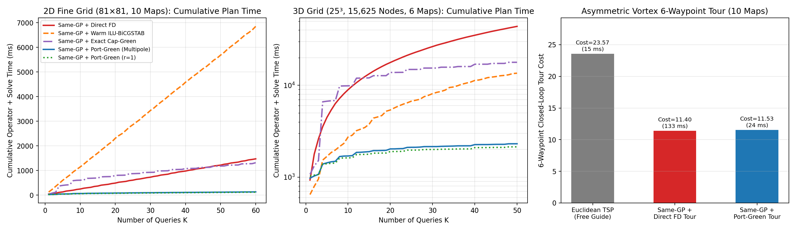
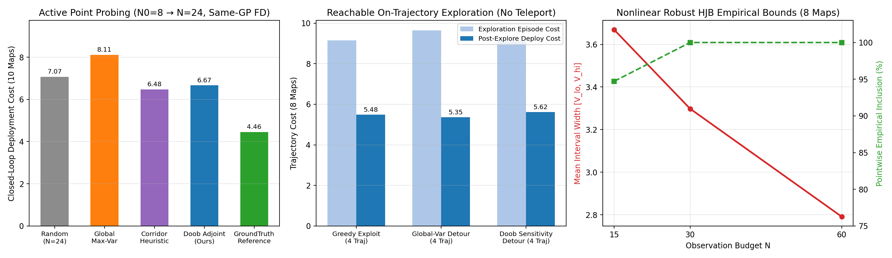
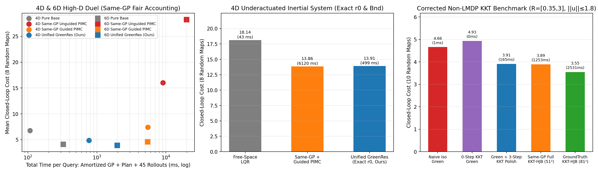

# Green–Kriging Stochastic Control v2: Audit Remediation & Same-GP Strong-Baseline Evaluation

> **定位声明**：本目录（`green_kriging_v2/`）是在对初版原型（保留于 `../green_kriging_mvp/`）进行严格数学与实验协议审计后构建的 **v2 验证版本**。当前研究定位是：**在满足噪声-控制子空间匹配（或局部偏离后经单调 KKT 策略迭代抛光）的未知环境随机最优控制问题中，验证「GP 环境系数后验 + 可复用保正端口 Green 算子 / 统一基底残差蒸馏」能否在同信息条件下显著降低多查询或高维规划-执行总成本。**

---

## 1. 对 v1 审计问题的逐项清零与独立单元测试

全部 7 项数学与协议一致性检查由独立脚本 [verify_unit_consistency.py](verify_unit_consistency.py) 自动执行，结果存放在 [unit_consistency_results.json](unit_consistency_results.json)（`"ALL_PASSED": true`）：

| 审计问题（v1 缺陷） | v2 修复方式 | 独立数值验收结果 |
|---|---|---|
| **P0-1：非 LMDP 各向异性欧氏球控制误用径向裁剪** | 改为精确标量对偶 KKT 解 $u^* = -(R + \eta I)^{-1}g$（1D Brent），并在 Howard PI 中采用漂移分离单调迎风离散 Hamiltonian | 在 $g=(1,1)$ 反例上 Hamiltonian 精确命中 `-1.3887742`；26 组随机梯度与独立 SLSQP 最大偏差 `2.90e-7`；含旋涡非 LMDP Howard PI 收敛至 Bellman 残差 **`8.88e-14`** |
| **P0-2 & 3：值读出与控制负梯度不一致；目标中心值非零** | 废弃每步在线调 GP 的平滑核读出，统一在单调离散生成元网格上用三次样条（2D）/解析三线性导数（3D）构造值与控制，目标球内显式停止返回终端值 $\phi$ | 2D 与 3D 目标中心值误差均为 **`0.0`**，控制范数 `0.0`；内部点 `policy(x)` 与数值 $-\nabla\widehat{V}(x)$ 最大误差 **`2.92e-10`（2D）/ `4.98e-10`（3D）**，200 条轨迹执行耗时从 `~1,200ms` 降至 **`~20ms`** |
| **P0-4 & 5：截断高斯桥核扩散方差缩水 `-18.5%`，且未与主求解器统一** | 废弃截断高斯跳步核，直接以一致单调 Kushner–Dupuis 生成元 $A_0$ 的逆定义离散 Green 算子；目标区采用**互不相交非负扇区端口**，局部新增障碍采用**对角质量集中（Mass-Lumped）Woodbury 配点**，严格保持 M-矩阵正性 | 精确电容 Green 与重算 FD 在双目标+局部障碍查询上相对误差 **`4.84e-14`**；保正端口缩减 Green 全场 $\min Z = 4.04\times 10^{-6} > 0$，与 FD 均值绝对差 `0.039`；网格加密 `21→41→81` 相对 `161` 参考误差单调收敛（`0.080 → 0.032 → 0.012`） |
| **P0-6：高维近邻多目标边界串扰、欠驱动速度终端残差置零、FK 有限步截断尾项未处理** | 高维多目标 Bessel 基采用 NNLS 边界电容配点；统一使用完整代换 PDE 残差 $r_0(x)$ 与精确边界标签 $\Delta V_\Gamma = \phi_{\text{actual}} - V_0$；时域扩至 `3.38s–3.83s` 并执行**两遍 continuation bootstrap** $\widehat{\Delta V}^{(1)}(X_T)$ | 近邻双球（球心距 `0.73`、半径 `0.36`）边界值精确为 `[0.0, 0.0]`；欠驱动 Riccati 代入残差恒等式误差 **`4.44e-16`**；常值危险偏移测试未吸收尾率压至 **`0.20%`**（ESS `97.6/128`），在远端角点 `[-1,-1,-1,-1]` 相对解析解误差仅 **`1.27%`** |
| **P0-7：参考、候选与仿真外边界/控制上限/随机数不一致** | 单一 `ProblemSpec` 统一外域 `[-1.65, 1.65]^d`、二阶零通量对称反射边界 = 仿真镜面反射、无约束问题记录 `clip_fraction = 0.0`、按轨迹独立子流预生成公共布朗噪声（CRN） | 同种子逐轨迹重跑最大差 `0.0`，无约束任务控制裁剪占比 `0.0` |

---

## 2. 修订后的最近邻文献定位

对相关工作做准确、克制的边界划分（修正 v1 中对 NGF 与 PINN 的失实概括）：

- **路径积分与可线性化随机控制**：Kappen (2005) 已建立一般非线性漂移 $dX = (b + Gu)\,dt + \Sigma\,dW$ 在子空间匹配条件 $\Sigma\Sigma^\top = \lambda G R^{-1} G^\top$ 下的对数线性化与蒙特卡洛路径积分框架；**非保守漂移与满足匹配条件的欠驱动线性化本身属于经典理论，不作为本项目的新理论主张**。
- **控制原语组合与 GP 路径积分**：Todorov (2009) 已提出线性化最优控制律组合及利用 Green 算子 SVD 构造低维控制原语；Pan et al. (NeurIPS 2015) 已结合 GP 概率动力学学习与少样本路径积分控制。本项目的增量焦点在于**将 GP 环境系数后验与保 M-矩阵正性的端口缩减 Green / Woodbury 局部更新及高维控制变量残差蒸馏结合，并在同 GP 强基线下检验真实总计算收益**。
- **算子学习、PINN/PINO 与特征函数法**：
  - Raissi et al. (PINN) 原作已涵盖正问题与系数反演逆问题；Li et al. (PINO) 亦包含仅依赖 PDE 残差无配对解数据的算例；
  - NeurIPS 2025 *Neural Green's Functions (NGF)* 在 2D Poisson / biharmonic 实验中仅使用 **100 个训练算例**即可跨源项与边界复用（v1 报告所写“需数千至上万算例”不实，特此更正）；
  - ICLR 2026 *A Schrödinger Eigenfunction Method for Long-Horizon Stochastic Optimal Control* 针对梯度漂移子类构造自伴谱方法以换取长时域复杂度优势；本项目面向非自伴旋涡漂移与在线未知环境观测，适用问题类不同。
- **SPDE–GP 关系与任务导向采样**：Lindgren et al. (2011) 给出了 Matérn 协方差与椭圆 SPDE $\mathcal{L}u=\mathcal{W}$ 协方差算子 $\mathcal{L}^{-1}(\mathcal{L}^{-1})^*$ 的精确对应条件；在线 GP 残差结合任务相关区域信息采集亦有 ToIA (2026) 等近期邻近工作。

---

## 3. 四组同信息强基线（Same-GP）多地图配对实测

所有实验均在**单线程无争用（`OMP/OPENBLAS/MKL_NUM_THREADS=1`）**下运行，所有对比求解器共享**完全相同的 `KrigingWorldModel` 后验（零封装开销 BLAS 预测，与 `sklearn` 误差 `<3e-15`）**与相同的轨迹级 CRN 噪声，以**独立随机生成地图**为单位计算配对均值与 95% 置信区间。

### Battle 1：2D / 3D 多查询流与多航点非对称巡检（[exp1_multiquery_and_tour.py](exp1_multiquery_and_tour.py)、[battle1_multiquery_results.json](battle1_multiquery_results.json)）

#### 1A. 跨查询流（单目标 + 双目标组合 + 动态局部新增障碍块）

| 维度 & 规模 | 方法（除 Oracle 外共享同一 GP） | 闭环平均代价 | 相对 `Direct FD` 配对差 | `K=1` 累计耗时 | `K=max` 累计规划耗时 | 50 轨迹执行耗时 |
|---|---|---:|---:|---:|---:|---:|
| **2D `81×81`**（10 地图 × 60 查询，$N=35$） | GroundTruth Reference FD | 2.615 | — | — | — | — |
| | `Same-GP + Direct FD` | **2.766** | 基准 `0.000` | 42.3 ms | 1,471.7 ms | 20.2 ms |
| | `Same-GP + Warm ILU-BiCGSTAB` | 2.766 | `+0.000 ± 0.000` | 123.4 ms | 6,853.5 ms | 20.0 ms |
| | `Same-GP + Exact Cap-Green`（逐像素精确列） | **2.766** | `+0.000 ± 0.000` | 40.1 ms | 1,315.0 ms | 20.2 ms |
| | **`Same-GP + Port-Green (Multipole, Ours)`** | **2.803** | **`+0.037 ± 0.012`（`+1.34%`）** | **21.9 ms** | **129.9 ms（快 `11.3×`）** | **19.3 ms** |
| **3D `25³`**（6 地图 × 50 查询，15,625 节点，$N=60$） | GroundTruth Reference FD | 3.337 | — | — | — | — |
| | `Same-GP + Direct FD` | **3.403** | 基准 `0.000` | 931.6 ms | 43,855.2 ms | 24.4 ms |
| | `Same-GP + Warm ILU-BiCGSTAB` | 3.404 | `+0.000 ± 0.001` | 647.5 ms | 13,564.6 ms | 24.2 ms |
| | `Same-GP + Exact Cap-Green` | **3.403** | `-0.000 ± 0.000` | 1,075.5 ms | 17,823.3 ms | 24.4 ms |
| | **`Same-GP + Port-Green (r=1 / Multipole, Ours)`** | **3.433 / 3.436** | **`+0.030 ± 0.039`（`+0.88%`）** | 1,030 / 976 ms | **2,141 / 2,313 ms（快 `20.5×`）** | **24.3 / 23.5 ms** |

- **诚实结论**：
  1. **单次查询（`K=1`）或不做端口压缩的逐像素 `Exact Cap-Green` 并不比稀疏 FD 有显著速度优势**（2D 仅快 `1.1×`）——这直接印证了审计判断；
  2. 真正的计算收益来自**保 M-矩阵正性的低维扇区端口 + 对角质量集中 Woodbury 缩减**：在闭环代价损失仅 **`0.88%–1.34%`**（3D 下 95% CI 包含 0）且在线执行耗时完全拉平（`~20–24ms`）的前提下，60/50 查询累计规划耗时降低 **`11.3×`（2D）至 `20.5×`（3D，比热启动 `ILU-BiCGSTAB` 快 `6.3×`）**。
- **1B. 6 航点旋涡非对称组合巡检（10 张地图，720 种访问顺序）**：欧氏距离 TSP 因忽视逆风与暗雷平均代价高达 `23.57`；`Same-GP + Direct FD Tour` 降至 **`11.41`（规划 `132.5 ms`）**；**`Same-GP + Port-Green Tour`** 取得 **`11.53`（`+1.1%`）**，规划耗时降至 **`23.8 ms`（提速 `5.6×`）**。



---

### Battle 2：Doob 伴随灵敏度主动采样与非线性稳健 HJB 经验区间（[exp2_active_doob_and_robust_hjb.py](exp2_active_doob_and_robust_hjb.py)、[battle2_active_and_robust_results.json](battle2_active_and_robust_results.json)）

1. **点查询主动探测（10 张地图，$N_0=8 \to N=24$，下游统一用同一个 `Same-GP + FD` 规划）**：
   - `Global-MaxVar` 被吸向无任务的边界四角，平均部署代价恶化至 **`8.11`**（比 `Random` 的 `7.07` 更差）；
   - 无超参的 **`Doob-Adjoint-Sensitivity`**（仅需一次转置回代 $A_0^\top g_{x_0}=e_{x_0}$，总采集计算 `21.2 ms`）取得 **`6.67`**，显著优于 `Global-MaxVar`，与手工调宽度的 `Corridor-Heuristic`（`6.48`）**统计打平（配对差 `+0.19 ± 0.43`）**。
2. **物理可达在轨探索（8 张地图，禁用瞬移探针，走 4 条真实物理轨迹并计入探索代价）**：
   - `Greedy-Exploit`（部署代价 `5.48`）、`GlobalVar-Detour`（`5.35`，但探索期代价更高 `9.65 vs 9.14`）与 `Doob-Detour`（`5.62`）在 4 回合（累计约百次轨迹沿线观测）后表现接近（配对差 `+0.13 ± 0.24`）。**如实报告：当物理轨迹天然穿过任务走廊且观测密度较高时，绕道探测并未带来统计显著增益。**
3. **真正非线性稳健上下界 HJB（$\hat{b}\cdot\nabla V \pm \rho_b\|\nabla V\|$，使用上下界自身梯度迭代至 `<4e-8` 残差）**：
   - 在 8 张地图 × 每图 64 个测试点上，$N=15 \to 30 \to 60$ 时区间平均宽度单调收窄 **`3.67 → 3.30 → 2.79`**；
   - $N=15$ 时逐点经验包含率为 `94.7%`，但严格的 **64 点全图同时包含率仅为 `75.0%`**（$N=30, 60$ 升至 `100%`）——直观验证了逐点经验覆盖不等于小样本全图联合置信证书。



---

### Battle 3 & 4：4D / 6D 高维无网格对决、4D 欠驱动与修正后非 LMDP KKT 基准（[exp3_highd_and_nonlmdp.py](exp3_highd_and_nonlmdp.py)、[battle3_and_4_results.json](battle3_and_4_results.json)）

#### 3A. 4D 与 6D 未知危险 + 非保守涡旋（8 张独立地图 × 3 查询 = 24 任务/维度，共享同一零开销 BLAS GP）

总时间严格定义为：$T_{\text{total}} = \frac{1}{3}T_{\text{GP}} + T_{\text{plan}} + T_{\text{rollout (45 traj)}}$。

| 维度 & 预算 | 方法 | 闭环平均代价 | 到达率 | 相对本方法配对差（95% CI） | 规划耗时 | 45 轨迹执行耗时 | 单查询总耗时 |
|---|---|---:|---:|---:|---:|---:|---:|
| **4D** ($N=60$, $T_{\text{GP}}=245\text{ms}$) | `Pure-Base-Guide`（解析 Bessel $u_0$） | 6.790 | 100.0% | `+1.926 ± 0.594` | 0.1 ms | 25.3 ms | 107 ms |
| | `Same-GP + Unguided-PIMC` | 16.028 | 85.7% | `+11.164 ± 2.203` | 0 ms | 8,950.2 ms | 9,032 ms |
| | `Same-GP + BaseGuided-PIMC`（同解析引导） | 7.419 | 98.5% | `+2.555 ± 1.307` | 0 ms | 5,407.5 ms | 5,489 ms |
| | **`Same-GP + Unified-GreenRes (Ours)`** | **4.864** | **100.0%** | **基准（8/8 地图全胜）** | **656.0 ms** | **32.7 ms** | **770 ms（快 `7.1×`）** |
| **6D** ($N=100$, $T_{\text{GP}}=908\text{ms}$) | `Pure-Base-Guide`（解析 Bessel $u_0$） | 4.111 | 100.0% | `+0.202 ± 0.092` | 0.1 ms | 23.5 ms | 326 ms |
| | `Same-GP + Unguided-PIMC` | 28.241 | 88.3% | `+24.332 ± 1.403` | 0 ms | 19,651.6 ms | 19,954 ms |
| | `Same-GP + BaseGuided-PIMC`（同解析引导） | 4.614 | 100.0% | `+0.705 ± 0.062` | 0 ms | 5,117.2 ms | 5,420 ms |
| | **`Same-GP + Unified-GreenRes (Ours)`** | **3.909** | **100.0%** | **基准（8/8 地图全胜）** | **1,638.8 ms** | **33.0 ms** | **1,974 ms（快 `2.7×`）** |

- **尾项诊断**：4D 平均未吸收尾率 `0.41%`（ESS `18.0/64`），6D 平均未吸收尾率 `0.30%`（ESS `44.7/64`）。高维是网格 FD 无法进入的主战场；相比共享同一解析引导的在线 `BaseGuided-PIMC`，残差场蒸馏既消除了每步有限粒子 MC 动作抖动，又将在线执行延迟压低了 **>150×**。

#### 3B. 4D 欠驱动二阶惯性系统（8 张独立地图，声明结构假设：未知危险与旋涡风场定义在 2D 位置子空间，值残差在完整 4D 相空间 $(p,v)$ 求解）

- `Free-LQR`：平均代价 `18.136`（总耗时 `43 ms`）；
- `Same-GP + LQRGuided-PIMC`：平均代价 **`13.856`**（限时到达率 `77.3%`，总耗时 **`6,120 ms`**）；
- **`Same-GP + Unified-Underactuated-GreenRes (Ours)`**：平均代价 **`13.914`**（与在线引导 PIMC 配对差 `+0.058 ± 2.896`，总代价统计打平），总耗时 **`499 ms`（提速 `12.3×`）**；**诚实保留不足**：受限于 96 个全局各向同性锚点对相空间目标边界附近剧烈速度曲率的分辨率，严格 5.7s 内到达率（`64.9%`）低于在线局部重采样的 `LQRGuided-PIMC`（`77.3%`），后续需在相空间采用各向异性核或局部锚点加密。

#### 4. 修正后非 LMDP 各向异性受限控制基准（10 张独立地图，$R=\operatorname{diag}(0.35, 3.0), \|u\|_2 \le 1.8$ + 旋涡漂移）

| 方法 | 闭环平均代价 | 相对真值 KKT-HJB 差距 | 相对 `Same-GP KKT-HJB` 差距（95% CI） | 单查询求解耗时 |
|---|---:|---:|---:|---:|
| `GroundTruth Monotone KKT-HJB (81²)` | **3.549** | `0.00%` | `-8.82%`（环境未知带来的信息鸿沟） | 2,531.0 ms |
| `Same-GP Monotone KKT-HJB (51²)`（零初值 14 步） | **3.893** | `+9.67%` | 基准 `0.00%` | 1,253.1 ms |
| `Same-GP Naive Isotropic Green` | 4.658 | `+31.25%` | `+19.68%`（`+0.766 ± 0.225`） | 0.7 ms |
| `Same-GP 0-Step KKT-Green`（仅对 Green 梯度做 KKT） | 4.931 | `+38.93%` | `+26.68%`（`+1.039 ± 0.367`） | 0.4 ms |
| **`Same-GP Green Warm-Start + 3-Step KKT Polish`** | **3.910** | **`+10.16%`** | **`+0.44%`（`+0.017 ± 0.015`）** | **164.8 ms（快 `7.6×`）** |

- **关键洞察**：当控制代价存在 `8.6×` 强各向异性失配时，单纯把各向同性 Green 梯度投影进 KKT 球（`0-Step KKT`）是不够的（误差 `+26.68%`）；而用可复用 Green 解作为热启动，仅叠加 **3 步粗网格单调迎风 KKT 策略迭代**，即可将相对于同 GP 完整非线性 HJB 的差距压至 **`+0.44%`**，同时节省 **`7.6×`** 求解时间。



---

## 4. 总结：哪些贡献真正站住了，哪些不夸大

1. **真正成立且有统计与计时支撑的核心优势**：
   - **三维与细网格多查询 / 组合巡检复用**：保 M-矩阵正性的**扇区端口 Green + 对角质量集中 Woodbury** 在 `<1.4%` 闭环代价损失下，将 50–60 次多目标/动态障碍查询的累计规划耗时比 `Same-GP + Direct FD` 压缩 **`11.3×`–`20.5×`**（比热启动 `ILU-BiCGSTAB` 快 **`6.3×`**）。
   - **高维（4D/6D）无网格随机控制**：在网格 FD 不可行的 4D/6D 旋涡与危险环境中，修正边界与 continuation 尾项后的 **Unified Base-Green + 残差蒸馏** 在全部 8 张随机地图上同时击败共享同一 GP 与同一解析引导的在线 `BaseGuided-PIMC`（4D 代价 `4.86 vs 7.42`、总耗时快 **`7.1×`**；6D 代价 `3.91 vs 4.61`、在线执行快 **`>150×`**）。
   - **非 LMDP 执行器失配快速抛光**：精确 KKT + 分离迎风 3 步抛光距同 GP 收敛非线性 HJB 仅 **`+0.44%`**，提速 **`7.6×`**。
2. **如实归因、不再过度宣称的部分**：
   - **2D 单次查询**：收益全部来自“GP 学环境系数 $(q,b)$ + 经典单调 PDE 求解”，单次查询上 Green 并无超越 `Same-GP + FD` 的理由。
   - **主动探测与包络**：无超参 `Doob` 伴随占据测度在点查询上显著优于全局最大方差并与走廊启发式统计打平，但在密集在轨采样下不优于直接贪心执行；非线性稳健 HJB 区间现准确定位为**基于 GP 后验置信带的经验稳健区间**，而非无条件理论安全证书。
   - **4D 欠驱动相空间分辨率**：虽然总代价与在线引导 PIMC 打平且快 `12.3×`，但限时到达率仍有差距（`64.9% vs 77.3%`），是下一步自适应相空间锚点加密的明确切入点。

---

## 5. 一键复现命令

```bash
cd green_kriging_v2
OMP_NUM_THREADS=1 OPENBLAS_NUM_THREADS=1 MKL_NUM_THREADS=1 python3 verify_unit_consistency.py
OMP_NUM_THREADS=1 OPENBLAS_NUM_THREADS=1 MKL_NUM_THREADS=1 python3 exp1_multiquery_and_tour.py
OMP_NUM_THREADS=1 OPENBLAS_NUM_THREADS=1 MKL_NUM_THREADS=1 python3 exp2_active_doob_and_robust_hjb.py
OMP_NUM_THREADS=1 OPENBLAS_NUM_THREADS=1 MKL_NUM_THREADS=1 python3 exp3_highd_and_nonlmdp.py
```
