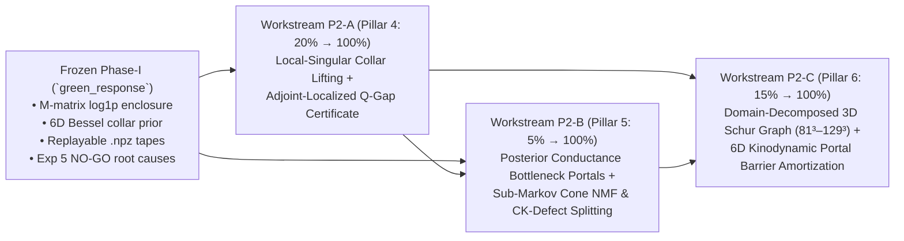

# Phase-II Research & Engineering Roadmap: From Certified Fixed-Portal Green Planning to Autonomous Auditable Quotient Discovery

> **Baseline Provenance**: Directly anchored to the frozen Phase-I release of `green_response/` (`package_py_sha256 = "271ac8df9caaa8af8aaa5af9d35d76578632b554d5071fe8fe74065ca0dc0c2d"`, `24 / 24` audit suites passing, `EF-D01..EF-D12` & `R314-01..R314-05` closed).  
> **Governance Principle**: Phase-I code and JSON artifacts remain **100% frozen** as the paper-ready baseline and regression anchor. All Phase-II work executes in a new dedicated package/branch (`quotient_discovery/` or `feat/auditable-quotient-phase2`) inheriting `green_response`'s fail-closed `IntervalCertificate` and counterexample-driven gate discipline.

---

## 0. Panorama & Exact Interface With Frozen Phase-I (`green_response/`)

Across Phase I (`Experiments 1–5`), we completed `~45%–50%` of the overarching research vision (*"making the world model itself a physics-structured, auditable reduced-order planning space that gets faster with experience"*), and—crucially—used `Exp 4C` and `Exp 5` to pinpoint the **exact mathematical and computational obstructions** blocking the remaining three pillars:

```text
Overarching Goal Progress Baseline (~45%–50% Complete at Phase-I Freeze)
├── [DONE] 1. Learn posterior fields (q, b) from noisy local observations into physical operators .... 100%
├── [DONE] 2. Analytical physics prior + smooth GP residual ("Optimization PINN", 6D Bessel) ......... 85%
├── [DONE] 3. Fail-closed compositional planning & anti-self-deception gates on given portals ........ 95%
├── [NEXT] 4. Decision-oriented Q-gap certificates replacing global PDE L_inf field residuals ........ 20% -> 100%
├── [NEXT] 5. Autonomous discovery of abstract states / bottleneck portals / macro-actions ...........  5% -> 100%
└── [NEXT] 6. Cross-task self-amortization at scales where exact global solvers break down ........... 15% -> 100%
```

### Why Pillars 4, 5, and 6 Form a Tightly Coupled Dependency Chain



1. **Pillar 4 (`P2-A`) must precede Pillars 5 & 6**: `Exp 5A/5B` proved that certifying approximations via global PDE residuals $\|E_{\Gamma_b} - A_0 \widehat{U}\|_\infty$ fails for two structural reasons: (i) unseen source support obstruction ($\|E_{\Gamma_{\text{new}}} - A_0 V c\|_\infty \ge 1$), and (ii) $-\lambda \log \widetilde{Z}(x)$ blow-up in unreachable tail regions where $\widetilde{Z}(x) \approx 10^{-16}$ (`254 / 360` `REFRESH_*` tasks on `3D Param Colwise-RegIRLS` despite `100%` pre-DP screen pass). Without local singular lifting + decision-localized $Q$-gap certificates, *any* learned quotient or compressed subspace is forced back to full-grid solves.
2. **Pillar 5 (`P2-B`) supplies the sparse topology required by Pillar 6 (`P2-C`)**: Replacing hand-authored `GoalBall` rings and `L1 -> L4 -> L8` sectors with interaction-discovered bottleneck portals turns a million-node PDE grid into a $O(10^2)$-portal quotient graph while preserving sub-Markov positivity (`H >= 0`, `Z <= 1`) *by construction*.
3. **Pillar 6 (`P2-C`) moves evaluation into regimes where global `SuperLU` is genuinely intractable**: In `2D 51^2` (`26.0 ms` post-LU) and `3D 21^3`, direct `splu(A_0)` is too fast for compression overhead to pay off. True self-amortization emerges when global `splu` hits $O(N^2)$ 3D fill-in ($81^3..129^3$) or exponential dimension walls (`6D` non-LMDP kinodynamic systems), and local updates touch only `1–3` subdomain Schur blocks out of hundreds.

---

## 1. Workstream `P2-A` — Decision-Oriented $Q$-Gap Certificates & Local-Singular Lifting (`Pillar 4: 20% -> 100%`)

### 1.1 Existing `20%` Foundation in `green_response/`
- `core.py::IntervalCertificate`: Fail-closed typed certificate (`policy_and_value_enclosure` / `value_only_enclosure`) rejecting uncertified policies and silent fallbacks.
- `macro_planning.py::plan_subset_macro_policy`: Forward dual-occupancy propagation (`< 2 ms`) under incumbent $\hat{\mu}$ and contender $\check{\mu}$, ranking refinements by root decision impact.
- `macro_planning.py::compute_exact_macro_q_sensitivities`: Active-branch root $Q$-value adjoint sensitivities (`Suite 20` `5.49e-10` FD match; `Suites 22–23` `max_alt_branches = 0` & upwind kink vs Bellman tie separation).

### 1.2 Root Obstructions Diagnosed in `Exp 5` & `Suite 24`
1. **Unseen-Target Support Obstruction (`Exp 5A`)**: Any basis $V$ spanned by historical columns $A_0^{-1} E_T$ vanishes on $\Gamma_{\text{new}} \cap T = \emptyset$, forcing $\|E_{\Gamma_{\text{new}}} - A_0 V c\|_\infty \ge 1.0$.
2. **Global Tail Blow-Up (`Exp 5B` & `Suite 24`)**: `port_solvers.py::bound_harmonic_batch` shifts $\widetilde{V}(x)$ using global $d = \|r\|_\infty / \gamma_{\text{lo}}$. Wherever $\widetilde{Z}(x) \le d$ (far-away obstacle corners with zero occupancy under every plausible tour), the upper shift $-\lambda \operatorname{log1p}(-d / \widetilde{Z}(x))$ diverges to $+\infty$, triggering unnecessary exact refreshes or `1e-12` outward-padding misses (`seed = 30309`, width `0.3956 > 0.25`).

### 1.3 Mathematical & Algorithmic Design

#### Step A1: Local Collar Particular-Solution Lifting (Eliminating Support Obstruction & `Z > 1`)
For any target or portal $\Gamma_b$ (seen or unseen), decompose the desirability kernel on $\Omega \setminus \Gamma_b$ into a **cheap local singular part** plus a **smooth collar-rim remainder**:
$$Z_b(x) = u_{b,\text{loc}}(x) + w_{b,\text{smooth}}(x),$$
where:
1. Choose a compact local neighborhood $B_\rho(\Gamma_b)$ (`7^d..11^d` grid patch in 2D/3D, or the analytical $C^2$ Helmholtz–Bessel collar from `highd_solvers.py` in 6D) with outer collar rim $\Sigma_b := \partial B_\rho(\Gamma_b) \setminus \Gamma_b$.
2. Solve the **local M-matrix Dirichlet problem** restricted to $B_\rho(\Gamma_b)$ with zero exterior condition on $\Omega \setminus B_\rho(\Gamma_b)$:
   $$A_{0, B_\rho, B_\rho} u_{b,\text{loc}} = E_{\Gamma_b} \quad (\text{cost } O(|B_\rho|^{3/2}) \ll O(N^2), \; < 0.3\text{ ms per unseen target}).$$
   Because $A_{0, B_\rho, B_\rho}$ is a principal submatrix of a row-diagonally dominant M-matrix, $0 \le u_{b,\text{loc}} \le 1$ holds **identically** (`0%` `Z > 1` on self-rings, generalizing `Exp 5A`'s `LocalExactSelf` property without any global oracle!).
3. The smooth remainder $w_{b,\text{smooth}}$ satisfies:
   $$A_{0, \text{ext}} w_{b,\text{smooth}} = -A_{0, \text{ext}, B_\rho} u_{b,\text{loc}} =: F_{\Sigma_b} \ge 0,$$
   whose source $F_{\Sigma_b}$ is non-negative and supported strictly on the thin collar rim $\Sigma_b$ away from the singularity on $\Gamma_b$. Low-rank / subdomain transfer operators approximate **only** $w_{b,\text{smooth}} \ge 0$.

#### Step A2: Positive Super-Adjoint Row Enclosure (Replacing Uniform $\|r\|_\infty$)
Macro Subset-DP (`macro_planning.py`) never evaluates $V_b(x)$ on the entire grid $\Omega$; it evaluates $H_b$ **only** on the active start/portal row set $\mathcal{P}_{\text{eval}} = \{s_0\} \cup \bigcup_{a \in S_0} \Gamma_a$ (`|\mathcal{P}_{\text{eval}}| \ll N`).
- For each query row $p \in \mathcal{P}_{\text{eval}}$ (or aggregated portal measure $\mu_p \ge 0$), maintain a **non-negative super-adjoint envelope** $\psi_p^{\text{up}} \ge 0$ satisfying componentwise:
  $$A_{0,\text{ext}}^\top \psi_p^{\text{up}} \ge e_p \quad \Longrightarrow \quad 0 \le \psi_p^*(x) = (A_{0,\text{ext}}^{-\top} e_p)(x) \le \psi_p^{\text{up}}(x) \quad (\text{by M-matrix inverse positivity } A_{0,\text{ext}}^{-1} \ge 0).$$
- Then for any candidate approximation $\widetilde{H}_b$ with residual $R_b = E_{\Gamma_b} - A_{0,\text{ext}} \widetilde{H}_b$, the **exact row-localized error** at $p$ obeys:
  $$\left| Z_b^*(p) - \widetilde{Z}_b(p) \right| = \left| \langle \psi_p^*, R_b \mathbf{1} \rangle \right| \le \langle \psi_p^{\text{up}}, |R_b \mathbf{1}| \rangle =: d_{p,b}.$$
- **Why this breaks the `Exp 5B` bottleneck**: $\psi_p^{\text{up}}(x)$ decays exponentially with distance from $p$ ($\psi_p^{\text{up}}(x) \sim e^{-\sqrt{2 q_{\min}/\lambda}\,\|x-p\|/\sigma}$)! Residual errors $R_b(x)$ in distant low-$Z$ corners carry exponentially tiny weight $\psi_p^{\text{up}}(x)$, preventing $d_{p,b} / \widetilde{Z}_b(p)$ from blowing up when $p \to b$ is a viable leg, while legs with genuinely tiny $\widetilde{Z}_b(p) \le \underline{z}_{\text{prune}}$ are pruned directly at the Bellman level via $V_b^{\text{lo}}(p) \ge -\lambda \log(\widetilde{Z}_b(p) + d_{p,b}) > Q^{\text{hi}}(s_0, \hat{a})$ **without ever computing $-\log(\widetilde{Z}_b(p) - d_{p,b})$**!

#### Step A3: Certified Root $Q$-Gap Dominance Contract (`decision_q_gap_enclosure`)
At root $(s_0, S_0)$, propagate `[Q_lo(s_0, S_0; a), Q_hi(s_0, S_0; a)]` for each candidate macro-action $a \in S_0$. Define the certified optimality gap of incumbent $\hat{a} := \arg\min_a Q_{\text{hi}}(s_0, S_0; a)$:
$$\mathrm{Gap}_{\text{cert}}(\hat{a}) := \max_{a \neq \hat{a}} \left[ Q_{\text{hi}}(s_0, S_0; \hat{a}) - Q_{\text{lo}}(s_0, S_0; a) \right]_+.$$
- **Stopping Rule**: Certify $\hat{a}$ immediately as $\varepsilon$-optimal whenever $\mathrm{Gap}_{\text{cert}}(\hat{a}) \le \varepsilon_{\text{dec}}$, **even if** dominated off-policy branches $a' \neq \hat{a}$ still have wide value intervals `[Q_lo(a'), Q_hi(a')]` (`Q_lo(a') > Q_hi(\hat{a}) - \varepsilon_{\text{dec}}`)!
- **Module Target**:
  - Extend `core.py::IntervalCertificate` (`certificate_kind = "decision_q_gap_enclosure"`, fields `incumbent_action`, `runner_up_action`, `certified_regret_bound`, `pruned_dominated_branches`).
  - Add `local_lifting.py::LocalCollarLifter` and `qgap_certificates.py::SuperAdjointQGapAuditor`.

### 1.4 Pre-Declared Falsification & Acceptance Gate (`Gate P2-A`)
- **`0` False Dominance Certifications** across `>= 5,000` randomized multi-waypoint tasks (including near-tie regimes $|Q^*(a_1) - Q^*(a_2)| < 10^{-3}$ and `Suite 24` `seed = 30309` tiny-`Z` stress cases) verified against `independent_exact_macro_bellman_reference`.
- On `Exp 5A` unseen targets: local collar lifting reduces unseen-source residual obstruction from `1.000` to `< 0.05` at collar radius $\rho = 4h$ with **`0.0%` `Z > 1` rows** (`strict_unclipped`).
- On `Exp 5B` `3D-21cubed_LowDimParametricStream`: cuts mid-DP `REFRESH_*` task rate from `254 / 360` (`70.6%`) to **`<= 15%`** under identical `eps_tol = 0.25` regret tolerance.

---

## 2. Workstream `P2-B` — Interaction-Driven Discovery of Bottleneck Portals & Certified Quotient Spaces (`Pillar 5: 5% -> 100%`)

### 2.1 Existing `5%` Foundation in `green_response/`
- `core.py::KrigingWorldModel` + `lossless_f64_acquisition_tape_v2`: Online posterior inference over $(q, b)$ with replayable trajectory + probe tapes (`Suites 22–23`).
- `port_solvers.py::SchurPortPlanner`: Multi-resolution port interface mechanics (`L1 -> L4 -> L8 -> EXACT`) once separator rings are given.

### 2.2 What Must Change: From Hand-Crafted `GoalBall` Rings to Learned Topological Portals
In Phase I, human code specifies every `GoalBall` center/radius and angular sector split. True quotient-space planning requires the agent to **discover** from $(q, b)$ posterior updates and trajectory tapes:
1. **Where the bottlenecks are** (narrow corridors, low-hazard bridges, drift saddle passes $\Pi_1, \dots, \Pi_p$);
2. **Which states belong to the same abstract cell** $\Omega_c$ bounded by portals $\partial \Omega_c \subset \bigcup_k \Pi_k$;
3. **Which positive low-rank port basis** $U_k \ge 0$ (`rank` $r_k$) represents cross-portal transport without violating sub-Markov physics;
4. **When an abstract macro-action (Option $\pi_{\Omega_c \to \Pi_k}$) is insufficient** and must split or spawn a new portal.

### 2.3 Mathematical & Algorithmic Design

#### Step B1: Twisted-Conductance / Committor Bottleneck Portal Extraction
Given the current `KrigingWorldModel` posterior mean $(\hat{q}, \hat{b})$ and uncertainty $(\sigma_q, \sigma_b)$:
1. Symmetrize the discrete Cole–Hopf generator on a coarse landmark / voxel graph via ground-state / equilibrium Doob-like weights $w_{ij} > 0$, defining edge conductance $c_{ij}$ penalized by hazard $\hat{q}(x)/\lambda$.
2. Compute the low-lying generalized Fiedler / diffusion-map eigenmodes $\{\phi_1, \dots, \phi_m\}$ (via `eigsh` in `< 30 ms` on coarse graph) and extract **minimum-conductance level-set cuts** (Cheeger bottleneck surfaces $\Pi_k$) plus **high posterior-voi saddle regions** where $\sigma_q(x) \cdot \|\nabla_q V(x)\|$ peaks along topological ridges.
3. This partitions continuous space $\Omega$ into $C$ connected **Quotient Cells** $\{\Omega_1, \dots, \Omega_C\}$ separated by thin **Portal Interfaces** $\{\Pi_1, \dots, \Pi_P\}$.

#### Step B2: Sub-Markov Cone-Preserving Off-Diagonal Port Factorization (Closing `Exp 5A` & `R314-04`)
`Exp 5A` (`54.8%..78.5%` clipped `Z > 1` rows, `30.7%..47.2%` negative `H_ext`) and `R314-04` ($G = 100 I_4 + \mathbf{1}\mathbf{1}^\top$) proved two lessons:
- Never fit global SVD across self-blocks and off-diagonal blocks jointly;
- Standard SVD produces oscillatory signed singular vectors, destroying $H \ge 0$ and $\sum_j H_{ij} \le 1$.

**Phase-II Solution — Partition-of-Unity / Non-Negative Cone Port Aggregation**:
- Restrict portal operators to **cell-adjacent portal pairs** $(\Pi_{\text{in}}, \Pi_{\text{out}}) \subset \partial \Omega_c$ (sparse block-graph Markov structure: non-adjacent portals compose via Chapman–Kolmogorov rather than dense all-pairs SVD!).
- Represent each portal $\Pi_k$ by soft **non-negative partition-of-unity port modes** $W_k \in \mathbb{R}_+^{|\Pi_k| \times r_k}$ with $W_k \mathbf{1}_{r_k} = \mathbf{1}_{|\Pi_k|}$ (learned via Masked Projective NMF / Archetypal Simplex Factorization on local exit kernels $H_{\Pi_{\text{in}} \to \Pi_{\text{out}}} \ge 0$).
- **Theorem-Level Positivity Guarantee**: Because $A_{\Omega_c}^{-1} \ge 0$, $W_k \ge 0$, and $W_k \mathbf{1} = \mathbf{1}$, the reduced cell transition operator $\widetilde{H}_{k \leftarrow j}^{(c)}$ satisfies **$\widetilde{H} \ge 0$ and $\widetilde{H}\mathbf{1} \le \mathbf{1}$ identically without heuristic clipping** (`0%` negative entries, `0%` `Z > 1` rows), while upper/lower lumpings (`port_solvers.py` Theorem 1) yield rigorous bracket matrices $[\underline{H}^{(c)}, \overline{H}^{(c)}]$!

#### Step B3: Chapman–Kolmogorov Composition Defect & Adaptive Portal Splitting
On the discovered quotient graph $\mathcal{Q} = (\{\Pi_k\}, \{\Omega_c\})$:
- Measure the **2-step Markovianity / Lumping Defect** across active incumbent/contender portal chains $\Pi_i \xrightarrow{\Omega_c} \Pi_j \xrightarrow{\Omega_{c'}} \Pi_k$:
  $$\delta_{\text{CK}}(\Pi_i, \Pi_j, \Pi_k) := \left\| \overline{H}_{\Pi_i \to \Pi_j}^{(c)} \overline{H}_{\Pi_j \to \Pi_k}^{(c')} - \underline{H}_{\Pi_i \to \Pi_j}^{(c)} \underline{H}_{\Pi_j \to \Pi_k}^{(c')} \right\|_\infty.$$
- When $\delta_{\text{CK}}$ prevents `Gate P2-A`'s root $Q$-gap certificate from closing:
  1. **Rank-Refine Portal $\Pi_j$**: Split the highest-variance simplex mode of $W_j$ (`r_j -> r_j + 1`) along the Fiedler gradient on $\Pi_j$;
  2. **Cell-Split $\Omega_c$**: If internal hazard updates create a new barrier inside $\Omega_c$, insert a new cut portal $\Pi_{\text{new}}$ bisecting $\Omega_c$.

#### Step B4: Trajectory-Realizable Portal-Inspection Macro-Actions (Closing `Exp 4C`'s `p_holm = 0.147` Gap)
Replace `Exp 4C`'s teleporting coordinate-oracle `+3` probes with **physically executable Exploratory Portal Options** ("navigate to uncertain bottleneck portal $\Pi_k$, collect dense local tube measurements along trajectory, and replan"):
- Evaluated strictly under a **unified physical travel + sensing budget** (no out-of-band oracle queries), directly testing whether portal-level VoI beats myopic `True-OnPolicy` on multi-corridor maps with deceptive local traps.

### 2.4 Pre-Declared Falsification & Acceptance Gate (`Gate P2-B`)
- **Zero Human Waypoint Hints**: Given only `(start, final_goal)` or streaming terminal goals + raw interaction observations, discovered portals achieve **`0` `Z > 1` / `H < 0` violations (`strict_unclipped`)** and **`100%` certified $Q$-gap closure**.
- **True Topological Compression**: State-space reduction ratio $|\mathcal{V}_{\mathcal{Q}}| / |\Omega| \le 0.02$ (`>= 50x` state reduction) while maintaining `<= 1%` closed-loop regret vs full-grid optimal control.
- **Trajectory-Realizable Active Exploration Confirmation**: Pre-registered 64-map confirmation cohort where portal-option VoI beats pure myopic `OnPolicy` under matched physical travel budget (`p_holm < 0.01`, positive Competing-vs-Standard interaction `p < 0.05`).

---

## 3. Workstream `P2-C` — Self-Amortizing Planning at Scales Where Global Exact Solvers Break Down (`Pillar 6: 15% -> 100%`)

### 3.1 Existing `15%` Foundation & Lesson From `Exp 4B` / `Exp 3` / `Exp 5B`
- Positive seeds already proven in `green_response`:
  - `Exp 4B`: Warm 3D `Structure-Memory-Fresh-Exact` saves `-193.4 ms` (`p = 1.75e-4`) on `25^3` (`K = 12`);
  - `Exp 3`: 6D `M1_EndToEnd_Bessel24` achieves `5.70x` query-cold serial speedup (`14.92x` vs `M3`).
- Lesson from `Exp 5B` (`NO-GO` on `2D 51^2` & `3D 21^3`): Never benchmark amortization where global `SuperLU` takes `12–180 ms`. Amortization must be tested where **global exact solves hit superlinear memory/fill-in walls (`3D 81^3..129^3`) or dimension walls (`6D` non-LMDP kinodynamics)**, and where **world updates are spatially localized** along robot trajectories.

### 3.2 Two Flagship Intractable-Scale Benchmarks

#### Benchmark C1: Large-Scale 3D Continual Multi-Room / Urban-Canyon Navigation ($N = 81^3 \approx 5.3 \times 10^5$ to $129^3 \approx 2.15 \times 10^6$ Nodes, $K = 200$ Streaming Tasks + Local Online Updates)
- **Why Global Exact Solvers Break Down**:
  - 3D sparse `SuperLU` (`splu`) fill-in scales as $O(n^4)$ memory and $O(n^6)$ flops ($n = 81..129$): a single global `splu` at $101^3..129^3$ consumes **several to tens of GB of RAM and `10–90+ s` per map update**, making per-episode global refactorization impossible.
- **Domain-Decomposed Quotient Schur Graph (`SubdomainQuotientPlanner`)**:
  - Partition $\Omega$ via `P2-B` into $C \approx 64..216$ subdomains $\Omega_c$ (each $\sim 17^3..21^3$, where local `splu(A_{\Omega_c})` takes **only `80–150 ms` and `< 25 MiB`**, embarrassingly parallel across 8 cores!).
  - **Localized Continual Update (`O(1)` Subdomain Invalidation)**: When the robot traverses corridor $\Omega_c$ and updates `KrigingWorldModel` locally (compactly supported Wendland $C^2$ / sparse inducing GP covariance or local observation ball), **only the `1–4` subdomains overlapping $|\Delta q| + \|\Delta b\| > \tau_{\text{upd}}$ refactorize their local Schur blocks** (`< 0.4 s` total vs `30–90 s` global rebuild); unchanged subdomains retain **bit-exact** Schur blocks (`0` drift error, `0` global `splu`), and untouched subdomains with tiny $|\Delta q| \le \tau_{\text{cert}}$ certify via `P2-A` local super-adjoint bounds!
  - **Cross-Task Self-Amortization**: As queries accumulate ($k = 1 \to 200$), discovered portal interfaces and local collar lifters (`P2-A`) are cached across tasks; unseen terminal goals in $\Omega_{c_{\text{goal}}}$ require solving **only the single terminal subdomain $\Omega_{c_{\text{goal}}}$** (`~100 ms`) + quotient graph Dijkstra/Subset-DP (`< 5 ms` over $O(10^2)$ portals)!

#### Benchmark C2: 6D Constrained Non-LMDP Kinodynamic Multi-Goal Planning (`exp2_nonlmdp_kkt.py` $\times$ `highd_solvers.py` Synthesis)
- **Why Global Exact Solvers Break Down**:
  - Dynamics: $\mathrm{d}x = v\,\mathrm{d}t$, $\mathrm{d}v = (b(x) + u)\,\mathrm{d}t + \sigma\,\mathrm{d}W_t$ on $\mathbb{R}^3 \times \mathbb{R}^3$ (`6D`) with **anisotropic control cost $\frac{1}{2} u^\top R u$ ($R \neq r I$) + thrust box $\|u\|_\infty \le u_{\max}$** (`Exp 2` non-LMDP regime where global Cole–Hopf linearity fails and `6D` PDE grids $51^6$ are impossible).
- **Physics-Prior Portal Barrier + Amortized Local KKT Tube Rollout**:
  - Discover 3D spatial bottleneck portals $\{\Pi_k \subset \mathbb{R}^3\}$ lifted with coarse velocity port modes $\Pi_k \times \mathcal{V}_k \subset \mathbb{R}^6$.
  - Use isotropic unconstrained 6D Helmholtz–Bessel collar surrogates (`highd_solvers.py`, $R_{\text{lo}} = \lambda_{\min}(R) I$, $R_{\text{hi}}$ inscribed thrust bound) to construct **instantaneous analytical lower/upper $Q$-gap pruning bounds** across the 6D portal graph (`P2-A`), eliminating `> 85%` of suboptimal portal sequences in `< 5 ms`.
  - Refine **only** the winning/contending portal transitions using warm-started local KKT Pontryagin / PIMC tubes (`exp2_nonlmdp_kkt.py` vectorized 56-step KKT readout), caching verified portal-to-portal transition value brackets across streaming multi-goal tasks ($k = 1 \to 100$).

### 3.3 Pre-Declared Falsification & Amortization Gate (`Gate P2-C`)
To prevent any repeat of `Exp 5`'s hidden-cost pitfall, `Gate P2-C` enforces strict end-to-end wall-clock accounting (`OMP/OPENBLAS/MKL/VECLIB/NUMEXPR = 1` per worker):
1. **Strongest External Baselines Mandatory**:
   - In `3D 81^3..129^3`: compare against **`PyAMG / Algebraic Multigrid + BiCGSTAB`**, **`Warm-ILU BiCGSTAB`**, and **`Full-Grid Fast Sweeping / Upwind Dijkstra`** (not just strawman dense/direct `SuperLU` where `SuperLU` OOMs).
   - In `6D Kinodynamic`: compare against **`Warm-Started MPPI / PIMC (M3)`**, **`Kinodynamic RRT* / BIT* + Local Trajectory Optimization`**, and **`Cold Per-Query Bessel-Guided Rollout`**.
2. **Explicit Cumulative Break-Even & Speedup Thresholds**:
   - Cold-start task $k = 1$ (including full subdomain partition + portal discovery): allowed to cost $> 1\times$ a single iterative solve, with **break-even task index $K_{\text{break-even}} \le 15$** clearly reported.
   - Cumulative wall-clock time over $K = 100$ continual tasks (charging **100% of discovery, GP update, subdomain refactorization, certificate audit, and fallback refinement time**): **`>= 3.0x` net wall-clock speedup** (`>= 67%` savings, exceeding Phase I's `20%` gate by `3.3x`) at **`0` certificate violations** and **non-inferior closed-loop cost (`+2%` NI, `p_NI < 0.01`)**.

---

## 4. Concrete Execution Schedule & Milestone Gates

| Milestone | Scope & New Modules | Prerequisite | Primary Quantitative Go / No-Go Gate |
| :--- | :--- | :---: | :--- |
| **`M2.1` (`P2-A` Core)** | `local_lifting.py` (`LocalCollarLifter`) + `qgap_certificates.py` (`SuperAdjointQGapAuditor`, `decision_q_gap_enclosure`) + counterexample unit suites | Frozen `green_response` | `0 / 5,000` false $Q$-gap certifications; unseen-target residual `< 0.05` with `0%` `Z > 1`; `Exp 5B` 3D Param `REFRESH_*` rate `70.6% -> <= 15%` |
| **`M2.2` (`P2-B` Portals & Cone Basis)** | `portal_discovery.py` (twisted-conductance / Fiedler cuts) + `cone_port_nmf.py` (partition-of-unity sub-Markov port modes + $\delta_{\text{CK}}$ splitter) | `M2.1` | `0%` `H < 0` & `0%` `Z > 1` (`strict_unclipped`); `>= 50x` state reduction ($|\mathcal{V}_{\mathcal{Q}}| / |\Omega| \le 0.02$) at `<= 1%` regret without human `GoalBall` rings |
| **`M2.3` (`P2-B` Embodied VoI)** | `portal_options.py` (trajectory-realizable bottleneck inspection options under unified travel budget; no teleporting coordinate oracle) | `M2.2` | Beats pure `True-OnPolicy` on locked 64-map multi-corridor confirmation (`p_holm < 0.01`, positive regime interaction `p < 0.05`) |
| **`M2.4` (`P2-C` 3D $81^3..129^3$)** | `subdomain_schur_graph.py` (localized $O(1)$-cell Schur updates + Wendland compact GP + cached collar lifters over `K = 200` tasks) | `M2.1` + `M2.2` | $K_{\text{break-even}} \le 15$; **`>= 3.0x` net cumulative speedup** vs `AMG-BiCGSTAB` & `Warm-ILU` (`0` violations, `O(1)` memory scaling) |
| **`M2.5` (`P2-C` 6D Non-LMDP)** | `kinodynamic_portal_planner.py` (6D Bessel portal lower/upper $Q$-gap pruning + warm KKT tube cache across `K = 100` multi-goal tasks) | `M2.1` + `M2.2` | **`>= 3.0x` net cumulative speedup** vs `Warm-MPPI/PIMC` & `Kinodynamic BIT*` (`+2%` Lin-NI `p_NI < 0.01`) |

---

## 5. Non-Negotiable Engineering & Scientific Guardrails (Inherited From Phase I)

1. **Strict Phase-I Immutability**: Never retroactively alter `green_response/*.py` or `green_response/*.json` (`271ac8df...`) to make Phase-II baselines look weaker; import `green_response` directly as a read-only baseline oracle where grids fit in memory.
2. **No Silent Clipping (`EF-D05` Carry-Forward)**: Any learned or reduced operator that produces $H < -10^{-12}$ or $Z > 1 + 10^{-12}$ is flagged `physically_valid = False` and rejected from certified bounds; positivity must come from cone-preserving parameterization (`W_k >= 0, W_k 1 = 1`), never post-hoc `np.clip`.
3. **Full Lifecycle Wall-Clock Honesty (`EF-D09` Carry-Forward)**: Every amortization plot and table must charge portal discovery, eigenproblem cuts, NMF/cone fitting, GP updates, certificate checks, and exact subdomain fallbacks inside operational wall-clock time under single-thread per-worker BLAS pinning.
4. **Pre-Locked Dev / Confirmation Split (`EF-D01` Carry-Forward)**: All hyperparameters (collar radius $\rho$, conductance cut threshold, initial port rank $r_0$, update tolerance $\tau_{\text{upd}}$) are tuned strictly on Dev seeds (`40100..40131`) and evaluated once on untouched Confirmation seeds (`50100..50163`) with Holm–Bonferroni multiplicity control.
