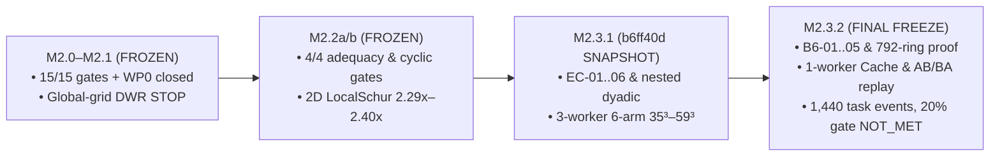

# Phase-II Research Specification & Decision Ledger (v6, `M2.0`–`M2.3.2` Final Release Freeze): Order-Preserving Portal Coarsening & Verified Discrete KL-LMDP Planning

> **Phase-I Frozen Anchor**: `green_response/` is locked byte-for-byte at `package_py_sha256 = "271ac8df9caaa8af8aaa5af9d35d76578632b554d5071fe8fe74065ca0dc0c2d"` (`0` edits).  
> **Phase-II Non-Destructive Provenance**: All prior campaign JSONs from `89761ff` (`m21_ablation_results.json` `634c15e5...`), `ec75871` (`m20` `bdad8346...`, `m22` `55d7e1ea...`, `m23_m24` `8fb6fb84...`), and `b6ff40d` (`m231_audit_closure.json` `4a0e2514...`, `m231_fair_ablation_results.json` `f844a102...`) remain **100% byte-untouched**. Final `M2.3.2` code (`phase2_package_py_sha256 = "1901d24f34b003340701870eee6631a84829976188a164b6430281ee9a5ddb76"`) publishes strict RFC-8259 JSON closure artifacts `m232_contract_and_ring_closure.json` (`06b44156...`) and `m232_targeted_replay_results.json` (`9979d61a...`).

---

## 0. Final Phase-II Verdict & Scope Freeze (`M2.0`–`M2.3.2`)

1. **`M2.0–M2.1` (Global-Grid Bilinear DWR — Formal Economic `STOP`)**: Certified `14,400 / 14,400` evaluations (`0` violations), but hit the economic `STOP` gate across all `8 / 8` streams (`F11` `+59.3%..+221.5%`) due to monolithic global `splu(A_t)` refactorizations and full-grid witness matmuls.
2. **`M2.2a/b` (2D Multi-Room Portal Quotients)**: Closed `tiny-Z` survival aliasing (`C12–C13`), single-option vs. multi-exit Cole–Hopf control gap (`+1.015` vs `0.0`, `C14`), and cyclic SSP Lyapunov bounds (`C15`). Uncompressed `LocalSchur` achieved `2.29x–2.40x` over `FullGrid` (`0 / 8,000` violations), while iterative 2D doorway splitting remained slower than `LocalSchur`.
3. **`M2.3 -> M2.3.1 -> M2.3.2` (3D Seam-Free Dyadic Portal Coarsening — Frozen Manuscript Mainline)**:
   - **Complete Public-API & Goal-Support Closure (`M2.3.2 WP-1`)**: Closed `EC-01..EC-06` and `B6-01..B6-05` (`0` warnings): shared `extract_directed_goal_ring_in_room` handles portal-adjacent slabs and whole-room targets (`36 / 36` `17^3` checks verifying $L \le V^* \le J^{\hat{\mu}} \le U$ down to $\varepsilon = 0.001$; `792 / 792` official tasks verified ring-unchanged); root actions primed inside `query_ms` for both interior and portal starts (`0` post-query backsolves); explicit guarantee tiers separate `float64_toleranced_model_enclosure` (`Portal / MatrixFree`) from `high_accuracy_numerical_reference` (`SingleLU`, hardened with componentwise relative residual check $\le 10^{-7}$).
   - **Corrected Cache Causal Decomposition (`M2.3.2 WP-2`, `47^3`, `1` Worker, `2x` `3x3` Latin Square)**: With intra-query memoization enabled across all modes, `CacheOn_Persistent` (`8.56s`) saves **`29.75%` (`1.42x`, $p = 1.20\times 10^{-4}$)** over `CacheL0Only` (`12.18s`) and **`43.98%` (`1.79x`, $p = 1.48\times 10^{-6}$)** over `QueryCold` (`15.28s`), cleanly isolating cross-query `L1..L3` basis reuse from `L0` reuse.
   - **Honest Closest-Neighbor Economic Verdict (`M2.3.1` `3`-Worker & `M2.3.2` `1`-Worker `AB/BA` Replay)**:
     - Against global reuse `SingleLU_GoalCapacitance`, `Portal_CacheOn` achieves **`1.57x` (`35^3`), `2.29x` (`47^3`), `2.39x` (`59^3`), and `4.74x` (`Continual 47^3`)** speedups.
     - Against closest neighbor `MatrixFree_ExactSchur_Krylov` (sharing room decomposition, local LUs, and L0 Lyapunov gauge): no gain on small `35^3` `7x7` portals (`-12.15%` saving, `0.89x`); statistically significant net time reductions on larger portals of **`19.79%` (`47^3`), `17.56%` (`59^3`), `16.60%` (`Continual 47^3` marginal)** under `3` workers (`m231`) and **`15.17%` (`47^3`, $p = 0.0174$), `13.74%` (`59^3`, $p = 0.00511$), `9.98%` (`Continual 47^3` marginal, $p = 1.41\times 10^{-4}$)** under exclusive `1`-worker `AB/BA` replay (`m232`, `1,440 / 1,440` saved events and `360 / 360` per-task $L \le V^* \le J^{\hat{\mu}} \le U$ checks satisfied). The pre-declared **`20%` relative time-saving gate vs. `MatrixFree` is formally registered as `NOT_MET` (`B6-D05`)**.

---

## 1. Locked Governance & Decision Ledger (`B6-D01`–`B6-D10`)

| Decision ID | Locked Resolution & Artifact Anchor |
| :--- | :--- |
| **`B6-D01`** | `b6ff40d` (`m231_*`) and all earlier `89761ff / ec75871 / a26c116` artifacts preserved byte-for-byte; `M2.3.2` writes `m232_*` (`allow_nan=False`). |
| **`B6-D02 & D03`** | `EC-01..EC-06` remain closed; `B6-01` portal-adjacent goal support fixed via `extract_directed_goal_ring_in_room` (`36/36` `17^3` 4-inequality checks + `792/792` official-task ring equivalence in `m232_contract_and_ring_closure.json`). |
| **`B6-D04`** | Corrected 1-worker `47^3` 3-arm cache study (`m232_targeted_replay_results.json`) isolates cross-query `L1..L3` reuse at **`1.42x` (`29.75%` saving, $p = 1.20\times 10^{-4}$)** over `CacheL0Only` and **`1.79x` (`43.98%` saving)** over `QueryCold`. |
| **`B6-D05`** | `20%` relative time-saving gate (`1 - T_Portal / T_MF >= 20%`) formally registered **`NOT_MET`** (`1`-worker `AB/BA`: `15.17%` on `47^3`, `13.74%` on `59^3`, `9.98%` continual marginal; `3`-worker: `19.79% / 17.56% / 16.60%`), while equal-mean paired tests confirm statistically significant positive savings ($p \le 0.0174$). |
| **`B6-D06`** | `unverified_warm_ilu` column inside `Verified_Global_WarmILU` is scoped strictly as `krylov_stage_diagnostic_inside_verified_pipeline`, not an independent standalone baseline. |
| **`B6-D07`** | Guarantee tiers explicitly separated: `high_accuracy_numerical_reference` (`SingleLU`, componentwise relative residual guarded) vs. `float64_toleranced_model_enclosure` (`Portal / MatrixFree`). |
| **`B6-D08`** | `m232_targeted_replay_results.json` stores `1,440` per-task events and reduces all denominators/violations from events (`360/360` explicit $L \le V^* \le J^{\hat{\mu}} \le U$ checks including continual epochs). |
| **`B6-D09 & D10`** | Algorithm scope frozen; zero seed chasing or new solver branches; manuscript writing proceeds directly on the locked `M2.3.2` evidence base. |
