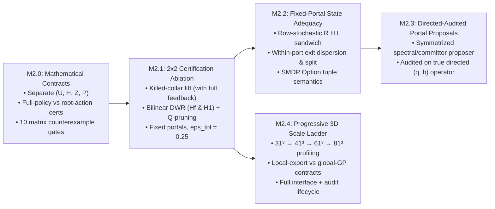

# Phase-II Research Specification (v2, Contract-Hardened): Decision-Functional Certification, State-Adequate Portal Quotients, and Continual Amortization

> **Phase-I Frozen Anchor**: `green_response/` is locked byte-for-byte at `package_py_sha256 = "271ac8df9caaa8af8aaa5af9d35d76578632b554d5071fe8fe74065ca0dc0c2d"` (`24 / 24` audit suites passing; `EF-D01..EF-D12`, `R314-01..05`, and `A26-D01..D12` closed).  
> **Scope & Epistemic Discipline**: All Phase-II mechanisms live in an isolated sibling package (`../quotient_phase2/`) importing `green_response` strictly read-only. Every unproven empirical speedup or runtime target below is treated explicitly as a **falsifiable hypothesis** rather than an assumed guarantee, and every theorem-level claim states its exact domain, boundary conditions, and small-matrix counterexample guards (`P2A-01..05`, `P2B-01..04`, `P2C-01..04`).

---

## 0. Three Falsifiable Core Questions (Replacing Subjective Completion Percentages)

Instead of unquantified progress percentages, Phase II is governed by three binary/quantitative questions linking world-model structure to auditable planning:

1. **Decision-Functional Certification (`M2.0–M2.1`)**: Under an **identical full-policy quality contract** ($\varepsilon_{\text{tol}} = 0.25$ on the discrete Markov macro-policy class), can replacing uniform whole-grid PDE residual bounds with **killed-domain local collar lifting + operator-verified bilinear primal-dual functional enclosures + same-state dominated-branch pruning** reduce **net total wall-clock planning cost** (charging 100% of representation, witness construction, verification, DP, and fallback)?
2. **Auditable State Adequacy & Portal Discovery (`M2.2–M2.3`)**: Can the system determine **which entry/state variables must be retained vs. merged** across candidate bottleneck portals—detecting non-lumpable entry dependence via within-port exit-distribution dispersion and automatically splitting inadequate abstract states—before replacing human intermediate rings with directed-audited spectral proposals?
3. **Lifecycle Net Amortization Across Scale (`M2.4`)**: Under explicit local-vs-global world-model update contracts and progressive 3D scaling (`31^3 -> 41^3 -> 61^3 -> 81^3`), does cumulative planning + update + audit + fallback cost cross below strong iterative and domain-decomposition baselines (`AMG/Krylov`, `Warm-ILU`, `Structure-Memory`)?

*(Note: 6D non-LMDP constrained kinodynamics and embodied active-sensing VoI require separate relaxation/control contracts and are explicitly deferred out of the initial `M2.0–M2.4` build sequence; see Section 5.)*

---

## 1. Milestone `M2.0` — Mathematical Object Separation & 10-Counterexample Contract Suite

Before running benchmark campaigns, `quotient_phase2/m20_contracts.py` enforces strict mathematical contracts closing all 10 small-matrix counterexamples identified in `v9`:

### 1.1 Separation of the Four Response Objects (`P2A-01`)
On a discrete grid $\Omega$ with nonsingular M-matrix $A = D_q + L_{\text{diff+drift}}$ ($A_{ij} \le 0$ for $i \neq j$, $(A\mathbf{1})_i \ge q_i / \lambda \ge q_{\min}/\lambda > 0$), target ball $M_b \subset \Omega$, graph separator ring $\Gamma_b \subset M_b$, and killed exterior $I_b := \Omega \setminus M_b$:

| Symbol | Mathematical Definition | Provable Property & Necessary Hypotheses | Counterexample Guard |
| :--- | :--- | :--- | :--- |
| **Green Source Matrix $U_b$** | $A U_b = E_{\Gamma_b}$ on $\Omega$ | $U_b \ge 0$ (`A^{-1} >= 0`), **NOT bounded above by `1`** (scales as $c^{-1}$ under $A \mapsto cA$). On disjoint $\Gamma_{\text{new}} \cap T = \emptyset$, historical $V = A_0^{-1} E_T$ satisfies $(A_0 V)|_{\Gamma_{\text{new}}} = 0$ (whereas $V|_{\Gamma_{\text{new}}}$ is generally nonzero). | $A_{BB} = \begin{pmatrix}0.05 & -0.02 \\ -0.02 & 0.05\end{pmatrix} \implies A_{BB}^{-1} e_1 = (23.81, 9.52)^\top \not\le 1$ |
| **Killed Hitting Kernel $H_b$** | $A_{I_b, I_b} H_b = B_b := -A_{I_b, \Gamma_b}$ on $I_b$ | $H_b \ge 0$ and **$H_b \mathbf{1} \le \mathbf{1}$** whenever $A_{I_b, I_b}$ is a nonsingular M-matrix, $B_b \ge 0$, and $A_{I_b, I_b}\mathbf{1} \ge B_b\mathbf{1}$ ($\mathbf{1} - H_b\mathbf{1} = A_{I_b,I_b}^{-1}(A_{I_b,I_b}\mathbf{1} - B_b\mathbf{1}) \ge 0$). Related to $U_b$ by separator elimination $H_b = U_b[I_b,:] (U_b[\Gamma_b,:])^{-1}$. | Rejects `B < 0` or `A_{II} 1 < B 1` |
| **Unit-Gauge Desirability $Z_b$** | $Z_b := H_b \mathbf{1} \in \mathbb{R}^{|I_b|}$ | $0 < Z_b(x) \le 1$ on connected components reaching $\Gamma_b$ under unit boundary gauge ($\phi_b$ factored out via $\Phi(S) = \sum_{b \in S} \phi_b$). | Non-unit terminal gauge scaled separately |
| **Conditional Exit Law $P_b$** | $P_b := \operatorname{diag}(Z_b)^{-1} H_b$ | Defined strictly on rows with certified $Z_b(x) > 0$; satisfies $P_b \ge 0, P_b \mathbf{1} = \mathbf{1}$. | Fails closed if $Z_{b,\text{lo}}(x) \le 0$ on active policy path |

### 1.2 Local Collar Lifting With Exact Full-Domain / Schur Interface Feedback (`P2A-02`)
Let $C_b \subset I_b$ be a local collar neighborhood around $\Gamma_b$ (e.g., $k$-hop graph collar $B_k(\Gamma_b) \setminus M_b$) and $F_b := I_b \setminus C_b$. Solving $A_{C_b, C_b} H_{b,\text{loc}} = B_b[C_b, :]$ and solving only on $F_b$ **without** feedback into $C_b$ leaves nonzero interior residual ($2 \times 2$ counterexample gives $(1/2, 1/4) \neq (2/3, 1/3)$). Two valid formulations are permitted:
1. **Zero-Extended Full-Exterior Remainder Decomposition**: Extend $H_{b,0}[C_b, :] := H_{b,\text{loc}}$, $H_{b,0}[F_b, :] := 0$ (or warm blend with historical $\widetilde{H}_b^{\text{hist}}$), compute the **exact full-exterior residual** $R_b := B_b - A_{I_b, I_b} \widetilde{H}_b$ on **all** of $I_b = C_b \cup F_b$, and solve/bound $A_{I_b, I_b} W_b = R_b$ across all of $I_b$. Because $(B_b - A_{I_b, I_b} H_{b,0})|_{C_b} = 0$, the singular boundary source on $C_b$ is annihilated exactly and pushed onto the outer collar rim $-A_{F_b, C_b} H_{b,\text{loc}} \ge 0$ while retaining 100% interior-exterior coupling in $A_{I_b, I_b}$.
2. **Exact Schur Complement Elimination**: $S_{F_b} H_b[F_b,:] = B_b[F_b,:] - A_{F_b,C_b} A_{C_b,C_b}^{-1} B_b[C_b,:]$ with mandatory back-substitution $H_b[C_b,:] = A_{C_b,C_b}^{-1}(B_b[C_b,:] - A_{C_b,F_b} H_b[F_b,:])$.

### 1.3 Verified Bilinear Primal-Dual (DWR) Enclosure for Both $H_b \mathbf{1}$ and $H_b f$ (`P2A-03` & `P2A-05`)
Controlling only row-sum residual $|R_b \mathbf{1}|$ cannot certify continuation values $P_b f = (H_b f)/(H_b \mathbf{1})$ (swapped $2 \times 2$ stochastic rows have $(H - \widetilde{H})\mathbf{1} = 0$ yet $|(H - \widetilde{H})f| = 0.8$), and radial exponential templates fail $A^\top \psi \ge e_p$ under asymmetric drift. Instead, we use an **operator-verified Bilinear Primal-Dual Identity** valid for **any** approximate killed kernel $\widetilde{H}_b \in \mathbb{R}^{|I_b| \times m_b}$ and **any** trial adjoint row $\psi_{p,b} \in \mathbb{R}^{|I_b|}$:
1. Compute the exact primal residual $R_b := B_b - A_{I_b, I_b} \widetilde{H}_b$ and the **explicit current-operator adjoint residual** $\delta_{p,b} := e_p - A_{I_b, I_b}^\top \psi_{p,b}$.
2. Define the **Adjoint-Corrected Portal Row**:
   $$\widehat{H}_b^{\text{corr}}[p, :] := \widetilde{H}_b[p, :] + \psi_{p,b}^\top R_b \in \mathbb{R}^{1 \times m_b}.$$
3. **Exact Remainder Theorem**: Since $H_b^* - \widetilde{H}_b = A_{I_b, I_b}^{-1} R_b$ and $e_p^\top = \psi_{p,b}^\top A_{I_b, I_b} + \delta_{p,b}^\top$, for **every** boundary vector $g \in \mathbb{R}^{m_b}$:
   $$(H_b^* g)(p) - (\widehat{H}_b^{\text{corr}}[p, :] g) = \delta_{p,b}^\top A_{I_b, I_b}^{-1} (R_b g).$$
   Because $A_{I_b, I_b}$ is a nonsingular M-matrix with $(A_{I_b, I_b}\mathbf{1})_i \ge q_{\min}/\lambda > 0$, $\|A_{I_b, I_b}^{-1} v\|_\infty \le \frac{\lambda}{q_{\min}} \|v\|_\infty$, yielding:
   $$\left| (H_b^* g)(p) - (\widehat{H}_b^{\text{corr}}[p, :] g) \right| \le \underbrace{\left(\frac{\lambda}{q_{\min}} \|\delta_{p,b}\|_1\right)}_{\alpha_{p,b} \ge 0} \|R_b g\|_\infty \le \alpha_{p,b} \sum_{j=1}^{m_b} \|R_b[:, j]\|_\infty |g_j|.$$
   - **Denominator $Z_b(p)$ ($g = \mathbf{1}$)**: Bounded using exact row-sum residual $\|R_b \mathbf{1}\|_\infty$: $|Z_b^*(p) - \widehat{Z}_b^{\text{corr}}(p)| \le \alpha_{p,b} \|R_b \mathbf{1}\|_\infty$.
   - **Centered Continuation Numerator $N_{b,f}(p)$ ($g \in [TF_{\text{lo}}, TF_{\text{hi}}]$)**: Splitting $\widehat{H}_b^{\text{corr}} = \widehat{H}_+ - \widehat{H}_-$ ($\widehat{H}_\pm \ge 0$) and letting $G_{\text{abs}} := \max(|TF_{\text{lo}}|, |TF_{\text{hi}}|)$ gives rigorous lower/upper bounds for all $g \in [TF_{\text{lo}}, TF_{\text{hi}}]$:
     $$\mathrm{Num}_{\text{lo}}(p) = \widehat{H}_+[p,:] TF_{\text{lo}} - \widehat{H}_-[p,:] TF_{\text{hi}} - \alpha_{p,b} (r_{b,\infty}^\top G_{\text{abs}}),$$
     $$\mathrm{Num}_{\text{hi}}(p) = \widehat{H}_+[p,:] TF_{\text{hi}} - \widehat{H}_-[p,:] TF_{\text{lo}} + \alpha_{p,b} (r_{b,\infty}^\top G_{\text{abs}}),$$
     propagated through the outward-rounded quotient `Num / Z` intersected with `[f_min, f_max]`.
   - **Single-LU Epoch-0 Separator Adjoint Source (100% Billed)**: At `ep = 0`, exact killed adjoint rows $\psi_{p,b}^{(0)} = (A_{I_b, I_b}^{(0)})^{-\top} e_p$ are extracted from the **single global `splu(A^{(0)})`** via exact graph-separator elimination $\psi_{p,b}^{(0)} = (\phi_p^{(0)} - \Phi_{\Gamma_b}^{(0)} (\Phi_{\Gamma_b}^{(0)}[\Gamma_b,:])^{-1} \phi_p^{(0)}[\Gamma_b])|_{I_b}$ (`<= 1e-14` residual at `ep = 0`), requiring **zero per-waypoint LU factorizations** and **zero test-epoch LU factorizations** unless fallback refinement is triggered.

### 1.4 Non-Interchangeable Policy vs. Root-Action Certificate Classes (`P2A-04`)
- **`full_policy_enclosure` (`certificate_kind = "policy_and_value_enclosure"`)**: Certifies a complete Markov macro-policy $\hat{\mu}$ via $g_{\text{policy}}(\hat{\mu}) := U^{\hat{\mu}}(s_0, S_0) - \min_a L_a^*(s_0, S_0) \le \varepsilon_{\text{tol}}$. Same-state dominated actions $a \neq \hat{\mu}(x, S)$ satisfying $Q_{\text{lo}}(x, S; a) \ge Q_{\text{hi}}(x, S; \hat{\mu}(x, S))$ do not inflate $U^{\hat{\mu}}(x, S) - L^*(x, S)$, **while every leg along the active incumbent tree $\hat{\mu}$ must still carry a finite certified upper bound**. Mandatory for all comparisons against Phase-I `Exp 5B`.
- **`receding_horizon_root_action_enclosure`**: Certifies only first-step optimality $\max_{a \neq \hat{a}}[U_{\hat{a}}^* - L_a^*]_+ \le \eta$ under subsequent re-planning (cumulative $m$-step regret bound $\le \sum_{t=1}^m \eta_t$); strictly forbidden from claiming single-shot full-policy $\varepsilon$-certification.

### 1.5 Quotient Positivity, Lumpability, & Local Inference Contracts (`P2B-01..04`, `P2C-01..02`)
- **Row-Stochastic Sandwich (`P2B-01`)**: Coarse kernels must take the form $\overline{H} = R H L$ with $H \ge 0, H\mathbf{1} \le \mathbf{1}$ and row-stochastic $R \ge 0, R\mathbf{1} = \mathbf{1}$, $L \ge 0, L\mathbf{1} = \mathbf{1}$ (or explicit substochastic constraints), never unconstrained Galerkin $W(W^\top A W)^{-1} W^\top$.
- **Within-Port Exit Dispersion vs. Interval Width (`P2B-02`)**: Separate interval product width from **within-port exit dispersion** $\delta_{\text{lump}}(\Pi_{\text{in}}; \Omega_c) = \max_{x, x' \in \Pi_{\text{in}}} \|H_{\Omega_c}(x, \cdot) - H_{\Omega_c}(x', \cdot)\|_1$ and independent 2-step discrepancy $\|H_{\text{2-step}}^{\text{true}} - Q_1 Q_2\|_\infty$.
- **Directed Validation of Spectral Proposals (`P2B-03/04`)**: Symmetrized Fiedler/Cheeger cuts act solely as candidate portal proposers; all certificates evaluate the true directed $(q, b)$ operator while preserving external user terminal goals and full SMDP Option tuples `(initiation, policy, termination, cost, exit_kernel, epoch_scope)`.
- **Explicit Local Inference & Interface Cost Contract (`P2C-01/02`)**: Compact prior covariance does not imply local posterior updates (`K_{LR|M} != 0`); any local update claim must specify either independent local models or certified posterior-truncation error bounds, and charge both local subdomain solves and global coupled interface updates without claiming `O(1)` total memory (`Exp 4B`'s `-193.4 ms` warm 3D result is referenced accurately as `3D 21^3 BroadWarm6`).

---

## 2. Milestone `M2.1` — Controlled $2 \times 2$ Feasibility Ablation (`quotient_phase2/m21_qgap_collar_ablation.py`)

### 2.1 Scientific Question & Experimental Design
Fixing the 2D/3D discrete LMDP model, catalog target geometry, and **`full_policy_enclosure` ($\varepsilon_{\text{tol}} = 0.25$, `100%` complete certification via operational exact fallback)**, `M2.1` crosses **Killed-Domain Local Collar Remainder Lifting** (Factor A) $\times$ **Verified Bilinear Primal-Dual DWR + Same-State Dominated-Branch Attribution** (Factor B):

| Arm ID | Representation / Source Handling | Error Auditor & Refinement Rule | Role |
| :--- | :--- | :--- | :--- |
| `ExactRing-Rebuild` | Fresh `splu(A_t)` + exact ring columns | Exact Subset-DP (`0` approx error) | Cold/per-epoch exact baseline |
| `Structure-Memory-Fresh-Exact` | Fresh `splu(A_t)` + remembered port levels | Phase-I `bound_harmonic_batch` | Best Phase-I 3D warm baseline |
| `F00_NoLift_PrimalUniform` | Historical killed kernel $\widetilde{H}_b$ (`0` lift) | Primal uniform $(\lambda / q_{\min}) \|R_b\|_\infty$ | Baseline approximate reuse |
| `F10_CollarLift_PrimalUniform` | **Local collar lift** $A_{C_b,C_b}^{-1}(R_b|_{C_b})$ + full $I_b$ residual | Primal uniform $(\lambda / q_{\min}) \|R_b^{\text{lift}}\|_\infty$ | Isolates collar singularity removal |
| `F01_NoLift_BilinearDWR` | Historical killed kernel $\widetilde{H}_b$ (`0` lift) | **Verified Bilinear DWR** (`Hf` & `H1`) + same-state pruning | Isolates goal-oriented DWR auditor |
| `F11_CollarLift_BilinearDWR` | **Local collar lift** + full $I_b$ residual | **Verified Bilinear DWR** (`Hf` & `H1`) + same-state pruning | Full $2 \times 2$ combined candidate |

### 2.2 Evaluation Cohorts, Scale Ladder, & Stopping Criterion
- **Part M2.1-A (Unseen-Target Source-Obstruction Diagnostic)**: Tests disjoint unseen targets on `2D 51^2` and `3D 21^3` comparing fixed historical span (`||E - A V c||_inf >= 1.0`) vs local collar lift (`hops = 1, 2, 3`) + Bilinear DWR under `strict_unclipped`.
- **Part M2.1-B (Continual Evolving-World Full-Lifecycle & Scale Crossover)**:
  - Tested on **Dev Seeds** (`30300..30311`, `12` maps, parity with `Exp 5B` on `2D 51^2` & `3D 21^3`) and **Untouched Confirmation Seeds** (`40300..40307`, `8` maps on `3D 21^3` [`N = 9,261`] and **`3D 27^3` [`N = 19,683`, `6.5x` heavier 3D `splu`]**, alongside standalone `21^3..31^3` `splu` fill-in profiling) across both `LowDimParametricStream` and `RealisticGPStream`.
  - **Primary Endpoint**: Total wall-clock cost $C_{\text{total}} = C_{\text{init/cache}} + C_{\text{lift}} + C_{\text{witness+audit}} + C_{\text{DP}} + C_{\text{fallback}}$ at **`100%` `full_policy_enclosure` ($\varepsilon = 0.25$) certification and `0` bound violations** vs independent killed-operator Bellman ground truth.
  - **Stopping Rule**: Any regime where witness/lifting/matmul cost exceeds exact/structure-memory cost is reported transparently as a negative crossover boundary rather than tuned post-hoc.

---

## 3. Subsequent Milestones (`M2.2 -> M2.4`, Unlocked Conditionally After `M2.1`)

- **`M2.2` (Fixed-Portal State Adequacy & Automatic State Splitting)**: On room/corridor layouts with controlled entry-dependent exit distributions, implement $\overline{H} = R H L$ brackets + $\delta_{\text{lump}}$ entry-dispersion auditing, demonstrating `insufficient coarse state -> counterexample detection -> entry-conditioned state split -> certified policy recovery`.
- **`M2.3` (Directed-Audited Bottleneck Portal Proposals)**: Connect symmetrized conductance / committor / trajectory cut proposers to `M2.2`'s directed $(q, b)$ auditor, benchmarking against uniform geometric grids, human portals, and uncompressed solvers under identical information budgets.
- **`M2.4` (Progressive 3D Scale & Local-Model Lifecycle)**: Scale `31^3 -> 41^3 -> 61^3 -> 81^3` comparing against `AMG/Krylov` and `Warm-ILU` with cached preconditioners under both (a) explicit local-domain world changes and (b) global GP refits.

---

## 4. Deferred Separate Research Tracks (Out of Initial `M2.0–M2.4` Scope)

1. **Embodied Trajectory-Constrained Active Exploration**: Requires mature `M2.2` SMDP portal options and a unified physical travel + sensing time/energy budget before comparing against `OnPolicy` trajectories.
2. **6D Constrained Non-LMDP Kinodynamics**: Requires independent mathematical proofs for hypoelliptic kinetic HJB sub-/supersolutions and box-vs-ball control Hamiltonians (note: `port_solvers.py`'s 56-step routine is an inner 1D ball-multiplier bisection given $\nabla V$, not a trajectory tube solver); kept strictly separate until 2D/3D quotient mechanics close.
