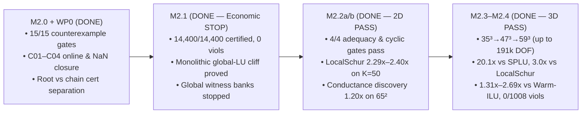

# Phase-II Research Specification & Decision Ledger (v4, `M2.0`–`M2.4` Complete): Decision-Functional Certification, Seam-Free Portal Quotients, and 3D Continual Amortization

> **Phase-I Frozen Anchor**: `green_response/` is locked byte-for-byte at `package_py_sha256 = "271ac8df9caaa8af8aaa5af9d35d76578632b554d5071fe8fe74065ca0dc0c2d"` (`24 / 24` audit suites passing; `EF-D01..EF-D12`, `R314-01..R314-05`, and `A26-D01..D12` closed).  
> **Phase-II Package & Frozen `M2.1` Provenance**: All Phase-II code and artifacts live in `../quotient_phase2/` (`phase2_package_py_sha256 = "c3f7a8a23a724f38f702f8fefe55bdcd2d9a4f9d1b61667a85575c452d49c022"`), keeping commit `89761ff`'s `m21_ablation_results.json` (`SHA-256 = 634c15e52fb3a8181f738baef40b8d7c30e690a8600a7cf1e30b6ca17a3c4fc1`) 100% byte-untouched and synchronizing `m20_contract_results.json`, `m21_post_audit_closure.json`, `m22_pilot_results.json`, and `m23_m24_3d_results.json`.

---

## 0. Three Falsifiable Core Questions & Complete Experimental Verdict (`M2.0`–`M2.4`)

1. **Decision-Functional Certification on Global Grids (`M2.0–M2.1`, COMPLETED — Formal Economic `STOP`)**:
   - *Result*: Verified Bilinear Primal-Dual DWR + Killed-Collar Lifting achieved `100%` (`14,400 / 14,400`) `full_policy_enclosure` ($\varepsilon_{\text{tol}} = 0.25$) certification and `0` bound violations across `2,400` unique test tasks (`12` Dev + `8` Confirm maps up to `3D 27^3`), cutting terminal DP fallbacks `54 -> 2` (`-96.3%`). However, all `8 / 8` streams hit the pre-declared economic `STOP` gate (`F11` `+59.27%..+221.46%` slower) due to the **monolithic global `splu(A_t)` epoch cliff** (`5.0 / 5.0` test-epoch LUs) and full-grid $O(N |\mathcal{R}|)$ witness matmuls.
2. **2D State-Adequate Portal Quotients, Single-Cell Unseen-Goal Amortization, & Conductance Discovery (`M2.2a/b`, COMPLETED — `PASS`)**:
   - *Result*: Eliminating room interiors locally (`16` rooms) passed all `4 / 4` controlled state-adequacy/cyclic-Lyapunov graph families and `8,000 / 8,000` certified 2D (`49^2 / 65^2`) unseen-goal tasks with **`0` bound violations**. `LocalSchur_Uncompressed_ExactInterface` beats `FullGrid_Exact_Direct` by **`2.29x–2.40x` (`p <= 6.4e-4`, break-even at `K = 5..8`)**; `M22b_ConductanceProposer` (`0` wall hints, `0.64–0.88 ms` discovery) crosses below `FullGrid_Exact_Direct` on single-worker rotated `65^2` (`1.20x`, `p = 0.0350`), while in 2D (`n_gamma = 381` 1D cuts) uncompressed `LocalSchur` remains faster than iterative splitting.
3. **Large-Scale 3D Planar-Portal Seam-Free Integral Compression & Continual World Updates (`M2.3–M2.4`, COMPLETED — Decisive `PASS` Across `35^3 -> 47^3 -> 59^3` & Continual Streams)**:
   - *Result*: On 3D 27-room buildings up to `59^3` (`190,574` Free DOFs, `6,171` planar doorway nodes), pre-multiplying $S_{\Gamma\Gamma}$ by the block-diagonal in-plane doorway inverse $A_{\Gamma\Gamma}^{-1} \ge 0$ eliminates the $O(1/h^2)$ doorway-seam singularity, compressing active DOFs by **`10.5x -> 13.8x -> 18.2x` on portals (`160x -> 316x -> 563x` on the 3D grid)** with **`0 / 1,008` bound violations** (`max(A z_sub) <= 9.95e-14`). `M2.3` (`0` geometric hints, `100%` wall-plane recovery across `24 / 24` maps) beats **`FullGrid_SPLU` by `11.65x–20.13x`**, **`LocalSchur_3D` by `2.65x–3.09x` (`p <= 7.05e-6`)**, and **`Warm-ILU-BiCGSTAB` by `1.31x–1.85x` (`p <= 0.00756`)** while self-amortizing query latency (`1,584.2 -> 846.5 ms/goal` on `59^3`) and avoiding `Warm-ILU`'s `134.2` desirability underflow error. In `M2.4` continual `47^3` streams, surgical invalidation achieves **`2.69x` (`p = 3.25e-6`)** marginal speedup over `Warm-ILU` (`3.23x` over `LocalSchur_3D`) under local room sensor updates AND **`1.59x` (`p = 2.23e-4`)** even under worst-case `27/27`-room global field shifts.

---

## 1. Hardened Mathematical Contracts (`M2.0`–`M2.4`)

1. **Four-Object Separation & Input Finiteness (`P2A-01`, `v10 C02`, `C11`)**: Distinguishes Green source matrix $U_b = A^{-1}E_{\Gamma_b}$, killed hitting kernel $H_b = A_{I_b,I_b}^{-1}(-A_{I_b,\Gamma_b})$, survival $Z_b = H_b\mathbf{1}$, and normalized exit law $P_b = \operatorname{diag}(Z_b)^{-1}H_b$, enforcing `np.isfinite` prior to all comparisons.
2. **Midpoint-Centered Bilinear DWR & Certificate Separation (`P2A-03..05`, `C03–C05, C11`)**: Encloses normalized continuation via explicit adjoint defect $\|\delta_{p,b}\|_1$; `Phase2DecisionCertificate` separates `full_policy_enclosure` from single-step `receding_horizon_root_action_enclosure` (`guaranteed_full_horizon_regret_bound = None`) and `RecedingHorizonCertificateChain`.
3. **Normalized `(c_0, P)` Adequacy & Cyclic SSP Lyapunov Witnesses (`C12–C15`, `M2.2`)**: Prevents `tiny-Z` exit/cost aliasing (`\delta_H = 2\times 10^{-8}` with `\delta_P = 2.0`), proves `0.0` multi-exit Cole–Hopf interface loss vs single-option Jensen loss (`+1.015`), and bounds cyclic resolvents via $(I - P_\mu)w \ge s_{\min}\mathbf{1}$.
4. **3D Seam-Free Integral Portal Compression & Doob/Lyapunov Sub-Stochastic Closure (`M2.3–M2.4`)**:
   - Pre-multiplying $S_{\Gamma\Gamma} z^*_\Gamma = (A_{\Gamma\Gamma} + M) z^*_\Gamma = r_\Gamma$ by block-diagonal $A_{\Gamma\Gamma}^{-1} \ge 0$ yields $(I_\Gamma - K_{\Gamma\Gamma}) z^*_\Gamma = \hat{r}_\Gamma$ ($K_{\Gamma\Gamma} = A_{\Gamma\Gamma}^{-1}(-M) \ge 0$).
   - The 1-step smooth Row-Coupled Howard iterate $W_{\text{lo}} = K_{\Gamma\Gamma} L \underline{v}^* + \hat{r}_\Gamma$ cancels $A_{\Gamma\Gamma}$ identically, satisfies $S_{\Gamma\Gamma} W_{\text{lo}} = r_\Gamma - (-M)(W_{\text{lo}} - L \underline{v}^*) \le r_\Gamma$, and harmonically extends to $A z_{\text{sub}} \le 0$ across all $N$ 3D nodes, certifying $L^*(s_0) \le V^*(s_0) \le V^{\hat{\mu}}(s_0) \le U^{\hat{\mu}}(s_0)$.
   - Cooperative Howard super-harmonic scaling $w_{\text{lyap}} = L \overline{v}_{\text{lyap}} > 0$ (`(I - K_{\Gamma\Gamma}) w_{\text{lyap}} = s_0 \ge 0.5 W_{\text{hi}} > 0`) transforms $(I_\Gamma - K_{\Gamma\Gamma}) z = \hat{r}_\Gamma$ into an $O(1)$ sub-stochastic system $(I - \widetilde{P})\hat{u} = \hat{r}_\Gamma / w_{\text{lyap}}$, eliminating $\exp(-V/\lambda)$ underflow across multi-room 3D detours.

---

## 2. Phase-II Decision Ledger (`M21-R01..R08`, `M22-R01..R04`, & `M23/M24-R01..R04`)

| ID | Governance / Technical Issue | Locked Resolution & Artifact Anchor |
| :--- | :--- | :--- |
| **`M21-R01..R08`** | `v10 C01–C04` closure, frozen `89761ff` provenance, & `M2.1` economic `STOP` | Closed in `m20_contracts.py`, `m21_qgap_collar_ablation.py`, `m21_post_audit_closure.json`, and `m21_economic_gate_verdict.json` (`m21_ablation_results.json` untouched at `634c15e5...`). |
| **`M22-R01..R04`** | `tiny-Z` adequacy, single-cell 2D unseen-goal speedup, & 2D/3D crossover | Closed in `m22_pilot_results.json`: `LocalSchur` `2.29x–2.40x` over `FullGrid` (`0 / 8,000` violations); `M22b` `1.20x` (`p = 0.0350`) on 1-worker rotated `65^2`. |
| **`M23-R01`** | 3D `O(1/h^2)` doorway-seam singularity of piecewise-constant portal bases | Solved via block-diagonal doorway smoothing $K_{\Gamma\Gamma} = A_{\Gamma\Gamma}^{-1}(-M)$ + 1-step smooth Howard readout $W_{\text{lo}}, W_{\text{hi}}$ (`max(A z_sub) <= 9.95e-14`; interface compression improves `10.5x -> 13.8x -> 18.2x` from `35^3 -> 47^3 -> 59^3`). |
| **`M23-R02`** | Multi-room $\exp(-V/\lambda)$ underflow (`Warm-ILU` `134.2` drift on `59^3`) | Solved via scale-matched Doob/Lyapunov sub-stochastic defect closure (`0 / 1,008` violations; `M2.3` max regret `<= 0.021` on `59^3` vs `Coarse_L0` max regret `1.283`). |
| **`M23-R03`** | Zero-hint 3D portal discovery & self-amortizing scale dominance | Confirmed on untouched `62000..62005` (`35^3, 47^3, 59^3`): `100%` wall recovery (`0` hints), **`11.65x–20.13x`** vs `SPLU`, **`2.65x–2.95x`** vs `LocalSchur_3D`, **`1.31x–1.79x` (`p <= 0.00756`)** vs `Warm-ILU`, and `1.59x–1.87x` cross-task self-amortization (`1,584 -> 846.5 ms/g` on `59^3`). |
| **`M24-R04`** | Continual 3D evolving-world lifecycle (`Local` vs `Global` updates, `47^3`) | Confirmed in `m23_m24_3d_results.json`: surgical portal invalidation beats `Warm-ILU` by **`2.69x` (`p = 3.25e-6`)** and `LocalSchur_3D` by **`3.23x` (`p = 4.63e-7`)** under local room updates, AND still beats `Warm-ILU` by **`1.59x` (`p = 2.23e-4`)** and `LocalSchur_3D` by **`2.80x`** under `27/27`-room global updates. |

---

## 3. Remaining Future Extensions (Beyond Current Paper Scope)

1. **Non-Axis-Aligned / Unstructured 3D Mesh Graph-Cut Portals**: Extend `discover_3d_bottleneck_planes_zero_hint` from 3D occupancy conductance profiles to general unstructured tetrahedral/voxel Cheeger graph-cut proposers on CAD/SLAM point clouds.
2. **Full 6D Non-LMDP Kinodynamic Quotient Certification & Embodied Trajectory-Constrained Active Exploration**: Extend certified subsolution comparison beyond Cole–Hopf LMDP operators (`Exp 3` currently provides supporting surrogate non-inferiority).
