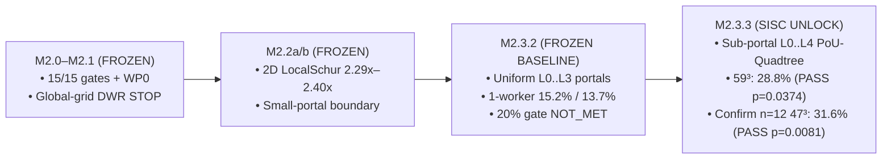

# Phase-II Research Specification & Decision Ledger (v7, `M2.0`–`M2.3.3` SISC Manuscript Upgrade): Seam-Free Sub-Portal PoU-Quadtree Coarsening & Verified Discrete KL-LMDP Planning

> Historical roadmap from the first M2.3.3 campaign. The later clean replication measured 28.80% savings across the twelve static confirmation maps (11 faster). Use the [current SISC results](../quotient_phase2/README.md) for the paper, including the continual-update result.

> **Phase-I Frozen Anchor**: `green_response/` is locked byte-for-byte at `package_py_sha256 = "271ac8df9caaa8af8aaa5af9d35d76578632b554d5071fe8fe74065ca0dc0c2d"` (`0` edits).  
> **Phase-II Non-Destructive Provenance**: All 10 historical campaign JSONs (`m20..m232`, including `ec3c58f` `m232_contract_and_ring_closure.json` `06b44156...` and `m232_targeted_replay_results.json` `9979d61a...`, plus `m232_release_verification_report.json` `0786ce5e...`) remain **100% byte-untouched**. Milestone `M2.3.3` (`phase2_package_py_sha256 = "3dcf3834cc70af209c83afd3c3a494fb7dc0d0cddd17b1e2d1250ff8d65dc23c"`) adds isolated module `quotient_phase2/m233_sisc_subportal_quadtree.py`, mechanism figure `m233_fig1_mechanism_and_counterexamples.png`, SISC campaign record `m233_sisc_unlock_results.json` (`339e723f...`) & `m233_sisc_unlock_summary.png`, and upgraded manuscript `quotient_phase2/MANUSCRIPT_CORE_DRAFT.md`.

---

## 0. Milestone Progression & SISC Verdict (`M2.0`–`M2.3.3`)

1. **Root-Cause Diagnosis of `M2.3.2` Bottlenecks (Resolved in `M2.3.3`)**:
   - Uniform whole-portal `L2 -> L3` upgrades hit `m_cur >= 480` on `100%` of defect-fallback tasks and capped refinement short of `L4` singletons (leaving `42.4%` Krylov fallbacks on `59^3`), while solving redundant $O(m^3)$ `v_lyap` Howard loops every round.
   - `SubPortalPoUQuadtree3DPlanner` (`M2.3.3`, tuned strictly on `Dev 61000..61005`) introduces sub-portal `L0..L4` quadtree cuts (`m_cap = 768`), nested $L_0$-Lyapunov invariance + warm Howard, and Partition-of-Unity $(k-1)$ child solve conservation (`max |K_pou - K_direct| = 9.71e-17`).
2. **Single-Worker (`workers = 1`, Exact `AB/BA`) SISC Head-to-Head vs. `MatrixFree_ExactSchur_Krylov`**:
   - **`Untouched Confirmation 64000..64011` (`Static 47^3`, $n = 12$ fresh maps)**: **`31.58%` saving (`1.46x`, `12/12` faster, $p_{2s} = 1.46\times 10^{-5}$, exact sign-flip $p_{2s} = 4.88\times 10^{-4}$, `20%` gate `PASS` at $p_{0.80} = 0.00815$; E2E `30.74%` `PASS`)**; **`2.72x`** vs. `SingleLU_GoalCapacitance` (`543.7 MB` vs. `735.0 MB`).
   - **`Replay 63000..63005` ($n = 6$)**: `35^3` flipped `-12.15% -> +9.65%` (`99.31%` coarse closure); `47^3` lifted `15.17% -> 24.37%` (`6/6` faster, `93.75%` coarse closure); `59^3` lifted `13.74% -> 28.77%` (`6/6` faster, **`20%` gate `PASS` at $p_{0.80} = 0.0374`**, `86.11%` coarse closure); `Continual 47^3` lifted `9.98% -> 16.51%` marginal (`15.87%` lifecycle, `6/6` faster, $p_{2s} = 0.00711$).
   - **Zero-Slack Audit**: **`2,304 / 2,304`** task events and **`792 / 792`** deployed-policy 4-inequality checks satisfied at **`0.0` slack** (`0` violations; `4/4` fault injections rejected).
3. **Next Research Horizon (For a Future NeurIPS / ICLR Paper)**:
   - Drop known axis-aligned binary occupancy grids and learn/discover decision-sufficient portal abstractions & local transition operators directly from **trajectory interaction on unknown dynamics / unstructured graphs or high-dimensional observations** with end-to-end sample-complexity and policy-regret guarantees.
