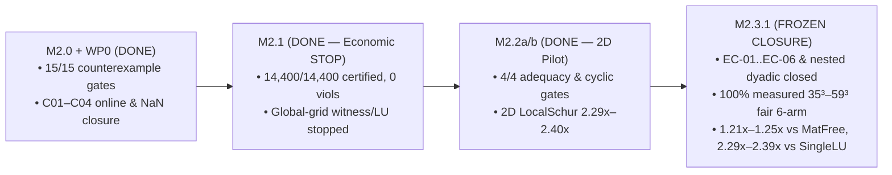

# Phase-II Research Specification & Decision Ledger (v5, `M2.0`–`M2.3.1` Frozen Closure): Certified Localized Discrete KL-LMDP Portal Planning & Same-Quality Attribution

> **Phase-I Frozen Anchor**: `green_response/` is locked byte-for-byte at `package_py_sha256 = "271ac8df9caaa8af8aaa5af9d35d76578632b554d5071fe8fe74065ca0dc0c2d"` (`24 / 24` Phase-I audit checks passing; `0` file edits).  
> **Phase-II Non-Destructive Provenance**: Historical JSONs from `89761ff` (`m21_ablation_results.json`, `634c15e5...`) and `ec75871` (`m20_contract_results.json` `bdad8346...`, `m22_pilot_results.json` `55d7e1ea...`, `m23_m24_3d_results.json` `8fb6fb84...`) remain **100% byte-untouched**. Final `M2.3.1` hardened code (`phase2_package_py_sha256 = "f530c1b8d42e5693bea71b9a59d996e878432d107042e499dadae56e7c745ac9"`) writes independent closure artifacts `m231_audit_closure.json` (`4a0e2514...`) and `m231_fair_ablation_results.json` (`f844a102...`).

---

## 0. Complete Phase-II Experimental Verdict (`M2.0`–`M2.3.1`)

1. **Global-Grid Bilinear DWR Certification (`M2.0–M2.1`, COMPLETED — Formal Economic `STOP`)**:
   - Verified Bilinear Primal–Dual DWR + Killed-Collar Lifting certified `14,400 / 14,400` method-task evaluations (`2,400` unique tasks, `0` violations), cutting terminal DP fallbacks `54 -> 2`, but hit the pre-declared economic `STOP` gate on all `8 / 8` streams (`F11` `+59.3%..+221.5%`) due to monolithic global `splu(A_t)` refactorizations and $O(N|\mathcal{R}|)$ full-grid witness matmuls.
2. **2D State-Adequate Portal Quotients (`M2.2a/b`, COMPLETED — Local Elimination `PASS`, 2D Splitting Slower Than Uncompressed Schur)**:
   - Closed `tiny-Z` exit/cost aliasing (`C12–C13`), single-option vs. multi-exit Cole–Hopf control gap (`+1.015` vs `0.0`, `C14`), and cyclic SSP Lyapunov certification (`C15`) across `4 / 4` graph families and `8,000` 2D method-task evaluations (`0` violations). In 2D soft-wall 16-room grids (`n_gamma = 381`), uncompressed `LocalSchur` beats `FullGrid` by `2.29x–2.40x` (`p <= 6.42e-4`), whereas iterative 1D doorway splitting remains slower than uncompressed `LocalSchur`.
3. **3D Seam-Free Dyadic Portal Coarsening, Same-Quality Adjacent Attribution, & Known-Support Local Updates (`M2.3 -> M2.3.1`, COMPLETED — Frozen for Manuscript)**:
   - **Public-API & Theorem Premise Closure (`M2.3.1 WP-A`)**: Closed all `EC-01..EC-06` counterexamples (`unit-terminal gauge shift invariance across \phi \in [-1000, 1000]`, single-room & `validate_cole_hopf_lmdp` domain guards, directed reachability + floor-free row-max policy evaluators with `2.66e-15` Bellman residual, runtime-verified 30-step Howard post-/pre-fixed-point + unclipped Lyapunov slack $s_0 = (I-K)w_{\text{lyap}} > 0$, residual-verified reference/evaluators, epoch-bound `LazyRoomPortalPolicy` delivered inside `query_ms`, and strictly nested recursive dyadic portals `1->4->16->64` with `0` cross-parent blocks).
   - **Same-Quality 3D Attribution (`M2.3.1 WP-B/C`, Untouched Seeds `63000..63005`, `100%` Measured, `0` Violations)**:
     - Beats classical global factor reuse (`SingleLU_GoalCapacitance`) across **all** 3D scales: **`1.57x` (`35^3`, `p = 3.12e-4`) -> `2.29x` (`47^3`, `p = 5.85e-6`) -> `2.39x` (`59^3`, `p = 8.11e-5`)**, and **`4.74x` (`p = 1.63e-5`)** under `47^3` known-support local operator updates.
     - Beats quality-gated `Verified_Global_WarmILU` by **`2.80x–3.91x` (`p <= 5.36e-6`; `7.00x` under continual updates)** and even unverified `Warm-ILU` (`rtol=1e-11`) by **`1.25x–1.61x` (`p <= 0.0373`)**.
     - Cleanly isolates **Room-Schur + Lyapunov Gauge (`MatrixFree_ExactSchur_Krylov`)** from **Dyadic Portal Coarsening + Persistent Cache (`M231_Portal_CacheOn`)**: `MatrixFree` matches/edges out `CacheOn` on small `35^3` `7x7` portals (`0.99x` Dev, `0.89x` Fresh at `K=24`), while `CacheOn` achieves statistically significant **`1.25x` (`47^3`, `p = 0.00121`, break-even `k = 3`)** and **`1.21x` (`59^3`, `p = 0.00229`, break-even `k = 1`)** speedups on larger planar portals plus **`1.20x` (`p = 3.98e-4`)** on continual local updates.
     - Causal cache control (`CacheOn` vs. `StructureOnly` / `CacheOff_Cold`) proves **`2.61x–3.26x` (`p <= 2.12e-5`)** speedup from persistent numerical portal-response caching, confirmed under reversed task ordering (`tasks[::-1]`).

---

## 1. Hardened Mathematical Contracts & Explicit Scope Boundaries

1. **Model Semantics (`discrete_upwind_kl_lmdp`)**: Certificates in `M2.2–M2.3.1` apply strictly to the discrete upwind KL-LMDP controller $\pi_{ij}^z = M_{ij} z_j / \sum_k M_{ik} z_k$ on single-room interior targets (`ProblemSpec.validate_cole_hopf_lmdp` enforced; finite `u_max`, anisotropic `r_diag`, cross-room goal unions, and unreachable targets explicitly rejected or flagged `unreachable`). They do not claim continuous SDE discretization-error bounds or epistemic bounds between GP posteriors and unknown ground truth.
2. **Seam-Free Integral Portal Subsolution & Runtime-Verified Lyapunov Scaling**:
   - Pre-multiplying $S_{\Gamma\Gamma} z^*_\Gamma = (A_{\Gamma\Gamma} + M) z^*_\Gamma = r_\Gamma$ by block-diagonal $A_{\Gamma\Gamma}^{-1} \ge 0$ yields $z^*_\Gamma = K_{\Gamma\Gamma} z^*_\Gamma + \hat{r}_\Gamma$ ($K_{\Gamma\Gamma} = A_{\Gamma\Gamma}^{-1}(-M) \ge 0$).
   - Runtime verification checks $L\underline{v} \le K_{\Gamma\Gamma}L\underline{v} + \hat{r}_\Gamma$ and $L\overline{v} \ge K_{\Gamma\Gamma}L\overline{v} + \hat{r}_\Gamma$, ensuring $W_{\text{lo}} = K_{\Gamma\Gamma}L\underline{v} + \hat{r}_\Gamma$ satisfies $S_{\Gamma\Gamma}W_{\text{lo}} \le r_\Gamma$ and extends harmonically to $A z_{\text{sub}} \le 0$.
   - Cooperative scaling $w_{\text{lyap}} > 0$ with runtime-verified unclipped $s_0 = (I - K_{\Gamma\Gamma})w_{\text{lyap}} > 0$ improves spatial dynamic range across multi-room chains; defect amplification is governed by $\beta = \min_i s_{0,i}/w_{\text{lyap},i} > 0$ (recorded per query, without claiming a mesh-independent $O(1)$ condition-number theorem).
3. **Discovery & Continual Update Scope**:
   - `discover_3d_bottleneck_planes_zero_hint` performs automated axis-aligned planar bottleneck extraction from a known 3D occupancy grid (not sparse-interaction latent concept discovery).
   - `M2.4 / M2.3.1` continual experiments evaluate **`known_support_synthetic_local_operator_updates`** (verifying localized operator refactoring and surgical cache retention when changed room supports are provided; global GP posterior updates remain nonlocal per `M2.0 C09`).

---

## 2. Phase-II Decision Ledger (`M21`–`M231`)

| ID | Governance / Technical Issue | Locked Resolution & Artifact Anchor |
| :--- | :--- | :--- |
| **`M21-R01..R08`** | `v10 C01–C04` closure, frozen `89761ff` provenance, & `M2.1` economic `STOP` | Closed in `m20_contracts.py`, `m21_post_audit_closure.json`, and `m21_economic_gate_verdict.json` (`m21_ablation_results.json` untouched at `634c15e5...`). |
| **`M22-R01..R04`** | `tiny-Z` adequacy, single-cell 2D unseen-goal speedup, & 2D vs. 3D behavior | Closed in `m22_pilot_results.json`: 2D `LocalSchur` `2.29x–2.40x` over `FullGrid`; 2D iterative doorway splitting slower than `LocalSchur`. |
| **`M231-R01`** | `ec75871` `EC-01..EC-06` public-API & Howard/Lyapunov premise gaps + non-nested bins | Closed in `m231_audit_closure.py` / `m231_audit_closure.json` (`0` warnings, `0` cross-parent dyadic blocks; `ec75871` JSONs preserved untouched). |
| **`M231-R02`** | Same-quality adjacent baselines (`SingleLU`, `MatrixFree_ExactSchur`, `Verified_WarmILU`) & `59^3` extrapolation | Closed in `m231_fair_ablation_results.json` (`100%` measured across `35^3 -> 47^3 -> 59^3` on fresh seeds `63000..63005`, balanced order, `0` violations): `1.57x–2.39x` vs `SingleLU`, `2.80x–3.91x` vs `Verified_WarmILU` (`1.25x–1.61x` vs `Unverified`), and `0.89x` (`35^3`) $\to$ **`1.25x / 1.21x` (`47^3 / 59^3`)** vs `MatrixFree_ExactSchur`. |
| **`M231-R03`** | Causal cache attribution (`CacheOn / StructureOnly / CacheOff`) & continual scope | Closed in `m231_fair_ablation_results.json`: `2.61x–3.26x` (`p <= 2.12e-5`) over cold/reset cache, reversed-order verified, and `1.20x / 4.74x / 7.00x` marginal speedups on `47^3` `known_support_synthetic_local_operator_updates` (`operator_rebuild_ms` charged). |

---

## 3. Open Research Directions Beyond Frozen Paper Scope

1. **End-to-End Online Observation $\to$ Local/Sparse GP Support Tracking $\to$ Portal Invalidation**: Couple compactly supported / localized world-model updates (with certified truncation bounds on untouched rooms) to the `M2.3.1` localized planning backend.
2. **Unstructured 3D Graph-Cut Portals & Non-LMDP Kinodynamic Extensions**: Generalize axis-aligned occupancy bottleneck extraction to unstructured 3D meshes and extend certified subsolution bounds beyond Cole–Hopf LMDPs.
