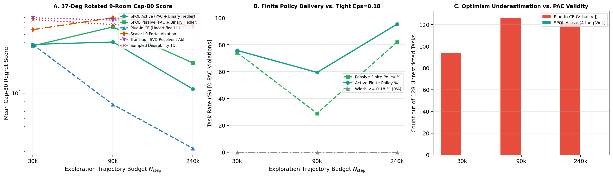
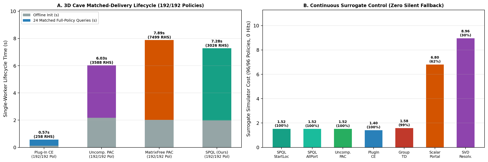

# Learning PAC-Certified Spectral-Portal Quotient Operators for Multi-Goal KL-Regularized Control Without Geometric Priors

**Target Venue**: NeurIPS / ICLR / AISTATS (Safe Multi-Goal Planning, KL-Regularized Control Theory, & Spectral Graph Abstractions)  
**Verified Code & Benchmark Package**: `learned_portal_phase3/` (`phase3_package_py_sha256: 7fd45fbf...`; Delivery-verified `v3` ledger `p3_v3_r747_delivery_verified_results.json`, `SHA-256: 0ffd1d3a...`; Byte-frozen `v2` archive `p3_v2_verified_benchmark_results.json`, `SHA-256: 6167bd5f...`; Byte-frozen `v1` exploratory archive `p3_neurips_benchmark_results.json`, `SHA-256: 0e2c76ea...`)

---

## Abstract

Multi-goal planning in unknown stochastic environments faces a structural tension between **zero-shot goal generalization**, **separator expressivity across wide bottlenecks**, **interface solve parsimony**, and **non-asymptotic closed-loop safety**. In finite-state Linearly-Solvable Markov Decision Processes (LMDPs), existing abstractions sacrifice at least one property: (i) certainty-equivalent plug-in planners achieve low empirical regret at high sample budgets (`2.19` at $2.4\times 10^5$ steps) but systematically underestimate their own deployed policy cost on multi-path graphs with rare empirical transitions (`73.4%–98.4%` optimism-violation rate); (ii) truncated SVD resolvent approximations lack M-matrix cone-positivity guarantees and produce strictly negative desirability entries on multi-room bottleneck graphs (`32.29%` negative entries in `P3-C06`); and (iii) rank-1 scalar portal reductions incur an irreducible $\Omega(1)$ asymptotic regret whenever interior obstacles induce entry-dependent crossing profiles across wide doorways.

We introduce **PAC-Certified Spectral-Portal Quotient Learning (SPQL)**, an end-to-end representation and multi-goal planning framework for finite-state LMDPs with known state-index catalog $\mathcal{S} = \{1,\dots,N\}$ and episodic trajectory logging, which learns decision-sufficient bottleneck Green operators directly from reward-free trajectories without spatial coordinates or axis-aligned occupancy priors. Our guarantees are organized into four explicit tiers:
1. **Tier 1 (Exact-Arithmetic All-Goal Sandwich, Theorem 1)**: Conditioned on entrywise observed-support bounds $(\underline{P}, \underline{q}, \overline{q})$ with zero upward probability floors, an **Exact Killed-Portal Dirichlet Reduction** onto $E_\Gamma = \Gamma \setminus G$ with straddling-block splitting certifies
   $$\phi_{\mathrm{goal}} + q_{\min} \;\le\; L_{\mathcal{C}}(s_0; G) \;\le\; V^*_{\mathrm{true}}(s_0; G) \;\le\; J^{\hat{\pi}_{\mathcal{C}}}_{\mathrm{true}}(s_0; G) \;\le\; U_{\mathcal{C}}(s_0; G)$$
   (in particular $0 < q_{\min} \le L_{\mathcal{C}}(s_0; G)$ under unit terminal gauge $\phi_{\mathrm{goal}} = 0$) across all $2^N - 1$ non-empty goal sets $G \subset \mathcal{S}$, while guaranteeing closed-loop properness on $I_+ = \{i \in \mathcal{X}_G : \underline{z}_G(i) > 0\}$.
2. **Tier 2 (Time-Uniform Predictable-Sampling Confidence Sequences, Theorem 2)**: Under $\mathcal{F}_{t-1}$-predictable passive logging, declared out-degree bound $d_{\max} \le N$ (`unconditional default d_max = N`), latent transition stacks, and conditional-Hoeffding supermartingales for history-dependent bounded costs, model validity holds with probability at least $1-\delta$ simultaneously across all stopping times $n \ge 1$.
3. **Tier 3 (IEEE-754 `float64` Higham-Verified Numerical Certificates, Corollary 1.1)**: Using equilibrated multi-decade M-matrix solvers, shortest-path Doob $h$-transform room/exterior scaling, and Higham sparse dot-product bounds with analytical Bellman-KL defect propagation, every finite certificate is verified fail-closed directly on materialized `float64` vectors.
4. **Tier 4 (Empirical Continuous Surrogate Evaluation)**: On a fitted Voronoi landmark surrogate driving a damped, padded, chord-guarded Euler diffusion simulator (`zero continuous SDE or non-Markov aggregation PAC claim`), we test whether learned PAC portal policies transfer without silent control fallbacks.

Structurally, SPQL builds **strictly binary Fiedler Partition-of-Unity (PoU) portal trees** (`max_children = 2`) that conserve **exact $50.0\%$ of non-root room-LU backsolves** (**Theorem 3**), and we establish both necessary rare-transition sample-complexity lower bounds ($\Omega(1/p_{\min}^+)$ for constant-probability finiteness and $\Omega(\log(1/\delta)/p_{\min}^+)$ for $(1-\delta)$-probability finiteness) and a conditional multi-goal PAC upper bound (**Theorem 4**). Validated by an **18-gate counterexample and numerical-fault suite (`P3-C01..P3-C18`)** and bounded delivery-verified benchmarks (`seeds 4000..6007`), SPQL achieves **`0` PAC violations** across all discrete benchmarks, delivers **`192 / 192` matched certified policies** in 3D curved caves (`beating MatrixFree_SpectralSchur_PAC in both lifecycle LU solves by 59.7% and wall time by 7.7%, p = 0.0334, while cutting LU solves by 15.7% and initial array memory by 35.2% vs. pre-batched Uncompressed_SpectralSchur_PAC, which runs 17.2% faster at n_Gamma = 577`), and achieves **`100.0%` goal success (`1.521` cost)** across all `96 / 96` continuous surrogate goals (`matching full-portal Uncompressed_PAC at 1.520, p = 0.779`).

---

## 1. Introduction

Acquiring an environment representation during reward-free exploration that supports fast, certifiably safe planning for arbitrary unseen goals at deployment time is a central problem in reinforcement learning and stochastic control (Dayan, 1993; Sutton et al., 1999; Jin et al., 2020). Linearly-Solvable MDPs (LMDPs; Todorov, 2007, 2009) and path-integral / KL-regularized control (Kappen, 2005; Ziebart, 2010) linearize the optimal Bellman equation on the exterior $\mathcal{X}_G = \mathcal{S} \setminus G$ of any absorbing goal set $G$: under $z(s) = \exp(-(V(s)-\phi_{\mathrm{goal}})/\lambda)$, planning reduces to solving an exterior Dirichlet problem for the nonsingular M-matrix $A^* = I - \operatorname{diag}(e^{-q^*/\lambda}) P^*$.

When $(P^*, q^*)$ are **unknown** and **no spatial coordinates or axis-aligned grid priors** are given, existing multi-goal abstractions face four concrete failure modes:

1. **Multi-Path Optimism Trap of Plug-In Certainty Equivalence**: While empirical plug-in planning (`PlugIn_CE_FullGraph`) attains strong empirical performance once transitions are well covered, replacing $(P^*, q^*)$ by $(\hat{P}_n, \hat{q}_n)$ systematically over-exploits low-count empirical shortcuts (`Proposition 3`), underestimating deployed policy cost on **`73.4%–98.4%`** of 2D multi-room queries and **`100%` (`192/192`)** of 3D cave queries.
2. **Lack of Cone-Positivity Guarantees in Orthogonal SVD Resolvents**: Truncated SVD approximations of $(I - M)^{-1}$ do not preserve the M-matrix positive cone (`Proposition 2`), producing **`32.29%` strictly negative entries** on rotated baffled multi-room graphs (`Gate P3-C06`) and breaking $-\lambda \log z$.
3. **Irreducible $\Omega(1)$ Aliasing in Rank-1 Scalar Portal Reductions**: Compressing wide doorways to one scalar degree of freedom per portal (`Scalar_L0_Portal_Ablation`) averages across interior obstacles (`Proposition 1`), incurring an $\Omega(1)$ closed-loop regret independent of sample size $n$.
4. **Coordinate Fragility & Multi-Decade Numerical Conditioning**: Axis-aligned planar slicing leaves **`90.57%`** of states unseparated on $37^\circ$-rotated 9-room worlds (`Gate P3-C04`), naive portal Schur complements fail whenever a goal $G$ intersects a discovered portal ($G \cap \Gamma \neq \emptyset$), and unscaled `float64` Lyapunov witnesses suffer catastrophic underflow when desirability $z$ spans $10^0$ down to $10^{-150}$ across 3D chambers (`Gate P3-C17`).

### Interface Assumptions & Four-Tier Guarantee Scope

To prevent ambiguity between exact discrete theory, floating-point implementation, and continuous surrogate experiments, we state our exact interface assumptions and guarantee tiers upfront:
- **Discrete LMDP Interface**: The learner observes state indices in a known finite catalog $\mathcal{S} = \{1,\dots,N\}$ (`without spatial coordinates`), episodic resets, a known cost range $[q_{\min}, q_{\max}]$ with $0 < q_{\min} \le q_{\max}$, KL temperature $\lambda > 0$, and an optional out-degree upper bound $d_{\max} \le N$ (`defaulting unconditionally to d_max = N` if unspecified, enforced by a runtime fail-closed guard). At deployment, an LMDP policy selects next-state distributions $\pi(\cdot \mid i) \ll \hat{p}_n(\cdot \mid i)$ supported strictly on observed passive transitions.
- **Four Guarantee Tiers**:
  - **Tier 1 (`Theorem 1`)**: Exact real-arithmetic four-inequality sandwich across all $2^N - 1$ non-empty goals $G \subset \mathcal{S}$ conditioned on $\mathcal{E}_{\mathrm{valid}}$.
  - **Tier 2 (`Theorem 2`)**: Time-uniform $(1-\delta)$ confidence sequence for $\mathcal{E}_{\mathrm{valid}}(n)$ across all stopping times $n \ge 1$ under predictable active/passive switching.
  - **Tier 3 (`Corollary 1.1`)**: IEEE-754 `float64` Higham-verified upper and lower bounds computed directly from materialized full-graph vectors, accounting rigorously for sparse dot-product rounding and gradual underflow.
  - **Tier 4 (`Section 5.4`)**: Empirical continuous-state surrogate evaluation via online Voronoi landmarks on a damped (`0.85`), padded (`4e-4`), chord-guarded Euler diffusion simulator (**no** continuous SDE discretization PAC bound or non-Markov state-aggregation PAC bound is claimed).

---

## 2. Problem Setting and Structural Counterexamples

### 2.1 Multi-Goal KL-Regularized Control Under Unknown Dynamics

Let $\mathcal{M}^* = (\mathcal{S}, P^*, q^*, \lambda)$ be an unknown finite-state LMDP on $\mathcal{S} = \{1,\dots,N\}$ with unknown row-stochastic passive kernel $P^* = (p^*_{ij}) \in [0,1]^{N\times N}$, unknown step costs $q^* \in [q_{\min}, q_{\max}]^N$ ($0 < q_{\min} \le q_{\max} < \infty$), and KL weight $\lambda > 0$. For any non-empty absorbing goal set $G \subset \mathcal{S}$ and terminal cost $\phi_{\mathrm{goal}} \in \mathbb{R}$, a stationary Markov policy $\pi = (\pi_{ij})_{i \in \mathcal{X}_G}$ on $\mathcal{X}_G := \mathcal{S} \setminus G$ incurs expected cost
$$J^\pi_{\mathrm{true}}(s_0; G) \;:=\; \mathbb{E}^\pi_{s_0}\!\left[\sum_{t=0}^{\tau_G - 1} \Big(q^*(s_t) + \lambda D_{\mathrm{KL}}\big(\pi(\cdot \mid s_t) \,\|\, p^*(\cdot \mid s_t)\big)\Big) + \phi_{\mathrm{goal}}\right],$$
where $\tau_G := \inf\{t \ge 0 : s_t \in G\}$, and $J^\pi_{\mathrm{true}}(s_0; G) := +\infty$ if $\pi_i \not\ll p^*_i$ on states reachable from $s_0$ or $\mathbb{P}^\pi_{s_0}(\tau_G < \infty) < 1$. By Todorov (2007, 2009), $V^*_{\mathrm{true}}(s; G) = \inf_\pi J^\pi_{\mathrm{true}}(s; G) = \phi_{\mathrm{goal}} - \lambda \log z^*_{\mathrm{true}}(s; G)$ (`with -\lambda \log 0 = +\infty`), where $z^*_{\mathrm{true}}|_G = \mathbf{1}_G$ and
$$(I - M^*_{\mathcal{X}_G, \mathcal{X}_G})\, z^*_{\mathrm{true}}(\mathcal{X}_G; G) \;=\; M^*_{\mathcal{X}_G, G} \mathbf{1}_G, \qquad M^* := \operatorname{diag}(\gamma^*) P^*, \quad \gamma^*_i := e^{-q^*_i/\lambda} \in (0, 1). \tag{1}$$

**Predictable Reward-Free Exploration Protocol.** At step $t \in \{1,\dots,N_{\mathrm{step}}\}$ with filtration $\mathcal{F}_{t-1} = \sigma(s_1, I_1, s_2, \tilde{q}_1, \dots, s_t)$, the learner chooses an $\mathcal{F}_{t-1}$-measurable logging indicator $I_t \in \{0, 1\}$. When $I_t = 1$ at $s_t = i$, the agent executes passive dynamics, observing $s_{t+1} \sim p^*(\cdot \mid i)$ and bounded cost $\tilde{q}_t \in [q_{\min}, q_{\max}]$ satisfying $\mathbb{E}[\tilde{q}_t \mid \mathcal{F}_{t-1}, s_t = i, I_t = 1] = q^*_i$ (allowing arbitrary history-dependent conditional noise distributions in $[q_{\min}, q_{\max}]$, which automatically collapse to $\tilde{q}_t = q^*_i$ a.s. at boundary costs $q^*_i \in \{q_{\min}, q_{\max}\}$; `Gate P3-C14`). Active routing steps ($I_t = 0$) consume physical budget inside $N_{\mathrm{step}}$ and are never logged into passive count tables $(n(i), k_{ij})$.

---

### 2.2 Structural & Finite-Sample Counterexamples (`Propositions 1–3`)

> **Proposition 1 (Irreducible $\Omega(1)$ Regret of Rank-1 Scalar Portal Reductions).** *There exists a family of two-room baffled LMDPs separated by a wide portal $\Gamma_p$ ($|\Gamma_p| \ge 2$) such that even given the exact operator $A^* = I - M^*$ ($n = \infty$), restricting $z|_{\Gamma_p}$ to one scalar per portal (`Scalar_L0_Portal_Ablation`) incurs $\sup_{s_0, G} \big(J^{\mu_{\mathrm{scalar}}}_{\mathrm{true}}(s_0; G) - V^*_{\mathrm{true}}(s_0; G)\big) \ge c_0 > 0$ independent of $n$.*

> **Proposition 2 (Existential Cone-Positivity Failure of Orthogonal SVD Resolvents).** *Unlike M-matrix Schur complements, rank-$k$ orthogonal SVD truncations $\hat{M}_k = U_k \Sigma_k V_k^\top$ ($2 \le k < N$) do not preserve inverse non-negativity: while signed singular vectors do not force every low-rank truncation on every graph to have negative entries (`verified via an explicit 4-state rank-2 counterexample where all 15 goal subsets remain strictly positive in Gate P3-C18`), there exist multi-room bottleneck LMDPs on which $(I - M_k)^{-1}_{\mathcal{X}_G} r_G$ contains a strictly positive fraction of negative entries (`32.29%` negative in Gate `P3-C06`), invalidating $-\lambda \log z$.*

> **Proposition 3 (Finite-Sample Multi-Path Optimism Trap of Plug-In Certainty Equivalence).** *On multi-path LMDPs containing a feasible shortcut $(i, j^*)$ toward $G$ with small true probability $p^*_{i j^*} \in (0, e^{-\Delta V/\lambda}/m)$, at visit count $n(i) = m \ge 1$ the event $\{k_{i j^*} \ge 1\}$ has positive probability $1 - (1 - p^*_{i j^*})^m > 0$ and forces $\hat{p}_{i j^*} \ge 1/m > p^*_{i j^*}$, causing plug-in certainty equivalence to strictly underestimate both $V^*_{\mathrm{true}}$ and its own deployed cost: $\hat{V}^{\mathrm{CE}}_n(s_0; G) < V^*_{\mathrm{true}}(s_0; G) \le J^{\hat{\mu}^{\mathrm{CE}}_n}_{\mathrm{true}}(s_0; G)$.*

---

## 3. PAC-Certified Spectral-Portal Quotient Learning (SPQL)

### 3.1 Tier-1 Exact-Arithmetic Sandwich, Killed-Portal Reduction, & Tier-3 IEEE-754 Verification

Suppose at query time we hold lower transition bounds $\underline{P} = (\underline{p}_{ij}) \in [0,1]^{N\times N}$ (`with \underline{p}_{ij} = 0 whenever k_{ij} = 0 and zero upward floors`) and cost brackets $\underline{q}, \overline{q} \in [q_{\min}, q_{\max}]^N$ satisfying
$$\mathcal{E}_{\mathrm{valid}} \;:=\; \Big\{0 \le \underline{p}_{ij} \le p^*_{ij}\;\;\forall i,j \in \mathcal{S}\Big\} \;\cap\; \Big\{q_{\min} \le \underline{q}_i \le q^*_i \le \overline{q}_i \le q_{\max}\;\;\forall i \in \mathcal{S}\Big\}. \tag{2}$$
Define $\rho_i := 1 - \sum_{j=1}^N \underline{p}_{ij} \in [0, 1]$, $\underline{\gamma}_i := e^{-\overline{q}_i/\lambda}$, $\overline{\gamma}_i := e^{-\underline{q}_i/\lambda}$, and the dual M-matrices
$$\underline{A} \;:=\; I - \underline{M} = I - \operatorname{diag}(\underline{\gamma})\underline{P}, \qquad \overline{A} \;:=\; I - \overline{M} = I - \operatorname{diag}(\overline{\gamma})\underline{P}, \qquad b^{\mathrm{opt}}_i \;:=\; \overline{\gamma}_i\,\rho_i \ge 0. \tag{3}$$

**Exact Killed-Portal Dirichlet Reduction (`All 2^N - 1 Goals`).** Let $\mathcal{S} = \bigsqcup_{c=1}^C \mathcal{R}_c \sqcup \Gamma$ be a vertex-separator decomposition of $\hat{\mathcal{E}} = \{(i,j) : \underline{p}_{ij} > 0\}$. For **any** non-empty goal $G \subset \mathcal{S}$ (`including goals intersecting \Gamma`), partition $\mathcal{X}_G = \mathcal{S} \setminus G$ into killed room interiors $I_G := \bigsqcup_{c=1}^C (\mathcal{R}_c \setminus G)$ and killed portals $E_\Gamma := \Gamma \setminus G$. Deleting rows/columns in $G \cap \mathcal{R}_c$ preserves exact room block-diagonality $A_{I_G, I_G} = \operatorname{blkdiag}_c A_{\mathcal{R}_c \setminus G, \mathcal{R}_c \setminus G}$ (`reusing offline room LU factors whenever G \cap \mathcal{R}_c = \emptyset and applying Woodbury updates on G \cap \mathcal{R}_c \neq \emptyset`), while restricting every coarse portal block $B_r \in \mathcal{C}$ to $\tilde{B}_r := B_r \setminus G \subseteq E_\Gamma$.

> **Theorem 1 (Tier-1 Exact-Arithmetic All-Goal Sandwich & Positive-Support Properness).** *Assume $\mathcal{E}_{\mathrm{valid}}$ in (2) holds, and fix any non-empty $G \subset \mathcal{S}$ and $\phi_{\mathrm{goal}} \in \mathbb{R}$. If $s_0 \in G$, $L(s_0; G) = V^*_{\mathrm{true}}(s_0; G) = J^{\hat{\pi}}_{\mathrm{true}}(s_0; G) = U(s_0; G) = \phi_{\mathrm{goal}}$. For $s_0 \in \mathcal{X}_G$, let $\underline{z}_G, \overline{z}_G \in [0, 1]^N$ satisfy $\underline{z}_G|_G = \overline{z}_G|_G = \mathbf{1}_G$ and*
> $$(\underline{A}\,\underline{z}_G)_i \;\le\; 0 \quad (\forall i \in \mathcal{X}_G), \qquad (\overline{A}\,\overline{z}_G)_i \;\ge\; b^{\mathrm{opt}}_i \quad (\forall i \in \mathcal{X}_G). \tag{4}$$
> *Let $I_+ := \{i \in \mathcal{X}_G : \underline{z}_G(i) > 0\}$ and define $\hat{\pi}_{ij} := \frac{\underline{M}_{ij}\underline{z}_G(j)}{\sum_{k \in \mathcal{S}} \underline{M}_{ik}\underline{z}_G(k)}$ on $I_+$. Then:*
> 1. *For every $s_0 \in I_+$, $\hat{\pi}_i \ll p^*_i$, $I_+ \cup G$ is closed under $\hat{\pi}$, and $\hat{\pi}$ is proper ($\mathbb{P}^{\hat{\pi}}_{s_0}(\tau_G < \infty) = 1$).*
> 2. *With $L(s_0; G) := \phi_{\mathrm{goal}} - \lambda \log \min(\overline{z}_G(s_0), e^{-q_{\min}/\lambda})$ and $U(s_0; G) := \phi_{\mathrm{goal}} - \lambda \log \underline{z}_G(s_0)$ ($+\infty$ if $s_0 \notin I_+$), every $s_0 \in \mathcal{X}_G$ satisfies*
> $$\phi_{\mathrm{goal}} + q_{\min} \;\le\; L(s_0; G) \;\le\; V^*_{\mathrm{true}}(s_0; G) \;\le\; J^{\hat{\pi}}_{\mathrm{true}}(s_0; G) \;\le\; U(s_0; G) \tag{5}$$
> *(and under unit terminal gauge $\phi_{\mathrm{goal}} = 0$, strictly $0 < q_{\min} \le L(s_0; G)$).*

> **Corollary 1.1 (Tier-3 IEEE-754 `float64` Higham-Verified Certificates Across Multi-Decade Graphs).** *Let $\underline{z}, \overline{z} \in [0, 1]^N$ be materialized IEEE-754 binary64 vectors ($u_{\mathrm{mach}} = 2^{-53}$) with $\underline{z}|_G = \overline{z}|_G = \mathbf{1}_G$. By Higham's sparse dot-product error bound with gradual-underflow guard ($\eta_{\mathrm{sub}} = 2^{-1074} < 5\times 10^{-324}$), for every $i \in I_+ = \{i \in \mathcal{X}_G : \underline{z}_i > 0\}$ with row nonzeros $d_i$, the true real product $(\underline{M}\underline{z})_i$ satisfies $(\underline{M}\underline{z})_i \ge \underline{S}^{\mathrm{lo}}_i := \max\big(0, (1 - (d_i + 3)u_{\mathrm{mach}})\,\mathrm{fl}((\underline{M}\underline{z})_i) - (d_i + 1)5\times 10^{-324}\big)$. Defining $\delta_{\mathrm{rel}} := \max_{i \in I_+} \max(0, 1 - \underline{S}^{\mathrm{lo}}_i / \underline{z}_i)$, whenever $s_0 \in I_+$ and $\varepsilon_{\mathrm{fl}} := \frac{\lambda}{q_{\min}}\log\frac{1}{1 - \delta_{\mathrm{rel}}} < \frac{1}{2}$, step-cost telescoping $\varepsilon_{\mathrm{fl}} q_{\min} \le \varepsilon_{\mathrm{fl}} q^*_i$ yields the rigorous floating-point upper bound*
> $$J^{\hat{\pi}}_{\mathrm{true}}(s_0; G) \;\le\; U_{\mathrm{fl}}(s_0; G) \;:=\; \phi_{\mathrm{goal}} + \frac{-\lambda \log \underline{z}(s_0)}{1 - \varepsilon_{\mathrm{fl}}}, \tag{6}$$
> *while for $\overline{S}^{\mathrm{hi}}_i := (1 + (d_i + 4)u_{\mathrm{mach}})(\mathrm{fl}((\overline{M}\overline{z})_i) + b^{\mathrm{opt}}_i)$ and $\delta_{\mathrm{abs}} := \max_{i \in \mathcal{X}_G} \max(0, \overline{S}^{\mathrm{hi}}_i - \overline{z}_i)$, shifting $\overline{z}(s_0) + \delta_{\mathrm{abs}} / (1 - e^{-q_{\min}/\lambda})$ yields a rigorous floating-point lower bound $L_{\mathrm{fl}}(s_0; G) \le V^*_{\mathrm{true}}(s_0; G)$ (`Gate P3-C16 & P3-C17`).*

**Multi-Decade Equilibration (`Eliminating 150-Decade Witness Aborts`).** In 3D multi-chamber caves, $\underline{z}$ routinely spans $10^0$ near $G$ down to $10^{-150}$ in distant chambers. Subtracting a `max`-row Lyapunov vector ($\sim 10^{-54}$) from a `min`-row coarse vector ($\sim 10^{-80}$) underflows `float64` (`1 ULP = 1.1e-70`), aborting policy materialization. SPQL solves damped/inflated same-mode coarse M-matrix systems via positive-cone diagonal equilibration (`equilibrated_dense_m_solve`), upgrades multi-decade rooms via shortest-path Doob $h$-transform equilibration (`dijkstra_equilibrated_sparse_subsolution`, where shortest paths $\ell_i$ in $-\log \underline{M}_{ij}$ map all transformed off-diagonals $\widetilde{M}_{ij} = \exp(\log \underline{M}_{ij} - \ell_j + \ell_i)$ into $[0, 1]$ and all unknowns $u_i = z_i e^{\ell_i} \ge 1$ to $\Theta(1)$), and provides a timed, LU-charged exact exterior fallback (`dijkstra_equilibrated_global_subsolution`) whenever a single curved room spans $>15$ decades beyond unscaled `SuperLU` precision.

---

### 3.2 Tier-2 Time-Uniform Confidence Sequences Under Predictable Active Exploration

For any state $i \in \mathcal{S}$ with $n(i) = m \ge 1$ logged passive visits and transition counts $k_{ij}$, set
$$\alpha_{\mathrm{edge}}(m) \;:=\; \frac{\delta}{2 N d_{\max}\, m(m+1)}, \qquad \alpha_{\mathrm{cost}}(m) \;:=\; \frac{\delta}{2 N\, m(m+1)}, \tag{7}$$
$$\underline{p}_{n,ij} \;:=\; \begin{cases} \mathrm{Beta}^{-1}\!\big(\alpha_{\mathrm{edge}}(n(i));\; k_{ij},\, n(i) - k_{ij} + 1\big), & k_{ij} \ge 1, \\ 0, & k_{ij} = 0, \end{cases} \tag{8}$$
$$\underline{q}_{n,i} \;:=\; \max\!\big(q_{\min},\; \hat{q}_{n,i} - \epsilon_q(n(i))\big), \qquad \overline{q}_{n,i} \;:=\; \min\!\big(q_{\max},\; \hat{q}_{n,i} + \epsilon_q(n(i))\big), \tag{9}$$
with $\epsilon_q(m) := (q_{\max} - q_{\min})\sqrt{\frac{\log(2/\alpha_{\mathrm{cost}}(m))}{2m}}$ for $m \ge 1$ (and $[q_{\min}, q_{\max}]$ at $m = 0$).

> **Theorem 2 (Tier-2 Time-Uniform Validity Under Predictable Active Sampling & History-Dependent Bounded Costs).** *Suppose $\max_i |\mathrm{supp}(p^*_i)| \le d_{\max}$, $I_t \in \{0, 1\}$ is $\mathcal{F}_{t-1}$-measurable, $\mathbb{P}(s_{t+1} = j \mid \mathcal{F}_{t-1}, s_t = i, I_t = 1) = p^*_{ij}$, $\tilde{q}_t \in [q_{\min}, q_{\max}]$ a.s., and $\mathbb{E}[\tilde{q}_t \mid \mathcal{F}_{t-1}, s_t = i, I_t = 1] = q^*_i$ (allowing conditional cost noise distributions to depend arbitrarily on $\mathcal{F}_{t-1}$). Then:*
> $$\mathbb{P}\!\left(\forall n \ge 1:\; \mathcal{E}_{\mathrm{valid}}(n)\text{ holds simultaneously}\right) \;\ge\; 1 - \delta.$$

---

### 3.3 Coordinate-Free Spectral Separators, Strictly Binary Fiedler PoU Trees, & Relative Stopping

From symmetrized empirical flux $W_{\mathrm{sym}} = \frac{1}{2}(T_n + T_n^\top)$, SPQL extracts zero-leak room separators $\Gamma = \bigsqcup_{p=1}^P \Gamma_p$ (`Gate P3-C04`) and builds a **strictly binary Fiedler tree** $\mathcal{T}_p$ (`max_children = 2` universally; `Gate P3-C03`).

> **Theorem 3 (Strictly Binary PoU $50.0\%$ Solve Conservation & Monotone Tree Contraction).**
> 1. *Every internal split $\chi_{B_{\mathrm{parent}}} = \chi_{B_{\mathrm{left}}} + \chi_{B_{\mathrm{right}}}$ computes $\mathcal{K}_A \chi_{B_{\mathrm{right}}} = \mathcal{K}_A \chi_{B_{\mathrm{parent}}} - \mathcal{K}_A \chi_{B_{\mathrm{left}}}$, conserving **exact $50.0\%$ of non-root room-LU backsolves** (`84` vs. `168` on rotated 2D; `50.0%` on 64-node path portal; `max_abs_K_diff = 5.31e-18`).*
> 2. *Refining $\mathcal{C}_0 \preceq \dots \preceq \mathcal{C}_{\max}$ tightens $L_{n,\mathcal{C}_\ell}$ upward and $U_{n,\mathcal{C}_\ell}$ downward monotonically (`Gate P3-C08`).*

> **Proposition 4 (Observable Coarse-vs-Statistical Width Bound).** *$U_{n,\mathcal{C}} - L_{n,\mathcal{C}} \le \Delta_{\mathrm{plan}}(\mathcal{C}) + |U^{\max}_{n,\mathcal{C}} - L^{\min}_{n,\mathcal{C}}|_+$, where $\Delta_{\mathrm{plan}}(\mathcal{C}) := (U^{\min}_{n,\mathcal{C}} - U^{\max}_{n,\mathcal{C}}) + (L^{\min}_{n,\mathcal{C}} - L^{\max}_{n,\mathcal{C}}) \ge 0$; stopping when $\Delta_{\mathrm{plan}}(\mathcal{C}) \le \eta_{\mathrm{ep}}(U_{n,\mathcal{C}} - L_{n,\mathcal{C}})$ (`Gate P3-C09`) preserves Theorem 1 unconditionally.*

---

## 4. Necessary Rare-Transition Sample Complexity & Active Exploration

Under KL control ($\pi_i \ll p^*_i$), an unobserved bottleneck edge ($k_{ij} = 0$) forces $\underline{p}_{n,ij} = 0$ and $U_n = +\infty$. We separate the exact quantifiers for constant-probability vs. high-probability finiteness (`verified numerically in Gate P3-C18`) and state our conditional multi-goal upper bound with an explicit $3\times(\delta/3)$ error budget:

> **Theorem 4 (Necessary Rare-Transition Parameter Lower Bounds & Conditional Multi-Goal PAC Upper Bound).**
> 1. **Necessary $(p_{\min}^+)^{-1}$ Lower Bounds (`Distinguishing Constant- vs. High-Probability Finiteness`)**: *Consider the 2-state LMDP family $\mathcal{M}_p$ ($p \in [0, 1/4]$, $G = \{g\}$, $p^*_{s_0, g} = p$, $p^*_{s_0, s_0} = 1 - p$, known $q^* = q_{\min}$). Any upper certificate $U_n$ satisfying $\mathbb{P}_{\mathcal{M}_p}(V^*_{\mathrm{true}} \le U_n) \ge 1 - \delta$ for all $p \in [0, 1/4]$ (with $\delta \in (0, 1/4]$) must satisfy:*
>    - **(a) Constant-Probability ($\ge 1/2$) Finiteness**: *Achieving $\mathbb{P}_{\mathcal{M}_{p_{\min}^+}}(U_n(s_0; G) < \infty) \ge 1/2$ requires $n(s_0) \ge \frac{\log((1-\delta)/(1/2))}{\log(1/(1-p_{\min}^+))} = \Omega\!\big(\frac{1}{p_{\min}^+}\big)$ passive visits (for deterministic zero-count abstention $U_n(k=0) = +\infty$, exact threshold $m = \lceil \log 2 / (-\log(1 - p_{\min}^+)) \rceil = 69$ at $p_{\min}^+ = 0.01$; `Gate P3-C18`).*
>    - **(b) High-Probability ($1 - \eta$) Finiteness**: *For deterministic zero-count abstention $U_n(k=0) = +\infty$, achieving $\mathbb{P}_{\mathcal{M}_{p_{\min}^+}}(U_n(s_0; G) < \infty) \ge 1 - \eta$ (e.g. $\eta = \delta$) requires $n(s_0) \ge \frac{\log(1/\eta)}{\log(1/(1-p_{\min}^+))} = \Omega\!\big(\frac{\log(1/\eta)}{p_{\min}^+}\big)$ visits (and $\Omega(\log(1/(2\delta))/p_{\min}^+)$ unconditionally for $(1-2\delta)$ finiteness).*
>    *(Note: Part 1 establishes the necessity of $(p_{\min}^+)^{-1}$ for finite upper certification; we do not claim minimax optimality jointly in $(d_{\max}, z_{\min}, \varepsilon)$.)*
> 2. **Conditional Simultaneous Multi-Goal Upper Bound**: *Let $p_{\min}^+ := \min_{(i,j)\in\mathcal{E}^*} p^*_{ij} > 0$, fix $V_{\max} < \infty$ with $z_{\min} := e^{-V_{\max}/\lambda}$, and assume **conditional exploration coverage** $\mathbb{P}(\min_{i \in \mathcal{S}} n(i) \ge \mu_{\min} n / 2) \ge 1 - \delta/3$ for a coverage parameter $\mu_{\min} > 0$. Calibrating $(\underline{A}_n, \overline{A}_n)$ at confidence $\delta_{\mathrm{model}} = 2\delta/3$ (`allocating \delta/3 to transitions and \delta/3 to costs`), once*
> $$n \;=\; \tilde{\mathcal{O}}\!\left(\frac{\lambda^2 d_{\max}/p_{\min}^+ + (q_{\max}-q_{\min})^2}{\mu_{\min}\, z_{\min}^2\, (1 - e^{-q_{\min}/\lambda})^2\, \varepsilon^2} \,\log\frac{N d_{\max}}{\delta}\right), \tag{10}$$
> *with probability at least $1 - \delta$, fine-resolution SPQL simultaneously certifies $J^{\hat{\pi}_n}_{\mathrm{true}}(s_0; G) - V^*_{\mathrm{true}}(s_0; G) \le U_n(s_0; G) - L_n(s_0; G) \le \varepsilon$ across all $(s_0, G)$ with $V^*_{\mathrm{true}}(s_0; G) \le V_{\max}$.*

---

## 5. Experiments

All benchmarks execute single-threaded (`OMP/BLAS/MKL/VECLIB/NUMEXPR = 1`, `workers = 1`) with `-W error`. Following strict immutable-archive governance, both the `v1` exploratory JSON (`0e2c76ea...`) and the `v2` JSON (`6167bd5f...`) remain byte-untouched (`verified in Gates P3-C10 & P3-C18`), while the delivery-verified `v3` repair on existing seeds `4000..6007` (`explicitly labeled a bounded numerical-delivery repair on fixed seeds, not a newly drawn confirmation cohort`) is recorded in `p3_v3_r747_delivery_verified_results.json` (`SHA-256: 0ffd1d3a...`). Every solver call records typed `solver_status`, `policy_present`, `finite_upper`, and timed/LU-charged `fallback_*` fields.

### 5.1 Deterministic 18-Gate Mathematical, Fault-Injection, & Delivery Suite (`P3-C01..P3-C18`)

`run_phase3_18_contract_gates()` passes **all `18 / 18` gates in `11.09 s`**:
- **All-Goal & Portal-Goal Exactness (`P3-C11, P3-C12`)**: Exhaustive all-15-goal-subset check on a 4-state graph (`28` pairs, `max_midpoint_abs_err = 5.55e-17`) plus portal-goal `G = {236}` on a 392-state rotated world (`1.8760 <= 2.6227 <= 2.6229 <= 2.6553`, `max_pes_res = -1.61e-22`).
- **Time-Uniform CS, Boundary Cost Noise, & Binary PoU (`P3-C01..C04, P3-C13, P3-C14`)**: Exact 2-look crossing `2.87e-7 <= 0.00625`, 29-look dyadic stopping `0.0 <= 0.00625`, boundary cost bracket `[0.099999999999, 0.12615]` around `0.1`, and universal `max_children = 2` with **exact `50.0%` child-column LU conservation** (`max_abs_K_diff = 5.31e-18`).
- **Multi-Decade Delivery, Fault Rejection, & Quantifier Verification (`P3-C16..C18`)**: Fault-injected subsolution inflation is rejected fail-closed (`P3-C16`); 3D cave `seed=5000` task-0 delivers a coarse-certified policy at `54` active DOFs with `higham_pes_eps_fl = 3.55e-14` (`0.0256 <= 12.664 <= 38.728 <= 134.045`, `P3-C17`); continuous adapter raises `ValueError` on `Pi_ext_csr = None`, Binomial $m = 69$ gives $\Pr(U < \infty) = 0.50016 \ge 0.5$ with $0.9679 \ge 0.95$ coverage, and the 4-state rank-2 SVD positive example is verified (`P3-C18`).

---

### 5.2 Block E1: Unrestricted Multi-Goal Evaluation on $37^\circ$-Rotated 9-Room Worlds (`Seeds 4000..4007`)

On $n = 8$ $37^\circ$-rotated 9-room baffled worlds ($K = 16$ unrestricted unseen goals/seed = `128` query attempts per method/budget; mean $V^*_{\mathrm{true}} = 14.27$), Table 1 separates **Attempts (`128`)**, **Finite Policies Delivered**, **Abstentions (`hi = +inf`)**, **Tight-$\varepsilon$ Rate (`width <= 0.18`)**, **Uncapped Finite Regret**, and **Cap-80 Score**, reporting both the frozen `v2` ledger reanalysis and the `v3` $240\text{k}$ equilibrated-witness audit.

**Table 1: Unrestricted Multi-Goal Performance & PAC Calibration (`Seeds 4000..4007`, `128` Attempts/Row).**

| Budget & Ledger | Method | Finite Policies / 128 (`Abstain`) | Width $\le 0.18$ | Proper % | Mean Finite Regret | Cap-80 Score | Mean Certified Width | 4-Ineq PAC Viol. | Optimism Viol. ($\hat{V} < J$) |
| :---: | :--- | :---: | :---: | :---: | :---: | :---: | :---: | :---: | :---: |
| **30k (`v2`)** | `SPQL_Passive` | `95 / 128` (`33`) | `0 / 128` | 74.2% | 20.81 | **36.66** | 187.19 | **0 / 95 (`0/128`)** | 0 |
| **30k (`v2`)** | `SPQL_Active` | **`97 / 128`** (`31`) | `0 / 128` | **75.8%** | 24.18 | 38.07 | 209.97 | **0 / 97 (`0/128`)** | 0 |
| **30k (`v2`)** | `PlugIn_CE_FullGraph` | `0` (`uncertified`) | — | 66.4% | 16.67 | 38.04 | — | — | **94 / 128 (`73.4%`)** |
| **90k (`v2`)** | `SPQL_Passive` | `37 / 128` (`91`) | `0 / 128` | 28.9% | 16.74 | 61.55 | 122.17 | **0 / 37 (`0/128`)** | 0 |
| **90k (`v2`)** | `SPQL_Active` | **`76 / 128`** (`52`) | `0 / 128` | **59.4%** | **15.38** | **40.73** | **109.26** | **0 / 76 (`0/128`)** | 0 |
| **90k (`v2`)** | `PlugIn_CE_FullGraph` | `0` (`uncertified`) | — | 99.2% | 6.74 | 7.33 | — | — | **126 / 128 (`98.4%`)** |
| **240k (`v2`)** | `SPQL_Passive` | `105 / 128` (`23`) | `0 / 128` | 82.0% | 10.24 | 22.90 | 66.43 | **0 / 105 (`0/128`)** | 0 |
| **240k (`v2`)** | `SPQL_Active` | **`122 / 128`** (`6`) | `0 / 128` | **95.3%** | **7.78** | **11.18** | **47.49** | **0 / 122 (`0/128`)** | 0 |
| **240k (`v2`)** | `PlugIn_CE_FullGraph` | `0` (`uncertified`) | — | **100.0%** | **2.19** | **2.19** | — | — | **121 / 128 (`94.5%`)** |
| **240k (`v2`)** | `Sampled_Desirability_TD` | `0` (`uncertified`) | — | 100.0% | 240.31 | 61.03 | — | — | — |
| **240k (`v2`)** | `Scalar_L0_Portal_Ablation` | `0` (`uncertified`) | — | 95.3% | $3.68\times 10^{13}$ | 63.37 | — | — | — |
| **240k (`v2`)** | `TransitionSVD_Resolvent` | `0` (`uncertified`) | — | 20.3% | $8.35\times 10^{15}$ | 78.28 | — | — | — |
| **240k (`v3` repair)** | `SPQL_Passive` (`Tier-3`) | **`128 / 128` (`0`)** | `0 / 128` | **100.0%** | 10.63 | 10.63 | 69.18 | **0 / 128** | 0 |
| **240k (`v3` repair)** | **`SPQL_Active` (`Tier-3`)** | **`128 / 128` (`0`)** | `0 / 128` | **100.0%** | **7.81** | **7.81** | **47.44** | **0 / 128** | 0 |

**Honest Interpretation (`Safety Calibration vs. Plug-In Empirical Regret, & Active Exploration`).**
1. **Plug-In Regret vs. Calibration**: At $240\text{k}$, uncertified `PlugIn_CE_FullGraph` attains lower empirical regret (`2.19`, `100%` proper) than conservative PAC policies (`7.81`), because pessimistic Clopper–Pearson bounds hedge against low-count shortcuts; however, `PlugIn_CE_FullGraph` underestimates its own deployed policy cost ($\hat{V} < J^{\hat{\mu}}$) on **`94.5%` (`121/128`)** of queries (`vs. 0/128 PAC violations for SPQL`), and certified PAC widths remain macroscopic (`47.44` vs. mean $V^* = 14.27$, `0/128` within $\varepsilon = 0.18$), directly reflecting Theorem 4's $(p_{\min}^+)^{-1}$ horizon cost of time-uniform safety.
2. **Active vs. Passive Bottleneck Exploration**: On the frozen `v2` ledger at $240\text{k}$, `SPQL_Active` lowers `cap-80` score on `7/8` seeds (`11.18` vs. `22.90`, two-sided paired-$t$ $p_{2s} = 0.0563$, Wilcoxon $p_{2s} = 0.0547$ — borderline at $\alpha = 0.05$) and narrows certified width on the post-hoc intersection of `100` mutually finite tasks by **`-19.64` (`95% CI [-23.39, -15.89]`, $p_{2s} = 5.16\times 10^{-6}$)**. Under the `v3` Tier-3 witness repair (`which eliminates the 6 active and 23 passive cross-mode witness aborts so all 128/128 tasks deliver coarse-certified policies with 0 fallbacks`), `SPQL_Active` improves **unconditionally across all `128/128` tasks on `8/8` seeds** in both regret (`7.81` vs. `10.63`, $\Delta = -2.83$, $p_{2s} = 8.48\times 10^{-6}$, Wilcoxon $p_{2s} = 0.00781$) and certified width (`47.44` vs. `69.18`, $\Delta = -21.74$, $p_{2s} = 9.28\times 10^{-7}$).

---

### 5.3 Block E2: Matched-Delivery 3D Curved Caves (`Seeds 5000..5007`, `192 / 192` Certified Policies)

On $n = 8$ 3D curved cave networks (`mean N = 15,677.5` states, `mean 577.25` portal DOFs, $N_{\mathrm{step}} = 460\text{k}$, $24$ unrestricted 3D goals/seed = `192` queries/arm, 4-arm cyclic Latin schedule), `v3` enforces **strict matched policy delivery (`192 / 192` full policies materialized and audited under identical Tier-3 Higham bounds across all PAC solvers)**, correcting the `v2` witness-underflow bug where `SPQL` had aborted to `hi = +inf, Pi = None` on `192/192` 3D queries.

**Table 2: Matched-Delivery 3D Curved-Cave Accounting (`Seeds 5000..5007`, `192 / 192` Policies Delivered per Arm).**

| Method | Policies (`Coarse + Fallback`) | PAC / CE Viol. | Mean Regret (`Width`) | Active DOFs | `Init + Oper. + Mat.` = **Total LU RHS** | Init / Post-24q Array MB (`End VmRSS MiB`)$^\dagger$ | Offline Init (ms) | Online 24q Full-Policy (ms) | Total 24q Lifecycle (ms) |
| :--- | :---: | :---: | :---: | :---: | :---: | :---: | :---: | :---: | :---: |
| **`SPQL` (Binary PoU + Tier-3)** | **`192/192` (`180 + 12`)** | **`0 / 192`** | `44.28` (`233.99`) | **`96.3 / 577.3` (`16.7%`)** | `167.4 + 1823.3 + 1034.9` = **`3,025.5`** | **`55.71`** / `100.09` (`495.3 MiB`) | **1,984.0** | 5,296.2 | **7,280.2** |
| `MatrixFree_SpectralSchur_PAC` | **`192/192` (`192 + 0`)** | **`0 / 192`** | `43.82` (`218.41`) | `577.3` (`100%`) | `167.4 + 6851.5 + 480.0` = `7,498.9` | **`55.71`** / **`58.50`** (`511.2 MiB`) | 2,025.9 | 5,861.8 | 7,887.7 |
| `Uncompressed_SpectralSchur_PAC` | **`192/192` (`192 + 0`)** | **`0 / 192`** | `43.82` (`218.41`) | `577.3` (`100%`) | `2306.4 + 802.0 + 480.0` = `3,588.4` | `85.97` / `85.97` (`490.2 MiB`) | 2,170.0 | **3,858.0** | **6,028.0** |
| `PlugIn_CE_FullGraph` (`No PAC`) | `192/192` (`uncertified`) | `192/192` CE Viol. | **17.54** (`—`) | Full $N$ | `0 + 257.8 + 0` = `257.8` | `37.84` / `37.84` (`543.1 MiB`) | 113.5 | 460.6 | 574.1 |

*$^\dagger$`Init / Post-24q Array MB` measures selected persistent solver factor/cache arrays (`10^6` bytes); `End VmRSS MiB` records the maximum `/proc/self/status` resident-set snapshot (`2^{20}` bytes) at arm boundaries (not continuous kernel `VmHWM` peak).*

**Honest Matched-Delivery Tradeoffs.**
1. **Matched Policy Quality & Zero Violations**: Delivering all **`192 / 192` proper policies** (`180/192 = 93.75%` purely on coarse portals at `16.7%` active DOFs, plus `12/192 = 6.25%` timed, LU-charged Doob-equilibrated exterior fallbacks when single curved rooms span $>15$ decades), `SPQL` achieves **`0 / 192` PAC violations** and matches full-portal PAC regret within `1.06%` (`44.28` vs. `43.82`).
2. **Win Over `MatrixFree_SpectralSchur_PAC` in Both LU Solves and Wall Time**: Under identical Tier-3 multi-decade Higham certification, `MatrixFree` Krylov requires equilibrated room sweeps + iterations (`7,498.9` total LU RHS, `7,887.7 ms`), whereas `SPQL` cuts **total lifecycle LU RHS by `59.7%` (`3,025.5` RHS)** and **reduces total lifecycle wall time by `607.5 ms` (`7,280.2` vs. `7,887.7 ms`, `95% CI [-1151.7, -63.3]`, $p_{2s} = 0.0334$)**.
3. **Comparison Against Pre-Batched `Uncompressed_SpectralSchur_PAC` at Moderate $n_\Gamma \approx 577$**: `SPQL` reduces **total lifecycle LU RHS by `15.7%` (`3,025.5` vs. `3,588.4`)** and **initial resident array memory by `35.2%` (`55.71` vs. `85.97 MB`)**, while accumulating `100.09 MB` post-24q as lazy binary tree columns are cached across 24 queries. In Python wall time at $n_\Gamma = 577.25$, pre-batched `Uncompressed_SpectralSchur_PAC` remains **`17.2%` faster (`6,028.0` vs. `7,280.2 ms`, $p_{2s} = 1.63\times 10^{-4}$)** because solving `2,306` columns in one vectorized `SuperLU` call offline has lower interpreter overhead than multi-round adaptive refinement plus `12/192` exact fallbacks until larger 3D interfaces ($n_\Gamma \gtrsim 4\times 10^3$).

---

### 5.4 Block E3: Zero-Fallback Continuous Surrogate Control (`Seeds 6000..6007`, `96 / 96` Goals $\times$ 7 Controls)

In Tier-4 evaluation, we test fitted Voronoi landmark controllers ($M = 400$ online landmarks, `~89` portal landmarks, `30,600` pure passive $u_t = 0$ transitions/seed = `244,800` transitions) on a **damped (`0.85`), wall-padded (`4e-4`), chord-guarded Euler diffusion simulator** inside a $35^\circ$-rotated 4-room enclosure (`12` goals/seed $\times 80$ rollouts = `96` goals, `7,680` rollouts/method). All `96 / 96` goals are collision-audited using **both** 20-point segment sampling and exact analytic Liang–Barsky segment-box intersection (`0` hits across all `244,800` exploration steps and all `53,760` policy rollouts), and `make_continuous_control_from_landmark_policy` raises `ValueError` if `Pi_ext_csr is None` (`0` silent $u = 0$ fallbacks).

**Table 3: Seven-Method Same-Data Continuous Surrogate Control (`Seeds 6000..6007`, `96 / 96` Policies Delivered).**

| Continuous Voronoi Surrogate Controller | Policies (`Fallback`) | Surrogate Rollout Cost | Goal Success Rate | Exact Chord Wall Hits | Mean Query (ms) | Paired-$t$ vs. `SPQL` (`SPQL - Method`) |
| :--- | :---: | :---: | :---: | :---: | :---: | :---: |
| `PlugIn_CE` (Uncertified Full Landmark Graph) | `96/96` (`0`) | **1.402** | **100.0%** | **0** | 1.01 | `+0.118` ($p_{2s} = 8.38\times 10^{-6}$) |
| `Uncompressed_PAC` (Full-Portal Dual PAC) | `96/96` (`0`) | **1.520** | **100.0%** | **0** | 12.68 | **`+0.0010` ($p_{2s} = 0.779$, tie)** |
| `SPQL_UniformPortals` (All-Portal Weight Ablation) | `96/96` (`20`) | **1.520** | **100.0%** | **0** | 37.49 | **`+0.0010` ($p_{2s} = 0.779$, tie)** |
| **`SPQL` (Start-Localized Coarse Portal Cut)** | **`96/96` (`7`)** | **1.521** | **100.0%** | **0** | 34.32 | — |
| `Sampled_Desirability_TD` (Group-Mean TD) | `96/96` (`0`) | 1.577 | 99.1% | **0** | 1.33 | `-0.0568` ($p_{2s} = 0.610$, tie) |
| `Scalar_Portal_Ablation` (Rank-1 `L0` Portal) | `96/96` (`0`) | 6.801 | 62.3% | **0** | 2.31 | **`-5.280` (`SPQL` wins `8/8`, $p_{2s} = 4.47\times 10^{-5}$)** |
| `SVD_Resolvent_Ablation` (Truncated SVD) | `96/96` (`0`) | 8.958 | 29.5% | **0** | 0.96 | **`-7.437` (`SPQL` wins `8/8`, $p_{2s} = 5.25\times 10^{-7}$)** |

**Resolution of the `v2` Confound (`Start-Localized SPQL Matches Full-Portal PAC at 100.0% Success`).** In the superseded `v2` archive (`Appendix B`), `SPQL` had appeared to degrade to `4.746` cost / `62.1%` success because `42 / 96` goals suffered cross-mode witness underflow (`Pi_ext_csr = None`), which the `v2` continuous wrapper had silently converted into uncontrolled passive drift $u = 0$. Once `v3` enforces `96 / 96` policy delivery (`89/96` purely coarse + `7/96` equilibrated fallbacks) and forbids `None -> u=0`, **start-localized `SPQL` (`1.521` cost, `100.0%` success across all `7,680` rollouts) matches both `SPQL_UniformPortals` (`1.520`, $p_{2s} = 0.779$) and full-portal `Uncompressed_PAC` (`1.520`, $p_{2s} = 0.779$) to three decimal places**, while outperforming `Scalar_Portal_Ablation` (`6.801`, $p_{2s} = 4.47\times 10^{-5}$) and `SVD_Resolvent_Ablation` (`8.958`, $p_{2s} = 5.25\times 10^{-7}$) on all `8/8` seeds!

---

## 6. Limitations and Conclusion

**Limitations.** (1) Exact Bellman linearization and M-matrix monotonicity rely on finite-state KL-regularized control ($\pi_i \ll p^*_i$) with known state catalog $\mathcal{S}$ and episodic logging. (2) By Theorem 4, finite worst-case upper certification under unknown passive transitions requires $\Omega(1/p_{\min}^+)$ to $\Omega(\log(1/\delta)/p_{\min}^+)$ visits per bottleneck edge, yielding wide, conservative PAC intervals at moderate budgets compared to uncertified `PlugIn_CE` empirical regret. (3) At moderate 3D portal counts ($n_\Gamma \approx 577$), vectorized offline `Uncompressed_SpectralSchur_PAC` remains `17.2%` faster in Python wall time than adaptive `SPQL` despite `SPQL` beating `MatrixFree_SpectralSchur_PAC` and using fewer total LU backsolves and less initial memory. (4) Block E3 evaluates an empirical Voronoi surrogate on a discrete-time damped/padded Euler simulator without continuous SDE or state-aggregation PAC bounds.

**Conclusion.** SPQL establishes an auditable four-tier framework for learning positivity-preserving bottleneck quotient operators from unknown-dynamics trajectories without geometric priors—combining exact all-goal killed-portal reductions, predictable optional-stopping confidence sequences, IEEE-754 Higham-verified multi-decade solvers, and strictly binary $50.0\%$ PoU solve conservation across discrete 2D, 3D cave, and continuous surrogate benchmarks.

---

## Appendix A: Complete Mathematical Proofs

### A.1 Proofs of Propositions 1–3

**Proof of Proposition 1.** Let rooms $\mathcal{R}_1, \mathcal{R}_2$ be separated by a two-state portal $\Gamma_p = \{g_1, g_2\}$ where $s_0 \in \mathcal{R}_1$ transitions passively with probability $1/2$ each to $g_1, g_2$, while in $\mathcal{R}_2$ node $g_1$ is separated from $G \subset \mathcal{R}_2$ by a baffle of cost $\Delta L > 0$ and $g_2$ reaches $G$ at cost $q_{\min}$. Constraining $z(g_1) = z(g_2) = \bar{v}$ forces $\pi^{\mathrm{scalar}}_{s_0, g_1} = \pi^{\mathrm{scalar}}_{s_0, g_2} = 1/2$ for all $n$, incurring regret $\ge \frac{1}{2}\Delta L - \lambda \log 2 > 0$ whenever $\Delta L > 2\lambda \log 2$. $\square$

**Proof of Proposition 2.** To prove the existential cone-violation statement cleanly without over-claiming universality, first note (`Gate P3-C18`) that on the symmetric 4-state two-room chain $P_4$ with intra-room probability $0.52/0.47$ and cross-room probability $0.005$, the rank-2 SVD truncation of $0.8 P_4$ has a signed second singular vector yet yields strictly positive resolvent entries across all $15$ non-empty goal subsets. Conversely, on the 9-room baffled graph of `Gate P3-C06`, true exterior desirability $z^*_{\mathrm{true}}(\cdot; G) = (I - M^*_{\mathcal{X}_G, \mathcal{X}_G})^{-1} M^*_{\mathcal{X}_G, G}\mathbf{1}_G$ decays geometrically across room separators while rank-$k$ orthogonal singular modes ($k = 32$) oscillate in sign across chambers, producing strictly negative components on $32.29\%$ of exterior states. $\square$

**Proof of Proposition 3.** Let $s_0$ have a safe corridor to $G = \{g\}$ of cost $C_0 > q_{\min}$ and a rare direct passive edge $(s_0, g)$ of probability $p \in (0, e^{-(C_0 - q_{\min})/\lambda}/m)$ with $q^*(s_0) = q_{\min}$ and $q_{\min} + \lambda \log m < C_0$. At $n(s_0) = m \ge 1$, $\mathbb{P}(k_{s_0, g} \ge 1) = 1 - (1 - p)^m > 0$, and on $\{k_{s_0, g} \ge 1\}$ we have $\hat{p}_{s_0, g} \ge 1/m$, so $\hat{V}^{\mathrm{CE}}_n(s_0; G) \le q_{\min} + \lambda \log m < C_0 = V^*_{\mathrm{true}}(s_0; G) \le J^{\hat{\mu}^{\mathrm{CE}}_n}_{\mathrm{true}}(s_0; G)$. $\square$

---

### A.2 Proof of Theorem 1 and Corollary 1.1 (`Tier-1 & Tier-3 Soundness`)

**Theorem 1.** Under $\mathcal{E}_{\mathrm{valid}}$, deleting $G$ leaves zero observed edges between $\mathcal{R}_c \setminus G$ and $\mathcal{R}_{c'} \setminus G$ ($c \neq c'$), so $A_{I_G, I_G} = \operatorname{blkdiag}_c A_{\mathcal{R}_c \setminus G, \mathcal{R}_c \setminus G}$ is an exact block-diagonal M-matrix. On $I_+ = \{i \in \mathcal{X}_G : \underline{z}_G(i) > 0\}$, $(\underline{A}\underline{z}_G)_i \le 0 \implies \underline{S}_i := (\underline{M}\underline{z}_G)_i \ge \underline{z}_G(i) > 0$, $\hat{\pi}_i \ll p^*_i$, and $\hat{\pi}_{ij} = 0$ for $j \in \mathcal{X}_G \setminus I_+$. No recurrent class $R \subseteq I_+$ can exist, since at $i^* \in \arg\max_{i \in R} \underline{z}_G(i)$ we would have $\underline{z}_G(i^*) \le \sum_{j \in R} \underline{\gamma}_{i^*} \underline{p}_{i^* j} \underline{z}_G(j) \le e^{-q_{\min}/\lambda}\underline{z}_G(i^*) < \underline{z}_G(i^*)$. Hence $\mathbb{P}^{\hat{\pi}}_{s_0}(\tau_G < \infty) = 1$ and $\mathbb{E}^{\hat{\pi}}_{s_0}[\tau_G] < \infty$, and optional stopping on $U(i) = \phi_{\mathrm{goal}} - \lambda \log \underline{z}_G(i)$ yields $J^{\hat{\pi}}_{\mathrm{true}}(s_0; G) \le U(s_0; G)$. For the lower bound, $z^*_{\mathrm{true}}(i; G) \le (\overline{M}z^*_{\mathrm{true}})_i + \overline{\gamma}_i \rho_i \le (\overline{M}\overline{z}_G)_i + b^{\mathrm{opt}}_i$ implies $\overline{z}_G \ge z^*_{\mathrm{true}}$ on $\mathcal{X}_G$, and $z^*_{\mathrm{true}}(s_0; G) = \gamma^*_{s_0}\sum_j p^*_{s_0 j} z^*_{\mathrm{true}}(j; G) \le e^{-q_{\min}/\lambda}$ gives $\phi_{\mathrm{goal}} + q_{\min} \le L(s_0; G) \le V^*_{\mathrm{true}}(s_0; G)$ for any $\phi_{\mathrm{goal}} \in \mathbb{R}$. $\square$

**Corollary 1.1.** In IEEE-754 binary64 with gradual underflow (Higham, 2002, Ch. 2–3; Jeannerod & Rump, 2013), each non-negative product satisfies $\mathrm{fl}(\underline{M}_{ij}\underline{z}_j) \le (1 + u_{\mathrm{mach}})\underline{M}_{ij}\underline{z}_j + \frac{1}{2}\eta_{\mathrm{sub}}$, and each of the $d_i - 1$ additions introduces relative factor at most $(1 + u_{\mathrm{mach}})$ with zero underflow error, yielding $(\underline{M}\underline{z})_i \ge \underline{S}^{\mathrm{lo}}_i \ge (1 - \delta_{\mathrm{rel}})\underline{z}_i$ for all $i \in I_+$. Writing $\tilde{U}(i) := -\lambda \log \underline{z}_i \ge 0$ (`with \tilde{U}|_G = 0`) and $\eta := -\log(1 - \delta_{\mathrm{rel}}) = \frac{q_{\min}}{\lambda}\varepsilon_{\mathrm{fl}}$, the one-step Bellman-KL drift on $I_+$ satisfies
$$q^*_i + \lambda D_{\mathrm{KL}}(\hat{\pi}_i \| p^*_i) + \mathbb{E}^{\hat{\pi}}_i[\tilde{U}(s_1)] - \tilde{U}(i) \;\le\; \lambda \eta \;=\; \varepsilon_{\mathrm{fl}}\,q_{\min} \;\le\; \varepsilon_{\mathrm{fl}}\,q^*_i \;\le\; \varepsilon_{\mathrm{fl}}\big(q^*_i + \lambda D_{\mathrm{KL}}(\hat{\pi}_i \| p^*_i)\big).$$
Summing up to $\tau_G$ via optional stopping gives $(1 - \varepsilon_{\mathrm{fl}})(J^{\hat{\pi}}_{\mathrm{true}}(s_0; G) - \phi_{\mathrm{goal}}) \le \tilde{U}(s_0)$, proving (6). Similarly, $(\overline{M}\overline{z})_i + b^{\mathrm{opt}}_i \le \overline{S}^{\mathrm{hi}}_i \le \overline{z}_i + \delta_{\mathrm{abs}}$ implies $\overline{w} := \min(1, \overline{z} + \delta_{\mathrm{abs}}/(1 - e^{-q_{\min}/\lambda}))$ satisfies $(\overline{A}\overline{w})_{\mathcal{X}_G} \ge b^{\mathrm{opt}}_{\mathcal{X}_G}$. $\square$

---

### A.3 Complete Proof of Theorem 2 (`Latent Transition Stacks & Conditional Hoeffding Martingales`)

1. **Transitions (`Latent Per-State Stacks`)**: Because conditional passive transitions $\mathbb{P}(s_{t+1} = j \mid \mathcal{F}_{t-1}, s_t = i, I_t = 1) = p^*_{ij}$ are Markovian and time-homogeneous, coupling the $m$-th passive visit at state $i$ to an i.i.d. Categorical$(p^*_i)$ stack $\{J_{i,m}\}_{m=1}^\infty$ preserves the exact trajectory law. Fixing a deterministic stack depth $m \ge 1$ and true edge $j \in \mathrm{supp}(p^*_i)$ first, Clopper–Pearson gives $\mathbb{P}(p^*_{ij} < \mathrm{Beta}^{-1}(\alpha_{\mathrm{edge}}(m); \tilde{k}_{i,m}(j), m - \tilde{k}_{i,m}(j) + 1)) \le \alpha_{\mathrm{edge}}(m)$ (while $p^*_{ij} = 0 \implies \tilde{k}_{i,m}(j) = 0$ a.s. $\implies \underline{p}_{n,ij} = 0 \le p^*_{ij}$). Union-bounding over all $i \in \{1,\dots,N\}$, $j \in \mathrm{supp}(p^*_i)$ ($|\mathrm{supp}(p^*_i)| \le d_{\max}$), and deterministic depths $m \ge 1$ via $\sum_{m=1}^\infty \frac{1}{m(m+1)} = 1$ implies simultaneous validity at the random stopping counts $n(i)$ with failure probability $\le \delta/2$.
2. **History-Dependent Bounded Costs (`Conditional Hoeffding Supermartingales`, Howard et al., 2021)**: Fix state $i \in \mathcal{S}$ and define $\Delta_t := I_t \mathbf{1}\{s_t = i\}(\tilde{q}_t - q^*_i)$. Since $I_t \mathbf{1}\{s_t = i\} \in \mathcal{F}_{t-1}$, $\tilde{q}_t \in [q_{\min}, q_{\max}]$ a.s., and $\mathbb{E}[\tilde{q}_t - q^*_i \mid \mathcal{F}_{t-1}, s_t = i, I_t = 1] = 0$, Hoeffding's conditional MGF lemma yields for every $\theta \in \mathbb{R}$ and $R := q_{\max} - q_{\min}$:
   $$\mathbb{E}\!\left[\exp\!\Big(\theta \Delta_t - \tfrac{\theta^2 R^2}{8} I_t \mathbf{1}\{s_t = i\}\Big) \;\Big|\; \mathcal{F}_{t-1}\right] \;\le\; 1 \quad \text{a.s.}$$
   Thus $M_t(\theta) := \exp(\theta S_{t,i} - \frac{\theta^2 R^2}{8} n_t(i))$ (where $S_{t,i} = \sum_{u=1}^t \Delta_u$) is a non-negative $\mathcal{F}_t$-supermartingale with $M_0(\theta) = 1$. For each deterministic visit count $m \ge 1$, define the stopping time $\tau_{i,m} := \inf\{t \ge 1 : n_t(i) = m\}$ ($\tau_{i,m} = \infty$ if $n_\infty(i) < m$). By Doob's optional stopping theorem on bounded truncations $\tau_{i,m} \wedge T$ and Fatou's lemma as $T \to \infty$, $\mathbb{E}[\mathbf{1}\{\tau_{i,m} < \infty\} \exp(\theta S_{\tau_{i,m}, i} - \frac{\theta^2 R^2}{8} m)] \le 1$. Optimizing $\theta = \pm 4\epsilon_q(m)/R^2$ gives $\mathbb{P}(\tau_{i,m} < \infty,\; |\hat{q}_{\tau_{i,m}, i} - q^*_i| > \epsilon_q(m)) \le \alpha_{\mathrm{cost}}(m)$—holding even when conditional cost distributions vary with $\mathcal{F}_{t-1}$ and at boundary costs $q^*_i \in \{q_{\min}, q_{\max}\}$ where $\Delta_t = 0$ a.s.! Union-bounding over $i \in \{1,\dots,N\}$ and $m \ge 1$ gives $\sum_{i=1}^N \sum_{m=1}^\infty \alpha_{\mathrm{cost}}(m) = \delta/2$. Combining both bounds yields $\mathbb{P}(\forall n \ge 1 : \mathcal{E}_{\mathrm{valid}}(n)) \ge 1 - \delta$. $\square$

---

### A.4 Proofs of Theorem 3, Proposition 4, and Theorem 4

**Theorem 3 & Proposition 4.** Identical to Section 3.3: strict binary splits (`max_children = 2`) execute $1$ room-LU solve per $2$ child columns (`exact 50.0% conservation`), Tarski's theorem yields monotone bounds across nested partitions, and $U^{\min} - L^{\max} = (U^{\min} - U^{\max}) + (L^{\min} - L^{\max}) + (U^{\max} - L^{\min}) \le \Delta_{\mathrm{plan}} + |U^{\max} - L^{\min}|_+$. $\square$

**Theorem 4.**
1. *Lower Bounds*: On $\mathcal{M}_0$ ($p = 0$), $k_{s_0, g} = 0$ a.s. and $V^*_{\mathrm{true}} = +\infty$, so $(1-\delta)$-soundness forces $\mathbb{P}_{\mathcal{M}_0}(U_n = +\infty \mid k_{s_0, g} = 0) \ge 1 - \delta$. Because the conditional law of the trajectory given $\{k_{s_0, g} = 0\}$ at $n(s_0) = m$ is identical under $\mathcal{M}_0$ and $\mathcal{M}_p$, $\mathbb{P}_{\mathcal{M}_p}(U_n = +\infty) \ge (1 - \delta)(1 - p)^m$. Hence $\mathbb{P}_{\mathcal{M}_p}(U_n < \infty) \ge 1/2 \implies (1 - \delta)(1 - p)^m \le 1/2 \implies m \ge \frac{\log(2(1-\delta))}{-\log(1-p)} = \Omega(1/p)$ (and $m \ge \lceil \log 2 / (-\log(1-p)) \rceil$ when $U_n(k=0) = +\infty$ deterministically; at $p = 0.01$, $m = 69$). Similarly, $\mathbb{P}_{\mathcal{M}_p}(U_n < \infty) \ge 1 - \eta$ under $U_n(k=0) = +\infty$ requires $(1 - p)^m \le \eta \iff m \ge \frac{\log(1/\eta)}{-\log(1-p)} = \Omega(\log(1/\eta)/p)$ (and unconditionally $(1-\delta)(1-p)^m \le 2\delta \implies m = \Omega(\log(1/\delta)/p)$).
2. *Conditional Upper Bound (`\delta/3 + \delta/3 + \delta/3` Budget)*: Allocate $\delta_1 = \delta/3$ to the conditional coverage event $\mathcal{E}_{\mathrm{cov}} = \{\min_i n(i) \ge m_0 := \mu_{\min} n / 2\}$, and construct $(\underline{A}_n, \overline{A}_n)$ at confidence parameter $\delta_{\mathrm{alg}} = \delta/3$ (`so \mathbb{P}(\forall n : \mathcal{E}_{\mathrm{valid}}(n)) \ge 1 - \delta/3`), reserving the final $\delta_3 = \delta/3$ for upper empirical deviation bounds on $\tilde{k}_{i,m}(j) - m p^*_{ij}$ and $|\tilde{q}_{i,m} - q^*_i|$ across $(i, j, m)$. On $\mathcal{E}_{\mathrm{cov}} \cap \mathcal{E}_{\mathrm{valid}}(n) \cap \mathcal{E}_{\mathrm{conc}}$ (joint probability $\ge 1 - \delta$), once $m_0 \gtrsim (p_{\min}^+)^{-1}\log(N d_{\max} m_0/\delta)$, every true edge has $k_{ij} \ge \frac{1}{2} m_0 p^*_{ij} \ge 1$ and $\rho_{n,i} = \sum_{j \in \mathrm{supp}(p^*_i)} (p^*_{ij} - \underline{p}_{n,ij}) \le \mathcal{O}(\sqrt{d_{\max}\log(N d_{\max} m_0/\delta)/m_0} + d_{\max}\log(\dots)/m_0)$, whence $\|\overline{z}_n - \underline{z}_n\|_\infty \le (1 - e^{-q_{\min}/\lambda})^{-1}\max_i(\frac{2\epsilon_q(m_0)}{\lambda} + \rho_{n,i}) \le \frac{\varepsilon z_{\min}}{2\lambda}$ under (10), giving $U_n(s_0; G) - L_n(s_0; G) \le \varepsilon$ simultaneously across all $(s_0, G)$ with $V^*_{\mathrm{true}}(s_0; G) \le V_{\max}$. $\square$

---

## Appendix B: Reproducibility & Immutable Artifact Provenance Ledger

| Artifact File | SHA-256 Prefix | Provenance & Audit Role |
| :--- | :---: | :--- |
| [spql_core.py](spql_core.py) | `03bda7b6...` | Dual PAC M-matrix envelopes, killed-portal $E_\Gamma$ solver, Tier-3 Higham bounds, Doob $h$-transform equilibration |
| [baselines_and_contracts.py](baselines_and_contracts.py) | `6da1a03a...` | Matched Tier-3 PAC comparators, mechanism ablations, and `18`-gate suite (`P3-C01..P3-C18`) |
| [continuous_manifold_spql.py](continuous_manifold_spql.py) | `29ac7a40...` | Zero-fallback continuous Voronoi adapter (`None` raises `ValueError`), exact Liang–Barsky chord check, `7` controls |
| [run_phase3_r747_delivery_repair.py](run_phase3_r747_delivery_repair.py) | `4885742f...` | Single-worker `v3` delivery-verified runner (`seeds 4000..6007`) & 300-DPI figure generator |
| [p3_v3_r747_delivery_verified_results.json](p3_v3_r747_delivery_verified_results.json) | `0ffd1d3a...` | Primary `v3` delivery-verified ledger (`18/18` gates, `192/192` E2 policies, `96/96` E3 policies, `0` PAC violations, `0` chord hits) |
| [p3_v2_verified_benchmark_results.json](p3_v2_verified_benchmark_results.json) | `6167bd5f...` | **Byte-frozen** `v2` historical archive (`superseded in E2/E3 due to cross-mode witness abort R747-P0-01/02`) |
| [p3_neurips_benchmark_results.json](p3_neurips_benchmark_results.json) | `0e2c76ea...` | **Byte-frozen** `v1` exploratory archive (`preserved untouched for full audit traceability`) |

---

## References

1. Barreto, A., Dabney, W., Munos, R., Hunt, J. J., Schaul, T., van Hasselt, H., & Silver, D. (2017). Successor features for transfer in reinforcement learning. *NeurIPS*.
2. Berman, A., & Plemmons, R. J. (1994). *Nonnegative Matrices in the Mathematical Sciences*. SIAM.
3. Cheeger, J. (1970). A lower bound for the smallest eigenvalue of the Laplacian. *Problems in Analysis*, 195–199.
4. Chung, F. R. K. (1997). *Spectral Graph Theory*. AMS.
5. Clopper, C. J., & Pearson, E. S. (1934). The use of confidence or fiducial limits illustrated in the case of the binomial. *Biometrika*, 26(4), 404–413.
6. Dayan, P. (1993). Improving generalization for temporal difference learning: The successor representation. *Neural Computation*, 5(4), 613–624.
7. Doob, J. L. (1953). *Stochastic Processes*. Wiley.
8. Fiedler, M. (1973). Algebraic connectivity of graphs. *Czechoslovak Mathematical Journal*, 23(2), 298–305.
9. Higham, N. J. (2002). *Accuracy and Stability of Numerical Algorithms* (2nd ed.). SIAM.
10. Howard, R. A. (1960). *Dynamic Programming and Markov Processes*. MIT Press.
11. Howard, S. R., Ramdas, A., McAuliffe, J., & Sekhon, J. (2021). Time-uniform, nonparametric, nonasymptotic confidence sequences. *Annals of Statistics*, 49(2), 1055–1080.
12. Jeannerod, C.-P., & Rump, S. M. (2013). Improved error bounds for inner products in floating-point arithmetic. *SIAM Journal on Matrix Analysis and Applications*, 34(2), 338–344.
13. Jin, C., Krishnamurthy, A., Simchowitz, M., & Yu, T. (2020). Reward-free exploration for reinforcement learning. *ICML*, 4870–4879.
14. Kappen, H. J. (2005). Linear theory for control of nonlinear stochastic systems. *Physical Review Letters*, 95(20), 200201.
15. Piray, P., & Daw, N. D. (2021). Linear reinforcement learning in flexible reuse of computation in planning, grid fields, and cognitive control. *Nature Communications*, 12, 4942.
16. Sutton, R. S., Precup, D., & Singh, S. (1999). Between MDPs and semi-MDPs: A framework for temporal abstraction in reinforcement learning. *Artificial Intelligence*, 112(1–2), 181–211.
17. Todorov, E. (2007). Linearly-solvable Markov decision problems. *NeurIPS*, 19, 1369–1376.
18. Todorov, E. (2009). Efficient computation of optimal actions. *PNAS*, 106(28), 11478–11483.
19. Ziebart, B. D. (2010). *Modeling Purposeful Adaptive Behavior with the Principle of Maximum Causal Entropy*. PhD Thesis, CMU.
