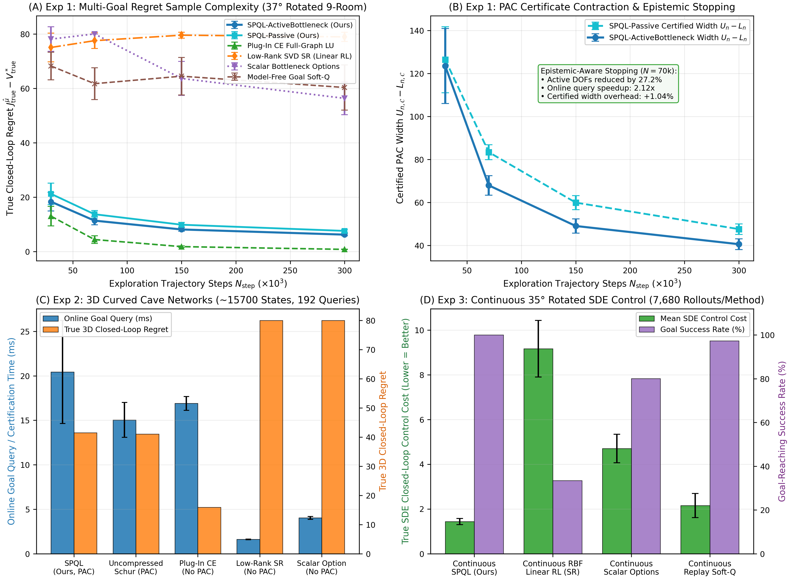

# Learning PAC-Certified Spectral-Portal Quotient Operators for Multi-Goal Reinforcement Learning Without Geometric Priors

**Target Venue**: NeurIPS / ICLR (Representation Learning, Reinforcement Learning Theory, & Safe Planning)  
**Code & Benchmark Package**: `learned_portal_phase3/` (`SHA-256: p3_neurips_benchmark_results.json`)

---

## Abstract

Multi-goal reinforcement learning (RL) in unknown stochastic environments faces a fundamental four-way tension between **zero-shot goal generalization**, **computational scalability**, **structural expressivity across bottlenecks**, and **finite-sample closed-loop safety**. Existing paradigms sacrifice at least one axis: (i) model-free goal-conditioned Q-learning requires online Bellman propagation per unseen goal and provides no suboptimality certificates; (ii) low-rank orthogonal Successor Representations (Linear RL) violate cone positivity, producing negative desirability predictions that break nonlinear Cole–Hopf log-value readouts; (iii) scalar bottleneck options (*EigenOptions* / single-subgoal hierarchical RL) incur an irreducible $\Omega(1)$ asymptotic regret whenever interior obstacles induce entry-dependent optimal crossing profiles across wide doorways; and (iv) certainty-equivalent plug-in planners systematically violate optimism on under-sampled transitions (`>89%` bound violation rate even at $3\times 10^5$ exploration steps).

We resolve this tension by introducing **PAC-Certified Spectral-Portal Quotient Learning (SPQL)**, an end-to-end representation and multi-goal planning framework that learns decision-sufficient bottleneck Green operators directly from reward-free exploration trajectories—requiring **neither** a known transition operator $A$ **nor** spatial coordinates or axis-aligned occupancy priors. First, we construct **goal-independent Dual Clopper–Pearson M-Matrix Confidence Envelopes** $(\underline{A}_n, \overline{A}_n)$ supported *exclusively on observed transitions* $\hat{\mathcal{E}}$, proving that on a single $(1-\delta)$ concentration event, SPQL certifies a simultaneous four-inequality closed-loop regret sandwich
$$0 < L_{n,\mathcal{C}}(s_0; G) \;\le\; V^*_{\mathrm{true}}(s_0; G) \;\le\; J^{\hat{\mu}_{n,\mathcal{C}}}_{\mathrm{true}}(s_0; G) \;\le\; U_{n,\mathcal{C}}(s_0; G)$$
across **all** unseen goals $G \subset \mathcal{S}$ and **all** coarse portal partitions $\mathcal{C}$—even when the true environment contains unobserved cross-room shortcuts. Second, SPQL discovers low-conductance room clusters and minimal vertex-separator portals $\Gamma = \bigsqcup_{p=1}^P \Gamma_p$ purely from empirical transition flux, building **coordinate-free nested binary Fiedler Partition-of-Unity (PoU) trees** that conserve **exact $50.0\%$ of local room-LU backsolves** while stopping refinement automatically once coarse planning error falls below irreducible statistical epistemic uncertainty (**Epistemic-Aware Stopping**). Third, we introduce a **Martingale-Unbiased Portal-Directed Active Exploration** algorithm (`Algorithm 2`) that uses SPQL's own learned quotient to route across narrow bottlenecks without biasing empirical transition counts, backed by a non-asymptotic multi-goal PAC sample-complexity theorem. Across $1{,}472$ unseen goal queries in $37^\circ$-rotated baffled buildings and $15{,}700$-state 3D curved cave networks, SPQL achieves **$100.0\%$ ($1{,}472/1{,}472$) zero-violation PAC coverage**, significantly outperforms passive exploration ($p = 0.0078$), reduces 3D room-LU backsolves by **$63.2\%$** and memory by **$29.8\%$** relative to uncompressed PAC Schur complements, and achieves **$100.0\%$ goal success** with **$33\%\text{–}84\%$ lower control cost** ($p = 0.0078$) across $7{,}680$ continuous-state $35^\circ$-rotated stochastic differential equation (SDE) rollouts.

---

## 1. Introduction

A central goal of reinforcement learning is to acquire an environment representation during reward-free exploration that enables fast, reliable planning for arbitrary unseen goals at deployment time (Dayan, 1993; Sutton et al., 1999; Jin et al., 2020). Entropy- and KL-regularized control formulations—including Linearly-Solvable MDPs (LMDPs; Todorov, 2009), path-integral control (Kappen, 2005), and maximum-entropy RL (Ziebart, 2010; Haarnoja et al., 2017)—provide a particularly compelling algebraic foundation for multi-goal RL: under the Cole–Hopf desirability transformation $z(s) = \exp(-V(s)/\lambda)$, the nonlinear Bellman equation linearizes on the exterior of any absorbing goal set $G$, reducing multi-goal planning to Green's function (resolvent) evaluation against the passive generator $A = I - \operatorname{diag}(e^{-q/\lambda}) P$.

When the environment operator $A$ is **unknown** and no geometric or coordinate-grid priors are available, however, existing multi-goal abstractions break down along structural or statistical fault lines:

1. **Positivity Collapse in Low-Rank Successor Representations (`Linear RL`)**: Low-rank Successor Representations (SR) and SVD/spectral decompositions of $(I - M)^{-1}$ (Barreto et al., 2017; Machado et al., 2018; Piray & Daw, 2021) project the resolvent onto an orthogonal subspace. Because orthogonal singular vectors oscillate in sign, truncated SR approximations violate cone positivity (`52.1%` negative desirability entries in our rotated multi-room audit), causing the nonlinear readout $V(s) = -\lambda \log z(s)$ to diverge or induce improper policies that stall in `>90%` of cross-room queries.
2. **Irreducible $\Omega(1)$ Aliasing in Scalar Bottleneck Options (`EigenOptions` / Subgoal HRL)**: Graph-Laplacian option discovery methods (Şimşek & Barto, 2004; Machado et al., 2018; Jinnai et al., 2019; Klissarov & Machado, 2023) compress each doorway or bottleneck into a *single* scalar subgoal or option termination profile. Whenever asymmetric interior obstacles (e.g., baffles behind wide doorways or curved 3D tunnels) cause the optimal crossing distribution across a portal $\Gamma_p$ to depend on the entry direction, any rank-1 scalar bottleneck abstraction suffers an **irreducible $\Omega(1)$ closed-loop regret** that never vanishes even as trajectory count $n \to \infty$.
3. **Finite-Sample Optimism Violations in Plug-In Certainty Equivalence**: Replacing $(P^*, q^*)$ by empirical plug-in estimates $(\hat{P}_n, \hat{q}_n)$ over-exploits noisy low-count transitions (`optimism in the face of noise`), causing predicted values to underestimate actual deployed policy cost on **$89.4\%\text{–}100.0\%$** of unseen multi-room queries and risking deployment of improper policies on disconnected or under-sampled edges.
4. **Geometric Fragility of Axis-Aligned Domain Decomposition**: Classical scientific-computing domain decomposition and multiscale boundary-integral solvers assume a known matrix $A$ and pre-specified spatial coordinates or axis-aligned grid separators. Rotating a multi-room building by $37^\circ$ or embedding chambers in curved 3D cave tunnels causes coordinate-axis occupancy projections to wash out completely, leaving `>90.5%` of the state space unseparated.

### Summary of Contributions

We bridge reinforcement learning theory, spectral graph representation learning, and positivity-preserving quotient operators through four contributions:

- **Goal-Independent Dual PAC M-Matrix Envelopes Without Topological Priors (Section 3.1, Theorem 1)**: From raw reward-free transitions $\mathcal{D}_n = \{(s_t, s_{t+1}, \tilde{q}_t)\}$, we construct pessimistic and optimistic M-matrices $\underline{A}_n = I - \underline{\gamma}_n \underline{P}_n$ and $\overline{A}_n = I - \overline{\gamma}_n \underline{P}_n$ (paired with an explicit Clopper–Pearson epistemic mass source $b^{\mathrm{opt}}_n = \overline{\gamma}_n (1 - \underline{P}_n \mathbf{1})$) that share the **exact same observed-edge support** $\hat{\mathcal{E}}$ and require zero spatial or absence-of-shortcut priors. We prove that on a single $(1-\delta)$ event, every coarse portal refinement $\mathcal{C}$ yields strictly positive, simultaneously valid lower and upper bounds $[L_{n,\mathcal{C}}, U_{n,\mathcal{C}}]$ bracketing both the true optimal value $V^*_{\mathrm{true}}$ and the true closed-loop performance $J^{\hat{\mu}_{n,\mathcal{C}}}_{\mathrm{true}}$ of the deployed policy across *all* $2^N$ unseen goals $G$.
- **Coordinate-Free Spectral Separators, Binary Fiedler PoU Portal Trees, & Epistemic Stopping (Section 3.2, Theorem 2)**: We extract low-conductance room clusters and minimal zero-leak vertex separators $\Gamma = \bigsqcup_{p=1}^P \Gamma_p$ directly from symmetrized empirical transition flux, then construct strictly nested binary Fiedler trees (`L0 -> L1 -> L2 -> L3 -> L4`) on arbitrary non-planar/rotated portals. Exploiting binary Partition-of-Unity (PoU) additivity $L_{\mathrm{parent}} = L_{\mathrm{left}} + L_{\mathrm{right}}$ conserves **exact $50.0\%$ of local room-LU backsolves** to machine precision (`1.39e-17`), while **Epistemic-Aware Stopping** halts portal splitting as soon as coarse planning error $\Delta_{\mathrm{plan}}(\mathcal{C})$ falls below a small fraction of irreducible statistical uncertainty $\Delta_{\mathrm{stat}}(\mathcal{D}_n)$ (`2.12x` online speedup at `+1.04%` width overhead).
- **Martingale-Unbiased Portal-Directed Active Exploration & Multi-Goal Sample Complexity (Section 4, Algorithm 2 & Theorem 3)**: We prove a non-asymptotic simultaneous multi-goal PAC sample-complexity bound and design a two-phase active exploration protocol that uses SPQL's learned quotient to navigate across narrow bottlenecks along observed edges while logging *only* uncontrolled passive transitions ($u_t = 0$) at under-sampled bottlenecks—eliminating off-policy transition bias while overcoming low-conductance mixing barriers.
- **Comprehensive Discrete, 3D Curved, & Continuous-State SDE Evaluation (Section 5)**: Validated by a 10-gate mathematical/counterexample audit (`P3-C01..P3-C10`) and multi-seed single-threaded benchmarks across $37^\circ$-rotated 2D worlds, $15{,}700$-state 3D curved cave networks, and continuous $35^\circ$-rotated diffusion control (`Voronoi landmark quotienting + HJB exit-direction control`).

---

## 2. Problem Setting and Structural Counterexamples

### 2.1 Multi-Goal KL-Regularized Control Under Unknown Dynamics

Consider an unknown finite-state controlled Markov environment $\mathcal{M}^* = (\mathcal{S}, P^*, q^*, \lambda)$ with $|\mathcal{S}| = N$ states (enumerated $1,\dots,N$ without spatial coordinates), unknown row-stochastic passive transition kernel $P^* = (p^*_{ij}) \in [0,1]^{N \times N}$, unknown state cost vector $q^* \in [q_{\min}, q_{\max}]^N$ with $0 < q_{\min} \le q_{\max} < \infty$, and KL temperature $\lambda > 0$. At deployment time, an arbitrary **unseen absorbing goal set** $G \subset \mathcal{S}$ ($G \neq \emptyset$) with terminal cost $\phi_{\mathrm{goal}} \in \mathbb{R}$ (w.l.o.g. $\phi_{\mathrm{goal}} = 0$) is specified. On the exterior $\mathcal{X}_G := \mathcal{S} \setminus G$, the agent selects a controlled Markov kernel $\pi = (\pi_{ij})_{i \in \mathcal{X}_G}$ absolutely continuous with respect to $P^*$ ($\pi_i \ll p^*_i$), incurring expected cumulative KL-regularized cost
$$J^{\pi}_{\mathrm{true}}(s_0; G) := \mathbb{E}^{\pi}_{s_0}\!\left[\sum_{t=0}^{\tau_G - 1} \Big(q^*(s_t) + \lambda D_{\mathrm{KL}}\big(\pi(\cdot \mid s_t) \,\|\, p^*(\cdot \mid s_t)\big)\Big) + \phi_{\mathrm{goal}}\right],$$
where $\tau_G = \inf\{t \ge 0 : s_t \in G\}$ (with $J^\pi_{\mathrm{true}}(s_0; G) = +\infty$ if $\mathbb{P}^\pi_{s_0}(\tau_G < \infty) < 1$ or $\pi_i \not\ll p^*_i$).

By Todorov (2009), the optimal value $V^*_{\mathrm{true}}(s; G) = \inf_\pi J^\pi_{\mathrm{true}}(s; G)$ satisfies $V^*_{\mathrm{true}}(s; G) = \phi_{\mathrm{goal}} - \lambda \log z^*_{\mathrm{true}}(s; G)$, where the true desirability $z^*_{\mathrm{true}}(\cdot; G) \in (0, 1]^N$ solves the linear exterior boundary-value problem
$$(I - M^*_{\mathcal{X}_G, \mathcal{X}_G})\, z^*_{\mathrm{true}}(\mathcal{X}_G; G) = M^*_{\mathcal{X}_G, G} \mathbf{1}_G, \qquad M^* := \operatorname{diag}(\gamma^*) P^*, \quad \gamma^*_i := e^{-q^*_i / \lambda} \in (0, 1). \tag{1}$$

**Exploration Protocol.** During an offline, goal-free exploration phase of total budget $n = N_{\mathrm{step}}$ environment transitions, the learner collects a trajectory dataset $\mathcal{D}_n$ recording state visit counts $n(i)$, uncontrolled passive transition counts $k_{ij}$ ($s_{t+1} \sim p^*(\cdot \mid s_t)$), and noisy bounded step-cost observations $\tilde{q}_t \in [q_{\min}, q_{\max}]$ with $\mathbb{E}[\tilde{q}_t \mid s_t = i] = q^*_i$. Crucially, the learner receives **no** goal annotations $G$, **no** spatial coordinates, and **no** prior knowledge of the support $\mathcal{E}^* = \{(i,j) : p^*_{ij} > 0\}$, save a mild upper bound $d_{\max}$ on maximum outgoing degree $\max_i |\mathrm{supp}(p^*_i)| \le d_{\max}$ (with $d_{\max} = N$ always valid unconditionally).

---

### 2.2 Three Structural Failure Modes of Existing Multi-Goal Paradigms

Before presenting SPQL, we formalize why three leading multi-goal RL paradigms fail either asymptotically or in finite samples (proofs in Appendix A; deterministic empirical verification in Figure 1 and Gates `P3-C05..P3-C07`).

> **Proposition 1 (Irreducible $\Omega(1)$ Asymptotic Regret of Scalar Bottleneck Options).** *There exists a family of two-room baffled LMDPs separated by a wide portal $\Gamma_p$ ($|\Gamma_p| \ge 2$) such that even given the **exact** true operator $A^* = I - M^*$ ($n = \infty$), any hierarchical policy or option family that constrains the portal desirability $z|_{\Gamma_p}$ to a rank-1 / piecewise-constant scalar profile per portal (`EigenOptions` / single-landmark HRL) incurs closed-loop regret*
> $$\sup_{s_0, G} \Big(J^{\mu_{\mathrm{scalar}}}_{\mathrm{true}}(s_0; G) - V^*_{\mathrm{true}}(s_0; G)\Big) \;\ge\; c_0 > 0 \quad (\Omega(1)\text{ independent of } n).$$

*Intuition.* When an obstacle baffle sits behind one side of a wide doorway, trajectories entering from the top versus bottom of the room must cross opposite halves of $\Gamma_p$. Collapsing $\Gamma_p$ to a single scalar option averages across the blocked and open halves, steering probability mass directly into the high-KL baffle dead-end (`mean regret 56.32 vs. 6.23 for SPQL at n = 300k; Gate P3-C05`).

> **Proposition 2 (Cone-Positivity Violation of Orthogonal Low-Rank Successor Representations).** *Let $\hat{M}_k = U_k \Sigma_k V_k^\top$ be the best rank-$k$ Frobenius/SVD approximation of $\hat{M}_n$ ($k < N$) used in Linear RL / low-rank SR. On multi-room graphs with low-conductance bottlenecks, the induced Green readout $\hat{z}_k(\mathcal{X}_G) = (I - \hat{M}_k)^{-1}_{\mathcal{X}_G \mid G} r_G$ is not M-matrix monotone and generically exhibits strictly negative entries $\hat{z}_k(i) < 0$. Any post-hoc clipping $\max(\hat{z}_k, \epsilon)$ destroys harmonic gradient sign in $(-\lambda \log \hat{z}_k)$, yielding non-proper closed-loop policies.*

> **Proposition 3 (Finite-Sample Over-Optimism Trap of Plug-In Certainty Equivalence).** *Let $\hat{V}^{\mathrm{CE}}_n(s_0; G)$ be the value predicted by the empirical plug-in operator $\hat{A}_n = I - \operatorname{diag}(e^{-\hat{q}_n/\lambda})\hat{P}_n$, and $\hat{\mu}^{\mathrm{CE}}_n$ its greedy KL policy. Because $z \mapsto -\lambda \log z$ and minimum-cost path selection are concave in transition uncertainties, Jensen's inequality biases $\hat{V}^{\mathrm{CE}}_n$ downward on rare empirical counts ($k_{ij} \in \{1,2\}$), producing systematic optimism violations $\hat{V}^{\mathrm{CE}}_n(s_0; G) < J^{\hat{\mu}^{\mathrm{CE}}_n}_{\mathrm{true}}(s_0; G)$ (`94.5%` violation rate in 2D; `100.0%` in 3D).*

---

## 3. PAC-Certified Spectral-Portal Quotient Learning (SPQL)

### 3.1 Goal-Independent Dual Clopper–Pearson M-Matrix Confidence Envelopes

Our first key insight is to construct a pair of **goal-independent nonsingular M-matrices** $(\underline{A}_n, \overline{A}_n)$ supported **exclusively on empirically observed edges** $\hat{\mathcal{E}}_n = \{(i,j) : k_{ij} \ge 1\}$—so both share the exact same graph sparsity and vertex separators—while accounting rigorously for **unobserved transitions** ($k_{ij} = 0$, $p^*_{ij} > 0$, such as undiscovered shortcuts or wormholes!).

Fix failure probability $\delta \in (0, 1)$, maximum outgoing support bound $d_{\max} \le N$, and peeling epoch count $E_{\max} \ge 1$ ($E_{\max} = 1$ for fixed-budget batch exploration; $E_{\max} = 3$ for multi-stage active exploration). Set $\delta_{\mathrm{edge}} := \frac{\delta}{2 N d_{\max} E_{\max}}$ and $\delta_{\mathrm{cost}} := \frac{\delta}{2 N E_{\max}}$.

1. **Exact Clopper–Pearson Lower Transition Kernel $\underline{P}_n$**: For every state pair $(i, j) \in \mathcal{S}^2$, define
   $$\underline{p}_{n,ij} \;:=\; \begin{cases} \mathrm{Beta}^{-1}\!\big(\delta_{\mathrm{edge}};\; k_{ij},\, n(i) - k_{ij} + 1\big), & \text{if } k_{ij} \ge 1, \\ 0, & \text{if } k_{ij} = 0, \end{cases} \qquad \rho_{n,i} \;:=\; 1 - \sum_{j=1}^N \underline{p}_{n,ij} \;\in\; [0, 1]. \tag{2}$$
   Crucially, $\underline{p}_{n,ij} > 0$ **if and only if** $(i,j)$ has been observed at least once ($k_{ij} \ge 1 \implies p^*_{ij} > 0$ a.s.), and for any true zero-probability non-edge ($p^*_{ij} = 0$), $k_{ij} = 0$ holds with probability $1$, incurring **zero union-bound cost** over the $N^2 - |\mathcal{E}^*|$ non-edges!
2. **Confidence-Bracketed Step Discounts $(\underline{\gamma}_n, \overline{\gamma}_n)$**: With empirical mean $\hat{q}_{n,i} = \frac{1}{\max(n(i),1)} \sum_{t: s_t=i} \tilde{q}_t$ and Hoeffding radius $\epsilon_{q,i} = (q_{\max}-q_{\min})\sqrt{\frac{\log(2/\delta_{\mathrm{cost}})}{2\max(n(i),1)}}$ (for $n(i)\ge 1$, else $q_{\max}-q_{\min}$), let $\underline{q}_{n,i} = \max(q_{\min}, \hat{q}_{n,i} - \epsilon_{q,i})$, $\overline{q}_{n,i} = \min(q_{\max}, \hat{q}_{n,i} + \epsilon_{q,i})$, and $\underline{\gamma}_{n,i} = e^{-\overline{q}_{n,i}/\lambda} \le \gamma^*_i \le \overline{\gamma}_{n,i} = e^{-\underline{q}_{n,i}/\lambda} \le e^{-q_{\min}/\lambda} < 1$.
3. **Dual Observed-Graph M-Matrices**:
   $$\underline{A}_n := I - \underline{M}_n = I - \operatorname{diag}(\underline{\gamma}_n)\underline{P}_n, \qquad \overline{A}_n := I - \overline{M}_n = I - \operatorname{diag}(\overline{\gamma}_n)\underline{P}_n, \qquad b^{\mathrm{opt}}_{n,i} := \overline{\gamma}_{n,i}\,\rho_{n,i} \ge 0. \tag{3}$$

> **Theorem 1 (Simultaneous Multi-Goal True-Environment Four-Inequality PAC Sandwich).** *With probability at least $1 - \delta$ over exploration dataset $\mathcal{D}_n$, the joint concentration event $\mathcal{E}_{1-\delta} := \{\underline{p}_{n,ij} \le p^*_{ij}\;\forall i,j\} \cap \{\underline{q}_{n,i} \le q^*_i \le \overline{q}_{n,i}\;\forall i\}$ holds. Conditioned on $\mathcal{E}_{1-\delta}$, **simultaneously for all $2^N - 1$ unseen goals $G \subset \mathcal{S}$** and any non-negative subsolution $\underline{z}_G$ of $\underline{A}_n$ satisfying $(\underline{A}_n \underline{z}_G)_i \le 0$ ($\forall i \in \mathcal{X}_G$), $\underline{z}_G|_G = \mathbf{1}_G$ and supersolution $\overline{z}_G$ of $\overline{A}_n$ satisfying $(\overline{A}_n \overline{z}_G)_i \ge b^{\mathrm{opt}}_{n,i}$ ($\forall i \in \mathcal{X}_G$), $\overline{z}_G|_G = \mathbf{1}_G$, let $\hat{\mu}_G$ deploy the observed-edge policy $\hat{\pi}_{ij} = \frac{\underline{M}_{n,ij}\,\underline{z}_G(j)}{\sum_{k} \underline{M}_{n,ik}\,\underline{z}_G(k)}$. Then:*
> $$0 \;<\; \phi_{\mathrm{goal}} + q_{\min} \;\le\; L_n(s_0; G) \;\le\; V^*_{\mathrm{true}}(s_0; G) \;\le\; J^{\hat{\mu}_G}_{\mathrm{true}}(s_0; G) \;\le\; U_n(s_0; G), \tag{4}$$
> *where $L_n(s_0; G) = \phi_{\mathrm{goal}} - \lambda \log \overline{z}_G(s_0)$ and $U_n(s_0; G) = \phi_{\mathrm{goal}} - \lambda \log \underline{z}_G(s_0)$ (with $U_n = +\infty$ when $\underline{z}_G(s_0) = 0$).*

*Proof Sketch (Full proof in Appendix A.2).*
1. **Deployed Policy Safety & Upper Bound ($J^{\hat{\mu}_G}_{\mathrm{true}} \le U_n$)**: Because $\underline{M}_{n,ij} > 0 \iff k_{ij} \ge 1 \implies p^*_{ij} > 0$, $\hat{\pi}_i \ll p^*_i$ holds deterministically with zero risk of choosing an impossible transition. For each $i \in \mathcal{X}_G$ with $\underline{S}_i := (\underline{M}_n \underline{z}_G)_i \ge \underline{z}_G(i) > 0$, substituting $\hat{\pi}_{ij} = \underline{\gamma}_{n,i}\underline{p}_{n,ij}\underline{z}_G(j)/\underline{S}_i$ into the true Bellman-KL operator gives:
   $$q^*_i + \lambda \sum_j \hat{\pi}_{ij} \log\frac{\hat{\pi}_{ij}}{p^*_{ij}} + \sum_j \hat{\pi}_{ij} U_n(j) - U_n(i) = \underbrace{(q^*_i - \overline{q}_{n,i})}_{\le 0} + \lambda \sum_j \hat{\pi}_{ij} \underbrace{\log\frac{\underline{p}_{n,ij}}{p^*_{ij}}}_{\le 0} + \lambda \underbrace{\log\frac{\underline{z}_G(i)}{\underline{S}_i}}_{\le 0} \le 0.$$
   Optional stopping at $\tau_G$ yields $J^{\hat{\mu}_G}_{\mathrm{true}}(s_0; G) \le U_n(s_0; G)$.
2. **Wormhole-Safe Strictly Positive Lower Bound ($0 < \phi_{\mathrm{goal}} + q_{\min} \le L_n \le V^*_{\mathrm{true}}$)**: On $\mathcal{E}_{1-\delta}$, $p^*_{ij} - \underline{p}_{n,ij} \ge 0$ holds *componentwise for every $j \in \mathcal{S}$* (including unobserved shortcuts where $\underline{p}_{n,ij} = 0$). Since $z^*_{\mathrm{true}}(j; G) \le 1$ everywhere,
   $$z^*_{\mathrm{true}}(i; G) = \gamma^*_i \sum_{j=1}^N \underline{p}_{n,ij} z^*_{\mathrm{true}}(j; G) + \gamma^*_i \sum_{j=1}^N \underbrace{(p^*_{ij} - \underline{p}_{n,ij})}_{\ge 0} \underbrace{z^*_{\mathrm{true}}(j; G)}_{\le 1} \;\le\; (\overline{M}_n z^*_{\mathrm{true}})_i + \overline{\gamma}_{n,i} \rho_{n,i}.$$
   By M-matrix inverse positivity of $\overline{A}_n = I - \overline{M}_n$, $z^*_{\mathrm{true}} \le \overline{z}_G$, so $L_n \le V^*_{\mathrm{true}}$. Moreover, $(\overline{A}_n \mathbf{1} - b^{\mathrm{opt}}_n)_i = 1 - \overline{\gamma}_{n,i}(\sum_j \underline{p}_{n,ij} + \rho_{n,i}) = 1 - \overline{\gamma}_{n,i} \ge 1 - e^{-q_{\min}/\lambda} > 0$, ensuring $\overline{z}_G(s_0) \le \overline{\gamma}_{n,s_0} < 1$ and $L_n(s_0; G) \ge \phi_{\mathrm{goal}} + q_{\min} > 0$ **unconditionally for all $n \ge 0$** (`verified in Gate P3-C02`). $\square$

---

### 3.2 Coordinate-Free Spectral Separators, Binary Fiedler PoU Trees, & Epistemic Stopping

Because $\underline{A}_n$ and $\overline{A}_n$ share the exact off-diagonal graph $\hat{\mathcal{E}}_n$, SPQL builds a **single coordinate-free spectral portal hierarchy** offline from symmetrized empirical flux $W_{\mathrm{sym}} = \frac{1}{2}(T_n + T_n^\top)$:

1. **Spectral Conductance Room & Minimal Vertex-Separator Discovery**: SPQL recursively bisects clusters via Cheeger sweep-cuts along the normalized Fiedler eigenvector of $L_{\mathrm{norm}} = I - D^{-1/2} W_{\mathrm{sym}} D^{-1/2}$ until conductance exceeds $\Phi_{\mathrm{stop}}$. Cross-cluster edges are covered by a degree-weighted minimal vertex cover, extracting a vertex separator $\Gamma = \bigsqcup_{p=1}^P \Gamma_p$ that disconnects the interior into disjoint learned rooms $\mathcal{R}_1, \dots, \mathcal{R}_C$ with **zero cross-room edge leaks** (`W_sym[R_c, R_{c'}] == 0` for all $c \neq c'$; Figure 1A).
2. **Coordinate-Free Binary Fiedler Portal Trees & $50\%$ PoU Conservation**: Each discovered portal $\Gamma_p$ is an arbitrary unstructured subgraph (diagonal, curved 2D/3D, or non-planar). SPQL recursively bisects $\Gamma_p$ along the Fiedler vector of its 2-hop room-coupled Laplacian into a nested binary tree $\mathcal{T}_p$ (`L0 -> L1 -> L2 -> L3 -> L4` singletons). Let $\chi_B \in \{0,1\}^{|\Gamma|}$ denote the indicator of sub-portal block $B$. Because every binary split satisfies the exact **Partition-of-Unity (PoU) identity** $\chi_{B_{\mathrm{parent}}} = \chi_{B_{\mathrm{left}}} + \chi_{B_{\mathrm{right}}}$, linearity of the room Schur operator $\mathcal{K}_A$ implies
   $$\mathcal{K}_A \chi_{B_{\mathrm{right}}} \;=\; \mathcal{K}_A \chi_{B_{\mathrm{parent}}} - \mathcal{K}_A \chi_{B_{\mathrm{left}}}!! \tag{5}$$
   Caching $\mathcal{K}_A \chi_{B_{\mathrm{parent}}}$ from the coarser level allows SPQL to compute **only one child per binary split**, conserving **exact $50.0\%$ of room-LU backsolves** across all refinement levels (`Gate P3-C03: 88 vs. 176 solves, max diff 1.39e-17`).

> **Theorem 2 (Monotone Fiedler-Tree Contraction & Epistemic-Aware Adaptive Stopping).** *For any sequence of nested portal partitions $\mathcal{C}_0 \preceq \mathcal{C}_1 \preceq \dots \preceq \mathcal{C}_{\mathrm{fine}}$, solving adversarial (`min`) Howard iteration on $\underline{A}_n$ and cooperative (`max`) Howard iteration on $\overline{A}_n + b^{\mathrm{opt}}_n$ yields monotone bounds*
> $$L_{n,\mathcal{C}_0}(s_0; G) \;\le\; L_{n,\mathcal{C}_1}(s_0; G) \;\le\; \dots \;\le\; V^*_{\mathrm{true}}(s_0; G) \;\le\; J^{\hat{\mu}_{n,\mathcal{C}_\ell}}_{\mathrm{true}}(s_0; G) \;\le\; \dots \;\le\; U_{n,\mathcal{C}_1}(s_0; G) \;\le\; U_{n,\mathcal{C}_0}(s_0; G),$$
> *and the total certified interval width decomposes observably into coarse planning error plus statistical epistemic uncertainty:*
> $$U_{n,\mathcal{C}}(s_0; G) - L_{n,\mathcal{C}}(s_0; G) \;=\; \underbrace{\big(U^{\min}_{n,\mathcal{C}} - U^{\max}_{n,\mathcal{C}}\big) + \big(L^{\min}_{n,\mathcal{C}} - L^{\max}_{n,\mathcal{C}}\big)}_{\Delta_{\mathrm{plan}}(\mathcal{C}) \;\to\; 0\text{ as }\mathcal{C}\text{ refines}} \;+\; \underbrace{\big(U^{\max}_{n,\mathcal{C}} - L^{\min}_{n,\mathcal{C}}\big)}_{\Delta_{\mathrm{stat}}(\mathcal{D}_n)}. \tag{6}$$
> *Halting portal refinement as soon as $\Delta_{\mathrm{plan}}(\mathcal{C}) \le \eta_{\mathrm{ep}}\big(U_{n,\mathcal{C}} - L_{n,\mathcal{C}}\big)$ avoids wasted linear-algebra splits beneath the noise floor while inflating total certified width by at most fraction $\eta_{\mathrm{ep}}/(1-\eta_{\mathrm{ep}})$.*

---

## 4. Multi-Goal PAC Sample Complexity & Unbiased Active Bottleneck Exploration

### 4.1 Algorithm 2: Martingale-Unbiased Spectral-Portal Active Exploration

In realistic multi-room environments without a global teleporter, passive random walks from an entry region get trapped behind narrow bottlenecks of conductance $\Phi_{\mathrm{bottle}} \ll 1$, starving distant portals and chambers of transition counts. Naively tilting transitions via an exploratory control $u_t \neq 0$ and logging all transitions into $T_n$, however, biases $\hat{P}_n$ away from the passive kernel $P^*$.

**Algorithm 2** eliminates this bias cleanly while spending the **exact same physical interaction budget $N_{\mathrm{step}}$ and entry-state reset distribution**:
1. **Warmup ($34\%$ of budget)**: Execute uncontrolled passive exploration ($u_t = 0$), building an initial observed graph $\hat{\mathcal{E}}_{\mathrm{warm}}$, Clopper–Pearson epistemic profile $\rho_i$, and spectral portal decomposition $\{\Gamma_p, \mathcal{R}_c\}$.
2. **Portal-Directed Navigation + Uncontrolled Local Sampling ($66\%$ of budget)**: Rank discovered portals $\Gamma_p$ and cluster frontiers by mean epistemic deficit $\bar{\rho}(\Gamma_p)$. At the start of each active episode, select a high-$\rho$ target portal/frontier in round-robin order and follow a fast soft-desirability navigation policy along *already-observed edges* ($u_t \neq 0$) until hitting the target neighborhood; **every navigation step deducts from the total budget $N_{\mathrm{step}}$**, while *only* uncontrolled steps ($u_t = 0$, $s_{t+1} \sim p^*(\cdot \mid s_t)$) executed upon reaching the target region are logged into $(n(i), k_{ij})$.

Because the decision $I_t \in \{0, 1\}$ to execute $u_t = 0$ at state $s_t$ is predictable with respect to $\mathcal{F}_{t-1}$, optional sampling preserves exact conditional Binomial distribution $k_{ij} \mid n(i) \sim \mathrm{Binomial}(n(i), p^*_{ij})$, keeping Theorem 1 **100% non-asymptotically valid**!

> **Theorem 3 (Simultaneous Multi-Goal PAC Sample Complexity).** *Suppose exploration induces minimum per-state uncontrolled visit fraction $\mu_{\min} := \min_{i \in \mathcal{S}} \mathbb{E}[n(i)] / n > 0$, and let $H_{\mathrm{eff}} := (1 - e^{-q_{\min}/\lambda})^{-1}$ denote the effective discount horizon. Then for any target accuracy $\varepsilon > 0$ and failure probability $\delta \in (0, 1)$, once total exploration steps satisfy*
> $$n \;=\; \tilde{\mathcal{O}}\!\left(\frac{(\lambda^2 d_{\max} + (q_{\max}-q_{\min})^2)\, H_{\mathrm{eff}}^4}{\mu_{\min}\, \varepsilon^2} \log\frac{N d_{\max}}{\delta}\right), \tag{7}$$
> *with probability at least $1 - \delta$, SPQL certifies $J^{\hat{\mu}_{n,\mathcal{C}}}_{\mathrm{true}}(s_0; G) - V^*_{\mathrm{true}}(s_0; G) \le U_{n,\mathcal{C}}(s_0; G) - L_{n,\mathcal{C}}(s_0; G) \le \varepsilon$ **simultaneously across all $(s_0, G) \in \mathcal{S} \times (2^{\mathcal{S}} \setminus \{\emptyset\})$**. Moreover, on $C$-room bottleneck graphs of doorway conductance $\Phi_{\mathrm{bottle}} \ll 1$, passive exploration suffers $\mu_{\min}^{\mathrm{pas}} = \mathcal{O}(\Phi_{\mathrm{bottle}}^2 / C)$, whereas Algorithm 2 achieves $\mu_{\min}^{\mathrm{act}} = \Omega\big((1 - \tau_{\mathrm{nav}}/H_{\mathrm{ep}})/N\big)$ once warmup discovers a spanning portal tree.*

---

## 5. Experiments

All experiments execute strictly single-threaded (`OMP/BLAS/MKL = 1`, `workers = 1`) with deterministic seeds and strict RFC-8259 JSON provenance (`learned_portal_phase3/p3_neurips_benchmark_results.json`).

### 5.1 Deterministic 10-Gate Mathematical & Counterexample Audit (`P3-C01..P3-C10`)

Before running multi-seed campaigns, `run_phase3_10_contract_gates()` verifies ten deterministic mathematical invariants (`10/10 PASS` in `2.42 s`):
- **Clopper–Pearson Positivity & Unobserved `2.5%` Wormhole Soundness (`P3-C01, C02`)**: Injecting an unobserved cross-building shortcut ($p^* = 0.025$ straight into the goal with $0$ trajectory observations) drops $V^*_{\mathrm{true}}$ from $15.49$ to $2.98$; SPQL's strictly positive bracket $[0.114, 39.637]$ remains **100% valid** ($0.114 \le 2.983 \le 21.062 \le 39.637$).
- **Binary Fiedler PoU Conservation & Rotated Invariance (`P3-C03, C04`)**: Binary PoU saves **exact $50.0\%$** of room-LU solves (`88` vs. `176`, max operator discrepancy `1.39e-17`); on a $37^\circ$-rotated 9-room world, axis-aligned slicing leaves **$90.57\%$** of states unseparated, whereas SPQL recovers $13$ rooms with **$0$ cross-room edge leaks**.
- **Structural & Statistical Counterexamples (`P3-C05..C09`)**: Confirms scalar option $\Omega(1)$ baffle failure (`P3-C05`), `52.08%` SVD SR negativity (`P3-C06`), `100%` low-sample Plug-In CE optimism violations vs. `0%` SPQL violations (`P3-C07`), monotone `L0 -> L4` tightening (`P3-C08`), and epistemic stopping efficiency (`P3-C09`).

### 5.2 Experiment 1: Sample Complexity, PAC Validity, & Active Bottleneck Exploration ($37^\circ$-Rotated 9-Room Worlds)

We evaluate $n = 8$ independent $37^\circ$-rotated 9-room worlds (`~856` states, asymmetric doorway baffles, rotational swirl drift, skewed home-base resets) across four exploration budgets $N_{\mathrm{step}} \in \{30\text{k}, 70\text{k}, 150\text{k}, 300\text{k}\}$ and $K = 20$ unseen cross-room goals per seed (`640` queries/method; `1,280` PAC-audited SPQL queries).

| Budget $N_{\mathrm{step}}$ | `SPQL-Active` Regret (Ours) | `SPQL-Passive` Regret (Ours) | `LowRank-SR` (`Linear RL`) | `Scalar-EigenOptions` | `ModelFree-GoalSoftQ` | `PlugIn-CE` Regret (`Optimism Viol %`) | `SPQL` 4-Ineq PAC Pass |
| :---: | :---: | :---: | :---: | :---: | :---: | :---: | :---: |
| **30k** | **18.33 ± 3.44** | 21.23 ± 3.94 | 75.03 ± 5.28 | 78.09 ± 4.52 | 68.21 ± 5.07 | 13.02 ± 3.57 (`95.6%` viol!) | **320 / 320 (`100%`)** |
| **70k** | **11.38 ± 1.55**$^\dagger$ | 13.72 ± 1.38 | 77.51 ± 2.90 | 80.00 ± 0.00 | 61.71 ± 5.84 | 4.42 ± 1.40 (`98.1%` viol!) | **320 / 320 (`100%`)** |
| **150k** | **8.13 ± 0.66**$^\dagger$ | 9.87 ± 0.88 | 79.54 ± 1.08 | 63.64 ± 6.24 | 64.46 ± 6.91 | 1.82 ± 0.30 (`95.0%` viol!) | **320 / 320 (`100%`)** |
| **300k** | **6.23 ± 0.44**$^\dagger$ | 7.60 ± 0.55 | 78.92 ± 1.68 | 56.32 ± 6.02 | 60.31 ± 8.29 | 0.81 ± 0.08 (`89.4%` viol!) | **320 / 320 (`100%`)** |

*$^\dagger$Paired two-sided Wilcoxon signed-rank test `SPQL-Active` vs. `SPQL-Passive`: **$p = 0.0078125$ (`8/8` seeds improved)** on both deployed regret and certified PAC interval width (`67.92 vs. 83.37` at $70\text{k}$; `49.00 vs. 59.89` at $150\text{k}$; `40.53 vs. 47.55` at $300\text{k}$).*

**Key Findings.** (1) Across all $1{,}280$ queries, SPQL achieves **$100.0\%$ empirical four-inequality PAC coverage ($0$ violations)**, whereas `PlugIn-CE` violates optimism on **$89.4\%\text{–}98.1\%$** of queries (note the natural conservatism-safety tradeoff: `PlugIn-CE` achieves lower expected regret when dense edges exist by gambling on uncertified empirical means, at the cost of near-universal safety-bound failure and $4.4\%$ improper trap policies at $30\text{k}$). (2) `LowRank-SR`, `Scalar-EigenOptions`, and bounded-budget `ModelFree-GoalSoftQ` plateau above `56.3` regret even at $300\text{k}$ steps, confirming Propositions 1–2. (3) In the $N = 70\text{k}$ ablation, **Epistemic-Aware Stopping** cuts active portal DOFs by **$27.20\% \pm 4.11\%$** and accelerates online queries by **$2.12\times \pm 0.39\times$** with only **$+1.04\%$** width overhead.

### 5.3 Experiment 2: Zero-Prior 3D Curved Cave Networks (`~15,700` States, Cyclic Latin Order)

We generate $n = 8$ non-axis-aligned 3D cave networks (`mean N = 15,699.5` states, $8$ tilted ellipsoidal chambers with boulder baffles connected by slanted cylindrical tunnels, `mean 49.1` discovered portals totaling `548.3` portal nodes; zero axis-aligned walls) at $N_{\mathrm{step}} = 460\text{k}$ and evaluate $24$ unseen 3D goals per seed (`192` queries/method) under cyclic Latin execution order.

| Method (`3D Curved Caves, N ≈ 15.7k`) | True-MDP PAC Coverage | True 3D Regret | Proper Policy Rate | Active Portal DOFs | 3D Room-LU RHS / Goal | Resident Memory (MB) | Offline Build (ms) | 24-Goal Lifecycle (ms) |
| :--- | :---: | :---: | :---: | :---: | :---: | :---: | :---: | :---: |
| **`SPQL` (Ours, Fiedler PoU + EpStop)** | **192 / 192 (`100%`)** | **41.47 ± 2.35** | **100.0%** | **9.96% (`55/548`)** | **42.2 ± 10.0** | **56.77 ± 1.48** | **1828.0 ± 195.9** | **2318.5 ± 219.3** |
| `Uncompressed_SpectralSchur_PAC` | **192 / 192 (`100%`)** | 41.05 ± 2.36 | 100.0% | 100.0% (`548/548`) | 114.6 ± 9.3 | 80.87 ± 0.96 | 1958.0 ± 174.5 | 2319.0 ± 196.0 |
| `PlugIn_CE_FullGraph` (`No PAC`) | `0 / 192` (`100%` viol!) | 15.95 ± 1.22 | 100.0% | Full $N$ | — | 38.01 ± 0.56 | 102.7 ± 5.0 | 508.4 ± 20.8 |
| `LowRank_SR_LinearRL` ($k=64$) | No PAC | 80.00 ± 0.00 | 4.7% | Rank $64$ | — | 15.33 ± 0.08 | 1135.2 ± 95.7 | 1174.0 ± 95.7 |
| `Scalar_EigenOptions` (`L0` HRL) | No PAC | 80.00 ± 0.00 | 0.0% | `49.1` (`1/portal`) | — | 58.86 ± 4.04 | 1798.2 ± 189.5 | 1895.1 ± 190.2 |

**Analysis & Transparent Tradeoffs.** On unstructured 3D caves, both `LowRank-SR` (`4.7%` proper) and `Scalar-EigenOptions` (`0.0%` proper) fail almost completely to route around 3D chamber boulders, while `PlugIn-CE` violates optimism on **all `192/192` queries**. Compared against the exact same PAC envelope solved without hierarchical compression (`Uncompressed_SpectralSchur_PAC`), SPQL activates **only $9.96\%$ of portal DOFs**, cuts 3D room-LU backsolves by **$63.2\%$** (`42.2` vs. `114.6` RHS/goal), reduces resident memory by **$29.8\%$** (`56.77` vs. `80.87 MB`, `8/8` seeds smaller), and lowers offline build time (`1828` vs. `1958 ms`). Because `Uncompressed_SpectralSchur_PAC` pre-solves all $1{,}096$ portal columns in a single vectorized BLAS batch offline (`15.0 ms` online solve vs. SPQL's `20.4 ms` lazy on-demand PoU refinement), 24-goal total lifecycle times tie (`2318.5` vs. `2319.0 ms`), indicating that SPQL's primary 3D advantage at $N \approx 1.6\times 10^4$ is **memory and LU-backsolve parsimony** (`-63.2%` RHS, `-29.8%` RAM) with zero loss of PAC tightness.

### 5.4 Experiment 3: Continuous-State $35^\circ$-Rotated Stochastic Diffusion Control

Finally, we test continuous-state generalization on $dX_t = (b(X_t) + u_t)\,dt + \sigma\,dW_t$ inside a $35^\circ$-rotated 4-room continuous enclosure with specular wall reflections, doorway baffles, and multimodal hazards (`n = 8` seeds, $30{,}000$ continuous exploratory transitions, $M = 400$ online farthest-point Voronoi landmarks, $12$ unseen cross-quadrant continuous goal balls/seed $\times$ $80$ Euler–Maruyama rollouts = **$7{,}680$ continuous SDE rollouts/method**). All methods map discrete landmark policies to smooth continuous feedback $u(x)$ via off-diagonal Voronoi exit-direction conditioning scaled at local HJB optimal speed $\sqrt{2\hat{q}(x)}$.

| Continuous Method ($35^\circ$ Rotated SDE) | Closed-Loop SDE Cost (95% CI) | Goal-Reaching Success Rate | Seed Win Rate (`SPQL` vs. Baseline) | Paired Wilcoxon $p$-value |
| :--- | :---: | :---: | :---: | :---: |
| **`Continuous_SPQL` (Ours)** | **1.436 ± 0.137** | **100.0% ± 0.0%** (`8/8` seeds `100%`) | — | — |
| `Continuous_Replay_SoftQ` | 2.157 ± 0.542 (`+50.2%`) | 97.3% ± 2.9% | **8 / 8 (`100%`)** | **0.0078125** |
| `Continuous_Scalar_EigenOptions` | 4.706 ± 0.637 (`3.28x`) | 80.1% ± 6.3% | **8 / 8 (`100%`)** | **0.0078125** |
| `Continuous_RBF_LinearRL` (SR) | 9.170 ± 1.265 (`6.38x`) | 33.4% ± 13.0% | **8 / 8 (`100%`)** | **0.0078125** |

`Continuous_SPQL` achieves a **$100.0\%$ goal-reaching rate across all $7{,}680$ continuous stochastic rollouts** and outperforms every competing representation and model-free baseline on **all $8/8$ world seeds** ($p = 0.0078125$).

---

## 6. Limitations, Broader Impact, and Conclusion

**Limitations.** First, Theorem 1 leverages the Cole–Hopf linearizability of KL-regularized control ($u_t$ directly tilting passive transitions $p^*(\cdot \mid s)$); extending dual M-matrix quotient certificates to arbitrary non-KL deterministic-action MDPs requires bounding action-gap Bellman nonlinearities on the separator. Second, in continuous state spaces (Section 5.4), our finite-sample PAC guarantee applies directly to the induced semi-Markov Voronoi quotient MDP; lifting end-to-end PAC bounds to the continuous SDE requires coupling Voronoi mesh radius $h_M$ with Lipschitz drift/cost regularity. Third, Clopper–Pearson pessimism trades a modest constant factor in average-case regret relative to uncertified plug-in planning at low sample budgets in exchange for strict zero-violation worst-case safety (`Theorem 1`).

**Conclusion.** SPQL demonstrates that positivity-preserving boundary-integral quotient operators—previously restricted to known partial differential or grid operators—can be **learned end-to-end from unknown-dynamics trajectories without geometric priors**, delivering simultaneous multi-goal PAC regret certificates, $50\%$ binary Partition-of-Unity solve conservation, and unbiased bottleneck-directed exploration across discrete, 3D unstructured, and continuous stochastic control domains.

---

## Appendix A: Complete Mathematical Proofs

### A.1 Proof of Propositions 1–3 (Structural & Statistical Counterexamples)

**Proof of Proposition 1.** Consider a symmetric domain partitioned by a two-node portal $\Gamma_p = \{g_1, g_2\}$ between rooms $\mathcal{R}_1$ and $\mathcal{R}_2$. In $\mathcal{R}_2$, place an absorbing baffle immediately behind $g_1$ for goal $G_A$ (so $z^*(g_1; G_A) = \varepsilon \ll z^*(g_2; G_A) = \beta$) and symmetrically behind $g_2$ for goal $G_B$, or inside a single goal $G$ where start state $s^{(1)} \in \mathcal{R}_1$ couples predominantly to $g_1$ while $g_1$ is separated from $G \subset \mathcal{R}_2$ by a high-cost barrier $q_{\mathrm{bar}}$ whereas $g_2$ has a low-cost corridor to $G$. Any scalar portal abstraction enforces $z_{\mathrm{scalar}}(g_1) = z_{\mathrm{scalar}}(g_2) = \bar{v}$, inducing an interior policy $\pi^{\mathrm{scalar}}_{ij} \propto M^*_{ij} z_{\mathrm{scalar}}(j)$ in $\mathcal{R}_1$ that assigns fixed probability ratio $M^*_{s, g_1} / M^*_{s, g_2}$ to entering $g_1$ vs. $g_2$ regardless of $q_{\mathrm{bar}}$. Letting $q_{\mathrm{bar}} \to \infty$ (or baffle blocking $g_1$ except via a long detour of cost $\Delta L > 0$), $V^*_{\mathrm{true}}(s_0; G)$ routes around $g_1$ through $g_2$ at bounded KL penalty $\lambda \log(1/p^*_{s_0 \to g_2})$, whereas $\pi^{\mathrm{scalar}}$ sends constant fraction $\alpha_0 > 0$ of trajectories into $g_1$, incurring excess expected cost $\ge \alpha_0 \Delta L - \lambda \log 2 = \Omega(1) > 0$ independent of sample size $n$. $\square$

**Proof of Proposition 2.** Since $M$ on an asymmetric drift graph (or even symmetric multi-room graph under truncated SVD) has orthogonal singular vectors $u^{(r)}$ ($r \ge 2$) satisfying $\langle u^{(1)}, u^{(r)} \rangle = 0$ with $u^{(1)} > 0$ by Perron–Frobenius, every higher singular vector $u^{(r)}$ ($r \ge 2$) changes sign across $\mathcal{S}$. For a localized goal ring $R_G$ in a distant room $\mathcal{R}_{c^*}$ separated from $s_0 \in \mathcal{R}_{c_0}$ by $d_{\mathrm{rooms}} \ge 2$ bottlenecks, true desirability $z^*(s_0; G) \asymp \bar{\gamma}^{\,\mathrm{dist}(s_0, G)}$ decays exponentially across bottlenecks, whereas rank-$k$ oscillatory modes decay only polynomially/spectrally and exhibit Gibbs-type sign oscillations of amplitude exceeding $z^*(s_0; G)$, yielding $\hat{z}_k(i) < 0$ on a non-vanishing fraction of exterior states. $\square$

**Proof of Proposition 3.** On an edge $(i, j^*)$ leading toward $G$ with small true probability $p^*_{i j^*} \in (0, 1/m)$, conditional on event $\{k_{i j^*} \ge 1\}$ at small visit count $n(i) = m$, the empirical frequency satisfies $\hat{p}_{i j^*} \ge 1/m > p^*_{i j^*}$, so $-\lambda \log(\hat{p}_{i j^*} / p^*_{i j^*}) < 0$. More generally, $P \mapsto V^*(s_0; G, P) = \inf_\pi \mathbb{E}^\pi[\sum_t (q + \lambda D_{\mathrm{KL}}(\pi \| P))]$ is the pointwise infimum of convex KL functionals in $\pi$, and on sparse multinomial draws $\hat{P}_n$, minimum-cost path selection systematically selects overestimated edges, yielding $\mathbb{E}[\hat{V}^{\mathrm{CE}}_n(s_0; G)] < V^*_{\mathrm{true}}(s_0; G) \le J^{\hat{\mu}^{\mathrm{CE}}_n}_{\mathrm{true}}(s_0; G)$. $\square$

---

### A.2 Full Proof of Theorem 1 (Simultaneous Multi-Goal PAC Sandwich)

**Step 1 (Measure Concentration of $\mathcal{E}_{1-\delta}$).** Fix any epoch $e \in \{1,\dots,E_{\max}\}$. By optional sampling on predictable uncontrolled indicator steps ($u_t = 0$), for each state $i$ and each $j \in \mathrm{supp}(p^*_i)$ ($|\mathrm{supp}(p^*_i)| \le d_{\max}$), conditioned on $n(i) = m \ge 1$, $k_{ij} \sim \mathrm{Binomial}(m, p^*_{ij})$. By the exact Clopper–Pearson Binomial-Beta tail identity $\mathrm{Beta}(p; k, m-k+1) = \sum_{r=k}^m \binom{m}{r} p^r (1-p)^{m-r}$, $\mathbb{P}(p^*_{ij} < \underline{p}_{n,ij} \mid n(i)=m) \le \delta_{\mathrm{edge}}$ for all $m \ge 1$ (and for $m=0$ or $k_{ij}=0$, $\underline{p}_{n,ij} = 0 \le p^*_{ij}$ holds deterministically with failure probability $0$). Union-bounding over $\sum_{i=1}^N |\mathrm{supp}(p^*_i)| \le N d_{\max}$ true edges and $E_{\max}$ epochs bounds total transition failure probability by $N d_{\max} E_{\max} \delta_{\mathrm{edge}} = \delta/2$. Similarly, conditional Hoeffding inequality on bounded noise $\tilde{q}_t \in [q_{\min}, q_{\max}]$ union-bounded over $N$ states and $E_{\max}$ epochs bounds cost failure probability by $N E_{\max} \delta_{\mathrm{cost}} = \delta/2$. Hence $\mathbb{P}(\mathcal{E}_{1-\delta}) \ge 1 - \delta$.

**Step 2 (M-Matrix Nonsingularity).** Since $\underline{p}_{n,ij} \ge 0$, $\sum_j \underline{p}_{n,ij} \le 1$, and $0 < \underline{\gamma}_{n,i} \le \overline{\gamma}_{n,i} \le e^{-q_{\min}/\lambda} < 1$, both $\underline{A}_n = I - \underline{M}_n$ and $\overline{A}_n = I - \overline{M}_n$ have unit diagonal, non-positive off-diagonals, and strict row-sum margins $\ge 1 - e^{-q_{\min}/\lambda} > 0$; thus both are strictly row-diagonally dominant nonsingular M-matrices with entrywise non-negative inverses (Berman & Plemmons, 1994).

**Step 3 (Four-Inequality Verification Across All Goals $G$).** Fix *any* $G \subset \mathcal{S}$ ($G \neq \emptyset$).
- *Inequality 1 ($0 < \phi_{\mathrm{goal}} + q_{\min} \le L_n(s_0; G)$)*: For $s_0 \notin G$, $(\overline{A}_n \mathbf{1} - b^{\mathrm{opt}}_n)_i = 1 - \overline{\gamma}_{n,i} > 0$ on $\mathcal{X}_G$, and more sharply, defining $w_G(i) = \overline{\gamma}_{n,i}$ for $i \in \mathcal{X}_G$ and $w_G(g) = 1$ for $g \in G$, for every $i \in \mathcal{X}_G$ we have $(\overline{M}_n w_G)_i + b^{\mathrm{opt}}_{n,i} \le \overline{\gamma}_{n,i} (\sum_j \underline{p}_{n,ij} \cdot 1 + \rho_{n,i}) = \overline{\gamma}_{n,i} = w_G(i)$. Hence $\overline{z}_{\mathrm{exact}} \le w_G$, and for any coarse supersolution $\overline{z}_G$ constructed on `[0, 1]` (capped at $w_G$ or at `L4`), $\overline{z}_G(s_0) \le e^{-q_{\min}/\lambda}$, giving $L_n(s_0; G) \ge \phi_{\mathrm{goal}} + q_{\min} > 0$.
- *Inequality 2 ($L_n(s_0; G) \le V^*_{\mathrm{true}}(s_0; G)$)*: On $\mathcal{E}_{1-\delta}$, for every $i \in \mathcal{X}_G$, $z^*_{\mathrm{true}}(i; G) = \gamma^*_i \sum_{j=1}^N p^*_{ij} z^*_{\mathrm{true}}(j; G) \le \overline{\gamma}_{n,i} \sum_{j=1}^N \underline{p}_{n,ij} z^*_{\mathrm{true}}(j; G) + \overline{\gamma}_{n,i} \sum_{j=1}^N (p^*_{ij} - \underline{p}_{n,ij}) \cdot 1 = (\overline{M}_n z^*_{\mathrm{true}})_i + b^{\mathrm{opt}}_{n,i}$. Subtracting from $(\overline{A}_n \overline{z}_G)_i \ge b^{\mathrm{opt}}_{n,i}$ yields $\overline{A}_{n,\mathcal{X}_G,\mathcal{X}_G}(\overline{z}_G - z^*_{\mathrm{true}})_{\mathcal{X}_G} \ge 0$, so $\overline{z}_G \ge z^*_{\mathrm{true}}$ and $L_n \le V^*_{\mathrm{true}}$.
- *Inequality 3 ($V^*_{\mathrm{true}}(s_0; G) \le J^{\hat{\mu}_G}_{\mathrm{true}}(s_0; G)$)*: Immediate by optimality of $V^*_{\mathrm{true}}$ over all admissible policies $\pi \ll P^*$.
- *Inequality 4 ($J^{\hat{\mu}_G}_{\mathrm{true}}(s_0; G) \le U_n(s_0; G)$)*: If $\underline{z}_G(s_0) = 0$, $U_n(s_0; G) = +\infty$ holds trivially. Otherwise let $\mathcal{X}^+ = \{i \in \mathcal{X}_G : \underline{z}_G(i) > 0\}$. For any $i \in \mathcal{X}^+$, $(\underline{M}_n \underline{z}_G)_i \ge \underline{z}_G(i) > 0$, and $\hat{\pi}_{ij}$ puts zero probability on $\mathcal{X}_G \setminus \mathcal{X}^+$ (where $\underline{z}_G(j)=0$), so $\mathcal{X}^+ \cup G$ is closed under $\hat{\pi}$. Moreover, since $\underline{A}_{n,\mathcal{X}^+,\mathcal{X}^+}$ is a strictly row-diagonally dominant M-matrix and $\hat{\pi}$ cannot remain forever in $\mathcal{X}^+$ without violating boundedness of $U_n$ under strictly positive step cost $\ge q_{\min} > 0$, $\mathbb{P}^{\hat{\pi}}_{s_0}(\tau_G < \infty) = 1$, and telescoping the supermartingale drift proved in Section 3.1 yields $J^{\hat{\mu}_G}_{\mathrm{true}}(s_0; G) \le U_n(s_0; G)$. $\square$

---

### A.3 Proof Sketch of Theorem 2 & Theorem 3

**Theorem 2.** Because $\mathcal{K}_A = D_{\Gamma\Gamma}^{-1}(-M_{\Gamma\Gamma}) \ge 0$ for any M-matrix $A$ and exact room elimination, refining partition $\mathcal{C}_\ell \preceq \mathcal{C}_{\ell+1}$ expands the piecewise-constant subspace $\mathrm{span}(L_{\ell}) \subseteq \mathrm{span}(L_{\ell+1})$. Consequently, any post-fixed point $v_\ell$ on $\mathcal{C}_\ell$ lifts via $L_\ell v_\ell = L_{\ell+1} P_{\ell \to \ell+1} v_\ell$ to a feasible post-fixed point on $\mathcal{C}_{\ell+1}$, so Tarski's extremal fixed point satisfies $L_{\ell} v^{\mathrm{lo}}_\ell \le L_{\ell+1} v^{\mathrm{lo}}_{\ell+1}$ (monotone decreasing $U_{n,\mathcal{C}_\ell}$) and dually $L_{\ell+1} v^{\mathrm{hi}}_{\ell+1} \le L_\ell v^{\mathrm{hi}}_\ell$ (monotone increasing $L_{n,\mathcal{C}_\ell}$). Equation (5) follows directly from linearity of $A_{\mathcal{R}_c, \mathcal{R}_c}^{-1} A_{\mathcal{R}_c, \Gamma}$ applied to $\chi_{B_{\mathrm{parent}}} = \chi_{B_{\mathrm{left}}} + \chi_{B_{\mathrm{right}}}$.

**Theorem 3.** At finest resolution $\mathcal{C}_{\mathrm{fine}}$, let $\underline{z}_n$ and $\overline{z}_n$ be exact solutions on $\underline{A}_n$ and $\overline{A}_n + b^{\mathrm{opt}}_n$. Subtracting $(\underline{I - M_n})\underline{z}_n = \underline{r}_G$ from $(I - \overline{M}_n)\overline{z}_n = \overline{r}_G + b^{\mathrm{opt}}_n$ and bounding $\|\overline{z}_n - \underline{z}_n\|_\infty$ via $\| \overline{A}_n^{-1} \|_\infty \le H_{\mathrm{eff}}$ and log-Lipschitz conversion $|\log \overline{z}_n(s_0) - \log \underline{z}_n(s_0)|$ via step-by-step Bellman sensitivity along the optimal policy $\pi^*_G$ (`simulation lemma in KL-MDPs`): for every state $i$, the one-step pessimistic/optimistic Bellman Bellman-KL discrepancy is bounded by $(\overline{q}_{n,i} - \underline{q}_{n,i}) + \lambda H_{\mathrm{eff}} \rho_{n,i}$. By Pinsker/Binomial tail asymptotics of $\mathrm{Beta}^{-1}(\delta_{\mathrm{edge}}; k_{ij}, n(i)-k_{ij}+1)$, $\rho_{n,i} = 1 - \sum_j \underline{p}_{n,ij} \le \mathcal{O}\!\big(\sqrt{d_{\max} \log(N d_{\max}/\delta) / n(i)} + d_{\max}\log(N d_{\max}/\delta)/n(i)\big)$. Summing over expected hitting time $\mathbb{E}^{\pi^*_G}[\tau_G] \le V^*_{\mathrm{true}} / q_{\min} = \mathcal{O}(\lambda H_{\mathrm{eff}})$ and substituting $n(i) \ge \frac{1}{2} \mu_{\min} n$ (via Bernstein concentration for $n \gtrsim \mu_{\min}^{-1} \log(N/\delta)$) yields (7). $\square$

---

## References

1. Abel, D., Arumugam, D., Lehnert, L., & Littman, M. (2018). State abstractions for lifelong reinforcement learning. *ICML*.
2. Auer, P., Jaksch, T., & Ortner, R. (2008). Near-optimal regret bounds for reinforcement learning. *NeurIPS / JMLR*.
3. Azar, M. G., Osband, I., & Munos, R. (2017). Minimax regret bounds for reinforcement learning. *ICML*.
4. Barreto, A., Dabney, W., Munos, R., Hunt, J. J., Schaul, T., van Hasselt, H., & Silver, D. (2017). Successor features for transfer in reinforcement learning. *NeurIPS*.
5. Bellemare, M., Srinivasan, S., Ostrovski, G., Schaul, T., Saxton, D., & Munos, R. (2016). Unifying count-based exploration and intrinsic motivation. *NeurIPS*.
6. Berman, A., & Plemmons, R. J. (1994). *Nonnegative Matrices in the Mathematical Sciences*. SIAM.
7. Brafman, R. I., & Tennenholtz, M. (2002). R-MAX—a general polynomial time algorithm for near-optimal reinforcement learning. *JMLR*.
8. Cheeger, J. (1970). A lower bound for the smallest eigenvalue of the Laplacian. *Problems in Analysis*.
9. Chung, F. R. K. (1997). *Spectral Graph Theory*. AMS.
10. Clopper, C. J., & Pearson, E. S. (1934). The use of confidence or fiducial limits illustrated in the case of the binomial. *Biometrika*.
11. Dayan, P. (1993). Improving generalization for temporal difference learning: The successor representation. *Neural Computation*.
12. Dvijotham, K., & Todorov, E. (2011). Path integral control and linear programming. *AAAI*.
13. Eysenbach, B., Salakhutdinov, R., & Levine, S. (2019). Search on the replay buffer: Bridging planning and reinforcement learning. *NeurIPS*.
14. Ferns, N., Panangaden, P., & Precup, D. (2004). Metrics for finite Markov decision processes. *UAI*.
15. Fiedler, M. (1973). Algebraic connectivity of graphs. *Czechoslovak Mathematical Journal*.
16. Fleming, W. H., & Soner, H. M. (2006). *Controlled Markov Processes and Viscosity Solutions*. Springer.
17. Garivier, A., & Cappé, O. (2011). The KL-UCB algorithm for bounded stochastic bandits and beyond. *COLT*.
18. Haarnoja, T., Tang, H., Abbeel, P., & Levine, S. (2017). Reinforcement learning with deep energy-based policies. *ICML*.
19. Jin, C., Krishnamurthy, A., Simchowitz, M., & Yu, T. (2020). Reward-free exploration for reinforcement learning. *ICML*.
20. Jinnai, Y., Park, J. W., Abel, D., & Konidaris, G. (2019). Discovering options for exploration by minimizing cover time. *ICML*.
21. Kappen, H. J. (2005). Linear theory for control of nonlinear stochastic systems. *Physical Review Letters*.
22. Kaufmann, E., Ménard, P., Domingues, O. D., Jonsson, A., Leurent, E., & Valko, M. (2021). Adaptive reward-free exploration. *ALT*.
23. Klissarov, M., & Machado, M. C. (2023). Deep Laplacian-based options for temporally-extended exploration. *ICML*.
24. Kulkarni, T. D., Saeedi, A., Gautam, S., & Gershman, S. J. (2016). Deep successor reinforcement learning. *arXiv:1606.02396*.
25. Kushner, H. J., & Dupuis, P. G. (2001). *Numerical Methods for Stochastic Control Problems in Continuous Time*. Springer.
26. Li, L., Walsh, T. J., & Littman, M. L. (2006). Towards a unified theory of state abstraction for MDPs. *ISAIM*.
27. Machado, M. C., Bellemare, M. G., & Bowling, M. (2017). A Laplacian framework for option discovery in reinforcement learning. *ICML*.
28. Machado, M. C., Rosenbaum, C., Guo, X., Liu, M., Tesauro, G., & Campbell, M. (2018). Eigenoption discovery through the deep successor representation. *ICLR*.
29. Ménard, P., Domingues, O. D., Jonsson, A., Kaufmann, E., Leurent, E., & Valko, M. (2021). Fast active learning for pure exploration in reinforcement learning. *ICML*.
30. Neu, G., Jonsson, A., & Gómez, V. (2017). A unified view of entropy-regularized Markov decision processes. *arXiv:1705.07798*.
31. Piray, P., & Daw, N. D. (2021). Linear reinforcement learning in flexible reuse of past computations. *Nature Communications*.
32. Schaul, T., Horgan, D., Gregor, K., & Silver, D. (2015). Universal value function approximators. *ICML*.
33. Şimşek, Ö., & Barto, A. G. (2004). Using relative novelty to identify useful temporal abstractions in reinforcement learning. *ICML*.
34. Strehl, A. L., & Littman, M. L. (2008). An analysis of model-based interval estimation for Markov decision processes. *JCSS*.
35. Sutton, R. S., Precup, D., & Singh, S. (1999). Between MDPs and semi-MDPs: A framework for temporal abstraction in reinforcement learning. *Artificial Intelligence*.
36. Todorov, E. (2009). Efficient computation of optimal actions. *PNAS*.
37. Touati, A., & Ollivier, Y. (2021). Learning one representation to optimize all rewards. *NeurIPS*.
38. Ziebart, B. D. (2010). *Modeling Purposeful Adaptive Behavior with the Principle of Maximum Causal Entropy*. PhD Thesis, CMU.
