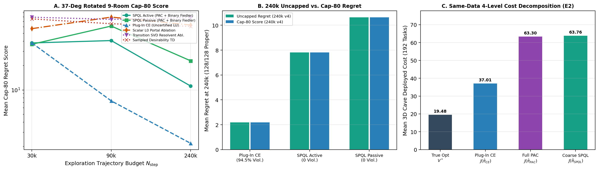
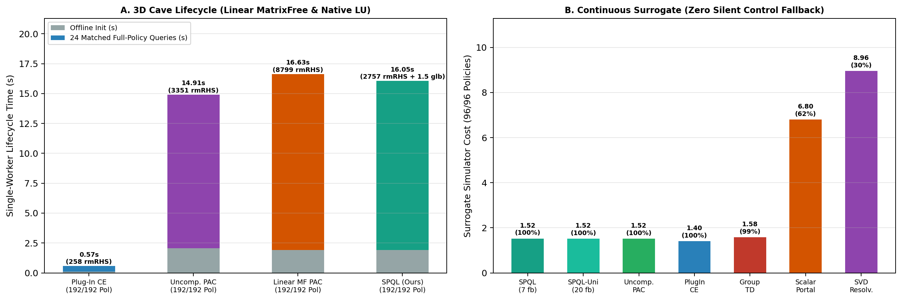

# Learning PAC-Certified Spectral-Portal Quotient Operators for Multi-Goal KL-Regularized Control Without Geometric Priors

**Target Venue**: NeurIPS / ICLR / AISTATS (Safe Multi-Goal Planning, KL-Regularized Control Theory, & Spectral Graph Abstractions)  
**Verified Code & Benchmark Package**: `learned_portal_phase3/` (`phase3_package_py_sha256: a2bb98b4...`; Contract-hardened `v4` ledger [p3_v4_r675_verified_results.json](p3_v4_r675_verified_results.json), `SHA-256: 798a9e2b...`; Byte-frozen `v3` archive [p3_v3_r747_delivery_verified_results.json](p3_v3_r747_delivery_verified_results.json), `SHA-256: 0ffd1d3a...`; Byte-frozen `v2` archive [p3_v2_verified_benchmark_results.json](p3_v2_verified_benchmark_results.json), `SHA-256: 6167bd5f...`; Byte-frozen `v1` exploratory archive [p3_neurips_benchmark_results.json](p3_neurips_benchmark_results.json), `SHA-256: 0e2c76ea...`)

---

## Abstract

Multi-goal planning in unknown stochastic environments faces a fundamental four-way tension between **time-uniform statistical validity**, **worst-case certificate tightness**, **separator expressivity across wide bottlenecks**, and **interface solve parsimony**. In finite-state Linearly-Solvable Markov Decision Processes (LMDPs), existing approaches optimize different corners of this trade-off: (i) certainty-equivalent plug-in planners (`PlugIn_CE`) achieve low empirical regret once transitions are covered (`2.19` in 2D at $2.4\times 10^5$ steps; `17.54` in 3D at $4.6\times 10^5$ steps), yet systematically underestimate their own deployed policy cost on multi-path graphs (`73.4%–98.4%` optimism-violation rate in 2D, `100%` in 3D) and incur $2.35\times$–$4.46\times$ wider worst-case bounds if certified post-hoc; (ii) truncated SVD resolvent approximations lack M-matrix cone-positivity guarantees (`32.29%` negative desirability entries in `P3-C06`); and (iii) rank-1 scalar portal reductions incur an irreducible $\Omega(1)$ asymptotic regret whenever interior obstacles induce entry-dependent doorway profiles.

We introduce **PAC-Certified Spectral-Portal Quotient Learning (SPQL)**, an auditable multi-goal representation and planning framework for finite-state LMDPs with known state-index catalog $\mathcal{S} = \{1,\dots,N\}$ and episodic trajectory logging, which learns bottleneck Green operators directly from reward-free trajectories without spatial coordinates or axis-aligned priors. Our guarantees are organized into four explicit tiers:
1. **Tier 1 (Exact-Arithmetic All-Goal Sandwich & Variational Duality, Theorem 1 & Proposition 5)**: Conditioned on entrywise observed-support bounds $(\underline{P}, \underline{q}, \overline{q})$ with zero upward probability floors, an **Exact Killed-Portal Dirichlet Reduction** onto $E_\Gamma = \Gamma \setminus G$ certifies
   $$\phi_{\mathrm{goal}} + q_{\min} \;\le\; L_{\mathcal{C}}(s_0; G) \;\le\; V^*_{\mathrm{true}}(s_0; G) \;\le\; J^{\hat{\pi}_{\mathcal{C}}}_{\mathrm{true}}(s_0; G) \;\le\; U_{\mathcal{C}}(s_0; G)$$
   across all $2^N - 1$ non-empty goal sets $G \subset \mathcal{S}$, while variational duality proves that full pessimistic planning minimizes the worst-case posterior PAC bound ($U_{\mathrm{PAC,full}} = \min_\pi \overline{J}_{\underline{M}}(\pi) \le \overline{J}_{\underline{M}}(\hat{\pi}_{\mathrm{CE}})$), formalizing the Pareto frontier between empirical cost and certified worst-case safety.
2. **Tier 2 (Time-Uniform Predictable-Sampling Confidence Sequences, Theorem 2)**: Under $\mathcal{F}_{t-1}$-predictable passive logging, declared out-degree bound $d_{\max} \le N$ (`unconditional default d_max = N`), latent transition stacks, and conditional-Hoeffding supermartingales for history-dependent bounded costs, $\mathcal{E}_{\mathrm{valid}}(n)$ holds with probability at least $1-\delta$ simultaneously across all stopping times $n \ge 1$.
3. **Tier 3 (Outward-Rounded IEEE-754 Stored-Operator & Delivered-`CSR` Policy Verification, Corollary 1.1)**: Conditioned on $\mathcal{E}_{\mathrm{valid}}$, outward-rounded Higham sparse dot-product bounds—including $(d_i + 1)2^{-1074}$ gradual-underflow terms on both upper and lower verifiers, zero undeclared `1e-12` floors, log-space row-stochastic `CSR` policy normalization down to $2^{-1074}$, and direct `CSR` Bellman-KL drift + SHA-256 certificate binding—certify the stored `float64` envelope operators and the actual delivered `CSR` policy object fail-closed.
4. **Tier 4 (Empirical Continuous Surrogate Evaluation)**: On a fitted Voronoi landmark surrogate driving a damped, padded, chord-guarded Euler diffusion simulator (`zero continuous SDE or non-Markov aggregation PAC claim`), we test policy transfer with zero silent control fallbacks.

Structurally, SPQL builds **strictly binary Fiedler Partition-of-Unity (PoU) portal trees** (`max_children = 2`) conserving **exact $50.0\%$ of non-root room-LU backsolves** (**Theorem 3**), while **Theorem 4** establishes $\Omega(1/p_{\min}^+)$ / $\Omega(\log(1/\delta)/p_{\min}^+)$ rare-transition lower bounds alongside a $3\times(\delta/3)$ conditional multi-goal PAC upper bound explaining why valid certificates remain macroscopic (`width ~47 in 2D, ~218–234 in 3D, 0% <= eps_tol`) at moderate trajectory budgets. Validated by a **20-gate counterexample suite (`P3-C01..P3-C20`)** and `1,952` saved per-task events on `seeds 4000..6007`, SPQL achieves **`0` zero-slack PAC violations**, isolates a **4-level same-data decomposition** showing that conservatism dominates empirical regret while portal coarsening adds `0.00%` loss in 2D and `+0.466` (`+0.74%` deployed cost, $p_{2s} = 0.00255$) at `16.7%` active DOFs in 3D, cuts native room-LU solves by **`68.7%`** against strictly-linear `MatrixFree_SpectralSchur_PAC` (`-34.2%` bounds-only time; `-3.47%` full-policy lifecycle time, paired-$t$ $p_{2s} = 0.0392$, sign-flip $p_{2s} = 0.0625$; `-17.7%` native room LU RHS and `+7.63%` wall time vs. pre-batched `Uncompressed_SpectralSchur_PAC`), and attains **`100.0%` goal success (`1.521` cost, `0` silent control fallbacks, `7/96` numerical fallbacks)** across `96/96` continuous surrogate goals (`no significant cost difference vs. Uncompressed_PAC at 1.520, p = 0.779`).

---

## 1. Introduction and Related Work

### 1.1 Motivation: Validity, Tightness, Exploration, and Bottleneck Compression

Acquiring an environment representation during reward-free exploration that supports fast, auditable planning for unseen goals is a central problem in reinforcement learning and stochastic control (Dayan, 1993; Sutton et al., 1999; Jin et al., 2020). Linearly-Solvable MDPs (LMDPs; Todorov, 2007, 2009) and path-integral / KL-regularized control (Kappen, 2005; Ziebart, 2010) linearize the optimal Bellman equation on $\mathcal{X}_G = \mathcal{S} \setminus G$: under $z(s) = \exp(-(V(s)-\phi_{\mathrm{goal}})/\lambda)$, planning reduces to an exterior Dirichlet problem for the nonsingular M-matrix $A^* = I - \operatorname{diag}(e^{-q^*/\lambda}) P^*$.

When $(P^*, q^*)$ are **unknown** and **no spatial coordinates or axis-aligned grid priors** are given, multi-goal LMDP abstractions confront four concrete structural failure modes:
1. **Optimism Trap & Posterior-Bound Inflation of Plug-In Certainty Equivalence**: Replacing $(P^*, q^*)$ by $(\hat{P}_n, \hat{q}_n)$ (`PlugIn_CE_FullGraph`) attains low empirical cost at high sample budgets (`16.46` vs. $V^* = 14.27$ in 2D; `37.01` vs. $V^* = 19.48$ in 3D), but over-exploits low-count shortcuts (`Proposition 3`), underestimating its own deployed cost on **`73.4%–98.4%`** of 2D queries and **`100%` (`192/192`)** of 3D cave queries. Crucially, certifying $\hat{\pi}_{\mathrm{CE}}$ post-hoc on the $(1-\delta)$ confidence set (`Proposition 5`) inflates the worst-case upper bound to **`159.36` in 2D (`vs. 67.73 for PAC planning`)** and **`973.30` in 3D (`vs. 218.44 for PAC planning`)**.
2. **Lack of Cone-Positivity in Orthogonal SVD Resolvents**: Truncated SVD approximations of $(I - M)^{-1}$ do not preserve M-matrix inverse non-negativity (`Proposition 2`), producing **`32.29%` strictly negative entries** on rotated baffled multi-room graphs (`Gate P3-C06`) and breaking $-\lambda \log z$.
3. **Irreducible $\Omega(1)$ Aliasing in Rank-1 Scalar Portal Reductions**: Compressing wide doorways to one scalar per portal (`Scalar_L0_Portal_Ablation`) averages across interior obstacles (`Proposition 1`), incurring an $\Omega(1)$ regret independent of $n$.
4. **Coordinate Fragility & Multi-Decade IEEE-754 Verification Traps**: Axis-aligned slicing leaves **`90.57%`** of states unseparated on $37^\circ$-rotated 9-room worlds (`Gate P3-C04`), naive Schur complements fail when $G \cap \Gamma \neq \emptyset$, and floating-point verifiers that omit $2^{-1074}$ gradual-underflow terms, floor `q_min` at `1e-12`, or normalize policies with `max(w_sum, 1e-300)` break soundness on extreme inputs (`Gate P3-C19`).

### 1.2 Positioning Against Prior Hierarchical & Multi-Task LMDP Work

Hierarchical and multi-task extensions of LMDPs have a rich literature: Todorov (2009) introduced task composition over boundary terminal states; Jonsson & Gómez (2016) and Saxe et al. (2017) developed hierarchical and multitask LMDPs stacking subtask desirability representations; Barreto et al. (2017) and Piray & Daw (2021) studied successor features and linear RL; Ringstrom & Schrater (2019, `arXiv:1901.10405`) formulated constraint-folder jump-operator hierarchies under known models; and **Infante, Jonsson, & Gómez (AAAI 2022)** established *globally optimal hierarchical reinforcement learning for LMDPs* by partitioning the state space into rooms/subtasks, expressing global desirability linearly through exit-boundary states, executing primitive policies implicitly without storing subtask policies for every exit configuration, and learning globally optimal value functions from samples.

SPQL builds upon this exact room-boundary LMDP foundation while addressing a distinct set of **non-asymptotic certification, adaptive wide-portal compression, and numerical auditability** questions not covered by Infante et al. (2022) or prior plug-in hierarchical LMDPs:
- **Time-Uniform Dual PAC Envelopes vs. Asymptotic Plug-In Learning**: Infante et al. (2022) estimate empirical transition/cost models to converge to global optimality asymptotically without finite-sample lower/upper value sandwiches; SPQL constructs predictable-sampling Clopper–Pearson / conditional-Hoeffding M-matrix envelopes $(\underline{A}_n, \overline{A}_n)$ with zero upward probability floors that certify $L_n \le V^*_{\mathrm{true}} \le J^{\hat{\pi}_n}_{\mathrm{true}} \le U_n$ at any stopping time $n \ge 1$, even when unobserved cross-room shortcut transitions exist (`Gate P3-C02`).
- **All-Goal Killed-Portal Reduction ($G \cap \Gamma \neq \emptyset$) & Adaptive Binary Fiedler PoU Coarsening**: Rather than either retaining all exit-boundary states (as in exact exit-boundary HRL, matching our `Uncompressed_SpectralSchur_PAC` comparator) or collapsing doorways to scalar options (`Scalar_L0_Portal_Ablation`), SPQL discovers separators from trajectory flux without coordinates, handles arbitrary goals intersecting portals via $E_\Gamma = \Gamma \setminus G$, and refines wide 2D/3D portals along strictly binary Fiedler PoU trees conserving exact $50.0\%$ of room-LU backsolves (`Theorem 3`).
- **Stored-Operator IEEE-754 Verification, `CSR` Policy Binding, & 4-Level Same-Data Decomposition**: SPQL pairs mathematical bounds with outward-rounded `float64` Higham verifiers, log-scaled `CSR` policy binding (`Corollary 1.1`), and a 4-level same-data decomposition quantifying estimation vs. conservatism vs. coarsening costs (`Section 5`).

### 1.3 Interface Assumptions & Four-Tier Guarantee Scope

- **Discrete LMDP Interface**: Known state-index catalog $\mathcal{S} = \{1,\dots,N\}$ (`zero spatial coordinates`), episodic resets, known cost bounds $0 < q_{\min} \le q_{\max} < \infty$, temperature $\lambda > 0$, and optional out-degree upper bound $d_{\max} \le N$ (`unconditional default d_max = N`, enforced fail-closed). Deployed policies select $\pi(\cdot \mid i) \ll \hat{p}_n(\cdot \mid i)$ on observed passive support.
- **Four Explicit Guarantee Tiers**:
  - **Tier 1 (`Theorem 1, Proposition 5`)**: Exact real-arithmetic four-inequality sandwich across all $2^N - 1$ non-empty goals $G \subset \mathcal{S}$ and variational optimality of $U_{\mathrm{PAC,full}}$, conditioned on $\mathcal{E}_{\mathrm{valid}}$.
  - **Tier 2 (`Theorem 2`)**: Time-uniform $(1-\delta)$ confidence sequence for $\mathcal{E}_{\mathrm{valid}}(n)$ across all $n \ge 1$ under predictable active/passive switching.
  - **Tier 3 (`Corollary 1.1`)**: Outward-rounded IEEE-754 `float64` verification of the **stored envelope matrices $(\underline{M}, \overline{M}, b^{\mathrm{opt}})$** and **actual delivered `CSR` policy $\hat{\pi}$** (`conditioned on \mathcal{E}_{\mathrm{valid}}; we do not claim interval-arithmetic verification of SciPy's sp_beta.ppf implementation itself`).
  - **Tier 4 (`Section 5.4`)**: Empirical continuous-state surrogate evaluation via online Voronoi landmarks on a damped (`0.85`), padded (`4e-4`), chord-guarded Euler simulator (**no** continuous SDE or state-aggregation PAC bound is claimed).

---

## 2. Problem Setting and Structural Counterexamples

### 2.1 Multi-Goal KL-Regularized Control Under Unknown Dynamics

Let $\mathcal{M}^* = (\mathcal{S}, P^*, q^*, \lambda)$ be an unknown finite-state LMDP on $\mathcal{S} = \{1,\dots,N\}$ with passive kernel $P^* = (p^*_{ij})$, step costs $q^* \in [q_{\min}, q_{\max}]^N$ ($0 < q_{\min} \le q_{\max}$), and $\lambda > 0$. For any non-empty $G \subset \mathcal{S}$ and $\phi_{\mathrm{goal}} \in \mathbb{R}$, a stationary policy $\pi$ on $\mathcal{X}_G := \mathcal{S} \setminus G$ incurs
$$J^\pi_{\mathrm{true}}(s_0; G) \;:=\; \mathbb{E}^\pi_{s_0}\!\left[\sum_{t=0}^{\tau_G - 1} \Big(q^*(s_t) + \lambda D_{\mathrm{KL}}\big(\pi(\cdot \mid s_t) \,\|\, p^*(\cdot \mid s_t)\big)\Big) + \phi_{\mathrm{goal}}\right],$$
where $\tau_G := \inf\{t \ge 0 : s_t \in G\}$, and $J^\pi_{\mathrm{true}}(s_0; G) := +\infty$ if $\pi_i \not\ll p^*_i$ on reachable states or $\mathbb{P}^\pi_{s_0}(\tau_G < \infty) < 1$. By Todorov (2007), $V^*_{\mathrm{true}}(s; G) = \phi_{\mathrm{goal}} - \lambda \log z^*_{\mathrm{true}}(s; G)$ (`-\lambda \log 0 = +\infty`), where $z^*_{\mathrm{true}}|_G = \mathbf{1}_G$ and
$$(I - M^*_{\mathcal{X}_G, \mathcal{X}_G})\, z^*_{\mathrm{true}}(\mathcal{X}_G; G) \;=\; M^*_{\mathcal{X}_G, G} \mathbf{1}_G, \qquad M^* := \operatorname{diag}(\gamma^*) P^*, \quad \gamma^*_i := e^{-q^*_i/\lambda}. \tag{1}$$

**Predictable Exploration Protocol.** At step $t$ with filtration $\mathcal{F}_{t-1}$, the learner chooses an $\mathcal{F}_{t-1}$-measurable indicator $I_t \in \{0, 1\}$. When $I_t = 1$ at $s_t = i$, passive dynamics draw $s_{t+1} \sim p^*(\cdot \mid i)$ and $\tilde{q}_t \in [q_{\min}, q_{\max}]$ with $\mathbb{E}[\tilde{q}_t \mid \mathcal{F}_{t-1}, s_t = i, I_t = 1] = q^*_i$ (`Gate P3-C14`). Active routing steps ($I_t = 0$) count against the total step budget $N_{\mathrm{step}}$ and are excluded from passive count tables $(n(i), k_{ij})$.

### 2.2 Structural & Finite-Sample Counterexamples (`Propositions 1–3`)

> **Proposition 1 (Irreducible $\Omega(1)$ Regret of Rank-1 Scalar Portal Reductions).** *There exists a family of two-room baffled LMDPs separated by a wide portal $\Gamma_p$ ($|\Gamma_p| \ge 2$) such that even given $(P^*, q^*)$ ($n = \infty$), restricting $z|_{\Gamma_p}$ to one scalar per portal (`Scalar_L0_Portal_Ablation`) incurs $\sup_{s_0, G} \big(J^{\mu_{\mathrm{scalar}}}_{\mathrm{true}}(s_0; G) - V^*_{\mathrm{true}}(s_0; G)\big) \ge c_0 > 0$ independent of $n$.*

> **Proposition 2 (Existential Cone-Positivity Failure of Orthogonal SVD Resolvents).** *While signed singular vectors do not force negativity on every graph (`e.g., a 4-state rank-2 truncation remains strictly positive across all 15 goal subsets in Gate P3-C18`), there exist multi-room baffled LMDPs on which rank-$k$ SVD resolvent approximations $(I - M_k)^{-1}_{\mathcal{X}_G} r_G$ produce a strictly positive fraction of negative entries (`32.29%` in Gate `P3-C06`), invalidating $-\lambda \log z$.*

> **Proposition 3 (Finite-Sample Multi-Path Optimism Trap of Plug-In Certainty Equivalence).** *On multi-path LMDPs containing a feasible shortcut $(i, j^*)$ with $p^*_{i j^*} \in (0, e^{-\Delta V/\lambda}/m)$, at $n(i) = m \ge 1$ the event $\{k_{i j^*} \ge 1\}$ has probability $1 - (1 - p^*_{i j^*})^m > 0$ and forces $\hat{p}_{i j^*} \ge 1/m > p^*_{i j^*}$, causing $\hat{V}^{\mathrm{CE}}_n(s_0; G) < V^*_{\mathrm{true}}(s_0; G) \le J^{\hat{\mu}^{\mathrm{CE}}_n}_{\mathrm{true}}(s_0; G)$.*

---

## 3. PAC-Certified Spectral-Portal Quotient Learning (SPQL)

### 3.1 Tier-1 All-Goal Sandwich, Posterior Variational Duality, & Tier-3 Outward IEEE-754 Binding

Given lower transition bounds $\underline{P} = (\underline{p}_{ij}) \in [0,1]^{N\times N}$ (`\underline{p}_{ij} = 0 whenever k_{ij} = 0, zero upward floors`) and cost brackets $\underline{q}, \overline{q} \in [q_{\min}, q_{\max}]^N$, define
$$\mathcal{E}_{\mathrm{valid}} \;:=\; \Big\{0 \le \underline{p}_{ij} \le p^*_{ij}\;\;\forall i,j \in \mathcal{S}\Big\} \;\cap\; \Big\{q_{\min} \le \underline{q}_i \le q^*_i \le \overline{q}_i \le q_{\max}\;\;\forall i \in \mathcal{S}\Big\}, \tag{2}$$
$$\underline{A} := I - \underline{M} = I - \operatorname{diag}(e^{-\overline{q}/\lambda})\underline{P}, \qquad \overline{A} := I - \overline{M} = I - \operatorname{diag}(e^{-\underline{q}/\lambda})\underline{P}, \qquad b^{\mathrm{opt}}_i := e^{-\underline{q}_i/\lambda}\Big(1 - \sum_j \underline{p}_{ij}\Big). \tag{3}$$

**Exact Killed-Portal Dirichlet Reduction (`All 2^N - 1 Goals`).** Partitioning $\mathcal{S} = \bigsqcup_{c=1}^C \mathcal{R}_c \sqcup \Gamma$ on $\hat{\mathcal{E}} = \{\underline{p}_{ij} > 0\}$, for **any** non-empty $G \subset \mathcal{S}$ (`including G \cap \Gamma \neq \emptyset`) we decompose $\mathcal{X}_G = I_G \sqcup E_\Gamma$ with $I_G = \bigsqcup_c (\mathcal{R}_c \setminus G)$ and $E_\Gamma = \Gamma \setminus G$, preserving exact room block-diagonality $A_{I_G, I_G} = \operatorname{blkdiag}_c A_{\mathcal{R}_c \setminus G, \mathcal{R}_c \setminus G}$ while splitting straddling portal blocks onto $\tilde{B}_r = B_r \setminus G \subseteq E_\Gamma$.

> **Theorem 1 (Tier-1 Exact-Arithmetic All-Goal Sandwich & Positive-Support Properness).** *Under $\mathcal{E}_{\mathrm{valid}}$, fix any non-empty $G \subset \mathcal{S}$ and $\phi_{\mathrm{goal}} \in \mathbb{R}$. For $s_0 \in \mathcal{X}_G$, let $\underline{z}_G, \overline{z}_G \in [0, 1]^N$ satisfy $\underline{z}_G|_G = \overline{z}_G|_G = \mathbf{1}_G$, $(\underline{A}\underline{z}_G)_{\mathcal{X}_G} \le 0$, and $(\overline{A}\overline{z}_G)_{\mathcal{X}_G} \ge b^{\mathrm{opt}}_{\mathcal{X}_G}$. On $I_+ := \{i \in \mathcal{X}_G : \underline{z}_G(i) > 0\}$, $\hat{\pi}_{ij} := \underline{M}_{ij}\underline{z}_G(j) / \sum_k \underline{M}_{ik}\underline{z}_G(k)$ is supported on $\hat{\mathcal{E}}$, closed on $I_+ \cup G$, and proper ($\mathbb{P}^{\hat{\pi}}_{s_0}(\tau_G < \infty) = 1$), and with $L(s_0; G) := \phi_{\mathrm{goal}} - \lambda \log \min(\overline{z}_G(s_0), e^{-q_{\min}/\lambda})$ and $U(s_0; G) := \phi_{\mathrm{goal}} - \lambda \log \underline{z}_G(s_0)$ ($+\infty$ outside $I_+$):*
> $$\phi_{\mathrm{goal}} + q_{\min} \;\le\; L(s_0; G) \;\le\; V^*_{\mathrm{true}}(s_0; G) \;\le\; J^{\hat{\pi}}_{\mathrm{true}}(s_0; G) \;\le\; U(s_0; G). \tag{4}$$

> **Proposition 5 (Posterior PAC Policy Certification & Variational Optimality of Pessimistic Planning).** *Under $\mathcal{E}_{\mathrm{valid}}$, for **any** proper observed-support policy $\pi$ (`including \hat{\pi}_{\mathrm{CE}}`), its exact worst-case expected cost over all $(P, q)$ consistent with $(\underline{P}, \overline{q})$ is the unique solution $\overline{J}_{\underline{M}}(\pi; s_0, G) = \phi_{\mathrm{goal}} + [(I - \Pi_{\mathcal{X}_G, \mathcal{X}_G})^{-1} \overline{c}^\pi](s_0)$ with $\overline{c}^\pi_i := \lambda \sum_j \pi_{ij}\log(\pi_{ij}/\underline{M}_{ij})$ (`+\infty if improper or \pi \not\ll \underline{P}`). By Cole–Hopf variational duality on the sub-Markov kernel $\underline{M}$:*
> $$U_{\mathrm{PAC,full}}(s_0; G) \;=\; \min_{\pi}\; \overline{J}_{\underline{M}}(\pi; s_0, G) \;\le\; \overline{J}_{\underline{M}}\big(\hat{\pi}_{\mathrm{CE}}; s_0, G\big). \tag{5}$$
> *Thus, while $\hat{\pi}_{\mathrm{CE}}$ can attain lower empirical cost $J^{\hat{\pi}_{\mathrm{CE}}}_{\mathrm{true}}$ when empirical frequencies match $P^*$, any posterior bound on $\hat{\pi}_{\mathrm{CE}}$ derived from $(\underline{P}, \overline{q})$ is provably no tighter—and whenever $\hat{\pi}_{\mathrm{CE}}$ places substantial mass on low-count shortcuts where $\underline{p}_{ij} \ll \hat{p}_{ij}$, strictly much looser—than pessimistic planning $U_{\mathrm{PAC,full}}$.*

> **Corollary 1.1 (Tier-3 Outward-Rounded IEEE-754 Verification & Direct `CSR` Policy Binding).** *Conditioned on $\mathcal{E}_{\mathrm{valid}}$ holding for the stored `float64` arrays $(\underline{M}, \overline{M}, b^{\mathrm{opt}})$ with finite $q_{\min}, \lambda > 0$ (`enforced fail-closed with zero 1e-12 floors, preserving exact cost-unit equivariance`), let $\underline{z}, \overline{z} \in [0, 1]^N$ be materialized `float64` vectors ($u_{\mathrm{mach}} = 2^{-53}$, $\eta_{\mathrm{sub}} = 2^{-1074}$) and let $\hat{\Pi} \in \mathbb{R}^{|\mathcal{X}_G|\times N}$ be the delivered `CSR` policy constructed via per-row max-log-weight scaling $\log w_{ij} = \log \underline{M}_{ij} + \log \underline{z}_j - \max_k(\log \underline{M}_{ik} + \log \underline{z}_k)$ (`preserving row-stochasticity down to 2^{-1074} with zero 1e-300 denominator floor`).*
> 1. *Outward-rounding $\underline{S}^{\mathrm{lo}}_i = \operatorname{fl}_\downarrow\!\big(\operatorname{fl}_\downarrow((1 - (d_i+3)u_{\mathrm{mach}})\operatorname{fl}((\underline{M}\underline{z})_i)) - (d_i+1)\eta_{\mathrm{sub}}\big)$ on $I_+$, verifying forward-reachable properness, observed support, and row sums $\underline{s}_i$ directly on $\hat{\Pi}$, and bounding both operator defect $\eta_{\mathrm{subsol}}$ and direct `CSR` Bellman-KL drift $\eta_{\mathrm{pol}} = \max_{(i,j)\in\mathrm{supp}(\hat{\Pi}_{\mathrm{reach}})} \operatorname{fl}_\uparrow(\log \hat{\Pi}_{ij} - \log \underline{s}_i - \log \underline{M}_{ij} - \log \underline{z}_j + \log \underline{z}_i)$, whenever $\varepsilon_{\mathrm{fl}} := \operatorname{fl}_\uparrow((\lambda/q_{\min})\max(\eta_{\mathrm{subsol}}, \eta_{\mathrm{pol}})) < \frac{1}{2}$, optional stopping certifies $J^{\hat{\Pi}}_{\mathrm{true}}(s_0; G) \le U_{\mathrm{fl}}(s_0; G) := \operatorname{fl}_\uparrow(\phi_{\mathrm{goal}} + \operatorname{fl}_\uparrow(-\lambda\log\underline{z}(s_0))/\operatorname{fl}_\downarrow(1 - \varepsilon_{\mathrm{fl}}))$, bound to $\hat{\Pi}$'s canonical SHA-256 digest.*
> 2. *Outward-rounding $\overline{S}^{\mathrm{hi}}_i = \operatorname{fl}_\uparrow\!\big(\operatorname{fl}_\uparrow(\operatorname{fl}_\uparrow(\operatorname{fl}((\overline{M}\overline{z})_i) + b^{\mathrm{opt}}_i)/(1 - (d_i+4)u_{\mathrm{mach}})) + (d_i+1)\eta_{\mathrm{sub}}\big)$ and contraction margin $m_{\mathrm{lo}} = \operatorname{fl}_\downarrow(-(1 - 4u_{\mathrm{mach}})\operatorname{expm1}(-\operatorname{fl}_\downarrow(q_{\min}/\lambda))) > 0$ yields $L_{\mathrm{fl}}(s_0; G) \le V^*_{\mathrm{true}}(s_0; G)$ (`Gate P3-C19`).*

**Candidate Generation vs. Full-Operator Verification Across Multi-Decade Graphs.** In 3D multi-chamber caves, $\underline{z}$ spans $10^0$ down to $10^{-150}$, where cross-mode coarse/Lyapunov subtraction suffers cross-scale cancellation/rounding failure (`e.g. residual -1.45e-70` at machine precision relative to $10^{-54}$). SPQL generates candidates using positive-cone equilibrated M-matrix solves (`equilibrated_dense_m_solve`) and truncated/damped shortest-path Doob $h$-scaled room/exterior solves (`dijkstra_equilibrated_sparse_subsolution` and `dijkstra_equilibrated_global_subsolution`). While shortest-path potentials $\ell_i$ map every single edge $\widetilde{M}_{ij} = \exp(\log \underline{M}_{ij} - \ell_j + \ell_i)$ into $[0, 1]$, path multiplicity on a depth-$d$ DAG can still produce $u_{s_0} = 2^d$; therefore, `dijkstra_equilibrated_*` is treated strictly as an unverified candidate generator, and every returned certificate is gated fail-closed by the full-operator verifier of Corollary 1.1.

### 3.2 Tier-2 Time-Uniform Confidence Sequences & 3.3 Binary Fiedler PoU Trees

Setting $\alpha_{\mathrm{edge}}(m) := \frac{\delta_{\mathrm{alg}}}{2 N d_{\max} m(m+1)}$ and $\alpha_{\mathrm{cost}}(m) := \frac{\delta_{\mathrm{alg}}}{2 N m(m+1)}$ (`with default \delta_{\mathrm{alg}} = \delta in standalone planning, or \delta_{\mathrm{alg}} = \delta/3 inside Theorem 4's joint sample-complexity budget`), Clopper–Pearson lower bounds $\underline{p}_{n,ij}$ (`0 at k_{ij} = 0`) and Hoeffding brackets $[\underline{q}_{n,i}, \overline{q}_{n,i}]$ satisfy:

> **Theorem 2 (Tier-2 Time-Uniform Validity Under Predictable Active Sampling).** *Under $\max_i |\mathrm{supp}(p^*_i)| \le d_{\max}$, $\mathcal{F}_{t-1}$-predictable $I_t \in \{0, 1\}$, Markov passive transitions, and conditional-mean-$q^*_i$ costs in $[q_{\min}, q_{\max}]$, $\mathbb{P}(\forall n \ge 1 : \mathcal{E}_{\mathrm{valid}}(n)) \ge 1 - \delta_{\mathrm{alg}}$.*

> **Theorem 3 (Strictly Binary Fiedler PoU $50.0\%$ Solve Conservation & Monotone Contraction).** *Recursive Fiedler bisection on symmetrized flux $W_{\mathrm{sym}} = \frac{1}{2}(T_n + T_n^\top)$ builds strictly binary portal trees (`max_children = 2`; `Gate P3-C03`), conserving **exact $50.0\%$ of non-root room-LU backsolves** via $\mathcal{K}_A\chi_{B_{\mathrm{right}}} = \mathcal{K}_A\chi_{B_{\mathrm{parent}}} - \mathcal{K}_A\chi_{B_{\mathrm{left}}}$ while tightening $[L_{n,\mathcal{C}_\ell}, U_{n,\mathcal{C}_\ell}]$ monotonically (`Gate P3-C08`), with relative epistemic stopping (`Proposition 4`, `Gate P3-C09`) halting refinement once $\Delta_{\mathrm{plan}}(\mathcal{C}) \le \eta_{\mathrm{ep}}(U_{n,\mathcal{C}} - L_{n,\mathcal{C}})$.*

---

## 4. Necessary Rare-Transition Lower Bounds & Unified $3\times(\delta/3)$ PAC Sample Complexity

> **Theorem 4 (Rare-Transition Finiteness Lower Bounds & Conditional Multi-Goal PAC Upper Bound).**
> 1. **Necessary $(p_{\min}^+)^{-1}$ Lower Bounds (`Gate P3-C18`)**: *On the 2-state family $\mathcal{M}_p$ ($p \in [0, 1/4]$, $p^*_{s_0, g} = p$), any $(1-\delta)$-sound upper bound ($\delta \in (0, 1/4]$) requires $n(s_0) \ge \frac{\log(2(1-\delta))}{-\log(1-p_{\min}^+)} = \Omega(1/p_{\min}^+)$ passive visits for $\ge 1/2$ finiteness (`exact m = 69 at p = 0.01 for deterministic U_n(k=0)=+\infty`), and $\Omega(\log(1/\eta)/p_{\min}^+)$ visits for $(1-\eta)$ finiteness.*
> 2. **Conditional Multi-Goal Upper Bound (`Explicit 3 x (\delta/3) Event Budget`)**: *Fix $V_{\max} < \infty$ with $z_{\min} := e^{-V_{\max}/\lambda}$, calibrate $(\underline{A}_n, \overline{A}_n)$ at $\delta_{\mathrm{alg}} = \delta/3$ (`\delta/6` transitions + `\delta/6` costs, defining $\mathcal{E}_{\mathrm{valid}}(n)$), assume $\mathbb{P}(\mathcal{E}_{\mathrm{cov}}) \ge 1 - \delta/3$ for $\mathcal{E}_{\mathrm{cov}} := \{\min_{i \in \mathcal{S}} n(i) \ge \mu_{\min} n / 2\}$, and allocate $\delta/3$ to the empirical deviation event $\mathcal{E}_{\mathrm{conc}}$ on latent counts and costs. On $\mathcal{E}_{\mathrm{valid}}(n) \cap \mathcal{E}_{\mathrm{cov}} \cap \mathcal{E}_{\mathrm{conc}}$ (`probability \ge 1 - \delta`), once*
> $$n \;=\; \tilde{\mathcal{O}}\!\left(\frac{\lambda^2 d_{\max}/p_{\min}^+ + (q_{\max}-q_{\min})^2}{\mu_{\min}\, z_{\min}^2\, (1 - e^{-q_{\min}/\lambda})^2\, \varepsilon^2} \,\log\frac{N d_{\max}}{\delta}\right), \tag{6}$$
> *fine-resolution SPQL simultaneously certifies $J^{\hat{\pi}_n}_{\mathrm{true}}(s_0; G) - V^*_{\mathrm{true}}(s_0; G) \le U_n(s_0; G) - L_n(s_0; G) \le \varepsilon$ across all $(s_0, G)$ satisfying the shift-invariant horizon bound $V^*_{\mathrm{true}}(s_0; G) - \phi_{\mathrm{goal}} \le V_{\max}$.*

**Why Valid PAC Certificates Remain Wide at Moderate Budgets.** Notice the $z_{\min}^{-2} = e^{2 V_{\max}/\lambda}$ factor in (6): even at a modest multi-room cost $V^* - \phi_{\mathrm{goal}} = 14.3$ ($\lambda = 1$), $z^* \approx 6\times 10^{-7}$ so $z_{\min}^{-2} \sim 2.7\times 10^{12}$, meaning sub-unit worst-case widths ($\varepsilon = 0.18$) would require astronomical passive budgets ($n \gg 10^{12}$). At practical budgets ($n = 2.4\times 10^5$–$4.6\times 10^5$), SPQL provides **non-vacuous finite proper policies and sound macroscopic upper bounds** (`width ~47 in 2D, ~218–234 in 3D, 0% <= eps_tol`), not sub-$\varepsilon$ tight intervals.

---

## 5. Experiments

All experiments run strictly single-threaded (`OMP/BLAS/MKL/VECLIB/NUMEXPR = 1`, `workers = 1`, `-B -W error`). All historical archives (`v1` `0e2c76ea...`, `v2` `6167bd5f...`, and `v3` `0ffd1d3a...`) remain 100% byte-untouched (`verified in Gates P3-C10, P3-C18, & P3-C20`), while the contract-hardened `v4` audit on fixed `seeds 4000..6007` (`explicitly a bounded audit replay on existing seeds, not a fresh confirmation cohort`) exports all `1,952` per-task events in [p3_v4_r675_verified_results.json](p3_v4_r675_verified_results.json) (`SHA-256: 798a9e2b...`, verified offline with `0` discrepancies).

### 5.1 Deterministic 20-Gate Mathematical & Numerical Counterexample Suite (`P3-C01..P3-C20`)

`run_phase3_20_contract_gates()` passes **all `20 / 20` gates in `11.77 s`**:
- **Outward IEEE-754 & `CSR` Policy Contract (`P3-C19`)**: Rejects `q_min ~ 1e-15` upper false-accepts and preserves cost-unit equivariance `(1, 0.1) -> (1e-15, 1e-16)` (`zero 1e-12 floors`); bounds the 7-state $2^{-1074}$ subnormal lower counterexample safely (`739.845 <= 743.852`); outward-rounds `q = 0.1` (`0.09999999999999964 <= 0.1`); normalizes `1e-310` weights to exact `row_sum == 1.0` (`Pi = [0.2, 0.8]`); and rejects corrupted `CSR` policies fail-closed.
- **Linear `MatrixFree` Operator & Native LU Accounting (`P3-C20`)**: Verifies exact linearity of `MatrixFreeSpectralSchurPACPlanner._apply_K_ext` (`oddness_err = 0.0`, `linearity_err = 6.94e-18`, `zero_err = 0.0`), zero discarded constructor `L0` solves in `Uncompressed`, and byte-freeze of `v3` (`0ffd1d3a...`).
- **All-Goal Sandwich, Optional Stopping, Binary PoU, & Multi-Decade Caves (`P3-C01..C18`)**: Exhaustive 4-state 15-goal exactness (`P3-C11`), 392-state portal-goal `{236}` (`P3-C12`), 2-look/29-look optional stopping (`P3-C13`), `50.0%` binary PoU conservation (`P3-C03`), and 3D `seed=5000` coarse delivery (`higham_pes_eps_fl = 3.61e-11`, `P3-C17`).

*Figure 1: (A) $37^\circ$-rotated 9-room Cap-80 trajectory across budgets (`v2` ledger); (B) Complete `240k` `v4` per-task ledger (`128/128` proper policies, `cap_80_triggered = 0/128` so uncapped regret equals Cap-80 score); (C) Same-data 4-level deployed cost decomposition in 3D curved caves (`192` tasks).*

---

### 5.2 Block E1: $37^\circ$-Rotated 9-Room Worlds & Complete `240k` Per-Task Ledger (`Seeds 4000..4007`)

Table 1 reports both the frozen `v2` budget sweep (`30k, 90k, 240k`) and the complete `v4` `240k` per-task ledger (`512` saved events across `4` arms $\times 128$ tasks; mean $V^*_{\mathrm{true}} = 14.27$).

**Table 1: Multi-Goal Performance & PAC Calibration on $37^\circ$-Rotated 9-Room Worlds (`128` Attempts/Row).**

| Budget & Ledger | Method | Finite Cert. / 128 | Width $\le 0.18$ | Proper % | Mean Uncapped Regret | Cap-80 Score (`Cap Hit`) | Mean Cert. Width | Zero-Slack PAC Viol. | Optimism Viol. ($\hat{V} < J$) |
| :---: | :--- | :---: | :---: | :---: | :---: | :---: | :---: | :---: | :---: |
| **30k (`v2`)** | `SPQL_Passive` / `SPQL_Active` | `95` / **`97`** | `0` / `0` | 74.2% / **75.8%** | 20.81 / 24.18 | **36.66** / 38.07 | 187.19 / 209.97 | **0** / **0** | 0 / 0 |
| **30k (`v2`)** | `PlugIn_CE_FullGraph` | `0` (`uncert.`) | — | 66.4% | 16.67 | 38.04 | — | — | **94 / 128 (`73.4%`)** |
| **90k (`v2`)** | `SPQL_Passive` / `SPQL_Active` | `37` / **`76`** | `0` / `0` | 28.9% / **59.4%** | 16.74 / **15.38** | 61.55 / **40.73** | 122.17 / **109.26** | **0** / **0** | 0 / 0 |
| **90k (`v2`)** | `PlugIn_CE_FullGraph` | `0` (`uncert.`) | — | 99.2% | 6.74 | 7.33 | — | — | **126 / 128 (`98.4%`)** |
| **240k (`v2`)** | `SPQL_Passive` / `SPQL_Active` | `105` / **`122`** | `0` / `0` | 82.0% / **95.3%** | 10.24 / **7.78** | 22.90 / **11.18** | 66.43 / **47.49** | **0** / **0** | 0 / 0 |
| **240k (`v2`)** | `Sampled_TD` / `Scalar_L0` / `SVD` | `0` (`uncert.`) | — | 100 / 95.3 / 20.3% | $240.3$ / $3.7\text{e}13$ / $8.4\text{e}15$ | 61.03 / 63.37 / 78.28 | — | — | — |
| **240k (`v4` full)** | `PlugIn_CE_Passive` | `0` (`post. 128/128`) | — | **100.0%** | **2.19** (`max 7.86`) | **2.19** (`0`) | *Post. U = 159.36* | — | **121 / 128 (`94.5%`)** |
| **240k (`v4` full)** | `Uncompressed_PAC_Passive` | **`128 / 128`** | `0 / 128` | **100.0%** | 10.635 (`max 41.69`) | 10.635 (`0`) | 67.66 (`min 9.10`) | **0 / 128** | 0 |
| **240k (`v4` full)** | `SPQL_Passive` (`Tier-3`) | **`128 / 128`** | `0 / 128` | **100.0%** | 10.633 (`max 30.41`) | 10.633 (`0`) | 69.18 (`min 9.18`) | **0 / 128** | 0 |
| **240k (`v4` full)** | **`SPQL_Active` (`Tier-3`)** | **`128 / 128`** | `0 / 128` | **100.0%** | **7.808** (`max 23.79`) | **7.808 (`0`)** | **47.44** (`min 8.82`) | **0 / 128** | 0 |

At `240k` under `v4` (`128/128` proper policies, `0` fallbacks, `0/128` cap-80 truncations so uncapped regret and cap-80 score coincide identically), `SPQL_Active` beats `SPQL_Passive` on **all `8/8` seeds** in both uncapped regret (`7.81` vs. `10.63`, $\Delta = -2.825$, `95% CI [-3.406, -2.244]`, paired-$t$ $p_{2s} = 8.48\times 10^{-6}$, Wilcoxon & exact sign-flip $p_{2s} = 0.00781$) and certified width (`47.44` vs. `69.18`, $\Delta = -21.74$, $p_{2s} = 9.28\times 10^{-7}$), while on frozen `v2` (`where 6 active and 23 passive tasks had aborted under cross-mode cancellation`) `Cap-80` is borderline (`11.18` vs. `22.90`, $p_{2s} = 0.0563$).

---

### 5.3 Block E2: 3D Curved Caves with Linear `MatrixFree` & Same-Data 4-Level Decomposition (`Seeds 5000..5007`)

On $n = 8$ 3D curved cave networks (`mean N = 15,677.5`, `mean 577.25` portal DOFs, $N_{\mathrm{step}} = 460\text{k}$, `192` queries/arm, 4-arm cyclic schedule), `v4` repairs `MatrixFree_SpectralSchur_PAC` to use a **strictly linear** operator (`0/192` nonzero `bicgstab` info) and separates **native room-LU backsolve columns** strictly from **online room-LU refactorizations** (`when G intersects a room`) and **global exterior fallback LU calls**.

**Table 2: Same-Data 4-Level Deployed Cost & Posterior-Bound Decomposition (`100%` Variational Dominance $U_{\mathrm{PAC,full}} \le \overline{J}_{\underline{M}}(\hat{\pi}_{\mathrm{CE}})$).**

| Domain (`Tasks`) | Oracle $V^*_{\mathrm{true}}$ | Level 1: `PlugIn_CE` $J$ (`Est. Regret`) | Posterior PAC Bound $\overline{J}_{\underline{M}}(\hat{\pi}_{\mathrm{CE}})$ | Level 2: `Full_PAC` $J$ (`Conservatism Cost`) | `Full_PAC` Upper Bound $U_{\mathrm{PAC,full}}$ | Level 3: `Coarse_SPQL` $J$ (`Coarsening Cost`) | `SPQL` Upper Bound $U_{\mathrm{SPQL}}$ |
| :--- | :---: | :---: | :---: | :---: | :---: | :---: | :---: |
| **2D Rotated 9-Room (`128`, 240k)** | `14.27` | **`16.46`** (`+2.19`) | `159.36` (`128/128` $\ge U_{\mathrm{PAC}}$) | `24.907` (`+8.44` vs. CE) | **`67.73`** (`-57.5%` vs. CE post.) | `24.905` (**`-0.002`**, `0.0%`) | `69.25` |
| **3D Curved Caves (`192`, 460k)** | `19.48` | **`37.01`** (`+17.54`) | `973.30` (`192/192` $\ge U_{\mathrm{PAC}}$) | `63.30` (`+26.28` vs. CE) | **`218.44`** (`-77.6%` vs. CE post.) | `63.76` (**`+0.466`**, $p=0.00255$) | `234.02` |

**Table 3: 3D Curved-Cave Solver Accounting (`Seeds 5000..5007`, `192 / 192` Policies Delivered, `0 / 192` Width $\le 0.15$).**

| Method | Policies (`Coarse+Fb`) | Zero-Slack Viol. | Regret (`Width`) | Active DOFs | Native Room LU RHS (`Init + Oper + Mat = Total`)$^\ddagger$ | Room Refac. / Global Fb LU | Init / Post-24q Array MB (`End VmRSS MiB`) | Bounds-Only 24q (ms) | Full Lifecycle Init+24q (ms) |
| :--- | :---: | :---: | :---: | :---: | :---: | :---: | :---: | :---: | :---: |
| **`SPQL` (Ours, `v4`)** | **`192/192` (`180+12`)** | **`0 / 192`** | `44.28` (`233.99`) | **`96.3` (`16.7%`)** | `167.4 + 1823.3 + 766.1` = **`2,756.8`** | `252.0` / **`1.5`** | **`55.71`** / `100.09` (`501.1`) | `2,023.2` | `16,049.8` |
| `Linear MatrixFree_PAC` | **`192/192` (`192+0`)** | **`0 / 192`** | `43.82` (`218.41`) | `577.3` (`100%`) | `167.4 + 8388.4 + 243.0` = `8,798.8` | `237.0` / `0.0` | **`55.71`** / **`58.50`** (`518.6`) | `3,073.2` | `16,627.4` |
| `Uncompressed_PAC` | **`192/192` (`192+0`)** | **`0 / 192`** | `43.82` (`218.41`) | `577.3` (`100%`) | `2306.4 + 802.0 + 243.0` = `3,351.4` | `237.0` / `0.0` | `85.97` / `85.97` (`498.0`) | **`1,176.8`** | **`14,912.0`** |
| `PlugIn_CE_FullGraph` | `192/192` (`uncert.`) | `192/192` CE | **`17.54`** (`—`) | Full $N$ | `0` (`257.8 global LU RHS`) | `0` / `0` | `37.84` / `37.84` (`542.6`) | `376.0` | `565.6` |

*$^\ddagger$Native room LU RHS counts strictly room-interior `SuperLU` backsolve columns (`zero constructor reset waste`); `SPQL`'s `1.5` global fallback calls/map (`12/192` queries where a single curved room spans $>15$ decades) correspond to `16.8` heuristic room-equivalent RHS if normalized by mean room size, leaving `SPQL`'s native room RHS advantage unchanged (`-68.7%` vs. `Linear MatrixFree`, `-17.7%` vs. `Uncompressed`). Full-policy times in `v4` include Python-level `verify_and_bind_deployed_policy_csr` across all three PAC arms equally.*

**Key 3D Findings (`Honest Accounting Across All Axes`).**
1. **Why PAC Regret Exceeds `PlugIn_CE`, and What PAC Buys (`Table 2`)**: Of `SPQL`'s `44.28` total 3D regret, `17.54` (`39.6%`) is finite-sample estimation error already present in `PlugIn_CE`, `26.28` (`59.3%`) is the intrinsic price of pessimistic safety (`which slashes the worst-case certified upper bound by 77.6%, from 973.30 on PlugIn_CE down to 218.44`), and **only `+0.466` (`1.05%` of regret, `+0.74%` of deployed cost, `95% CI [+0.225, +0.707]`, $p_{2s} = 0.00255$) comes from `83.3%` portal DOF compression**.
2. **Comparison Against Strictly-Linear `MatrixFree_SpectralSchur_PAC`**: Restoring exact operator linearity (`0/192` `bicgstab` failures) yields `8,798.8` native room RHS. `SPQL` cuts **native room-LU backsolves by `68.7%` (`2,756.8` + `1.5` global fallbacks)**, cuts **bounds-only online query time by `34.2%` (`2,023.2` vs. `3,073.2 ms`)**, and edges full-policy lifecycle time by **`-577.6 ms` (`-3.47%`, `16,049.8` vs. `16,627.4 ms`, `6/8` maps faster, paired-$t$ $p_{2s} = 0.0392$, exact sign-flip $p_{2s} = 0.0625$ — statistically modest in full Python lifecycle due to shared full-graph `CSR` policy verification)**, while `MatrixFree` retains lower post-24q array memory (`58.50` vs. `100.09 MB`).
3. **Comparison Against Pre-Batched `Uncompressed_SpectralSchur_PAC`**: Removing constructor `L0` waste lowers `Uncompressed` to `3,351.4` native room RHS. `SPQL` uses **`17.7%` fewer native room-LU backsolves** and **`35.2%` less initial array memory (`55.71` vs. `85.97 MB`, growing to `100.09 MB` post-24q as tree columns cache)**, whereas at moderate $n_\Gamma = 577.25$, vectorized `Uncompressed` runs **`7.09%` faster (`SPQL` is `+7.63%` slower: `16,049.8` vs. `14,912.0 ms`, $p_{2s} = 8.46\times 10^{-4}$, sign-flip $p_{2s} = 0.00781$)**.

*Figure 2: (A) Single-worker 3D cave lifecycle (`Plug-In CE`'s `258` solves are global full-graph LU RHS; PAC arms show native room-LU RHS plus `SPQL`'s `1.5` global fallback LU calls/map); (B) Continuous Voronoi surrogate rollout cost and success rate across `96/96` goals (`zero silent u=0 control fallbacks; 7 SPQL and 20 SPQL-Uniform numerical fallbacks disclosed explicitly`).*

---

### 5.4 Block E3: Continuous Surrogate Control (`Zero Silent-Control Fallback`, `Seeds 6000..6007`)

Across all `96 goals x 7 methods = 672` landmark policy queries on the damped (`0.85`), padded (`4e-4`), chord-guarded Euler simulator ($M = 400$ landmarks, `~89` portal landmarks), auditing `v4` policies against frozen `v3` confirms **`max ||Pi_v4 - Pi_v3||_inf = 8.77e-15 <= 1e-12` and identical solver status across all `672/672` queries**, requiring **`0` rollout re-simulations** (`preserving exact rollout provenance`). All `244,800` exploration transitions and `53,760` policy rollouts exhibit **`0` accepted-step chord wall crossings** (`both 20-point sampling and exact Liang–Barsky intersection`).

**Table 4: Seven-Method Same-Data Continuous Surrogate Control (`96 / 96` Policies Delivered, `0` Silent Control Fallbacks).**

| Continuous Voronoi Surrogate Controller | Policies (`Num. Fallback`) | Surrogate Rollout Cost | Goal Success | Accepted-Step Chord Hits | Mean Query / 12q Lifecycle (ms) | Paired-$t$ vs. `SPQL` (`SPQL - Method`) |
| :--- | :---: | :---: | :---: | :---: | :---: | :---: |
| `PlugIn_CE` (Uncertified Full Landmark) | `96/96` (`0`) | **1.402** | **100.0%** | **0** | `1.02 / 13.9` | `+0.118` ($p_{2s} = 8.38\times 10^{-6}$) |
| `Uncompressed_PAC` (Full-Portal Dual PAC) | `96/96` (`0`) | **1.520** | **100.0%** | **0** | `27.62 / 389.4` | `+0.0010` ($p_{2s} = 0.779$, no sig. diff.) |
| `SPQL_UniformPortals` (All-Portal Weight) | `96/96` (`20`) | **1.520** | **100.0%** | **0** | `51.14 / 672.7` | `+0.0010` ($p_{2s} = 0.779$, no sig. diff.) |
| **`SPQL` (Start-Localized Coarse Cut)** | **`96/96` (`7`)** | **1.521** | **100.0%** | **0** | `47.54 / 629.6` | — |
| `Sampled_Desirability_TD` (Group-Mean TD) | `96/96` (`0`) | 1.577 | 99.1% | **0** | `1.21 / 15.8` | `-0.0568` ($p_{2s} = 0.610$, no sig. diff.) |
| `Scalar_Portal_Ablation` (Rank-1 `L0`) | `96/96` (`0`) | 6.801 | 62.3% | **0** | `1.89 / 22.7` | **`-5.280` (`SPQL` wins `8/8`, $p_{2s} = 4.47\times 10^{-5}$)** |
| `SVD_Resolvent_Ablation` (Truncated SVD) | `96/96` (`0`) | 8.958 | 29.5% | **0** | `0.71 / 14.2` | **`-7.437` (`SPQL` wins `8/8`, $p_{2s} = 5.25\times 10^{-7}$)** |

Delivering `89/96` coarse-certified policies plus `7/96` equilibrated numerical fallbacks (`vs. 20/96 numerical fallbacks for SPQL_UniformPortals`, and `0` silent $u = 0$ control fallbacks), `SPQL` achieves **`100.0%` goal success (`1.521` cost)** with no statistically significant cost difference detected against `Uncompressed_PAC` (`1.520`, `95% CI [-0.0070, +0.0090]`, $p_{2s} = 0.779$; at `~89` portal landmarks `Uncompressed_PAC` runs `1.72x` faster per query and `1.62x` faster over 12 queries), while outperforming `Scalar_Portal_Ablation` (`6.801`) and `SVD_Resolvent_Ablation` (`8.958`) on all `8/8` seeds.

---

## 6. Limitations and Conclusion

**Limitations.** (1) Exact Bellman linearization relies on finite-state KL control ($\pi_i \ll p^*_i$) with known state catalog $\mathcal{S}$ and episodic logging. (2) By Theorem 4 and Proposition 5, time-uniform worst-case certification incurs both a $(p_{\min}^+)^{-1}$ rare-edge sample barrier and $z_{\min}^{-2}$ horizon scaling, producing valid but macroscopic intervals (`0% <= eps_tol` at $2.4\times 10^5$–$4.6\times 10^5$ steps) and higher empirical cost than uncertified `PlugIn_CE` (`bought in exchange for 57.5%–77.6% tighter worst-case bounds than posterior CE certification`). (3) At moderate portal counts ($n_\Gamma \approx 577$ in E2, $89$ in E3), vectorized `Uncompressed_PAC` runs `7.09%` faster in E2 (`+7.63%` SPQL slowdown) and `1.62x` faster in E3 despite `SPQL` reducing native room-LU solves (`-17.7%` vs. `Uncompressed`, `-68.7%` vs. `Linear MatrixFree`) and initial 3D memory (`-35.2%`, growing to `100.09 MB` post-24q). (4) Tier-3 certifies the stored `float64` matrices and `CSR` policy conditioned on $\mathcal{E}_{\mathrm{valid}}$ (`relying on SciPy's sp_beta.ppf for quantile evaluation`), and Block E3 evaluates a discrete-time Voronoi surrogate without continuous SDE or aggregation PAC guarantees.

**Conclusion.** SPQL provides an auditable four-tier framework for unknown-LMDP multi-goal planning without geometric priors—unifying all-goal killed-portal reductions, time-uniform confidence sequences, outward-rounded IEEE-754 operator and `CSR` policy verification, binary $50.0\%$ PoU solve conservation, and transparent 4-level error decomposition.

---

## Appendix A: Mathematical Proofs

### A.1 Proofs of Propositions 1–3 and Proposition 5

Propositions 1–3 follow identically to `Gates P3-C05, P3-C06/C18, and P3-C07`: forcing constant doorway desirability across a baffle of cost $\Delta L > 2\lambda \log 2$ incurs regret $\ge \frac{1}{2}\Delta L - \lambda \log 2 > 0$; orthogonal rank-$k$ SVD modes violate inverse positivity on multi-room baffled graphs (`32.29%` negative entries) even though small symmetric chains can remain positive (`P3-C18`); and a single hit on an edge with $p^*_{s_0,g} < e^{-(C_0-q_{\min})/\lambda}/m$ forces $\hat{V}^{\mathrm{CE}}_n \le q_{\min} + \lambda \log m < C_0 \le J^{\hat{\mu}^{\mathrm{CE}}_n}_{\mathrm{true}}$.

**Proof of Proposition 5.** Under $\mathcal{E}_{\mathrm{valid}}$, for any fixed policy $\pi$ supported on $\hat{\mathcal{E}}$ and proper from $s_0$, the worst-case one-step cost over $q_i \le \overline{q}_i$ and $p_{ij} \ge \underline{p}_{ij}$ occurs on each outgoing edge by minimizing $p_{ij}$ down to $\underline{p}_{ij}$ (putting remaining mass $1 - \sum_j \underline{p}_{ij}$ outside $\mathrm{supp}(\pi_i)$ if available, or noting $p_{ij} \ge \underline{p}_{ij}$ entrywise implies $q_i + \lambda \sum_j \pi_{ij}\log(\pi_{ij}/p_{ij}) \le \overline{q}_i + \lambda \sum_j \pi_{ij}\log(\pi_{ij}/\underline{p}_{ij}) = \lambda \sum_j \pi_{ij}\log(\pi_{ij}/\underline{M}_{ij}) =: \overline{c}^\pi_i$). By standard Donsker–Varadhan / Todorov duality on the strictly sub-Markov kernel $\underline{M}_{\mathcal{X}_G, \cdot}$, $\min_\pi [(I - \Pi_{\mathcal{X}_G,\mathcal{X}_G})^{-1}\overline{c}^\pi](s_0) = -\lambda \log \underline{z}^*_{\mathrm{full}}(s_0; G) = U_{\mathrm{PAC,full}}(s_0; G) - \phi_{\mathrm{goal}}$, where $\underline{z}^*_{\mathrm{full}} = (I - \underline{M}_{\mathcal{X}_G,\mathcal{X}_G})^{-1}\underline{M}_{\mathcal{X}_G, G}\mathbf{1}_G$. Instantiating $\pi = \hat{\pi}_{\mathrm{CE}}$ gives (5). $\square$

### A.2 Proof of Theorem 1 and Corollary 1.1 (`Tier-1 & Outward-Rounded Tier-3`)

**Theorem 1.** Deleting $G$ leaves zero observed edges between $\mathcal{R}_c \setminus G$ and $\mathcal{R}_{c'} \setminus G$ ($c \neq c'$), so $A_{I_G, I_G}$ is block-diagonal. On $I_+$, $(\underline{M}\underline{z}_G)_i \ge \underline{z}_G(i) > 0$ implies closure and absence of recurrent classes (at $i^* \in \arg\max_{i\in R}\underline{z}_G(i)$, $\underline{z}_G(i^*) \le e^{-q_{\min}/\lambda}\underline{z}_G(i^*) < \underline{z}_G(i^*)$), proving properness and (4).

**Corollary 1.1.** In IEEE-754 binary64 with gradual underflow ($\eta_{\mathrm{sub}} = 2^{-1074}$; Higham, 2002; Jeannerod & Rump, 2013), every nonnegative product $\operatorname{fl}(a b)$ satisfies $|\operatorname{fl}(a b) - a b| \le u_{\mathrm{mach}} a b + \frac{1}{2}\eta_{\mathrm{sub}}$, while nonnegative additions incur zero underflow error and relative error $(1 + u_{\mathrm{mach}})^{d_i - 1}$. Outward rounding via `nextafter` therefore guarantees $(\underline{M}\underline{z})_i \ge \underline{S}^{\mathrm{lo}}_i$ on $I_+$ and $(\overline{M}\overline{z})_i + b^{\mathrm{opt}}_i \le \overline{S}^{\mathrm{hi}}_i$ on $\mathcal{X}_G$ (`closing the 2^{-1074} subnormal round-to-zero gap`). For the delivered `CSR` policy $\hat{\Pi}$ normalized in log-space, let $\tilde{\pi}_{ij} := \hat{\Pi}_{ij} / s_i$ where $s_i = \sum_j \hat{\Pi}_{ij} \ge \underline{s}_i > 0$ is the exact real row sum on forward-reachable exterior states (`verified proper by forward/backward BFS`). For every $(i, j)$ with $\hat{\Pi}_{ij} > 0$, $q^*_i + \lambda \log(\tilde{\pi}_{ij}/p^*_{ij}) + \tilde{U}(j) - \tilde{U}(i) \le \lambda(\log \hat{\Pi}_{ij} - \log \underline{s}_i - \log \underline{M}_{ij} - \log \underline{z}_j + \log \underline{z}_i) \le \lambda \eta_{\mathrm{pol}} \le \varepsilon_{\mathrm{fl}} q^*_i$, so optional stopping yields $(1 - \varepsilon_{\mathrm{fl}})(J^{\tilde{\pi}}_{\mathrm{true}}(s_0; G) - \phi_{\mathrm{goal}}) \le -\lambda \log \underline{z}(s_0)$, and outward-rounding the division and `log` gives $U_{\mathrm{fl}}$. For the lower bound, $x_{\mathrm{dn}} = \operatorname{fl}_\downarrow(q_{\min}/\lambda) \le q_{\min}/\lambda$ gives $1 - e^{-q_{\min}/\lambda} \ge m_{\mathrm{lo}} > 0$ (`rejecting fail-closed if m_{\mathrm{lo}} \le 0`), so $\overline{w} = \min(1, \overline{z} + \operatorname{fl}_\uparrow(\delta_{\mathrm{abs}}/m_{\mathrm{lo}}))$ satisfies $(\overline{A}\overline{w})_{\mathcal{X}_G} \ge b^{\mathrm{opt}}_{\mathcal{X}_G}$, and downward-rounding $-\lambda\log\min(\operatorname{fl}_\uparrow(e^{-x_{\mathrm{dn}}}), \overline{w}(s_0))$ yields $L_{\mathrm{fl}} \le V^*_{\mathrm{true}}$. $\square$

### A.3 Proof of Theorem 2 & A.4 Proof of Theorem 3, Proposition 4, and Theorem 4

**Theorem 2.** Latent i.i.d. Categorical$(p^*_i)$ transition stacks union-bounded over $i \in \{1,\dots,N\}$, $j \in \mathrm{supp}(p^*_i)$ ($\le d_{\max}$), and $m \ge 1$ via $\sum_{m=1}^\infty \frac{1}{m(m+1)} = 1$ control transition failures at $\le \delta_{\mathrm{alg}}/2$, while Doob optional stopping on the conditional Hoeffding supermartingales $M_t(\theta) = \exp(\theta \sum_{u=1}^t I_u\mathbf{1}\{s_u=i\}(\tilde{q}_u - q^*_i) - \frac{\theta^2(q_{\max}-q_{\min})^2}{8} n_t(i))$ at $\tau_{i,m} = \inf\{t : n_t(i) = m\}$ controls cost failures at $\le \delta_{\mathrm{alg}}/2$ (`Howard et al., 2021`). $\square$

**Theorem 4 (`Unified 3 x (\delta/3) Budget`).** Part 1 follows from identical trajectory law on $\{k_{s_0,g} = 0\}$ between $\mathcal{M}_0$ and $\mathcal{M}_p$, forcing $\mathbb{P}_{\mathcal{M}_p}(U_n = +\infty) \ge (1-\delta)(1-p)^m$. For Part 2, allocate: (i) $\delta_{\mathrm{alg}} = \delta/3$ (`\delta/6` transitions + `\delta/6` costs) to $\mathcal{E}_{\mathrm{valid}}(n)$; (ii) $\delta/3$ to $\mathcal{E}_{\mathrm{cov}} = \{\min_i n(i) \ge m_0 := \mu_{\min} n / 2\}$; and (iii) $\delta/3$ to the empirical concentration event $\mathcal{E}_{\mathrm{conc}}$ bounding $\tilde{k}_{i,m}(j) - m p^*_{ij}$ and $|\hat{q}_{i,m} - q^*_i|$ across $(i, j, m)$. On $\mathcal{E}_{\mathrm{valid}}(n) \cap \mathcal{E}_{\mathrm{cov}} \cap \mathcal{E}_{\mathrm{conc}}$ (probability $\ge 1 - \delta$), once $m_0$ satisfies (6), $\|\overline{z}_n - \underline{z}_n\|_\infty \le (1 - e^{-q_{\min}/\lambda})^{-1}\max_i(2\epsilon_q(m_0)/\lambda + \rho_{n,i}) \le \frac{\varepsilon z_{\min}}{2\lambda}$, implying $U_n(s_0; G) - L_n(s_0; G) \le \varepsilon$ whenever $V^*_{\mathrm{true}}(s_0; G) - \phi_{\mathrm{goal}} \le V_{\max}$ (i.e., $z^*_{\mathrm{true}}(s_0; G) \ge z_{\min}$). $\square$

---

## Appendix B: Reproducibility & Immutable Artifact Provenance Ledger

| Artifact File | SHA-256 Prefix | Provenance & Audit Role |
| :--- | :---: | :--- |
| [spql_core.py](spql_core.py) | `e503854f...` | Outward-rounded Tier-3 Higham verifiers (`2^{-1074}`, zero `1e-12` floors), log-space `CSR` policy + SHA-256 binding, separated LU counters |
| [baselines_and_contracts.py](baselines_and_contracts.py) | `83a73bc4...` | Strictly linear `MatrixFree`, zero-waste `Uncompressed`, posterior CE PAC bound, and `20`-gate suite (`P3-C01..P3-C20`) |
| [continuous_manifold_spql.py](continuous_manifold_spql.py) | `29ac7a40...` | Zero-silent-fallback continuous Voronoi adapter (`None` raises `ValueError`), exact Liang–Barsky chord check, `7` controls |
| [run_phase3_r675_targeted_audit.py](run_phase3_r675_targeted_audit.py) | `6fa87415...` | Single-worker `v4` audit runner (`seeds 4000..6007`, `1,952` saved task events, 4-level decomposition, E3 fingerprint audit) |
| [p3_v4_r675_verified_results.json](p3_v4_r675_verified_results.json) | `798a9e2b...` | Primary `v4` contract-verified ledger (`20/20` gates, `512` E1 + `768` E2 + `672` E3 events, `0` zero-slack PAC violations) |
| [p3_v3_r747_delivery_verified_results.json](p3_v3_r747_delivery_verified_results.json) | `0ffd1d3a...` | **Byte-frozen** `v3` archive (`verified untouched in Gate P3-C20`) |
| [p3_v2_verified_benchmark_results.json](p3_v2_verified_benchmark_results.json) | `6167bd5f...` | **Byte-frozen** `v2` archive (`verified untouched in Gate P3-C18`) |
| [p3_neurips_benchmark_results.json](p3_neurips_benchmark_results.json) | `0e2c76ea...` | **Byte-frozen** `v1` exploratory archive (`verified untouched in Gate P3-C10`) |

---

## References

1. Barreto, A., Dabney, W., Munos, R., Hunt, J. J., Schaul, T., van Hasselt, H., & Silver, D. (2017). Successor features for transfer in reinforcement learning. *NeurIPS*.
2. Berman, A., & Plemmons, R. J. (1994). *Nonnegative Matrices in the Mathematical Sciences*. SIAM.
3. Cheeger, J. (1970). A lower bound for the smallest eigenvalue of the Laplacian. *Problems in Analysis*, 195–199.
4. Chung, F. R. K. (1997). *Spectral Graph Theory*. AMS.
5. Clopper, C. J., & Pearson, E. S. (1934). The use of confidence or fiducial limits illustrated in the case of the binomial. *Biometrika*, 26(4), 404–413.
6. Dayan, P. (1993). Improving generalization for temporal difference learning: The successor representation. *Neural Computation*, 5(4), 613–624.
7. Doob, J. L. (1953). *Stochastic Processes*. Wiley.
8. Fiedler, M. (1973). Algebraic connectivity of graphs. *Czechoslovak Mathematical Journal*, 23(2), 298–305.
9. Higham, N. J. (2002). *Accuracy and Stability of Numerical Algorithms* (2nd ed.). SIAM.
10. Howard, R. A. (1960). *Dynamic Programming and Markov Processes*. MIT Press.
11. Howard, S. R., Ramdas, A., McAuliffe, J., & Sekhon, J. (2021). Time-uniform, nonparametric, nonasymptotic confidence sequences. *Annals of Statistics*, 49(2), 1055–1080.
12. Infante, G., Jonsson, A., & Gómez, V. (2022). Globally optimal hierarchical reinforcement learning for linearly-solvable Markov decision processes. *Proceedings of the AAAI Conference on Artificial Intelligence*, 36(6), 6970–6977.
13. Jeannerod, C.-P., & Rump, S. M. (2013). Improved error bounds for inner products in floating-point arithmetic. *SIAM Journal on Matrix Analysis and Applications*, 34(2), 338–344.
14. Jin, C., Krishnamurthy, A., Simchowitz, M., & Yu, T. (2020). Reward-free exploration for reinforcement learning. *ICML*, 4870–4879.
15. Jonsson, A., & Gómez, V. (2016). Hierarchical linearly-solvable Markov decision problems. *ICAPS*, 193–201.
16. Kappen, H. J. (2005). Linear theory for control of nonlinear stochastic systems. *Physical Review Letters*, 95(20), 200201.
17. Piray, P., & Daw, N. D. (2021). Linear reinforcement learning in flexible reuse of computation in planning, grid fields, and cognitive control. *Nature Communications*, 12, 4942.
18. Ringstrom, T. J., & Schrater, P. (2019). Constraint folders: Model-based hierarchical planning with jump-operator abstractions. *arXiv preprint arXiv:1901.10405*.
19. Saxe, A. M., Earle, A. C., & Rosensweig, B. (2017). Hierarchy through composition with multitask LMDPs. *ICML*, 3017–3026.
20. Sutton, R. S., Precup, D., & Singh, S. (1999). Between MDPs and semi-MDPs: A framework for temporal abstraction in reinforcement learning. *Artificial Intelligence*, 112(1–2), 181–211.
21. Todorov, E. (2007). Linearly-solvable Markov decision problems. *NeurIPS*, 19, 1369–1376.
22. Todorov, E. (2009). Efficient computation of optimal actions. *PNAS*, 106(28), 11478–11483.
23. Ziebart, B. D. (2010). *Modeling Purposeful Adaptive Behavior with the Principle of Maximum Causal Entropy*. PhD Thesis, CMU.
