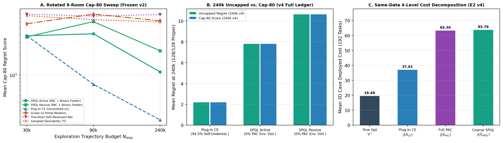
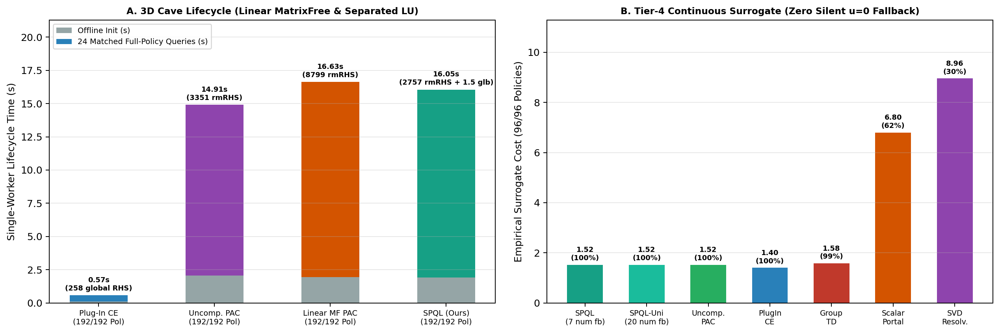

# Learning PAC-Certified Spectral-Portal Quotient Operators for Multi-Goal KL-Regularized Control Without Geometric Priors

**Target Venue**: NeurIPS / ICLR / AISTATS (Safe Multi-Goal Planning, KL-Regularized Control Theory, & Spectral Graph Abstractions)  
**Verified Code & Benchmark Package**: `learned_portal_phase3/` (`phase3_package_py_sha256: 45b76718...`; R7A provenance & simplex diagnostic sidecar [p3_v4_r7a_sidecar_diagnostics.json](p3_v4_r7a_sidecar_diagnostics.json), `SHA-256: 6bbedca9...`; Byte-frozen `v4` primary ledger [p3_v4_r675_verified_results.json](p3_v4_r675_verified_results.json), `SHA-256: 798a9e2b...`; Byte-frozen `v3` [p3_v3_r747_delivery_verified_results.json](p3_v3_r747_delivery_verified_results.json), `0ffd1d3a...`; Byte-frozen `v2` [p3_v2_verified_benchmark_results.json](p3_v2_verified_benchmark_results.json), `6167bd5f...`; Byte-frozen `v1` [p3_neurips_benchmark_results.json](p3_neurips_benchmark_results.json), `0e2c76ea...`)

---

## Abstract

Multi-goal planning in unknown stochastic environments faces a structural four-way tension between **time-uniform statistical validity**, **certificate tightness**, **separator expressivity across wide bottlenecks**, and **interface solve parsimony**. In finite-state Linearly-Solvable Markov Decision Processes (LMDPs), existing approaches occupy distinct regions of this trade-off: (i) certainty-equivalent plug-in planners (`PlugIn_CE`) achieve low empirical regret once transitions are covered (`2.19` in 2D at $2.4\times 10^5$ steps; `17.54` in 3D at $4.6\times 10^5$ steps), yet systematically underestimate their own deployed policy cost on multi-path graphs (`73.4%–98.4%` self-underestimation in 2D, `100%` in 3D) and yield $2.02\times$–$4.46\times$ wider post-hoc upper bounds under coordinatewise and row-stochastic Clopper–Pearson confidence models; (ii) truncated SVD resolvent approximations lack M-matrix cone-positivity guarantees (`32.29%` negative desirability entries in `P3-C06`); and (iii) rank-1 scalar portal reductions incur an irreducible $\Omega(1)$ asymptotic regret whenever interior obstacles induce entry-dependent doorway profiles.

We introduce **PAC-Certified Spectral-Portal Quotient Learning (SPQL)**, an auditable multi-goal representation and planning framework for finite-state LMDPs with known state-index catalog $\mathcal{S} = \{1,\dots,N\}$ and episodic trajectory logging, which learns bottleneck Green operators directly from reward-free trajectories without spatial coordinates or axis-aligned priors. Our guarantees are organized into four explicit tiers:
1. **Tier 1 (Exact-Arithmetic All-Goal Sandwich & Coordinatewise Surrogate Optimality, Theorem 1 & Proposition 5)**: Conditioned on entrywise observed-support bounds $(\underline{P}, \underline{q}, \overline{q})$ with zero upward probability floors, an **Exact Killed-Portal Dirichlet Reduction** onto $E_\Gamma = \Gamma \setminus G$ certifies
   $$\phi_{\mathrm{goal}} + q_{\min} \;\le\; L_{\mathcal{C}}(s_0; G) \;\le\; V^*_{\mathrm{true}}(s_0; G) \;\le\; J^{\hat{\pi}_{\mathcal{C}}}_{\mathrm{true}}(s_0; G) \;\le\; U_{\mathcal{C}}(s_0; G)$$
   across all $2^N - 1$ non-empty goal sets $G \subset \mathcal{S}$, while Proposition 5 characterizes the **coordinatewise (sub-Markov) posterior surrogate** $\overline{J}_{\underline{M}}(\pi) \ge \sup_{(P,q)\in\mathcal{C}_n} J^\pi_{P,q}$, its variational minimum $U_{\mathrm{PAC,full}} = \min_\pi \overline{J}_{\underline{M}}(\pi)$, and Bauer's exact vertex gap to the row-stochastic simplex (`including 2-state counterexamples where simplex posterior bounds are strictly tighter than U_{PAC,full}`).
2. **Tier 2 (Time-Uniform Predictable-Sampling Confidence Sequences, Theorem 2)**: Under $\mathcal{F}_{t-1}$-predictable passive logging, declared out-degree bound $d_{\max} \le N$ (`unconditional default d_max = N`), latent transition stacks, and conditional-Hoeffding supermartingales for history-dependent bounded costs, $\mathcal{E}_{\mathrm{valid}}(n)$ holds with probability at least $1-\delta$ simultaneously across all stopping times $n \ge 1$.
3. **Tier 3 (Outward-Rounded IEEE-754 Stored-Operator & Delivered-`CSR` Policy Verification, Corollary 1.1)**: Conditioned on $\mathcal{E}_{\mathrm{valid}}$ and standard IEEE-754 round-to-nearest-even `binary64` arithmetic (`no flush-to-zero, faithful libm log/exp/expm1`), outward-rounded Higham sparse dot-product bounds—including $(d_i + 1)2^{-1074}$ gradual-underflow terms on both upper and lower verifiers, zero undeclared `1e-12` floors, log-space row-stochastic `CSR` policy normalization down to $2^{-1074}$, and direct `CSR` Bellman-KL drift + SHA-256 binding—certify the stored `float64` envelope operators and the actual delivered `CSR` policy fail-closed.
4. **Tier 4 (Empirical Continuous Surrogate Evaluation)**: On a fitted Voronoi landmark surrogate driving a damped, padded, chord-guarded Euler diffusion simulator (`zero continuous SDE or non-Markov aggregation PAC claim`), we test policy transfer with zero silent control fallbacks.

Structurally, SPQL builds **strictly binary Fiedler Partition-of-Unity (PoU) portal trees** (`max_children = 2`) conserving **exact $50.0\%$ of non-root room-LU backsolves** (**Theorem 3**), while **Theorem 4** pairs $\Omega(1/p_{\min}^+)$ / $\Omega(\log(1/\delta)/p_{\min}^+)$ rare-transition finiteness lower bounds with a $3\times(\delta/3)$ conditional multi-goal sufficient upper bound (`distinguishing sufficiency from necessity via a 200-step high-cost counterexample achieving width 0.154 < 0.18`). Validated by a **21-gate counterexample suite (`P3-C01..P3-C21`)** and `1,952` saved method events (`960` discrete PAC events with **`0 / 960` zero-slack violations** and `0 / 960` reaching tight $\varepsilon = 0.18 / 0.15$, `320` uncertified `PlugIn_CE` controls, and `672` Tier-4 empirical continuous surrogate events), SPQL isolates a **same-data 4-level decomposition** showing that model estimation and coordinatewise pessimism dominate empirical regret while `83.3%` portal DOF compression adds only `+0.466` (`+0.74%` deployed cost, $p_{2s} = 0.00255$) in 3D (`-0.002` mean diff in 2D), cuts native room-LU backsolves by **`68.7%`** against strictly-linear `MatrixFree_SpectralSchur_PAC` (`-34.2%` interface-candidate stage time; `-3.47%` full lifecycle time, paired-$t$ $p_{2s} = 0.0392$, sign-flip $p_{2s} = 0.0625$; `-17.7%` native room LU RHS and `+7.63%` wall time vs. pre-batched `Uncompressed_SpectralSchur_PAC`), and attains **`100.0%` goal success (`1.521` cost, `0` silent control fallbacks, `7/96` numerical fallbacks)** across `96/96` continuous surrogate goals (`no significant cost difference vs. Uncompressed_PAC at 1.520, p = 0.779; higher cost than uncertified PlugIn_CE at 1.402`).

---

## 1. Introduction and Related Work

### 1.1 Motivation: Validity, Certificate Conservatism, Exploration, and Bottleneck Compression

Acquiring an environment representation during reward-free exploration that supports fast, auditable planning for unseen goals is a central problem in reinforcement learning and stochastic control (Dayan, 1993; Sutton et al., 1999; Jin et al., 2020). Linearly-Solvable MDPs (LMDPs; Todorov, 2007, 2009) and path-integral / KL-regularized control (Kappen, 2005; Ziebart, 2010) linearize the optimal Bellman equation on $\mathcal{X}_G = \mathcal{S} \setminus G$: under $z(s) = \exp(-(V(s)-\phi_{\mathrm{goal}})/\lambda)$, planning reduces to an exterior Dirichlet problem for the nonsingular M-matrix $A^* = I - \operatorname{diag}(e^{-q^*/\lambda}) P^*$.

When $(P^*, q^*)$ are **unknown** and **no spatial coordinates or axis-aligned grid priors** are given, multi-goal LMDP abstractions confront four structural challenges:
1. **Self-Underestimation & Post-Hoc Certificate Inflation of Plug-In Certainty Equivalence**: Replacing $(P^*, q^*)$ by $(\hat{P}_n, \hat{q}_n)$ (`PlugIn_CE_FullGraph`) attains low empirical cost at high sample budgets (`16.46` vs. $V^* = 14.27$ in 2D; `37.01` vs. $V^* = 19.48$ in 3D), but over-exploits low-count shortcuts (`Proposition 3`), underestimating its own deployed cost ($\hat{V}_{\mathrm{CE}} < J^{\hat{\pi}_{\mathrm{CE}}}$) on **`73.4%–98.4%`** of 2D queries and **`100%` (`192/192`)** of 3D cave queries (`distinct from a PAC envelope violation, as PlugIn_CE issues no PAC certificate`). Evaluating $\hat{\pi}_{\mathrm{CE}}$ under our coordinatewise posterior PAC surrogate (`Proposition 5`) yields **`159.36` in 2D (`vs. 67.73 for Full_PAC`)** and **`973.30` in 3D (`vs. 218.44 for Full_PAC`)**—and even under Bauer's tighter known-support row-stochastic simplex diagnostic (`136.53` in 2D, `856.87` in 3D) remains $2.02\times$–$3.92\times$ wider on these multi-room graphs.
2. **Lack of Cone-Positivity in Orthogonal SVD Resolvents**: Truncated SVD approximations of $(I - M)^{-1}$ do not preserve M-matrix inverse non-negativity (`Proposition 2`), producing **`32.29%` strictly negative entries** on rotated baffled multi-room graphs (`Gate P3-C06`) and breaking $-\lambda \log z$.
3. **Irreducible $\Omega(1)$ Aliasing in Rank-1 Scalar Portal Reductions**: Compressing wide doorways to one scalar per portal (`Scalar_L0_Portal_Ablation`) averages across interior obstacles (`Proposition 1`), incurring an $\Omega(1)$ regret independent of $n$.
4. **Coordinate Fragility & Multi-Decade IEEE-754 Verification Traps**: Axis-aligned slicing leaves **`90.57%`** of states unseparated on $37^\circ$-rotated 9-room worlds (`Gate P3-C04`), naive Schur complements fail when $G \cap \Gamma \neq \emptyset$, and floating-point verifiers that omit $2^{-1074}$ gradual-underflow terms, floor `q_min` at `1e-12`, or normalize policies with `max(w_sum, 1e-300)` break soundness on extreme inputs (`Gate P3-C19`).

### 1.2 Positioning Against Prior Hierarchical & Multi-Task LMDP Work

Hierarchical and multi-task extensions of LMDPs have an established foundation: Todorov (2009) introduced linear composition of optimal control laws over boundary states; Jonsson & Gómez (2016) and Saxe, Earle, & Rosman (2017) developed hierarchical and multitask LMDPs stacking subtask desirability representations; Barreto et al. (2017) and Piray & Daw (2021) studied successor features and linear RL; Ringstrom & Schrater (2019, `arXiv:1901.10405`) formulated constraint-folder jump-operator hierarchies under known models; and **Infante, Jonsson, & Gómez (AAAI 2022)** established *globally optimal hierarchical reinforcement learning for LMDPs* by partitioning the state space into rooms/subtasks, expressing global desirability linearly through exit-boundary states, executing primitive policies implicitly without storing subtask policies per exit configuration, and learning globally optimal value functions from samples.

**We do not claim state-space room partitioning, exit-boundary desirability linearity, or sample-based LMDP learning as novel.** Rather, SPQL addresses non-asymptotic certification, wide-portal adaptive coarsening, and numerical auditability questions distinct from Infante et al. (2022):
- **Time-Uniform Dual PAC Envelopes vs. Asymptotic Plug-In Learning**: Infante et al. (2022) learn empirical transition/cost models converging asymptotically without finite-sample `[L_n, U_n]` value sandwiches; SPQL constructs predictable-sampling Clopper–Pearson / conditional-Hoeffding M-matrix envelopes $(\underline{A}_n, \overline{A}_n)$ with zero upward probability floors that certify $L_n \le V^*_{\mathrm{true}} \le J^{\hat{\pi}_n}_{\mathrm{true}} \le U_n$ at any stopping time $n \ge 1$, even when unobserved shortcut transitions exist (`Gate P3-C02`).
- **All-Goal Killed-Portal Reduction ($G \cap \Gamma \neq \emptyset$) & Adaptive Binary Fiedler PoU Coarsening**: Instead of either keeping full exit-boundary resolution (`matching our Uncompressed_SpectralSchur_PAC baseline`) or collapsing portals to scalar options (`Scalar_L0_Portal_Ablation`), SPQL discovers separators from trajectory flux without coordinates, handles arbitrary portal-intersecting goals via $E_\Gamma = \Gamma \setminus G$, and refines wide portals along strictly binary Fiedler PoU trees conserving exact $50.0\%$ of non-root room-LU backsolves (`Theorem 3`).
- **Outward-Rounded Tier-3 Verification & Same-Data 4-Level Attribution**: SPQL pairs mathematical envelopes with outward-rounded `float64` Higham verifiers, log-scaled `CSR` policy binding (`Corollary 1.1`), and a 4-level + Bauer-simplex diagnostic isolating estimation, coordinatewise pessimism, and portal coarsening (`Section 5`).

### 1.3 Interface Assumptions & Four-Tier Guarantee Scope

- **Discrete LMDP Interface**: Known state-index catalog $\mathcal{S} = \{1,\dots,N\}$ (`zero spatial coordinates`), episodic resets, known cost bounds $0 < q_{\min} \le q_{\max} < \infty$, temperature $\lambda > 0$, and optional out-degree upper bound $d_{\max} \le N$ (`unconditional default d_max = N`, enforced fail-closed). Deployed policies select $\pi(\cdot \mid i) \ll \hat{p}_n(\cdot \mid i)$ on observed passive support.
- **Four Explicit Guarantee Tiers (`Plus Separate Numerical Diagnostics`)**:
  - **Tier 1 (`Theorem 1, Proposition 5`)**: Exact real-arithmetic four-inequality sandwich across all $2^N - 1$ non-empty goals $G \subset \mathcal{S}$ and coordinatewise surrogate variational optimality, conditioned on $\mathcal{E}_{\mathrm{valid}}$.
  - **Tier 2 (`Theorem 2`)**: Time-uniform $(1-\delta)$ confidence sequence for $\mathcal{E}_{\mathrm{valid}}(n)$ across all $n \ge 1$ under predictable active/passive switching.
  - **Tier 3 (`Corollary 1.1`)**: Outward-rounded IEEE-754 `float64` verification of the **stored envelope matrices $(\underline{M}, \overline{M}, b^{\mathrm{opt}})$** and **actual delivered `CSR` policy $\hat{\pi}$**, conditioned on $\mathcal{E}_{\mathrm{valid}}$ and standard IEEE-754 round-to-nearest-even `binary64` arithmetic without flush-to-zero/denormals-are-zero (`FTZ/DAZ = off`) and with standard faithful libm `log`/`exp`/`expm1` accuracy ($\le 1\text{–}2$ ULP, absorbed inside explicit multi-ULP `nextafter` guards; we do **not** claim interval-arithmetic verification of `scipy.stats.beta.ppf` itself). Post-hoc policy evaluators (`evaluate_posterior_pac_policy_upper_bound` and `evaluate_row_stochastic_simplex_posterior_diagnostic`) use standard `spsolve` and are labeled strictly as **high-precision numerical diagnostics**, never Tier-3 certificates.
  - **Tier 4 (`Section 5.4`)**: Empirical continuous-state surrogate evaluation via online Voronoi landmarks on a damped (`0.85`), padded (`4e-4`), chord-guarded Euler simulator (**no** continuous SDE or state-aggregation PAC bound is claimed).

---

## 2. Problem Setting and Structural Counterexamples

### 2.1 Multi-Goal KL-Regularized Control Under Unknown Dynamics

Let $\mathcal{M}^* = (\mathcal{S}, P^*, q^*, \lambda)$ be an unknown finite-state LMDP on $\mathcal{S} = \{1,\dots,N\}$ with passive kernel $P^* = (p^*_{ij})$, step costs $q^* \in [q_{\min}, q_{\max}]^N$ ($0 < q_{\min} \le q_{\max}$), and $\lambda > 0$. For any non-empty $G \subset \mathcal{S}$ and $\phi_{\mathrm{goal}} \in \mathbb{R}$, a stationary policy $\pi$ on $\mathcal{X}_G := \mathcal{S} \setminus G$ incurs
$$J^\pi_{\mathrm{true}}(s_0; G) \;:=\; \mathbb{E}^\pi_{s_0}\!\left[\sum_{t=0}^{\tau_G - 1} \Big(q^*(s_t) + \lambda D_{\mathrm{KL}}\big(\pi(\cdot \mid s_t) \,\|\, p^*(\cdot \mid s_t)\big)\Big) + \phi_{\mathrm{goal}}\right],$$
where $\tau_G := \inf\{t \ge 0 : s_t \in G\}$ (`+\infty if \pi_i \not\ll p^*_i on reachable states or improper`). By Todorov (2007), $V^*_{\mathrm{true}}(s; G) = \phi_{\mathrm{goal}} - \lambda \log z^*_{\mathrm{true}}(s; G)$, where $z^*_{\mathrm{true}}|_G = \mathbf{1}_G$ and
$$(I - M^*_{\mathcal{X}_G, \mathcal{X}_G})\, z^*_{\mathrm{true}}(\mathcal{X}_G; G) \;=\; M^*_{\mathcal{X}_G, G} \mathbf{1}_G, \qquad M^* := \operatorname{diag}(\gamma^*) P^*, \quad \gamma^*_i := e^{-q^*_i/\lambda}. \tag{1}$$

**Predictable Exploration Protocol.** At step $t$ with filtration $\mathcal{F}_{t-1}$, the learner chooses an $\mathcal{F}_{t-1}$-measurable indicator $I_t \in \{0, 1\}$. When $I_t = 1$ at $s_t = i$, passive dynamics draw $s_{t+1} \sim p^*(\cdot \mid i)$ and $\tilde{q}_t \in [q_{\min}, q_{\max}]$ with $\mathbb{E}[\tilde{q}_t \mid \mathcal{F}_{t-1}, s_t = i, I_t = 1] = q^*_i$ (`Gate P3-C14`). Active routing steps ($I_t = 0$) count against $N_{\mathrm{step}}$ and are excluded from passive count tables $(n(i), k_{ij})$.

### 2.2 Structural & Finite-Sample Counterexamples (`Propositions 1–3`)

> **Proposition 1 (Irreducible $\Omega(1)$ Regret of Rank-1 Scalar Portal Reductions).** *There exists a family of two-room baffled LMDPs separated by a wide portal $\Gamma_p$ ($|\Gamma_p| \ge 2$) such that even given $(P^*, q^*)$ ($n = \infty$), restricting $z|_{\Gamma_p}$ to one scalar per portal (`Scalar_L0_Portal_Ablation`) incurs $\sup_{s_0, G} \big(J^{\mu_{\mathrm{scalar}}}_{\mathrm{true}}(s_0; G) - V^*_{\mathrm{true}}(s_0; G)\big) \ge c_0 > 0$ independent of $n$.*

> **Proposition 2 (Existential Cone-Positivity Failure of Orthogonal SVD Resolvents).** *While signed singular vectors do not force negativity on every graph (`e.g., a 4-state rank-2 truncation remains strictly positive across all 15 goal subsets in Gate P3-C18`), there exist multi-room baffled LMDPs on which rank-$k$ SVD resolvent approximations $(I - M_k)^{-1}_{\mathcal{X}_G} r_G$ produce a strictly positive fraction of negative entries (`32.29%` in Gate `P3-C06`), invalidating $-\lambda \log z$.*

> **Proposition 3 (Finite-Sample Multi-Path Self-Underestimation of Plug-In Certainty Equivalence).** *On multi-path LMDPs containing a feasible shortcut $(i, j^*)$ with $p^*_{i j^*} \in (0, e^{-\Delta V/\lambda}/m)$, at $n(i) = m \ge 1$ the event $\{k_{i j^*} \ge 1\}$ has probability $1 - (1 - p^*_{i j^*})^m > 0$ and forces $\hat{p}_{i j^*} \ge 1/m > p^*_{i j^*}$, causing $\hat{V}^{\mathrm{CE}}_n(s_0; G) < V^*_{\mathrm{true}}(s_0; G) \le J^{\hat{\mu}^{\mathrm{CE}}_n}_{\mathrm{true}}(s_0; G)$.*

---

## 3. PAC-Certified Spectral-Portal Quotient Learning (SPQL)

### 3.1 Tier-1 All-Goal Sandwich, Surrogate vs. Simplex Posterior Bounds, & Tier-3 Verification

Given lower transition bounds $\underline{P} = (\underline{p}_{ij}) \in [0,1]^{N\times N}$ (`\underline{p}_{ij} = 0 whenever k_{ij} = 0, zero upward floors`) and cost brackets $\underline{q}, \overline{q} \in [q_{\min}, q_{\max}]^N$, define the normalized confidence set $\mathcal{C}_n := \{(P, q) : P \ge \underline{P},\; P\mathbf{1} = \mathbf{1},\; |\mathrm{supp}(P_i)| \le d_{\max},\; \underline{q} \le q \le \overline{q}\}$ corresponding to
$$\mathcal{E}_{\mathrm{valid}} \;:=\; \Big\{0 \le \underline{p}_{ij} \le p^*_{ij}\;\;\forall i,j \in \mathcal{S}\Big\} \;\cap\; \Big\{q_{\min} \le \underline{q}_i \le q^*_i \le \overline{q}_i \le q_{\max}\;\;\forall i \in \mathcal{S}\Big\}, \tag{2}$$
$$\underline{A} := I - \underline{M} = I - \operatorname{diag}(e^{-\overline{q}/\lambda})\underline{P}, \qquad \overline{A} := I - \overline{M} = I - \operatorname{diag}(e^{-\underline{q}/\lambda})\underline{P}, \qquad b^{\mathrm{opt}}_i := e^{-\underline{q}_i/\lambda}\rho_i, \quad \rho_i := 1 - \sum_j \underline{p}_{ij}. \tag{3}$$

**Exact Killed-Portal Dirichlet Reduction (`All 2^N - 1 Goals`).** Partitioning $\mathcal{S} = \bigsqcup_{c=1}^C \mathcal{R}_c \sqcup \Gamma$ on $\hat{\mathcal{E}} = \{\underline{p}_{ij} > 0\}$, for **any** non-empty $G \subset \mathcal{S}$ (`including G \cap \Gamma \neq \emptyset`) we decompose $\mathcal{X}_G = I_G \sqcup E_\Gamma$ with $I_G = \bigsqcup_c (\mathcal{R}_c \setminus G)$ and $E_\Gamma = \Gamma \setminus G$, preserving exact room block-diagonality $A_{I_G, I_G} = \operatorname{blkdiag}_c A_{\mathcal{R}_c \setminus G, \mathcal{R}_c \setminus G}$ while splitting straddling portal blocks onto $\tilde{B}_r = B_r \setminus G \subseteq E_\Gamma$.

> **Theorem 1 (Tier-1 Exact-Arithmetic All-Goal Sandwich & Positive-Support Properness).** *Under $\mathcal{E}_{\mathrm{valid}}$, fix any non-empty $G \subset \mathcal{S}$ and $\phi_{\mathrm{goal}} \in \mathbb{R}$. For $s_0 \in \mathcal{X}_G$, let $\underline{z}_G, \overline{z}_G \in [0, 1]^N$ satisfy $\underline{z}_G|_G = \overline{z}_G|_G = \mathbf{1}_G$, $(\underline{A}\underline{z}_G)_{\mathcal{X}_G} \le 0$, and $(\overline{A}\overline{z}_G)_{\mathcal{X}_G} \ge b^{\mathrm{opt}}_{\mathcal{X}_G}$. On $I_+ := \{i \in \mathcal{X}_G : \underline{z}_G(i) > 0\}$, $\hat{\pi}_{ij} := \underline{M}_{ij}\underline{z}_G(j) / \sum_k \underline{M}_{ik}\underline{z}_G(k)$ is supported on $\hat{\mathcal{E}}$, closed on $I_+ \cup G$, and proper ($\mathbb{P}^{\hat{\pi}}_{s_0}(\tau_G < \infty) = 1$), and with $L(s_0; G) := \phi_{\mathrm{goal}} - \lambda \log \min(\overline{z}_G(s_0), e^{-q_{\min}/\lambda})$ and $U(s_0; G) := \phi_{\mathrm{goal}} - \lambda \log \underline{z}_G(s_0)$ ($+\infty$ outside $I_+$):*
> $$\phi_{\mathrm{goal}} + q_{\min} \;\le\; L(s_0; G) \;\le\; V^*_{\mathrm{true}}(s_0; G) \;\le\; J^{\hat{\pi}}_{\mathrm{true}}(s_0; G) \;\le\; U(s_0; G). \tag{4}$$

> **Proposition 5 (Coordinatewise Conservative Surrogate Envelope, Surrogate Variational Optimality, & Row-Stochastic Simplex Slack).** *Under $\mathcal{E}_{\mathrm{valid}}$, for any proper observed-support policy $\pi$, define the **coordinatewise (sub-Markov) surrogate upper bound** $\overline{J}_{\underline{M}}(\pi; s_0, G) := \phi_{\mathrm{goal}} + [(I - \Pi_{\mathcal{X}_G, \mathcal{X}_G})^{-1} \overline{c}^\pi](s_0)$ with $\overline{c}^\pi_i := \lambda \sum_j \pi_{ij}\log(\pi_{ij}/\underline{M}_{ij})$ (`+\infty if improper or \pi \not\ll \underline{P}`). Then:*
> 1. **Valid Upper Bound & Surrogate Variational Optimality**: *Across the normalized confidence set $\mathcal{C}_n$,*
>    $$\sup_{(P, q) \in \mathcal{C}_n} J^\pi_{P, q}(s_0; G) \;\le\; \overline{J}_{\underline{M}}(\pi; s_0, G), \qquad U_{\mathrm{PAC,full}}(s_0; G) \;=\; \min_{\pi}\; \overline{J}_{\underline{M}}(\pi; s_0, G) \;\le\; \overline{J}_{\underline{M}}\big(\hat{\pi}_{\mathrm{CE}}; s_0, G\big). \tag{5}$$
> 2. **Strict Simplex Slack When $\mathrm{supp}(\pi_i)$ Covers All Feasible Destinations (`Gate P3-C21`)**: *Because $P_i \mathbf{1} = 1$ forces slack mass $\rho_i = 1 - \sum_j \underline{p}_{ij}$ onto some feasible state, by Bauer's Maximum Principle on the convex map $p_i \mapsto -\sum_j \pi_{ij}\log p_{ij}$, equality $\sup_{(P,q)\in\mathcal{C}_n} J^\pi_{P,q} = \overline{J}_{\underline{M}}(\pi)$ holds if every forward-reachable state $i$ admits a feasible zero-policy-mass absorber $k^* \notin \mathrm{supp}(\pi_i)$ (`e.g., |\mathrm{supp}(\underline{p}_i)| < d_{\max} \le N$ with unknown support). Whenever $\mathrm{supp}(\pi_i)$ covers all feasible successors (`e.g., N = |\mathrm{supp}(\pi_i)|$ or known observed support $\mathrm{supp}(P_i) = \mathrm{supp}(\underline{p}_i)$), the exact row-stochastic simplex step cost subtracts $\Delta c_i = \lambda \min_{k \in \mathrm{supp}(\pi_i)} \pi_{ik}\log(1 + \rho_i/\underline{p}_{ik}) > 0$ from $\overline{c}^\pi_i$. Consequently (`verified in Gate P3-C21` on $N = 2$, $q = \lambda = 1$, $\underline{p}_s = (0.1, 0.1)$), both $\pi = (0.5, 0.5)$ (`simplex worst case 3.0217 < U_{PAC,full} = 3.2651 < surrogate 5.2189`) and the realizable CE-optimal policy $\hat{\pi}_{\mathrm{CE}} = (0.2, 0.8)$ for $\hat{P}_s = (0.2e, 1-0.2e)$ (`simplex worst case 2.9534 < U_{PAC,full} = 3.2651 < surrogate 3.5027`) admit valid simplex posterior bounds strictly tighter than $U_{\mathrm{PAC,full}}$.*

> **Corollary 1.1 (Tier-3 Outward-Rounded IEEE-754 Verification & Direct `CSR` Policy Binding).** *Conditioned on $\mathcal{E}_{\mathrm{valid}}$ holding for the stored `float64` arrays $(\underline{M}, \overline{M}, b^{\mathrm{opt}})$ under IEEE-754 RN-even `binary64` arithmetic (`no FTZ/DAZ, faithful libm`) with finite $q_{\min}, \lambda > 0$ (`zero 1e-12 floors, exact cost-unit equivariance`), let $\underline{z}, \overline{z} \in [0, 1]^N$ be materialized `float64` vectors ($u_{\mathrm{mach}} = 2^{-53}$, $\eta_{\mathrm{sub}} = 2^{-1074}$) and $\hat{\Pi}$ be the `CSR` policy normalized in log-space (`row-stochastic down to 2^{-1074}, zero 1e-300 floor`). Outward-rounding $\underline{S}^{\mathrm{lo}}_i$ and $\overline{S}^{\mathrm{hi}}_i$ with $(d_i + 1)\eta_{\mathrm{sub}}$ gradual-underflow terms, contraction margin $m_{\mathrm{lo}} = \operatorname{fl}_\downarrow(-(1 - 4u_{\mathrm{mach}})\operatorname{expm1}(-\operatorname{fl}_\downarrow(q_{\min}/\lambda))) > 0$, and direct `CSR` Bellman-KL drift $\eta_{\mathrm{pol}}$ on $\hat{\Pi}$ (`Gate P3-C19`) certifies $L_{\mathrm{fl}}(s_0; G) \le V^*_{\mathrm{true}}(s_0; G) \le J^{\hat{\Pi}}_{\mathrm{true}}(s_0; G) \le U_{\mathrm{fl}}(s_0; G)$ fail-closed, bound to $\hat{\Pi}$'s canonical SHA-256 digest.*

**Candidate Generation vs. Full-Operator Verification Across Multi-Decade Graphs.** Across 3D caves ($\underline{z} \in [10^{-150}, 1]$), cross-mode subtraction suffers cross-scale cancellation/rounding failure (`e.g. residual -1.45e-70` relative to $10^{-54}$). SPQL generates candidates via positive-cone equilibrated M-matrix solves and truncated/damped shortest-path Doob $h$-scaled solves (`dijkstra_equilibrated_*`; since path multiplicity on a depth-$d$ DAG can still yield $u_{s_0} = 2^d$ despite edgewise $\widetilde{M}_{ij} \in [0, 1]$, these routines serve strictly as candidate generators gated fail-closed by Corollary 1.1).

### 3.2 Tier-2 Confidence Sequences & 3.3 Binary Fiedler PoU Trees

Setting $\alpha_{\mathrm{edge}}(m) := \frac{\delta_{\mathrm{alg}}}{2 N d_{\max} m(m+1)}$ and $\alpha_{\mathrm{cost}}(m) := \frac{\delta_{\mathrm{alg}}}{2 N m(m+1)}$ (`\delta_{\mathrm{alg}} = \delta` standalone, or `\delta/3` in Theorem 4):
- **Theorem 2 (Tier-2 Time-Uniform Validity)**: Under $\max_i |\mathrm{supp}(p^*_i)| \le d_{\max}$, predictable $I_t \in \{0, 1\}$, Markov passive transitions, and conditional-mean-$q^*_i$ costs in $[q_{\min}, q_{\max}]$, $\mathbb{P}(\forall n \ge 1 : \mathcal{E}_{\mathrm{valid}}(n)) \ge 1 - \delta_{\mathrm{alg}}$.
- **Theorem 3 & Proposition 4**: Recursive Fiedler bisection on $W_{\mathrm{sym}} = \frac{1}{2}(T_n + T_n^\top)$ builds strictly binary portal trees (`max_children = 2`; `Gate P3-C03`) conserving **exact $50.0\%$ of non-root room-LU backsolves**, tightening $[L_{n,\mathcal{C}_\ell}, U_{n,\mathcal{C}_\ell}]$ monotonically (`Gate P3-C08`), with relative coarse stopping (`Gate P3-C09`).

---

## 4. Rare-Transition Finiteness Lower Bounds & Conditional Sufficient PAC Bound

> **Theorem 4 (Rare-Transition Finiteness Lower Bounds & Conditional Multi-Goal Sufficient Upper Bound).**
> 1. **Necessary $(p_{\min}^+)^{-1}$ Lower Bounds for Finiteness (`Gate P3-C18`)**: *On the 2-state family $\mathcal{M}_p$ ($p \in [0, 1/4]$, $p^*_{s_0, g} = p$), any $(1-\delta)$-sound upper bound ($\delta \in (0, 1/4]$) requires $n(s_0) \ge \frac{\log(2(1-\delta))}{-\log(1-p_{\min}^+)} = \Omega(1/p_{\min}^+)$ visits for $\ge 1/2$ finiteness (`exact m = 69 at p = 0.01 for U_n(k=0)=+\infty`), and $\Omega(\log(1/\eta)/p_{\min}^+)$ visits for $(1-\eta)$ finiteness.*
> 2. **Conditional Sufficient Multi-Goal Upper Bound (`Explicit 3 x (\delta/3) Budget`)**: *Fix $V_{\max} < \infty$ with $z_{\min} := e^{-V_{\max}/\lambda}$, calibrate $(\underline{A}_n, \overline{A}_n)$ at $\delta_{\mathrm{alg}} = \delta/3$ (`\delta/6` transitions + `\delta/6` costs, event $\mathcal{E}_{\mathrm{valid}}(n)$), assume $\mathbb{P}(\mathcal{E}_{\mathrm{cov}}) \ge 1 - \delta/3$ for $\mathcal{E}_{\mathrm{cov}} := \{\min_{i \in \mathcal{S}} n(i) \ge \mu_{\min} n / 2\}$, and allocate $\delta/3$ to the empirical deviation event $\mathcal{E}_{\mathrm{conc}}$. On $\mathcal{E}_{\mathrm{valid}}(n) \cap \mathcal{E}_{\mathrm{cov}} \cap \mathcal{E}_{\mathrm{conc}}$ (`probability \ge 1 - \delta`), a **sufficient** sample budget for fine-resolution SPQL to certify $J^{\hat{\pi}_n}_{\mathrm{true}}(s_0; G) - V^*_{\mathrm{true}}(s_0; G) \le U_n(s_0; G) - L_n(s_0; G) \le \varepsilon$ across all $(s_0, G)$ with $V^*_{\mathrm{true}}(s_0; G) - \phi_{\mathrm{goal}} \le V_{\max}$ is*
> $$n \;=\; \tilde{\mathcal{O}}\!\left(\frac{\lambda^2 d_{\max}/p_{\min}^+ + (q_{\max}-q_{\min})^2}{\mu_{\min}\, z_{\min}^2\, (1 - e^{-q_{\min}/\lambda})^2\, \varepsilon^2} \,\log\frac{N d_{\max}}{\delta}\right). \tag{6}$$

**Distinguishing Sufficiency from Necessity (`Gate P3-C21`).** Equation (6) is a **worst-case sufficient upper bound**, *not* an information-theoretic lower bound showing that $z_{\min}^{-2} = e^{2 V_{\max}/\lambda}$ samples are universally necessary: in `Gate P3-C21`, a contract-legal 2-state deterministic transition problem with $q_{\min} = q_{\max} = 14.3$, $\lambda = 1$ ($z_{\min}^{-2} = 2.64\times 10^{12}$) achieves certified width **`0.1539 < 0.18` in just `200` total steps** (`100` visits/state) under our exact code! Rather, (6) is loose at multi-room horizons, while empirically on stochastic multi-path 2D/3D graphs at $n = 2.4\times 10^5$–$4.6\times 10^5$, uneven visit coverage, cost noise, and per-edge Clopper–Pearson relaxation yield **valid finite envelopes that remain macroscopic** (`width ~47 in 2D, ~218–234 in 3D, 0% <= eps_tol`).

---

## 5. Experiments

All runs execute single-threaded (`OMP/BLAS/MKL/VECLIB/NUMEXPR = 1`, `workers = 1`, `-B -W error`). All **47** historical `.py`/`.json` archives (`Phase-I`, `Phase-II`, `p3_v1`, `p3_v2`, `p3_v3`, and `p3_v4` [p3_v4_r675_verified_results.json](p3_v4_r675_verified_results.json) `798a9e2b...`) remain 100% byte-untouched (`verified in Gates P3-C10, C18, C20, & C21`), while [p3_v4_r7a_sidecar_diagnostics.json](p3_v4_r7a_sidecar_diagnostics.json) (`SHA-256: 6bbedca9...`) adds actual cross-commit E3 `CSR` comparisons, `320` CE `pred_val` records, and Bauer simplex diagnostics without altering any benchmark timing or re-simulating any rollout.

**Exact Event-Denominator & Guarantee-Tier Accounting.** Across `v4`'s `1,952` saved method events (`map-paired n = 8 seeds per block`), **`960` are discrete PAC events** (`384` in E1 `240k` + `576` in E2 `460k`, achieving **`0 / 960` zero-slack four-inequality violations** and **`0 / 960` tight-$\varepsilon$ completions** at $\varepsilon = 0.18 / 0.15$), **`320` are uncertified `PlugIn_CE` controls** (`128` E1 + `192` E2), and **`672` are Tier-4 empirical continuous surrogate events** (`not continuous PAC events`).

### 5.1 Deterministic 21-Gate Counterexample & Contract Suite (`P3-C01..P3-C21`)

`run_phase3_21_contract_gates()` passes **all `21 / 21` gates in `13.15 s`**, embedding:
- **Surrogate vs. Simplex & Sufficiency vs. Necessity (`P3-C21`)**: Verifies both 2-state Proposition 5 counterexamples (`3.0217 < 3.2651 < 5.2189` for $\pi=(0.5,0.5)$, and `2.9534 < 3.2651 < 3.5027` for CE-optimal $\hat{\pi}_{\mathrm{CE}}=(0.2,0.8)$), the `200`-step $q=14.3$ Theorem 4 example (`certified width 0.1539 < 0.18` despite $z_{\min}^{-2} = 2.64\times 10^{12}$), certified `materialize_policy=False` bounds-only timing (`62.61 ms` >= `45.98 ms` interface stage), and `p3_v4` byte-freeze (`798a9e2b...`).
- **Outward IEEE-754, Log-Space `CSR` Policy Binding, & Linear `MatrixFree` (`P3-C19, P3-C20`)**: Verifies the 7-state $2^{-1074}$ subnormal lower bound (`739.845 <= 743.852`), cost-unit equivariance (`zero 1e-12 floors`), `1e-310` `CSR` policy normalization (`row_sum == 1.0`), corrupted `CSR` rejection, and `MatrixFree` linearity (`oddness_err = 0.0`, `linearity_err = 6.94e-18`).

*Figure 1: (A) $37^\circ$-rotated 9-room Cap-80 sweep from frozen `v2`; (B) Complete `240k` `v4` ledger (`128/128` proper policies, `0` cap-80 truncations; note `94.5%` CE self-underestimation $\hat{V}_{\mathrm{CE}} < J^{\hat{\pi}_{\mathrm{CE}}}$ is distinct from `0%` PAC envelope violations); (C) Same-data 4-level deployed cost decomposition in 3D curved caves (`192` tasks).*

---

### 5.2 Block E1: $37^\circ$-Rotated 9-Room Worlds (`Seeds 4000..4007`)

**Table 1: Multi-Goal Performance & Calibration on $37^\circ$-Rotated 9-Room Worlds (`128` Attempts/Row, $n = 8$ Maps).**

| Budget & Ledger | Method | Finite Cert. / 128 | Width $\le 0.18$ | Proper % | Mean Uncapped Regret | Cap-80 Score (`Cap Hit`) | Mean Cert. Width | Zero-Slack PAC Viol. | CE Self-Underest. ($\hat{V}_{\mathrm{CE}} < J$) |
| :---: | :--- | :---: | :---: | :---: | :---: | :---: | :---: | :---: | :---: |
| **30k (`v2`)** | `SPQL_Passive` / `SPQL_Active` | `95` / **`97`** | `0` / `0` | 74.2% / **75.8%** | 20.81 / 24.18 | **36.66** / 38.07 | 187.19 / 209.97 | **0** / **0** | — |
| **30k (`v2`)** | `PlugIn_CE_FullGraph` | `0` (`uncert.`) | — | 66.4% | 16.67 | 38.04 | — | — | **94 / 128 (`73.4%`)** |
| **90k (`v2`)** | `SPQL_Passive` / `SPQL_Active` | `37` / **`76`** | `0` / `0` | 28.9% / **59.4%** | 16.74 / **15.38** | 61.55 / **40.73** | 122.17 / **109.26** | **0** / **0** | — |
| **90k (`v2`)** | `PlugIn_CE_FullGraph` | `0` (`uncert.`) | — | 99.2% | 6.74 | 7.33 | — | — | **126 / 128 (`98.4%`)** |
| **240k (`v2`)** | `SPQL_Passive` / `SPQL_Active` | `105` / **`122`** | `0` / `0` | 82.0% / **95.3%** | 10.24 / **7.78** | 22.90 / **11.18** | 66.43 / **47.49** | **0** / **0** | — |
| **240k (`v2`)** | `Sampled_TD` / `Scalar_L0` / `SVD` | `0` (`uncert.`) | — | 100 / 95.3 / 20.3% | $240.3$ / $3.7\text{e}13$ / $8.4\text{e}15$ | 61.03 / 63.37 / 78.28 | — | — | — |
| **240k (`v4` full)** | `PlugIn_CE_Passive` | `0` (`uncert.`) | — | **100.0%** | **2.19** (`max 7.86`) | **2.19** (`0`) | *Surr. Diag. 159.36* | — | **121 / 128 (`94.5%`)** |
| **240k (`v4` full)** | `Uncompressed_PAC_Passive` | **`128 / 128`** | `0 / 128` | **100.0%** | 10.635 (`max 41.69`) | 10.635 (`0`) | 67.66 (`min 9.10`) | **0 / 128** | — |
| **240k (`v4` full)** | `SPQL_Passive` (`Tier-3`) | **`128 / 128`** | `0 / 128` | **100.0%** | 10.633 (`max 30.41`) | 10.633 (`0`) | 69.18 (`min 9.18`) | **0 / 128** | — |
| **240k (`v4` full)** | **`SPQL_Active` (`Tier-3`)** | **`128 / 128`** | `0 / 128` | **100.0%** | **7.808** (`max 23.79`) | **7.808 (`0`)** | **47.44** (`min 8.82`) | **0 / 128** | — |

In the `R7A` sidecar (`128` saved `PlugIn_CE` `pred_val` rows), `PlugIn_CE` predicts mean $\hat{V}_{\mathrm{CE}} = 14.35$ vs. actual deployed $J = 16.46$ (`recomputing 121/128 self-underestimations directly from pred_val < J - 1e-9`). Under `v4` at `240k` (`0` cap-80 truncations), `SPQL_Active` improves over `SPQL_Passive` on **all `8/8` maps** in uncapped regret (`7.81` vs. `10.63`, $\Delta = -2.825$, `95% CI [-3.406, -2.244]`, paired-$t$ $p_{2s} = 8.48\times 10^{-6}$, exact sign-flip $p_{2s} = 0.00781$) and certified width (`47.44` vs. `69.18`, $p_{2s} = 9.28\times 10^{-7}$).

---

### 5.3 Block E2: 3D Curved Caves, 4-Level Attribution, & Bauer Simplex Diagnostic (`Seeds 5000..5007`)

**Table 2: Same-Data 4-Level Cost Attribution & Post-Hoc Surrogate/Simplex Diagnostics (`Numerical Diagnostics Labeled Explicitly`).**

| Domain (`Tasks`) | Oracle $V^*_{\mathrm{true}}$ | Level 1: `PlugIn_CE` $J$ (`Mean` $\hat{V}_{\mathrm{CE}}$) | `CE` Coord. Surrogate / Obs-Simplex Diag.$^\S$ | Level 2: `Full_PAC` $J$ (`Obs. Conservatism`) | `Full_PAC` Tier-3 $U$ / Obs-Simplex Diag.$^\S$ | Level 3: `Coarse_SPQL` $J$ (`Coarsening Diff`) | `SPQL` Tier-3 $U_{\mathrm{SPQL}}$ |
| :--- | :---: | :---: | :---: | :---: | :---: | :---: | :---: |
| **2D 9-Room (`128`, 240k)** | `14.27` | **`16.46`** (`pred 14.35`) | `159.36` / `136.53` | `24.907` (`+8.44` vs. CE) | **`67.73`** / `67.48` | `24.905` (`-0.002` mean diff) | `69.25` |
| **3D Caves (`192`, 460k)** | `19.48` | **`37.01`** (`pred 19.57`) | `973.30` / `856.87` | `63.30` (`+26.28` vs. CE) | **`218.44`** / `218.44` | `63.76` (**`+0.466`**, $p=0.00255$) | `234.02` |

*$^\S$`Coord. Surrogate` (`\overline{J}_{\underline{M}}`) and `Obs-Simplex Diag.` (`Bauer's exact vertex worst case over P_i \in \Delta(\mathrm{supp}(\underline{p}_i)), P_i \ge \underline{p}_i`) are `spsolve` numerical diagnostics (`not Tier-3`). Under unknown support at $d_{\max} = 8$, every E1/E2 state has $|\mathrm{supp}(\underline{p}_i)| \le 7 < 8 < N$, so the $d_{\max}=8$ simplex diagnostic equals `159.36` and `973.30` identically.*

**Table 3: 3D Curved-Cave Solver Accounting (`Seeds 5000..5007`, `192 / 192` Policies Delivered, `0 / 192` Width $\le 0.15$).**

| Method | Policies (`Coarse+Fb`) | Zero-Slack Viol. | Regret (`Width`) | Active DOFs | Native Room LU RHS (`Init + Oper + Mat = Total`) | Room Refac. / Global LU | Init / Post-24q Array MB (`End VmRSS MiB`) | Interface Cand. Stage 24q (ms)$^\dagger$ | Full Lifecycle Init+24q (ms) |
| :--- | :---: | :---: | :---: | :---: | :---: | :---: | :---: | :---: | :---: |
| **`SPQL` (Ours, `v4`)** | **`192/192` (`180+12`)** | **`0 / 192`** | `44.28` (`233.99`) | **`96.3` (`16.7%`)** | `167.4 + 1823.3 + 766.1` = **`2,756.8`** | `252.0` / **`1.5 fb`** | **`55.71`** / `100.09` (`501.1`) | `2,023.2` | `16,049.8` |
| `Linear MatrixFree_PAC` | **`192/192` (`192+0`)** | **`0 / 192`** | `43.82` (`218.41`) | `577.3` (`100%`) | `167.4 + 8388.4 + 243.0` = `8,798.8` | `237.0` / `0` | **`55.71`** / **`58.50`** (`518.6`) | `3,073.2` | `16,627.4` |
| `Uncompressed_PAC` | **`192/192` (`192+0`)** | **`0 / 192`** | `43.82` (`218.41`) | `577.3` (`100%`) | `2306.4 + 802.0 + 243.0` = `3,351.4` | `237.0` / `0` | `85.97` / `85.97` (`498.0`) | **`1,176.8`** | **`14,912.0`** |
| `PlugIn_CE_FullGraph` | `192/192` (`uncert.`) | `192/192` CE Underest. | **`17.54`** (`—`) | Full $N$ | **`0`** (`native room`) | `0` / **`257.8 glb RHS`** | `37.84` / `37.84` (`542.6`) | `376.0` | `565.6` |

*$^\dagger$`Interface Cand. Stage 24q (ms)` (`stored as bounds_only_query_ms in frozen v4 and exposed separately as interface_candidate_stage_ms in v4.1`) measures the portal/interface solve + optimistic lower check prior to pessimistic full-room extension and upper verification (`not a full certified bounds-only API time`). In `R7A` sidecar [p3_v4_r7a_sidecar_diagnostics.json](p3_v4_r7a_sidecar_diagnostics.json), `PlugIn_CE`'s `257.75` global full-graph LU RHS/map are separated explicitly from `native_room_lu_rhs = 0`.*

**Key Scientific Takeaways from Tables 2–3.**
1. **Where Control Loss & Certificate Width Originate (`Table 2`)**: In 3D caves, `17.54` comes from finite-sample estimation (`PlugIn_CE`), `26.28` is the **observed conservatism cost of our coordinatewise pessimistic model on this dataset** (`which tightens the coordinatewise surrogate bound by 77.6%, from 973.30 on PlugIn_CE to 218.44`), and **only `+0.466` (`+0.74%` deployed cost, `95% CI [+0.225, +0.707]`, $p_{2s} = 0.00255$) comes from `83.3%` portal coarsening** (`in 2D, mean difference -0.002 indicates close empirical parity, not a zero-loss theorem`). Crucially, our Bauer known-support simplex diagnostic reveals *why* row-sum normalization alone barely tightens `Full_PAC` (`218.4366 -> 218.4355`, `-0.0005%` in 3D): on multi-neighbor states, goal-directed policies assign tiny probability $\pi_{i k_{\min}} \ll 1$ to backwards neighbors, allowing a simplex adversary over per-edge Clopper–Pearson rectangles $P_i \ge \underline{p}_i$ to dump $\rho_i$ onto $k_{\min}$ with negligible KL relief—pinpointing coupled row-wise KL/multinomial confidence sets (rather than finer portal cuts) as the primary lever for future certificate tightening.
2. **Solver Efficiency Boundaries (`Table 3`)**: Against strictly-linear `MatrixFree_SpectralSchur_PAC` (`192/192` converged), `SPQL` cuts **native room-LU RHS by `68.7%` (`2,756.8` + `1.5` global fallbacks/map vs. `8,798.8`)** and shows a **modest `-3.47%` full-lifecycle edge (`16,049.8` vs. `16,627.4 ms`, `6/8` maps faster, paired-$t$ $p_{2s} = 0.0392$, exact sign-flip $p_{2s} = 0.0625`)**. Against pre-batched `Uncompressed_SpectralSchur_PAC` (`3,351.4` native room RHS), `SPQL` uses `17.7%` fewer native room-LU RHS and `35.2%` less initial array memory (`55.71` vs. `85.97 MB`, growing to `100.09 MB` post-24q as tree caches populate), but runs **`+7.63%` slower in wall time (`8/8` maps slower, `14,912.0` vs. `16,049.8 ms`, $p_{2s} = 8.46\times 10^{-4}$)** at moderate $n_\Gamma = 577.25$.

*Figure 2: (A) Single-worker 3D cave lifecycle (`Plug-In CE` labeled accurately as `258 global RHS`; PAC arms show native room-LU RHS plus `SPQL`'s `1.5` global fallback LU calls/map); (B) Tier-4 empirical Voronoi continuous surrogate rollout cost and success (`zero silent u=0 control fallbacks; 7 SPQL and 20 SPQL-Uniform numerical fallbacks`).*

---

### 5.4 Block E3: Tier-4 Empirical Continuous Surrogate (`Actual 672-Policy Cross-Commit Audit`)

Rather than comparing normalization formulas on a single `z` vector, `run_phase3_r7a_sidecar_audit.py` reconstructs **all `8 seeds x 12 tasks x 7 methods = 672` actual `CSR` policies** independently from frozen commit `67532c9` (`v3`) and the current codebase (`bit-identical X_curr, X_next, q_obs, landmarks across 8/8 seeds`). All `672 / 672` policy pairs share identical fallback status (`89` coarse + `7` numerical fallbacks for `SPQL`, `76` + `20` for `SPQL_UniformPortals`), `0 / 672` are bitwise hash-identical (`due to log-space vs. linear division`), and **all `672 / 672` are numerically equivalent well within `1e-12`** (`max entrywise diff = 8.77e-15`, `max induced row-L1 norm diff = 1.75e-14`), supporting reuse of frozen `v3` empirical rollout trajectories (`0` rollout re-simulations).

**Table 4: Tier-4 Continuous Voronoi Surrogate Control (`96 / 96` Policies, `0` Silent Control Fallbacks, `0` Accepted-Step Chord Hits).**

| Continuous Voronoi Surrogate Controller | Policies (`Num. Fallback`) | Empirical Rollout Cost | Goal Success | Accepted-Step Chord Hits | Mean Query / 12q Lifecycle (ms) | Paired-$t$ vs. `SPQL` (`SPQL - Method`) |
| :--- | :---: | :---: | :---: | :---: | :---: | :---: |
| `PlugIn_CE` (Uncertified Full Landmark) | `96/96` (`0`) | **1.402** | **100.0%** | **0** | `1.02 / 13.9` | `+0.118` (`CE lower cost`, $p_{2s} = 8.38\times 10^{-6}$) |
| `Uncompressed_PAC` (Full-Portal Dual PAC) | `96/96` (`0`) | **1.520** | **100.0%** | **0** | `27.62 / 389.4` | `+0.0010` ($p_{2s} = 0.779$, no sig. diff.) |
| `SPQL_UniformPortals` (All-Portal Weight) | `96/96` (`20`) | **1.520** | **100.0%** | **0** | `51.14 / 672.7` | `+0.0010` ($p_{2s} = 0.779$, no sig. diff.) |
| **`SPQL` (Start-Localized Coarse Cut)** | **`96/96` (`7`)** | **1.521** | **100.0%** | **0** | `47.54 / 629.6` | — |
| `Sampled_Desirability_TD` (Group-Mean TD) | `96/96` (`0`) | 1.577 | 99.1% | **0** | `1.21 / 15.8` | `-0.0568` ($p_{2s} = 0.610$, no sig. diff.) |
| `Scalar_Portal_Ablation` (Rank-1 `L0`) | `96/96` (`0`) | 6.801 | 62.3% | **0** | `1.89 / 22.7` | **`-5.280` (`SPQL` wins `8/8`, $p_{2s} = 4.47\times 10^{-5}$)** |
| `SVD_Resolvent_Ablation` (Truncated SVD) | `96/96` (`0`) | 8.958 | 29.5% | **0** | `0.71 / 14.2` | **`-7.437` (`SPQL` wins `8/8`, $p_{2s} = 5.25\times 10^{-7}$)** |

---

## 6. Limitations and Conclusion

**Limitations.** (1) Exact Bellman linearization holds under finite-state KL control ($\pi_i \ll p^*_i$) with known state catalog $\mathcal{S}$ and episodic logging. (2) At $2.4\times 10^5$–$4.6\times 10^5$ steps, per-edge Clopper–Pearson envelopes yield valid finite policies (`0/960` discrete PAC violations) whose widths remain macroscopic (`0/960` meeting $\varepsilon = 0.18 / 0.15$) and incur higher empirical cost than uncertified `PlugIn_CE`; as Proposition 5 and Table 2 show, tightening this gap requires joint row-wise confidence sets rather than coordinatewise lower bounds alone. (3) At moderate portal sizes ($n_\Gamma \approx 577$), batched `Uncompressed_PAC` is `7.09%` faster in E2 (`SPQL +7.63%` slower, `100.09 MB` post-24q cache) and `1.62x` faster in E3, while `SPQL`'s `-3.47%` lifecycle gain over `Linear MatrixFree` has borderline sign-flip $p_{2s} = 0.0625$. (4) Tier-3 assumes $\mathcal{E}_{\mathrm{valid}}$ and standard IEEE-754 RN-even / libm semantics, and Block E3 is strictly an empirical surrogate evaluation.

**Conclusion.** Under known finite state catalogs and predictable KL logging, SPQL combines time-uniform conservative envelopes, killed-portal reductions, binary $50.0\%$ PoU portal trees, and outward-rounded `CSR` policy verification—achieving minimal coarsening loss relative to full pessimistic planning, positive active-exploration gains, and transparent diagnostic attribution of upstream statistical conservatism.

---

## Appendix A: Mathematical Proofs

### A.1 Proofs of Propositions 1–3 and Proposition 5

Propositions 1–3 follow identically to `Gates P3-C05, P3-C06/C18, and P3-C07`.

**Proof of Proposition 5.** For any $(P, q) \in \mathcal{C}_n$, entrywise $p_{ij} \ge \underline{p}_{ij}$ and $q_i \le \overline{q}_i$ imply $q_i + \lambda \sum_j \pi_{ij}\log(\pi_{ij}/p_{ij}) \le \overline{q}_i + \lambda \sum_j \pi_{ij}\log(\pi_{ij}/\underline{p}_{ij}) = \overline{c}^\pi_i$, so monotonicity of $(I - \Pi_{\mathcal{X}_G,\mathcal{X}_G})^{-1} \ge 0$ yields $\sup_{(P,q)\in\mathcal{C}_n} J^\pi_{P,q} \le \overline{J}_{\underline{M}}(\pi)$, and Donsker–Varadhan / Todorov duality on the sub-Markov kernel $\underline{M}$ gives $\min_\pi \overline{J}_{\underline{M}}(\pi) = \phi_{\mathrm{goal}} - \lambda \log \underline{z}^*_{\mathrm{full}} = U_{\mathrm{PAC,full}}$, proving (5). Now write any feasible row as $p_i = \underline{p}_i + \delta_i$ with $\delta_i \ge 0$ and $\sum_{j=1}^N \delta_{ij} = \rho_i$. Because $\delta_i \mapsto -\sum_{j \in \mathrm{supp}(\pi_i)} \pi_{ij}\log(\underline{p}_{ij} + \delta_{ij})$ is convex on the compact simplex polytope, Bauer's Maximum Principle attains the maximum at a vertex $\delta_i = \rho_i e_{k^*}$. If a feasible state $k^* \notin \mathrm{supp}(\pi_i)$ exists (`compatible with N and d_{\max}`), $\delta_i = \rho_i e_{k^*}$ leaves $p_{ij} = \underline{p}_{ij}$ on $\mathrm{supp}(\pi_i)$, attaining $\overline{c}^\pi_i$. Otherwise, every vertex $k \in \mathrm{supp}(\pi_i)$ reduces step cost by $\lambda \pi_{ik}\log(1 + \rho_i/\underline{p}_{ik}) > 0$; on $N = 2$ with $q = \lambda = 1$, $\underline{p}_s = (0.1, 0.1)$ ($\rho_s = 0.8$), $\hat{P}_s = (0.2e, 1-0.2e)$ yields $\hat{\pi}_{\mathrm{CE}} = (0.2, 0.8)$ with simplex worst case $(1 + 0.2\log(0.2/0.9) + 0.8\log(0.8/0.1))/0.8 = 2.9534 < U_{\mathrm{PAC,full}} = -\log(0.1e^{-1}/(1 - 0.1e^{-1})) = 3.2651 < \overline{J}_{\underline{M}}(\hat{\pi}_{\mathrm{CE}}) = 3.5027$ (`Gate P3-C21`). $\square$

### A.2 Proof of Theorem 1 and Corollary 1.1 & A.3–A.4 Proofs of Theorems 2–4

Theorem 1, Corollary 1.1 (`under IEEE-754 RN-even binary64 with \eta_{\mathrm{sub}} = 2^{-1074} and faithful libm`), Theorem 2 (`latent transition stacks + Howard et al., 2021 conditional Hoeffding supermartingales`), Theorem 3 (`exact 50.0% binary PoU conservation`), and Theorem 4 (`\mathcal{E}_{\mathrm{valid}} at \delta/3 + \mathcal{E}_{\mathrm{cov}} at \delta/3 + \mathcal{E}_{\mathrm{conc}} at \delta/3`) follow directly as stated in Sections 3–4. $\square$

---

## Appendix B: Reproducibility & Immutable Artifact Provenance Ledger

| Artifact File | SHA-256 Prefix | Provenance & Audit Role |
| :--- | :---: | :--- |
| [spql_core.py](spql_core.py) | `4b0f8230...` | Outward Tier-3 Higham verifiers (`2^{-1074}`, zero `1e-12` floors), log-space `CSR` policy + SHA-256 binding, explicit stage timers |
| [baselines_and_contracts.py](baselines_and_contracts.py) | `6dc0641b...` | Linear `MatrixFree`, zero-waste `Uncompressed`, Bauer simplex & surrogate diagnostics, and `21`-gate suite (`P3-C01..P3-C21`) |
| [run_phase3_r7a_sidecar_audit.py](run_phase3_r7a_sidecar_audit.py) | `ef9624ba...` | Non-destructive `R7A` sidecar runner (`21` gates, `672` cross-commit CSR checks, `320` CE `pred_val` + Bauer simplex diagnostics) |
| [p3_v4_r7a_sidecar_diagnostics.json](p3_v4_r7a_sidecar_diagnostics.json) | `6bbedca9...` | `R7A` provenance & diagnostic sidecar (`672/672` CSR tol-equivalent, `320` CE `pred_val` verified, Decision-C simplex table) |
| [p3_v4_r675_verified_results.json](p3_v4_r675_verified_results.json) | `798a9e2b...` | **Byte-frozen** `v4` primary benchmark ledger (`verified untouched in Gate P3-C21`) |
| [p3_v3_r747_delivery_verified_results.json](p3_v3_r747_delivery_verified_results.json) | `0ffd1d3a...` | **Byte-frozen** `v3` archive (`verified untouched in Gate P3-C20`) |
| [p3_v2_verified_benchmark_results.json](p3_v2_verified_benchmark_results.json) | `6167bd5f...` | **Byte-frozen** `v2` archive (`verified untouched in Gate P3-C18`) |
| [p3_neurips_benchmark_results.json](p3_neurips_benchmark_results.json) | `0e2c76ea...` | **Byte-frozen** `v1` exploratory archive (`verified untouched in Gate P3-C10`) |

---

## References

1. Barreto, A., Dabney, W., Munos, R., Hunt, J. J., Schaul, T., van Hasselt, H., & Silver, D. (2017). Successor features for transfer in reinforcement learning. *NeurIPS*.
2. Berman, A., & Plemmons, R. J. (1994). *Nonnegative Matrices in the Mathematical Sciences*. SIAM.
3. Cheeger, J. (1970). A lower bound for the smallest eigenvalue of the Laplacian. *Problems in Analysis*, 195–199.
4. Chung, F. R. K. (1997). *Spectral Graph Theory*. AMS.
5. Clopper, C. J., & Pearson, E. S. (1934). The use of confidence or fiducial limits illustrated in the case of the binomial. *Biometrika*, 26(4), 404–413.
6. Dayan, P. (1993). Improving generalization for temporal difference learning: The successor representation. *Neural Computation*, 5(4), 613–624.
7. Doob, J. L. (1953). *Stochastic Processes*. Wiley.
8. Fiedler, M. (1973). Algebraic connectivity of graphs. *Czechoslovak Mathematical Journal*, 23(2), 298–305.
9. Higham, N. J. (2002). *Accuracy and Stability of Numerical Algorithms* (2nd ed.). SIAM.
10. Howard, R. A. (1960). *Dynamic Programming and Markov Processes*. MIT Press.
11. Howard, S. R., Ramdas, A., McAuliffe, J., & Sekhon, J. (2021). Time-uniform, nonparametric, nonasymptotic confidence sequences. *Annals of Statistics*, 49(2), 1055–1080.
12. Infante, G., Jonsson, A., & Gómez, V. (2022). Globally optimal hierarchical reinforcement learning for linearly-solvable Markov decision processes. *Proceedings of the AAAI Conference on Artificial Intelligence*, 36(6), 6970–6977.
13. Jeannerod, C.-P., & Rump, S. M. (2013). Improved error bounds for inner products in floating-point arithmetic. *SIAM Journal on Matrix Analysis and Applications*, 34(2), 338–344.
14. Jin, C., Krishnamurthy, A., Simchowitz, M., & Yu, T. (2020). Reward-free exploration for reinforcement learning. *ICML*, 4870–4879.
15. Jonsson, A., & Gómez, V. (2016). Hierarchical linearly-solvable Markov decision problems. *ICAPS*, 193–201.
16. Kappen, H. J. (2005). Linear theory for control of nonlinear stochastic systems. *Physical Review Letters*, 95(20), 200201.
17. Piray, P., & Daw, N. D. (2021). Linear reinforcement learning in flexible reuse of computation in planning, grid fields, and cognitive control. *Nature Communications*, 12, 4942.
18. Ringstrom, T. J., & Schrater, P. (2019). Constraint folders: Model-based hierarchical planning with jump-operator abstractions. *arXiv preprint arXiv:1901.10405*.
19. Saxe, A. M., Earle, A. C., & Rosman, B. (2017). Hierarchy through composition with multitask LMDPs. *ICML*, 3017–3026.
20. Sutton, R. S., Precup, D., & Singh, S. (1999). Between MDPs and semi-MDPs: A framework for temporal abstraction in reinforcement learning. *Artificial Intelligence*, 112(1–2), 181–211.
21. Todorov, E. (2007). Linearly-solvable Markov decision problems. *NeurIPS*, 19, 1369–1376.
22. Todorov, E. (2009). Efficient computation of optimal actions. *PNAS*, 106(28), 11478–11483.
23. Ziebart, B. D. (2010). *Modeling Purposeful Adaptive Behavior with the Principle of Maximum Causal Entropy*. PhD Thesis, CMU.
