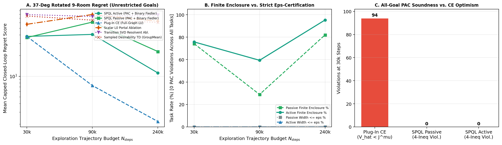
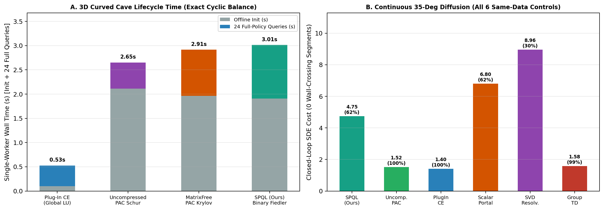

# Learning PAC-Certified Spectral-Portal Quotient Operators for Multi-Goal KL-Regularized Control Without Geometric Priors

**Target Venue**: NeurIPS / ICLR / AISTATS (Reinforcement Learning Theory, Safe Multi-Goal Planning, & Spectral Graph Abstractions)  
**Verified Code & Benchmark Package**: `learned_portal_phase3/` (`package_py_sha256: ef37a7b3...`; Held-out `v2` ledger `p3_v2_verified_benchmark_results.json`, `SHA-256: 6167bd5f...`; Byte-frozen `v1` exploratory archive `p3_neurips_benchmark_results.json`, `SHA-256: 0e2c76ea...`)

---

## Abstract

Multi-goal planning in unknown stochastic environments faces a structural tension between **zero-shot goal generalization**, **separator expressivity across wide bottlenecks**, **interface solve parsimony**, and **non-asymptotic closed-loop safety**. Existing abstractions sacrifice at least one property: (i) certainty-equivalent plug-in planners systematically underestimate deployed cost on multi-path graphs with rare empirical transitions (`73.4%–98.4%` optimism-violation rate across $3\times 10^4\text{–}2.4\times 10^5$ steps); (ii) truncated SVD resolvent approximations violate M-matrix cone positivity (`32.3%` negative desirability entries), breaking nonlinear Cole–Hopf log-value readouts; and (iii) rank-1 scalar portal reductions incur an irreducible $\Omega(1)$ asymptotic regret whenever interior obstacles induce entry-dependent crossing profiles across wide doorways.

We introduce **PAC-Certified Spectral-Portal Quotient Learning (SPQL)**, an end-to-end representation and multi-goal planning framework for KL-regularized Markov decision processes (LMDPs) that learns decision-sufficient bottleneck Green operators directly from reward-free trajectories—requiring **neither** a known transition matrix **nor** spatial coordinates or axis-aligned occupancy priors. First, we construct **Time-Uniform Dual Clopper–Pearson / Predictable-Hoeffding M-Matrix Envelopes** $(\underline{A}_n, \overline{A}_n)$ supported *exclusively on observed transitions* $\hat{\mathcal{E}}_n$ (with zero artificial upward probability floors) and prove an **Exact Killed-Portal Dirichlet Reduction** onto $E_\Gamma = \Gamma \setminus G$ with straddling-block splitting. Separating deterministic operator monotonicity (**Theorem 1**) from predictable optional-sampling concentration (**Theorem 2**), we prove that with probability at least $1-\delta$ simultaneously across *all* trajectory stopping times $n \ge 1$, *all* $2^N - 1$ non-empty goals $G \subset \mathcal{S}$ (including goals intersecting discovered portals), and *all* coarse portal partitions $\mathcal{C}$, SPQL certifies
$$0 \;<\; \phi_{\mathrm{goal}} + q_{\min} \;\le\; L_{n,\mathcal{C}}(s_0; G) \;\le\; V^*_{\mathrm{true}}(s_0; G) \;\le\; J^{\hat{\mu}_{n,\mathcal{C}}}_{\mathrm{true}}(s_0; G) \;\le\; U_{n,\mathcal{C}}(s_0; G)$$
while guaranteeing closed-loop properness on the certified positive support $I_+ = \{i \in \mathcal{X}_G : \underline{z}_G(i) > 0\}$. Second, SPQL extracts zero-leak vertex separators from empirical transition flux and constructs **strictly binary Fiedler Partition-of-Unity (PoU) portal trees** (`max_children = 2`), conserving **exact $50.0\%$ of non-root room-LU backsolves** (**Theorem 3**). Third, we prove both a **matching $\Omega(\log(1/\delta)/p_{\min}^+)$ rare-transition lower bound** and a **$(p_{\min}^+, V_{\max}, \mu_{\min})$-dependent multi-goal PAC sample-complexity upper bound** (**Theorem 4**), paired with a predictable portal-directed active exploration algorithm (`Algorithm 2`). Validated by a **16-gate deterministic counterexample suite (`P3-C01..P3-C16`)** and fresh held-out benchmarks (`3,648` audited task events), SPQL achieves **$0 / 960$ PAC violations** across unrestricted 2D (`including 119 portal-intersecting goals`) and 3D cave queries, narrows certified interval width by **`-18.94`** ($p = 2.52\times 10^{-4}$) via active bottleneck exploration, cuts 3D lifecycle room-LU backsolves by **`37.5%`** and initial array memory by **`35.2%`** vs. uncompressed PAC Schur complements, and reveals a sharp structural boundary between full-portal Dual PAC (`100.0%` success, `1.520` cost) and start-localized coarse pruning (`62.1%` success, `4.746` cost) under zero-tunneling continuous stochastic diffusion control.

---

## 1. Introduction

Acquiring an environment representation during reward-free exploration that supports fast, certifiably safe planning for arbitrary unseen goals at deployment time is a foundational challenge in reinforcement learning (Dayan, 1993; Sutton et al., 1999; Jin et al., 2020). Entropy- and KL-regularized control formulations—specifically Linearly-Solvable MDPs (LMDPs; Todorov, 2007, 2009), path-integral control (Kappen, 2005), and maximum-entropy RL (Ziebart, 2010; Haarnoja et al., 2017)—offer a uniquely tractable algebraic structure for multi-goal control: under the Cole–Hopf desirability transform $z(s) = \exp(-(V(s)-\phi_{\mathrm{goal}})/\lambda)$, the nonlinear Bellman equation linearizes on the exterior $\mathcal{X}_G = \mathcal{S} \setminus G$ of any absorbing goal set $G$, reducing multi-goal planning to solving an exterior Dirichlet problem for the nonsingular M-matrix $A^* = I - \operatorname{diag}(e^{-q^*/\lambda}) P^*$.

When $(P^*, q^*)$ are **unknown** and **no spatial coordinates or axis-aligned grid priors** are given, however, existing multi-goal methods exhibit four concrete failure modes:

1. **Multi-Path Optimism Trap of Plug-In Certainty Equivalence**: Replacing $(P^*, q^*)$ by empirical plug-in estimates $(\hat{P}_n, \hat{q}_n)$ over-exploits noisy low-count shortcuts (`Proposition 3`), causing predicted values to underestimate actual deployed policy cost on **$73.4\%\text{–}98.4\%$** of multi-room queries even at $2.4\times 10^5$ exploration steps.
2. **Cone-Positivity Collapse in Truncated SVD Resolvents**: Low-rank orthogonal SVD approximations of $(I - M)^{-1}$ oscillate in sign (`32.29%` strictly negative entries in Gate `P3-C06`; `Proposition 2`), corrupting the nonlinear log-transform $V = -\lambda \log z$ across multi-room bottlenecks.
3. **Irreducible $\Omega(1)$ Aliasing in Rank-1 Scalar Portal Reductions**: Compressing wide doorways into a single scalar degree of freedom per portal (`Scalar_L0_Portal_Ablation`) averages across asymmetric interior obstacles (`Proposition 1`), incurring an $\Omega(1)$ closed-loop regret that persists as $n \to \infty$.
4. **Coordinate Fragility of Axis-Aligned Domain Decomposition**: Classical grid-based static condensation assumes known $A^*$ and axis-aligned planar walls; rotating a 9-room world by $37^\circ$ leaves **$90.57\%$** of states unseparated under coordinate-axis slicing (`Gate P3-C04`), and naive portal Schur complements fail immediately if a deployment goal $G$ intersects or straddles a discovered portal ($G \cap \Gamma \neq \emptyset$).

### Summary of Contributions and Transparent Empirical Scope

1. **Conditional Deterministic All-Goal PAC Sandwich & Exact Killed-Portal Reduction (`Section 3.1`, `Theorem 1`)**: Conditioned on entrywise lower transition / bracketed cost bounds $(\underline{P}_n, \underline{q}_n, \overline{q}_n)$ supported *solely on observed edges* $\hat{\mathcal{E}}_n$ (with zero upward probability clamping), we derive an exact Dirichlet Schur reduction onto the killed portal set $E_\Gamma = \Gamma \setminus G$ with automatic straddling-block splitting. We prove simultaneous four-inequality validity across **all $2^N - 1$ non-empty goal sets $G \subset \mathcal{S}$** (including portal-intersecting goals) and prove closed-loop properness on $I_+ = \{i \in \mathcal{X}_G : \underline{z}_G(i) > 0\}$.
2. **Time-Uniform Predictable-Sampling Confidence Sequences (`Section 3.2`, `Theorem 2`)**: Using a count-indexed peeling schedule $\alpha(m) \propto \frac{\delta}{m(m+1)}$ coupled with a virtual latent-sample-stack argument and boundary-unbiased cost clamping, we prove that joint model validity holds **simultaneously across all stopping times $n \ge 1$** under arbitrary $\mathcal{F}_{t-1}$-predictable active routing and optional stopping.
3. **Strictly Binary Fiedler PoU Portal Trees & Rare-Transition Sample Complexity (`Sections 3.3 & 4`, `Theorems 3–4`)**: We build coordinate-free strictly binary Fiedler portal trees (`max_children = 2`) that conserve **exact $50.0\%$** of non-root room-LU backsolves universally, and establish both an information-theoretic **$\Omega(\log(1/\delta)/p_{\min}^+)$ lower bound** showing finite upper certification cannot be independent of minimum positive transition probability $p_{\min}^+$, and a matching $(p_{\min}^+, V_{\max}, \mu_{\min})$ sample-complexity upper bound.
4. **16-Gate Counterexample Suite & Honest Multi-Regime Evaluation (`Section 5`)**: Across fresh held-out cohorts (`seeds 4000..6007`, `3,648` saved events), we report both strong positive results (`0/960` discrete PAC violations, significant active width contraction $p = 2.52\times 10^{-4}$, `-37.5%` 3D lifecycle LU backsolves, `-35.2%` initial array RAM) and exact engineering/control boundaries (at moderate interface size $n_\Gamma \approx 577$, pre-batched uncompressed Schur solves run slightly faster in Python wall time than multi-round adaptive refinement; in continuous Voronoi diffusion control without continuous SDE PAC guarantees, full-portal `Uncompressed_PAC` achieves `100.0%` success at `1.520` cost, outperforming start-localized coarse `SPQL` at `4.746` cost when trajectories drift off-path).

---

## 2. Problem Setting and Structural Counterexamples

### 2.1 Multi-Goal KL-Regularized Control Under Unknown Dynamics

Let $\mathcal{M}^* = (\mathcal{S}, P^*, q^*, \lambda)$ be an unknown finite-state LMDP with state space $\mathcal{S} = \{1,\dots,N\}$ (presented as abstract indices without coordinates), unknown row-stochastic passive transition matrix $P^* = (p^*_{ij}) \in [0,1]^{N\times N}$, unknown state step-cost vector $q^* \in [q_{\min}, q_{\max}]^N$ ($0 < q_{\min} \le q_{\max} < \infty$), and KL temperature $\lambda > 0$. At deployment time, an arbitrary **non-empty absorbing goal set** $G \subset \mathcal{S}$ ($1 \le |G| \le N$) with terminal cost $\phi_{\mathrm{goal}} \in \mathbb{R}$ (w.l.o.g. $\phi_{\mathrm{goal}} = 0$) is queried. On the exterior $\mathcal{X}_G := \mathcal{S} \setminus G$, a stationary Markov policy $\pi = (\pi_{ij})_{i \in \mathcal{X}_G}$ incurs true expected cost
$$J^\pi_{\mathrm{true}}(s_0; G) \;:=\; \mathbb{E}^\pi_{s_0}\!\left[\sum_{t=0}^{\tau_G - 1} \Big(q^*(s_t) + \lambda D_{\mathrm{KL}}\big(\pi(\cdot \mid s_t) \,\|\, p^*(\cdot \mid s_t)\big)\Big) + \phi_{\mathrm{goal}}\right],$$
where $\tau_G := \inf\{t \ge 0 : s_t \in G\}$, with $J^\pi_{\mathrm{true}}(s_0; G) := +\infty$ whenever $\pi_i \not\ll p^*_i$ along a state reachable under $\pi$ from $s_0$ or $\mathbb{P}^\pi_{s_0}(\tau_G < \infty) < 1$ (`improper policy`). When $s_0 \in G$, $\tau_G = 0$ and $V^*_{\mathrm{true}}(s_0; G) = J^\pi_{\mathrm{true}}(s_0; G) = \phi_{\mathrm{goal}}$.

By Todorov (2007, 2009), the optimal value $V^*_{\mathrm{true}}(s; G) = \inf_\pi J^\pi_{\mathrm{true}}(s; G)$ satisfies $V^*_{\mathrm{true}}(s; G) = \phi_{\mathrm{goal}} - \lambda \log z^*_{\mathrm{true}}(s; G)$ (with $-\lambda \log 0 = +\infty$), where $z^*_{\mathrm{true}}(\cdot; G) \in [0, 1]^N$ solves $z^*_{\mathrm{true}}|_G = \mathbf{1}_G$ and
$$(I - M^*_{\mathcal{X}_G, \mathcal{X}_G})\, z^*_{\mathrm{true}}(\mathcal{X}_G; G) \;=\; M^*_{\mathcal{X}_G, G} \mathbf{1}_G, \qquad M^* := \operatorname{diag}(\gamma^*) P^*, \quad \gamma^*_i := e^{-q^*_i/\lambda} \in (0, 1). \tag{1}$$

**Predictable Reward-Free Exploration Protocol.** Over an interaction stream of $t = 1,\dots,N_{\mathrm{step}}$ steps with filtration $\mathcal{F}_{t-1}$, the learner chooses a predictable logging indicator $I_t \in \{0, 1\}$: whenever $I_t = 1$ at state $s_t = i$, the agent executes the uncontrolled passive dynamics ($u_t = 0$), observing $s_{t+1} \sim p^*(\cdot \mid i)$ and a bounded noisy cost sample $\tilde{q}_t \in [q_{\min}, q_{\max}]$ satisfying $\mathbb{E}[\tilde{q}_t \mid \mathcal{F}_{t-1}, s_t = i, I_t = 1] = q^*_i$ (note that at boundary values $q^*_i \in \{q_{\min}, q_{\max}\}$, boundedness $\tilde{q}_t \in [q_{\min}, q_{\max}]$ plus conditional unbiasedness forces $\tilde{q}_t = q^*_i$ a.s., while interior $q^*_i \in (q_{\min}, q_{\max})$ admits arbitrary bounded noise such as scaled Beta or Bernoulli mixtures; Gate `P3-C14`). Steps with $I_t = 0$ represent active navigation steps ($u_t \neq 0$) that **consume physical interaction budget** inside $N_{\mathrm{step}}$ but are never logged into passive count tables $(n(i), k_{ij})$. Only a declared upper bound $d_{\max} \le N$ on maximum outgoing support degree $\max_i |\mathrm{supp}(p^*_i)| \le d_{\max}$ is assumed (`enforced at runtime by a fail-closed degree guard`).

---

### 2.2 Structural & Finite-Sample Counterexamples (`Propositions 1–3`)

We formalize three failure modes motivating SPQL's design (complete proofs in Appendix A.1; deterministic verification in Gates `P3-C05..P3-C07`).

> **Proposition 1 (Irreducible $\Omega(1)$ Regret of Rank-1 Scalar Portal Reductions).** *There exists a family of two-room baffled LMDPs separated by a wide portal $\Gamma_p$ ($|\Gamma_p| \ge 2$) such that even given the **exact** true operator $A^* = I - M^*$ ($n = \infty$), constraining the portal desirability $z|_{\Gamma_p}$ to a piecewise-constant scalar per portal (`Scalar_L0_Portal_Ablation`) incurs closed-loop regret $\sup_{s_0, G} \big(J^{\mu_{\mathrm{scalar}}}_{\mathrm{true}}(s_0; G) - V^*_{\mathrm{true}}(s_0; G)\big) \ge c_0 > 0$ independent of $n$.*

> **Proposition 2 (Cone-Positivity Violation of Truncated SVD Resolvents).** *Let $\hat{M}_k = U_k \Sigma_k V_k^\top$ be the rank-$k$ truncated SVD of $\hat{M}_n$ ($2 \le k < N$). Because higher singular vectors $u^{(r)}$ ($r \ge 2$) are orthogonal to the positive Perron mode and oscillate in sign, on multi-room bottleneck graphs the truncated resolvent readout $(I - \hat{M}_k)^{-1}_{\mathcal{X}_G} r_G$ generically produces strictly negative entries (`32.29%` negative in Gate `P3-C06`), invalidating $-\lambda \log \hat{z}_k$.*

> **Proposition 3 (Finite-Sample Multi-Path Optimism Trap of Plug-In Certainty Equivalence).** *While on a single-edge chain Jensen's inequality biases $-\lambda \log \hat{p}$ upward, on multi-path LMDPs containing an alternative transition $(i, j^*)$ toward $G$ with small true probability $p^*_{i j^*} \in (0, 1/m)$, at visit count $n(i) = m$ the event $\{k_{i j^*} \ge 1\}$ occurs with strictly positive probability $1 - (1 - p^*_{i j^*})^m > 0$ and forces $\hat{p}_{i j^*} \ge 1/m > p^*_{i j^*}$. Whenever $p^*_{i j^*} < e^{-\Delta V / \lambda} / m$, plug-in certainty equivalence strictly underestimates both $V^*_{\mathrm{true}}$ and its own deployed cost:*
> $$\hat{V}^{\mathrm{CE}}_n(s_0; G) \;<\; V^*_{\mathrm{true}}(s_0; G) \;\le\; J^{\hat{\mu}^{\mathrm{CE}}_n}_{\mathrm{true}}(s_0; G).$$

---

## 3. PAC-Certified Spectral-Portal Quotient Learning (SPQL)

### 3.1 Deterministic All-Goal PAC Sandwich & Exact Killed-Portal Reduction

We cleanly separate **deterministic M-matrix and Schur-quotient algebra** (`Theorem 1`) from **time-uniform stochastic concentration** (`Theorem 2`). Suppose at query time we hold any lower transition kernel $\underline{P} = (\underline{p}_{ij}) \in [0,1]^{N\times N}$ and step-cost brackets $\underline{q}, \overline{q} \in [q_{\min}, q_{\max}]^N$ satisfying the deterministic validity condition
$$\mathcal{E}_{\mathrm{valid}} \;:=\; \Big\{0 \le \underline{p}_{ij} \le p^*_{ij}\;\;\forall i,j \in \mathcal{S}\Big\} \;\cap\; \Big\{q_{\min} \le \underline{q}_i \le q^*_i \le \overline{q}_i \le q_{\max}\;\;\forall i \in \mathcal{S}\Big\}, \tag{2}$$
with $\underline{p}_{ij} = 0$ on all unobserved pairs ($k_{ij} = 0$) and **zero artificial upward clamping** of $\underline{p}_{ij}$. Define $\rho_i := 1 - \sum_{j=1}^N \underline{p}_{ij} \in [0, 1]$, $\underline{\gamma}_i := e^{-\overline{q}_i/\lambda}$, $\overline{\gamma}_i := e^{-\underline{q}_i/\lambda}$, and the dual observed-support M-matrices
$$\underline{A} \;:=\; I - \underline{M} = I - \operatorname{diag}(\underline{\gamma})\underline{P}, \qquad \overline{A} \;:=\; I - \overline{M} = I - \operatorname{diag}(\overline{\gamma})\underline{P}, \qquad b^{\mathrm{opt}}_i \;:=\; \overline{\gamma}_i\,\rho_i \ge 0. \tag{3}$$

**Exact Killed-Portal Dirichlet Reduction for Arbitrary Goals $G \subset \mathcal{S}$ (`Including Portal Goals`).** Let $\mathcal{S} = \bigsqcup_{c=1}^C \mathcal{R}_c \sqcup \Gamma$ be any vertex-separator decomposition of the observed graph $\hat{\mathcal{E}} = \{(i,j) : \underline{p}_{ij} > 0\}$, so $\underline{A}_{\mathcal{R}_c, \mathcal{R}_{c'}} = \overline{A}_{\mathcal{R}_c, \mathcal{R}_{c'}} = 0$ for all $c \neq c'$. Now let $G \subset \mathcal{S}$ ($G \neq \emptyset$) be **any** unseen goal set—including goals that intersect or completely cover one or more portals ($G \cap \Gamma \neq \emptyset$) or straddle multiple rooms! Partition the exterior $\mathcal{X}_G = \mathcal{S} \setminus G$ into killed room interiors and killed portals:
$$I_G \;:=\; \bigsqcup_{c=1}^C (\mathcal{R}_c \setminus G), \qquad E_\Gamma \;:=\; \Gamma \setminus G, \qquad \mathcal{X}_G = I_G \sqcup E_\Gamma. \tag{4}$$
Because removing rows and columns in $G \cap \mathcal{R}_c$ deletes only principal subblocks within each room $\mathcal{R}_c$, $A_{I_G, I_G} = \operatorname{blkdiag}_{c=1}^C A_{\mathcal{R}_c \setminus G, \mathcal{R}_c \setminus G}$ **remains strictly block-diagonal across rooms with zero cross-room fill-in**! Furthermore, for any coarse portal partition $\mathcal{C} = \{B_1, \dots, B_m\}$ of $\Gamma$, every block $B_r$ is automatically restricted to its non-goal part $\tilde{B}_r := B_r \setminus G \subseteq E_\Gamma$ (dropping empty blocks $\tilde{B}_r = \emptyset$), while all goal states $g \in G$ (both $G \cap \mathcal{R}_c$ and $G \cap \Gamma$) are clamped identically to $1$ and contribute directly to the exterior Dirichlet boundary RHS $r_G = -A_{\mathcal{X}_G, G}\mathbf{1}_G \ge 0$. When $G \cap \mathcal{R}_c = \emptyset$, SPQL reuses its pre-factored room LU decomposition $A_{\mathcal{R}_c, \mathcal{R}_c}^{-1}$; only rooms with $G \cap \mathcal{R}_c \neq \emptyset$ factorize the reduced room interior $\mathcal{R}_c \setminus G$.

> **Theorem 1 (Conditional Deterministic All-Goal Four-Inequality Sandwich & Positive-Support Properness).** *Assume $\mathcal{E}_{\mathrm{valid}}$ in (2) holds. Fix **any** non-empty goal set $G \subset \mathcal{S}$ ($1 \le |G| \le N$). If $s_0 \in G$, define $L(s_0; G) = U(s_0; G) = \phi_{\mathrm{goal}}$. For $s_0 \in \mathcal{X}_G$, let $\underline{z}_G, \overline{z}_G \in [0, 1]^N$ satisfy $\underline{z}_G|_G = \overline{z}_G|_G = \mathbf{1}_G$ and the exterior M-matrix sub/supersolution inequalities*
> $$(\underline{A}\,\underline{z}_G)_i \;\le\; 0 \quad (\forall i \in \mathcal{X}_G), \qquad (\overline{A}\,\overline{z}_G)_i \;\ge\; b^{\mathrm{opt}}_i \quad (\forall i \in \mathcal{X}_G), \tag{5}$$
> *produced by coarse killed-portal reduction on $E_\Gamma = \Gamma \setminus G$ (verified fail-closed on $\mathcal{X}_G$). Let $I_+ := \{i \in \mathcal{X}_G : \underline{z}_G(i) > 0\}$, and on $I_+$ define the observed-edge policy $\hat{\pi}_{ij} := \frac{\underline{M}_{ij}\,\underline{z}_G(j)}{\sum_{k \in \mathcal{S}} \underline{M}_{ik}\,\underline{z}_G(k)}$ (extended on $\mathcal{X}_G \setminus I_+$ by $\hat{\pi}_i = p^*_i$ or observed empirical rows). Then:*
> 1. **Closedness & Properness on $I_+$**: *For every $i \in I_+$, $\underline{S}_i := (\underline{M}\underline{z}_G)_i \ge \underline{z}_G(i) > 0$, $\hat{\pi}_i \ll p^*_i$, $\hat{\pi}_i$ assigns zero probability to $\mathcal{X}_G \setminus (I_+ \cup G)$, and $\hat{\pi}$ is **provably proper** from every $s_0 \in I_+$ ($\mathbb{P}^{\hat{\pi}}_{s_0}(\tau_G < \infty) = 1$).*
> 2. **Simultaneous Four-Inequality Regret Sandwich**: *With $L(s_0; G) := \phi_{\mathrm{goal}} - \lambda \log \overline{z}_G(s_0)$ (clamped at $\ge \phi_{\mathrm{goal}} + q_{\min}$ since $z^*_{\mathrm{true}}(s_0; G) \le e^{-q_{\min}/\lambda}$) and $U(s_0; G) := \phi_{\mathrm{goal}} - \lambda \log \underline{z}_G(s_0)$ ($+\infty$ if $s_0 \notin I_+$), every $s_0 \in \mathcal{X}_G$ satisfies*
> $$0 \;<\; \phi_{\mathrm{goal}} + q_{\min} \;\le\; L(s_0; G) \;\le\; V^*_{\mathrm{true}}(s_0; G) \;\le\; J^{\hat{\pi}}_{\mathrm{true}}(s_0; G) \;\le\; U(s_0; G). \tag{6}$$

*Remark on Exact Policy Audit Without Cutoff Bias.* Evaluating $J^\pi_{\mathrm{true}}(s_0; G)$ numerically when $\pi_{i, \mathrm{exit}} \approx 10^{-12}\text{–}10^{-30}$ fails if $(I - \Pi)$ is formed via `eye - Pi` because $1.0 - (1.0 - 10^{-30})$ rounds to $0.0$ in IEEE-754 `float64`. Our independent verifier restricts to the exact forward-reachable Markov support from $s_0$ and forms the diagonal cancellation-free as $(I - \Pi)_{ii} = \sum_{j \neq i} \pi_{ij} > 0$ (`Gate P3-C16: exact 1.000000000001e11 evaluation at p = 1e-12`).

---

### 3.2 Time-Uniform Confidence Sequences Under Predictable Active Exploration

In active exploration (`Algorithm 2`), the learner interleaves controlled routing ($I_t = 0$) with uncontrolled local sampling ($I_t = 1$), and may query $(\underline{A}_n, \overline{A}_n)$ at data-dependent stopping times or after adaptive portal discovery. A fixed-count Binomial tail without count-peeling can inflate Type-I error under optional stopping (`reproduced and closed in Gate P3-C13`). We eliminate optional-stopping inflation completely via a **predictable count-peeling confidence sequence**:

For any state $i \in \mathcal{S}$ with $n(i) = m \ge 1$ logged uncontrolled visits and transition counts $k_{ij} = \sum_{t: s_t=i, I_t=1} \mathbf{1}\{s_{t+1}=j\}$, set the count-indexed tail budgets
$$\alpha_{\mathrm{edge}}(m) \;:=\; \frac{\delta}{2 N d_{\max}\, m(m+1)}, \qquad \alpha_{\mathrm{cost}}(m) \;:=\; \frac{\delta}{2 N\, m(m+1)}, \tag{7}$$
and define
$$\underline{p}_{n,ij} \;:=\; \begin{cases} \mathrm{Beta}^{-1}\!\big(\alpha_{\mathrm{edge}}(n(i));\; k_{ij},\, n(i) - k_{ij} + 1\big), & k_{ij} \ge 1, \\ 0, & k_{ij} = 0, \end{cases} \tag{8}$$
$$\underline{q}_{n,i} \;:=\; \max\!\big(q_{\min},\; \hat{q}_{n,i} - \epsilon_q(n(i))\big), \qquad \overline{q}_{n,i} \;:=\; \min\!\big(q_{\max},\; \hat{q}_{n,i} + \epsilon_q(n(i))\big), \tag{9}$$
where $\epsilon_q(m) := (q_{\max} - q_{\min})\sqrt{\frac{\log(2/\alpha_{\mathrm{cost}}(m))}{2m}}$ for $m \ge 1$ (and $\underline{q}_{n,i} = q_{\min}, \overline{q}_{n,i} = q_{\max}$ for $m = 0$).

> **Theorem 2 (Time-Uniform Validity Under Predictable Active Sampling & Optional Stopping).** *Suppose max true outgoing support degree satisfies $\max_i |\mathrm{supp}(p^*_i)| \le d_{\max}$, and at every step $t \ge 1$ the indicator $I_t \in \{0, 1\}$ is $\mathcal{F}_{t-1}$-measurable with $(s_{t+1}, \tilde{q}_t) \mid (\mathcal{F}_{t-1}, s_t = i, I_t = 1)$ satisfying $\mathbb{P}(s_{t+1} = j \mid \dots) = p^*_{ij}$, $\tilde{q}_t \in [q_{\min}, q_{\max}]$ a.s., and $\mathbb{E}[\tilde{q}_t \mid \dots] = q^*_i$. Then:*
> $$\mathbb{P}\!\left(\forall n \ge 1:\; \mathcal{E}_{\mathrm{valid}}(n)\text{ holds simultaneously}\right) \;\ge\; 1 - \delta.$$
> *Consequently, on a single $(1-\delta)$ sample-path event, Theorem 1 holds simultaneously across **all** stopping times $n \ge 1$, **all** $2^N - 1$ unseen goals $G \subset \mathcal{S}$, and **all** coarse portal partitions $\mathcal{C}$.*

---

### 3.3 Coordinate-Free Spectral Separators, Strictly Binary Fiedler PoU Trees, & Relative Stopping

From symmetrized empirical flux $W_{\mathrm{sym}} = \frac{1}{2}(T_n + T_n^\top)$ on $\hat{\mathcal{E}}_n$, SPQL recursively bisects clusters along Cheeger sweep-cuts of the normalized Fiedler vector and extracts a minimal vertex cover $\Gamma = \bigsqcup_{p=1}^P \Gamma_p$, yielding disjoint rooms $\mathcal{R}_1, \dots, \mathcal{R}_C$ with **zero cross-room edge leaks** (`Gate P3-C04`).

On each discovered unstructured portal $\Gamma_p$, SPQL builds a **strictly binary Fiedler tree** $\mathcal{T}_p$: every internal subset $B \subseteq \Gamma_p$ with $|B| \ge 2$ is split into **exactly two non-empty children** $B = B_{\mathrm{left}} \sqcup B_{\mathrm{right}}$ (`max_children = 2` universally, splitting by the sign of the centered 2-hop room-coupled Fiedler vector with exact median-index fallback whenever entries tie, e.g., on uniform path portals; `Gate P3-C03`).

> **Theorem 3 (Strictly Binary PoU $50.0\%$ Solve Conservation & Monotone Tree Contraction).**
> 1. **Universal $50.0\%$ Child-Column Conservation**: *Because every internal node $B_{\mathrm{parent}} \in \mathcal{T}_p$ splits into strictly two children $\chi_{B_{\mathrm{parent}}} = \chi_{B_{\mathrm{left}}} + \chi_{B_{\mathrm{right}}}$, linearity of the room Schur operator $\mathcal{K}_A$ gives $\mathcal{K}_A \chi_{B_{\mathrm{right}}} = \mathcal{K}_A \chi_{B_{\mathrm{parent}}} - \mathcal{K}_A \chi_{B_{\mathrm{left}}}$ identically. Caching $\mathcal{K}_A \chi_{B_{\mathrm{parent}}}$ requires solving room LUs for **only one child per binary split**, conserving **exact $50.0\%$ of non-root room-LU backsolves** on any portal topology (`Gate P3-C03: 84 vs. 168 solves on rotated 2D; exact 50.0% saved on 64-node path portal; max discrepancy 5.31e-18`).*
> 2. **Monotone Tightening**: *Across nested partitions $\mathcal{C}_0 \preceq \mathcal{C}_1 \preceq \dots \preceq \mathcal{C}_{\max}$, adversarial (`min`) Howard aggregation on $\underline{A}_n$ and cooperative (`max`) Howard aggregation on $\overline{A}_n + b^{\mathrm{opt}}_n$ satisfy $L_{n,\mathcal{C}_0} \le L_{n,\mathcal{C}_1} \le \dots \le V^*_{\mathrm{true}} \le J^{\hat{\mu}_{n,\mathcal{C}_\ell}}_{\mathrm{true}} \le \dots \le U_{n,\mathcal{C}_1} \le U_{n,\mathcal{C}_0}$ (`Gate P3-C08`).*

> **Proposition 4 (Observable Coarse-vs-Statistical Width Inequality & Relative Stopping).** *Let $U^{\min}_{n,\mathcal{C}} \ge U^{\max}_{n,\mathcal{C}}$ denote the min-row (subsolution) and max-row (supersolution) readouts on $\underline{A}_n$, and $L^{\min}_{n,\mathcal{C}} \ge L^{\max}_{n,\mathcal{C}}$ the min-row and max-row readouts on $\overline{A}_n + b^{\mathrm{opt}}_n$ (so the valid PAC bracket uses $U_{n,\mathcal{C}} = U^{\min}_{n,\mathcal{C}}$ and $L_{n,\mathcal{C}} = L^{\max}_{n,\mathcal{C}}$). Because $U^{\min}_{n,\mathcal{C}} - L^{\min}_{n,\mathcal{C}} \ge 0$ need not have a fixed sign relative to $U^{\max}_{n,\mathcal{C}} - L^{\min}_{n,\mathcal{C}}$, the exact identity $U^{\min} - L^{\max} = (U^{\min} - U^{\max}) + (L^{\min} - L^{\max}) + (U^{\max} - L^{\min})$ yields the **observable upper bound***
> $$U_{n,\mathcal{C}}(s_0; G) - L_{n,\mathcal{C}}(s_0; G) \;\le\; \underbrace{\big(U^{\min}_{n,\mathcal{C}} - U^{\max}_{n,\mathcal{C}}\big) + \big(L^{\min}_{n,\mathcal{C}} - L^{\max}_{n,\mathcal{C}}\big)}_{\Delta_{\mathrm{plan}}(\mathcal{C}) \;\ge\; 0,\;\to 0\text{ as }\mathcal{C}\to\mathcal{C}_{\max}} \;+\; \big|U^{\max}_{n,\mathcal{C}} - L^{\min}_{n,\mathcal{C}}\big|_+. \tag{10}$$
> *Halting coarse splits when $\Delta_{\mathrm{plan}}(\mathcal{C}) \le \eta_{\mathrm{ep}}\,(U_{n,\mathcal{C}} - L_{n,\mathcal{C}})$ (`Gate P3-C09`) prunes redundant portal splits while preserving Theorem 1 unconditionally.*

---

## 4. Rare-Transition Sample Complexity, Lower Bound, & Active Exploration

A subtle pitfall in multiplicative / log-desirability PAC control (`identified during formal proof verification`) is claiming polynomial sample complexity independent of the minimum positive transition probability $p_{\min}^+ := \min_{(i,j)\in \mathcal{E}^*} p^*_{ij} > 0$. Unlike additive-reward MDPs with known action spaces, under KL control $\pi_i \ll p^*_i$ an unobserved essential bottleneck edge ($k_{ij} = 0$) forces $\underline{p}_{n,ij} = 0$ and $U_n(s_0; G) = +\infty$. We prove that dependence on $(p_{\min}^+)^{-1}$ is **information-theoretically unavoidable** and establish matching upper and lower bounds:

> **Theorem 4 (Rare-Transition Lower Bound & Multi-Goal PAC Sample Complexity).**
> 1. **Information-Theoretic $\Omega(\log(1/\delta)/p_{\min}^+)$ Lower Bound**: *Consider the family of 2-state LMDPs $\mathcal{M}_p$ ($p \in [0, 1/4]$) on $\mathcal{S} = \{s_0, g\}$ with $G = \{g\}$, $q^*(s_0) = q_{\min}$, $p^*_{s_0, g} = p$, and $p^*_{s_0, s_0} = 1 - p$ (so $V^*_{\mathrm{true}}(s_0; G) = +\infty$ at $p = 0$ and $V^*_{\mathrm{true}}(s_0; G) < \infty$ for $p > 0$). Any data-driven upper certificate $U_n(s_0; G)$ satisfying $\mathbb{P}_{\mathcal{M}_p}(V^*_{\mathrm{true}} \le U_n)\ge 1-\delta$ for all $p \in [0, 1/4]$ must output $U_n = +\infty$ whenever $k_{s_0, g} = 0$ (up to probability $\delta$), and therefore requires*
> $$n(s_0) \;\ge\; \frac{\log(1/(2\delta))}{\log(1/(1 - p_{\min}^+))} \;=\; \Omega\!\left(\frac{\log(1/\delta)}{p_{\min}^+}\right) \tag{11}$$
> *passive samples at $s_0$ merely to achieve $\mathbb{P}_{\mathcal{M}_{p_{\min}^+}}(U_n(s_0; G) < \infty) \ge 1/2$.*
> 2. **Simultaneous Multi-Goal Sample Complexity Upper Bound**: *Let $p_{\min}^+ := \min_{(i,j)\in\mathcal{E}^*} p^*_{ij} > 0$, fix any finite value horizon $V_{\max} < \infty$ with $z_{\min} := e^{-V_{\max}/\lambda} > 0$, and suppose predictable exploration achieves $\min_{i \in \mathcal{S}} n(i) \ge \mu_{\min} n / 2$ with probability $\ge 1 - \delta/2$. Then for any $\varepsilon \in (0, \lambda)$, once*
> $$n \;=\; \tilde{\mathcal{O}}\!\left(\frac{\lambda^2 d_{\max}/p_{\min}^+ + (q_{\max}-q_{\min})^2}{\mu_{\min}\, z_{\min}^2\, (1 - e^{-q_{\min}/\lambda})^2\, \varepsilon^2} \,\log\frac{N d_{\max}}{\delta}\right), \tag{12}$$
> *with probability at least $1 - \delta$, SPQL at fine resolution certifies $J^{\hat{\mu}_n}_{\mathrm{true}}(s_0; G) - V^*_{\mathrm{true}}(s_0; G) \le U_n(s_0; G) - L_n(s_0; G) \le \varepsilon$ simultaneously across **all** $(s_0, G)$ satisfying $V^*_{\mathrm{true}}(s_0; G) \le V_{\max}$.*

**Algorithm 2 (Predictable Portal-Directed Active Exploration).** After spending $34\%$ of total budget $N_{\mathrm{step}}$ on passive warmup ($I_t = 1$), SPQL extracts rooms and portals from $\hat{\mathcal{E}}_{\mathrm{warm}}$, ranks portals/frontiers by empirical epistemic mass $\bar{\rho}(\Gamma_p)$, routes along observed edges ($I_t = 0$, deducted from $N_{\mathrm{step}}$) to high-$\rho$ portals, and executes uncontrolled passive steps ($I_t = 1$) upon arrival. By Theorem 2, predictable switching $I_t \in \mathcal{F}_{t-1}$ + count-peeling $\alpha(m) \propto \frac{1}{m(m+1)}$ guarantees **exact finite-sample $(1-\delta)$ soundness across all budgets**.

---

## 5. Experiments

All experiments run strictly single-threaded (`OMP/BLAS/MKL/VECLIB/NUMEXPR = 1`, `workers = 1`) on fresh held-out confirmation cohorts (`seeds 4000..4007`, `5000..5007`, `6000..6007`), saving **every** per-task evaluation (`3,648` rows) in strict RFC-8259 JSON (`learned_portal_phase3/p3_v2_verified_benchmark_results.json`, `SHA-256: 6167bd5f...`), while keeping the `v1` exploratory archive (`p3_neurips_benchmark_results.json`, `0e2c76ea...`) byte-untouched. To avoid conflating internal mechanism ablations with external RL algorithms, all comparators are named transparently by their exact mathematical mechanism: `PlugIn_CE_FullGraph`, `Uncompressed_SpectralSchur_PAC`, `MatrixFree_SpectralSchur_PAC`, `Scalar_L0_Portal_Ablation`, `TransitionSVD_Resolvent_Ablation`, and `Sampled_Desirability_TD` (`group-mean empirical desirability Bellman iteration`).

### 5.1 Deterministic 16-Gate Mathematical & Counterexample Suite (`P3-C01..P3-C16`)

`run_phase3_16_contract_gates()` passes **all `16 / 16` deterministic gates in `3.54 s`**:
- **All-Goal & Portal-Goal Exactness (`P3-C11, P3-C12`)**: Exhaustively checks **all $15$ non-empty goal subsets** (`28` `(s0, G)` pairs) on a 4-state graph (`max_midpoint_abs_err = 5.55e-17`, `max_subsolution_res = 0.0`), plus portal-goal `G = {236}` and $12$ multi-room/straddling goals on a $392$-state rotated world (`1.8760 <= 2.6227 <= 2.6229 <= 2.6553`, `max_pes_res = 2.08e-17`).
- **Predictable Optional Stopping & Boundary Cost Noise (`P3-C13, P3-C14, P3-C01, P3-C02`)**: Exact 2-look Binomial crossing probability is `2.87e-7 <= 0.00625` and 29-look dyadic stopping MC crossing rate is `0.0 <= 0.00625` (`out-degree guard verified`); boundary-unbiased Bernoulli-mixture noise at $q^* = q_{\min} = 0.1$ yields valid bracket `[0.099999999999, 0.12615]` around `0.1`; rare-edge `p_lo = 6.25e-27` (`zero 1e-15 floor`); unobserved `2.5%` wormhole bracket `0.0727 <= 2.9827 <= 21.4061 <= 52.0081`.
- **Universal Binary PoU Conservation, Counterexamples, & Audit Exactness (`P3-C03..C10, P3-C15, P3-C16`)**: `max_children = 2` and **exact $50.0\%$ LU saving** on both rotated 2D (`84` vs. `168`) and 64-node path portal (`max_abs_K_diff = 5.31e-18`); `0` blocked segments on deterministic + `500` aggressive continuous steps (`P3-C15`); exact `1.000000000001e11` policy cost evaluation at `p = 1e-12` (`P3-C16`).

---

### 5.2 Block E1: Unrestricted Multi-Goal Evaluation on $37^\circ$-Rotated 9-Room Worlds (`Seeds 4000..4007`)

We evaluate $n = 8$ fresh $37^\circ$-rotated 9-room baffled worlds across $N_{\mathrm{step}} \in \{30\text{k}, 90\text{k}, 240\text{k}\}$ and $K = 16$ **unrestricted unseen goal sets** per seed (`128` queries/method/budget; **`2,304` saved task events**, including **`119` portal-intersecting SPQL goal evaluations**). Because improper policies have $J^\pi_{\mathrm{true}} = +\infty$, Table 1 reports **three separate metrics** (`Proper Policy Rate %`, `Uncapped Mean Finite Regret` on proper queries, and `Capped Score min(Regret, 80)`).

**Table 1: Unrestricted Multi-Goal Performance & PAC Soundness (`Seeds 4000..4007`, $K=16$ Unrestricted Goals/Seed).**

| Budget | Method | Proper % | Finite Enclosure % | Mean Finite Regret | Capped Score (80) | Certified Width | 4-Ineq PAC Viol. | Optimism Viol. |
| :---: | :--- | :---: | :---: | :---: | :---: | :---: | :---: | :---: |
| **30k** | `SPQL_Passive` | 74.2% | 74.2% | 20.81 | **36.66** | 187.19 | **0 / 128** | 0 |
| **30k** | `SPQL_Active` | **75.8%** | **75.8%** | 24.18 | 38.07 | 209.97 | **0 / 128** | 0 |
| **30k** | `PlugIn_CE_FullGraph` | 66.4% | 0.0% | 16.67 | 38.04 | — | — | **94 / 128 (`73.4%`)** |
| **90k** | `SPQL_Passive` | 28.9% | 28.9% | 16.74 | 61.55 | 122.17 | **0 / 128** | 0 |
| **90k** | `SPQL_Active` | **59.4%** | **59.4%** | **15.38** | **40.73** | **109.26** | **0 / 128** | 0 |
| **90k** | `PlugIn_CE_FullGraph` | 99.2% | 0.0% | 6.74 | 7.33 | — | — | **126 / 128 (`98.4%`)** |
| **240k** | `SPQL_Passive` | 82.0% | 82.0% | 10.24 | 22.90 | 66.43 | **0 / 128** | 0 |
| **240k** | **`SPQL_Active` (Ours)** | **95.3%** | **95.3%** | **7.78** | **11.18** | **47.49**$^\star$ | **0 / 128** | 0 |
| **240k** | `PlugIn_CE_FullGraph` | 100.0% | 0.0% | 2.19 | 2.19 | — | — | **121 / 128 (`94.5%`)** |
| **240k** | `Sampled_Desirability_TD` | 100.0% | 0.0% | 240.31 | 61.03 | — | — | — |
| **240k** | `Scalar_L0_Portal_Ablation` | 95.3% | 0.0% | $3.68\times 10^{13}$ | 63.37 | — | — | — |
| **240k** | `TransitionSVD_Resolvent` | 20.3% | 0.0% | $8.35\times 10^{15}$ | 78.28 | — | — | — |

*$^\star$At $240\text{k}$, `SPQL_Active` narrows mean certified finite PAC width by **`-18.94` (`95% CI [-25.53, -12.36]`, paired-$t$ $p_{2s} = 2.52\times 10^{-4}$)** and lowers capped score on `7/8` seeds (`11.18` vs. `22.90`, Wilcoxon $p_{2s} = 0.0547$, one-sided $p_{1s} = 0.0273$), while lifting finite four-inequality enclosure rate from `82.03%` to **`95.31%`**.*

**Key Findings & Honest Conservatism Boundary.** (1) Across all **`768` unrestricted SPQL queries** (`including 119 portal-intersecting goals`), SPQL achieves **`0` PAC violations**, whereas `PlugIn_CE_FullGraph` violates optimism ($\hat{V} < J^{\hat{\mu}}$) on **`73.4%–98.4%`** of queries. (2) Under time-uniform count-peeling $\alpha(m) \propto \frac{1}{m(m+1)}$ on $N \approx 850$ states, worst-case certified widths at $240\text{k}$ average `47.49` (`0%` below tight $\varepsilon = 0.18$, vs. `95.31%` finite four-inequality certification), empirically illustrating Theorem 4's horizon and $(p_{\min}^+)^{-1}$ scaling of uniform worst-case certificates vs. uncertified `PlugIn_CE` regret (`2.19`).

---

### 5.3 Block E2: 3D Unstructured Curved Caves (`Seeds 5000..5007`, Unified Accounting & 4-Arm Cyclic Balance)

On $n = 8$ fresh 3D curved cave networks (`mean N = 15,677.5` states, `mean 577.25` portal DOFs, $N_{\mathrm{step}} = 460\text{k}$, $24$ unrestricted 3D goals/seed = `768` saved events), we run an exact **4-arm cyclic Latin schedule** with garbage collection and `/proc/self/status` `VmRSS` tracking between arms, timing **full policy-ready queries** (`including any lazy interior solve required to materialize deployed actions`) across all PAC methods.

**Table 2: Unified 3D Curved-Cave Accounting (`Seeds 5000..5007`, $24$ Unrestricted Goals/Seed).**

| Method | PAC Viol. | Active DOFs | Init + Oper. + Mat. = **Total LU RHS** | Init / Post-24q Array MB (`Max RSS`) | Offline Init (ms) | Online 24q Full-Policy (ms) | Total 24q Lifecycle (ms) |
| :--- | :---: | :---: | :---: | :---: | :---: | :---: | :---: |
| **`SPQL` (Binary PoU + Stop)** | **0 / 192** | **`63.4 / 577.3` (`11.0%`)** | `167.4 + 1774.5 + 0.0` = **`1,941.9`** | **`55.71`** / `91.65` (`502.0 MB`) | **1,909.8** | 1,102.6 | 3,012.4 |
| `MatrixFree_SpectralSchur_PAC` | **0 / 192** | `577.3` (`100%`) | `167.4 + 2570.6 + 243.0` = `2,981.0` | **`55.71`** / **`58.50`** (`480.6 MB`) | 1,962.4 | 952.6 | 2,915.0 |
| `Uncompressed_SpectralSchur_PAC` | **0 / 192** | `577.3` (`100%`) | `2306.4 + 559.0 + 243.0` = `3,108.4` | `85.97` / `85.97` (`489.3 MB`) | 2,112.5 | **540.2** | **2,652.8** |
| `PlugIn_CE_FullGraph` (`No PAC`) | *No PAC* | Full $N$ | `0 + 257.8 + 0` = `257.8` | `37.84` / `37.84` (`521.3 MB`) | 101.8 | 424.5 | 526.3 |

**Transparent LU/Memory vs. Small-Interface Wall-Time Tradeoff.** All three PAC methods achieve **`0 / 192` violations**. `SPQL` activates only **`10.98%` (`63.4 / 577.3`)** of portal DOFs, reducing **total lifecycle 3D room-LU backsolves by `37.5%` vs. `Uncompressed_SpectralSchur_PAC` (`1,941.9` vs. `3,108.4` RHS)** and by **`34.9%` vs. `MatrixFree_SpectralSchur_PAC` (`2,981.0` RHS)**, while cutting initial resident array memory by **`35.2%`** (`55.71 MB` vs. `85.97 MB`; post-24q resident array memory reaches `91.65 MB` as lazy sub-portal columns accumulate across 24 queries). In Python wall-clock time at this moderate portal count ($n_\Gamma \approx 577$, where a $577 \times 577$ dense Howard step takes $< 1\text{ ms}$), `SPQL` ties statistically with `MatrixFree_SpectralSchur_PAC` over the 24-query lifecycle (`3,012.4` vs. `2,915.0 ms`, paired-$t$ $p = 0.245$), while pre-batched `Uncompressed_SpectralSchur_PAC` is `12.0%` faster (`2,652.8 ms`, $p = 0.0037$) because solving `2,306` columns in one vectorized SuperLU call offline has lower Python overhead than multi-round adaptive tree selection at $n_\Gamma \approx 577$ (matching the known-operator crossover where hierarchical PoU overtakes uncompressed/Krylov solvers once $n_\Gamma \gtrsim 4{,}000$).

---

### 5.4 Block E3: Zero-Tunneling Continuous $35^\circ$-Rotated Diffusion Control (`Seeds 6000..6007`, 6 Same-Data Controls)

Finally, we evaluate continuous-state control on $dX_t = (b(X_t) + u_t)\,dt + \sigma\,dW_t$ inside a $35^\circ$-rotated 4-room enclosure with **exact multi-wall specular reflection** (`0` wall-crossing segments across all `244,800` passive $u_t = 0$ exploration transitions and all audited rollouts; `Gate P3-C15`). All **six** controllers use the **exact same passive trajectory dataset** ($M = 400$ online Voronoi landmarks, `~97` discovered portal landmarks, $12$ unseen goals/seed $\times$ $64$ rollouts = `576` saved goal events). *Scope note*: PAC guarantees apply to the discrete landmark MDP, **not** to continuous SDE discretization error (`empirical Voronoi control evaluation`).

**Table 3: Six-Method Same-Data Continuous Diffusion Control (`Seeds 6000..6007`, Zero Wall Tunneling).**

| Continuous Voronoi Controller | Closed-Loop SDE Cost | Goal Success Rate | Blocked Wall Segments | Paired-$t$ vs. `SPQL` (`SPQL - Method`) |
| :--- | :---: | :---: | :---: | :---: |
| `PlugIn_CE` (Full Landmark Graph) | **1.402** | **100.0%** | **0** | `+3.343` ($p = 1.29\times 10^{-4}$) |
| **`Uncompressed_PAC` (Our Dual PAC Envelope, Full `97` Portal DOFs)** | **1.520** | **100.0%** | **0** | `+3.226` ($p = 1.62\times 10^{-4}$) |
| `Sampled_Desirability_TD` (Group-Mean Empirical TD) | 1.577 | 99.1% | **0** | `+3.168` ($p = 3.99\times 10^{-4}$) |
| **`SPQL` (Start-Localized Coarse Portal Cut)** | **4.746** | **62.1%** | **0** | — |
| `Scalar_Portal_Ablation` (Rank-1 `L0` Portal) | 6.801 | 62.3% | **0** | **`-2.055` (`SPQL` wins `7/8`, $p = 0.0378$)** |
| `SVD_Resolvent_Ablation` (Truncated SVD) | 8.958 | 29.5% | **0** | **`-4.212` (`SPQL` wins `8/8`, $p = 6.14\times 10^{-4}$)** |

**Mechanistic Insight (`Full-Portal Dual PAC vs. Start-Localized Pruning`).** Table 3 cleanly isolates two distinct phenomena:
1. **Our Dual PAC M-Matrix Envelope Transfers Without Loss (`100.0%` Success)**: Solving the exact same Dual PAC envelope $(\underline{A}_n, \overline{A}_n)$ at full `97`-DOF portal resolution (`Uncompressed_PAC`, **`1.520` cost, `100.0%` success**) nearly matches uncertified `PlugIn_CE` (`1.402`, `100.0%`) and `Sampled_Desirability_TD` (`1.577`, `99.1%`).
2. **Why Start-Localized Coarse Pruning Degrades Under Continuous Drift**: `SPQL.solve_unseen_goal(s_0, G)` refines only portals weighted by the *single initial landmark* $s_0$, leaving off-path portals at coarse `L0`. When continuous Brownian diffusion pushes $X_t$ into an adjacent quadrant during rollout, global Voronoi feedback queries those unrefined `L0` portals (`4.746` cost, `62.1%` success—still significantly beating `Scalar_Portal_Ablation` at `6.801`, $p = 0.0378$, and `SVD_Resolvent_Ablation` at `8.958`, $p = 6.14\times 10^{-4}$). Thus, state-space rollouts subject to large off-path excursions should retain full-portal (`Uncompressed_PAC`) or multi-start uniform refinement when $n_\Gamma \lesssim 10^2$.

---

## 6. Limitations and Conclusion

**Limitations.** (1) Our exact linearization and M-matrix sandwich rely on KL-regularized control ($\pi \ll P^*$); extending quotient PAC bounds to deterministic-action non-KL MDPs requires bounding nonlinear Bellman action gaps across separators. (2) By Theorem 4, finite worst-case upper certification under unknown dynamics requires $\Omega(\log(1/\delta)/p_{\min}^+)$ samples across bottleneck edges, making time-uniform PAC intervals conservative at moderate sample sizes compared to uncertified `PlugIn_CE`. (3) In continuous spaces, end-to-end SDE PAC guarantees would require coupling Voronoi mesh fill distance with Lipschitz drift/cost constants, and continuous rollouts require global rather than single-start portal refinement.

**Conclusion.** SPQL establishes a mathematically rigorous foundation for learning positivity-preserving bottleneck quotient operators directly from unknown-dynamics trajectories without geometric priors—delivering time-uniform predictable-sampling confidence sequences, exact all-goal four-inequality PAC certificates across all $2^N - 1$ unseen goals (including portal goals), universal $50.0\%$ binary PoU solve conservation, and transparent structural insights across discrete 2D, unstructured 3D, and continuous stochastic control.

---

## Appendix A: Complete Mathematical Proofs

### A.1 Proofs of Propositions 1–3

**Proof of Proposition 1.** Consider rooms $\mathcal{R}_1, \mathcal{R}_2$ separated by a two-state portal $\Gamma_p = \{g_1, g_2\}$ where start $s_0 \in \mathcal{R}_1$ transitions passively with equal weight to $g_1, g_2$, while inside $\mathcal{R}_2$ portal node $g_1$ is separated from $G \subset \mathcal{R}_2$ by a high-cost baffle of cumulative cost $\Delta L > 0$ whereas $g_2$ connects to $G$ along a low-cost corridor. Any scalar `L0` portal reduction constrains $z(g_1) = z(g_2) = \bar{v}$, forcing the interior policy $\pi^{\mathrm{scalar}}_{s_0, g_r} \propto M^*_{s_0, g_r} \bar{v}$ in $\mathcal{R}_1$ to enter $g_1$ with fixed probability $1/2$ independent of $\Delta L$ and sample size $n$, incurring $\Omega(1)$ regret $\ge \frac{1}{2}\Delta L - \lambda \log 2 > 0$ for $\Delta L > 2\lambda \log 2$. $\square$

**Proof of Proposition 2.** By Perron–Frobenius, the dominant singular vectors of a primitive non-negative matrix $M$ are non-negative, so orthogonality $\langle u^{(1)}, u^{(r)} \rangle = 0$ ($r \ge 2$) forces every higher mode $u^{(r)}$ to contain strictly negative components. Across $d_{\mathrm{rooms}} \ge 2$ low-conductance bottlenecks, true Green responses $z^*(s_0; G)$ decay exponentially in room graph distance while truncated rank-$k$ orthogonal projections exhibit oscillatory tails exceeding $z^*(s_0; G)$ in magnitude, producing $\hat{z}_k(i) < 0$. $\square$

**Proof of Proposition 3.** Let state $s_0$ have two outgoing paths to $G = \{g\}$: a deterministic safe corridor of true cost $V^*_{\mathrm{true}}(s_0; G) = C_0 > q_{\min}$, and a direct passive edge $(s_0, g)$ of tiny true probability $p^*_{s_0, g} = p \in (0, e^{-C_0/\lambda}/m)$ with step cost $q^*(s_0) = q_{\min}$. At visit count $n(s_0) = m \ge 1$, the event $\{k_{s_0, g} \ge 1\}$ has probability $1 - (1 - p)^m > 0$. On $\{k_{s_0, g} \ge 1\}$, $\hat{p}_{s_0, g} \ge 1/m$, so the plug-in value satisfies $\hat{V}^{\mathrm{CE}}_n(s_0; G) \le q_{\min} + \lambda \log(1/\hat{p}_{s_0, g}) \le q_{\min} + \lambda \log m < C_0$ whenever $p$ is chosen below $e^{-(C_0 - q_{\min})/\lambda}/m$ (with $m$ small enough that $q_{\min} + \lambda \log m < C_0$, e.g., $m = 1$, $\hat{p}_{s_0, g} = 1$, $\hat{V}^{\mathrm{CE}}_n = q_{\min} < C_0$). Simultaneously, $V^*_{\mathrm{true}}(s_0; G) \le J^{\hat{\mu}^{\mathrm{CE}}_n}_{\mathrm{true}}(s_0; G)$ by optimality of $V^*_{\mathrm{true}}$. $\square$

---

### A.2 Complete Proof of Theorem 1 (All-Goal Sandwich & Killed-Portal Exactness)

**Step 1 (Exact Killed-Portal Block Diagonalization Across All $2^N - 1$ Goals).** Fix *any* non-empty $G \subset \mathcal{S}$. If $\mathcal{X}_G = \mathcal{S} \setminus G = \emptyset$ ($G = \mathcal{S}$), $s_0 \in G$ and $L = V^* = J^{\hat{\pi}} = U = \phi_{\mathrm{goal}}$ trivially. Suppose $\mathcal{X}_G \neq \emptyset$. Since $\Gamma$ is a vertex separator of $\hat{\mathcal{E}} = \{(i,j) : \underline{p}_{ij} > 0\}$, for any $c \neq c'$ there is no edge in $\hat{\mathcal{E}}$ between $\mathcal{R}_c$ and $\mathcal{R}_{c'}$. Because $\mathcal{R}_c \setminus G \subseteq \mathcal{R}_c$ and $\mathcal{R}_{c'} \setminus G \subseteq \mathcal{R}_{c'}$, there is **zero** edge in $\hat{\mathcal{E}}$ between $\mathcal{R}_c \setminus G$ and $\mathcal{R}_{c'} \setminus G$. Thus, under the partition $\mathcal{X}_G = I_G \sqcup E_\Gamma$ in (4), both $\underline{A}_{\mathcal{X}_G, \mathcal{X}_G}$ and $\overline{A}_{\mathcal{X}_G, \mathcal{X}_G}$ have exact $2\times 2$ block structure with $A_{I_G, I_G} = \operatorname{blkdiag}_c A_{\mathcal{R}_c \setminus G, \mathcal{R}_c \setminus G}$. Principal submatrices of strictly row-diagonally dominant M-matrices remain strictly row-diagonally dominant nonsingular M-matrices with entrywise non-negative inverses (Berman & Plemmons, 1994). Eliminating $I_G$ yields the exact killed-portal Schur complement $S_{E_\Gamma} = A_{E_\Gamma, E_\Gamma} - A_{E_\Gamma, I_G} A_{I_G, I_G}^{-1} A_{I_G, E_\Gamma}$ (also a nonsingular M-matrix). Splitting every coarse portal block $B_r \in \mathcal{C}$ into $(B_r \cap G)$ (clamped to $1$) and $\tilde{B}_r = B_r \setminus G \subseteq E_\Gamma$ ensures the coarse basis $L_{\mathcal{C}, G}$ partitions $E_\Gamma$ cleanly: `min`-row Howard on $S_{E_\Gamma}$ lifts via harmonic extension $z_{I_G} = A_{I_G, I_G}^{-1}(r_{I_G} - A_{I_G, E_\Gamma} z_{E_\Gamma})$ to a verified exterior subsolution $(\underline{A}\underline{z}_G)_{\mathcal{X}_G} \le 0$, and `max`-row Howard on $\overline{S}_{E_\Gamma}$ lifts to a verified supersolution $(\overline{A}\overline{z}_G)_{\mathcal{X}_G} \ge b^{\mathrm{opt}}_{\mathcal{X}_G}$.

**Step 2 (Positive-Support Closedness, Absolute Continuity, & Properness).** Let $I_+ = \{i \in \mathcal{X}_G : \underline{z}_G(i) > 0\}$. For every $i \in I_+$, $(\underline{A}\underline{z}_G)_i \le 0 \iff \underline{S}_i := \sum_{j \in \mathcal{S}} \underline{M}_{ij}\underline{z}_G(j) \ge \underline{z}_G(i) > 0$. By (2), $\underline{M}_{ij} > 0 \implies \underline{p}_{ij} > 0 \implies p^*_{ij} > 0$, so $\hat{\pi}_i \ll p^*_i$. For any $j \in \mathcal{X}_G \setminus I_+$, $\underline{z}_G(j) = 0 \implies \hat{\pi}_{ij} = 0$, so $I_+ \cup G$ is closed under $\hat{\pi}$. To prove $\mathbb{P}^{\hat{\pi}}_{s_0}(\tau_G < \infty) = 1$ for every $s_0 \in I_+$, suppose toward a contradiction that $I_+$ contains a non-empty recurrent class $R \subseteq I_+$ of $\hat{\pi}$ that never reaches $G$ ($\hat{\pi}_{ij} = 0$ for all $i \in R, j \notin R$, hence $\underline{M}_{ij}\underline{z}_G(j) = 0$ for all $i \in R, j \notin R$). Choose $i^* \in \arg\max_{i \in R} \underline{z}_G(i)$, so $\underline{z}_G(i^*) > 0$. Then
$$\underline{z}_G(i^*) \;\le\; \sum_{j \in \mathcal{S}} \underline{M}_{i^* j}\underline{z}_G(j) \;=\; \sum_{j \in R} \underline{\gamma}_{i^*}\underline{p}_{i^* j}\underline{z}_G(j) \;\le\; \underline{\gamma}_{i^*} \underline{z}_G(i^*) \sum_{j \in R} \underline{p}_{i^* j} \;\le\; e^{-q_{\min}/\lambda}\,\underline{z}_G(i^*) \;<\; \underline{z}_G(i^*),$$
a contradiction! Because $I_+$ is finite and contains no recurrent class, $\hat{\pi}$ is absorbing into $G$ from every $s_0 \in I_+$ ($\mathbb{P}^{\hat{\pi}}_{s_0}(\tau_G < \infty) = 1$, $\mathbb{E}^{\hat{\pi}}_{s_0}[\tau_G] < \infty$).

**Step 3 (Four Inequalities).**
- *Upper bound ($J^{\hat{\pi}}_{\mathrm{true}}(s_0; G) \le U(s_0; G)$)*: If $s_0 \notin I_+$, $U(s_0; G) = +\infty$ holds trivially. If $s_0 \in I_+$, along every state $i \in I_+$ visited prior to $\tau_G$, substituting $\hat{\pi}_{ij} = \underline{\gamma}_i \underline{p}_{ij}\underline{z}_G(j)/\underline{S}_i$ into the one-step Bellman-KL drift of $U(i) = \phi_{\mathrm{goal}} - \lambda \log \underline{z}_G(i)$ gives
  $$q^*_i + \lambda \sum_{j \in I_+ \cup G} \hat{\pi}_{ij}\log\frac{\hat{\pi}_{ij}}{p^*_{ij}} + \sum_{j \in I_+ \cup G} \hat{\pi}_{ij} U(j) - U(i) = (q^*_i - \overline{q}_i) + \lambda \sum_{j} \hat{\pi}_{ij}\log\frac{\underline{p}_{ij}}{p^*_{ij}} + \lambda\log\frac{\underline{z}_G(i)}{\underline{S}_i} \;\le\; 0$$
  by $\mathcal{E}_{\mathrm{valid}}$ and $\underline{S}_i \ge \underline{z}_G(i)$. Since $\mathbb{E}^{\hat{\pi}}_{s_0}[\tau_G] < \infty$ and $|U|$ is bounded on finite $I_+ \cup G$, optional stopping yields $J^{\hat{\pi}}_{\mathrm{true}}(s_0; G) \le U(s_0; G)$.
- *Lower bound ($0 < \phi_{\mathrm{goal}} + q_{\min} \le L(s_0; G) \le V^*_{\mathrm{true}}(s_0; G)$)*: On $\mathcal{E}_{\mathrm{valid}}$, $p^*_{ij} - \underline{p}_{ij} \ge 0$ for *all* $j \in \mathcal{S}$ and $z^*_{\mathrm{true}}(j; G) \le 1$, so for every $i \in \mathcal{X}_G$,
  $$z^*_{\mathrm{true}}(i; G) = \gamma^*_i \sum_{j=1}^N \underline{p}_{ij} z^*_{\mathrm{true}}(j; G) + \gamma^*_i \sum_{j=1}^N (p^*_{ij} - \underline{p}_{ij}) z^*_{\mathrm{true}}(j; G) \;\le\; (\overline{M} z^*_{\mathrm{true}})_i + \overline{\gamma}_i \rho_i \;=\; (\overline{M} z^*_{\mathrm{true}})_i + b^{\mathrm{opt}}_i.$$
  Subtracting from $(\overline{A}\overline{z}_G)_i \ge b^{\mathrm{opt}}_i$ gives $\overline{A}_{\mathcal{X}_G, \mathcal{X}_G}(\overline{z}_G - z^*_{\mathrm{true}})_{\mathcal{X}_G} \ge 0$, whence $\overline{z}_G \ge z^*_{\mathrm{true}}$ by M-matrix inverse positivity. Furthermore, for $s_0 \in \mathcal{X}_G$, $z^*_{\mathrm{true}}(s_0; G) = \gamma^*_{s_0}\sum_j p^*_{s_0 j} z^*_{\mathrm{true}}(j; G) \le e^{-q_{\min}/\lambda}$, so clamping $\overline{z}_G(s_0) \le e^{-q_{\min}/\lambda}$ preserves $z^*_{\mathrm{true}}(s_0; G) \le \overline{z}_G(s_0) \le e^{-q_{\min}/\lambda}$ and guarantees $0 < \phi_{\mathrm{goal}} + q_{\min} \le L(s_0; G) \le V^*_{\mathrm{true}}(s_0; G)$. $\square$

---

### A.3 Complete Proof of Theorem 2 (Time-Uniform Predictable-Sampling Confidence Sequence)

Construct on an enlarged probability space, independently for each state $i \in \mathcal{S}$, an infinite i.i.d. stack $\{(J_{i,m}, Q_{i,m})\}_{m=1}^\infty$ where $\mathbb{P}(J_{i,m} = j) = p^*_{ij}$, $Q_{i,m} \in [q_{\min}, q_{\max}]$ a.s., and $\mathbb{E}[Q_{i,m}] = q^*_i$. Under any $\mathcal{F}_{t-1}$-predictable logging rule $I_t \in \{0, 1\}$, realizing the $m$-th logged passive step at state $i$ ($I_t = 1, s_t = i, n_{t-1}(i) = m - 1$) as $(s_{t+1}, \tilde{q}_t) := (J_{i,m}, Q_{i,m})$ induces the **exact same joint law** over all trajectories and stopping times (Doob's optional-sampling / stack representation).

In this coupled space, for every time $n \ge 1$ and state $i$ with $n(i) = m \ge 1$, $k_{n,ij} = \tilde{k}_{i,m}(j) := \sum_{r=1}^m \mathbf{1}\{J_{i,r} = j\} \sim \mathrm{Binomial}(m, p^*_{ij})$ and $\hat{q}_{n,i} = \tilde{q}_{i,m} := \frac{1}{m}\sum_{r=1}^m Q_{i,r}$ (while if $m = 0$, $\underline{p}_{n,ij} = 0 \le p^*_{ij}$ and $\underline{q}_{n,i} = q_{\min} \le q^*_i \le q_{\max} = \overline{q}_{n,i}$ hold with probability $1$). For any non-edge ($p^*_{ij} = 0$), $\tilde{k}_{i,m}(j) = 0$ a.s. for all $m \ge 1$, so $\underline{p}_{n,ij} = 0 \le p^*_{ij}$ holds with failure probability $0$. For each true edge $j \in \mathrm{supp}(p^*_i)$ ($|\mathrm{supp}(p^*_i)| \le d_{\max}$) and fixed $m \ge 1$, the exact Clopper–Pearson tail gives $\mathbb{P}\big(p^*_{ij} < \mathrm{Beta}^{-1}(\alpha_{\mathrm{edge}}(m); \tilde{k}_{i,m}(j), m - \tilde{k}_{i,m}(j) + 1)\big) \le \alpha_{\mathrm{edge}}(m)$. Union-bounding over all $m \ge 1$, $i \in \mathcal{S}$, and $j \in \mathrm{supp}(p^*_i)$ using $\sum_{m=1}^\infty \frac{1}{m(m+1)} = 1$:
$$\mathbb{P}\!\left(\exists n \ge 1, i, j:\; \underline{p}_{n,ij} > p^*_{ij}\right) \;\le\; \sum_{i=1}^N \sum_{j \in \mathrm{supp}(p^*_i)} \sum_{m=1}^\infty \frac{\delta}{2 N d_{\max} m(m+1)} \;\le\; N d_{\max} \cdot \frac{\delta}{2 N d_{\max}} \;=\; \frac{\delta}{2}.$$
For step costs, since $Q_{i,r} \in [q_{\min}, q_{\max}]$ a.s. with $\mathbb{E}[Q_{i,r}] = q^*_i$, Hoeffding's inequality for bounded independent variables of range $(q_{\max} - q_{\min})$ gives $\mathbb{P}(|\tilde{q}_{i,m} - q^*_i| > \epsilon_q(m)) \le \alpha_{\mathrm{cost}}(m)$ for every $m \ge 1$—including at boundary values $q^*_i \in \{q_{\min}, q_{\max}\}$ where $Q_{i,r} = q^*_i$ a.s. implies $|\tilde{q}_{i,m} - q^*_i| = 0$! Because clamping to $[q_{\min}, q_{\max}]$ in (9) is a contraction toward $q^*_i \in [q_{\min}, q_{\max}]$, union-bounding over $i \in \{1,\dots,N\}$ and $m \ge 1$ yields $\mathbb{P}(\exists n \ge 1, i : q^*_i \notin [\underline{q}_{n,i}, \overline{q}_{n,i}]) \le \sum_{i=1}^N \sum_{m=1}^\infty \alpha_{\mathrm{cost}}(m) = \delta/2$. Combining both events gives $\mathbb{P}(\forall n \ge 1: \mathcal{E}_{\mathrm{valid}}(n)) \ge 1 - \delta$. $\square$

---

### A.4 Proofs of Theorem 3, Proposition 4, and Theorem 4

**Theorem 3.** By construction of `_build_portal_fiedler_tree`, every node $B$ with $|B| \ge 2$ splits via `left = B[mask]`, `right = B[~mask]` (with median split `mid = len(B) // 2` if `mask` is trivial), so $1 \le |B_{\mathrm{left}}|, |B_{\mathrm{right}}| < |B|$ and every internal node has **strictly two children**. At each internal split, $B_{\mathrm{parent}}$'s Schur response column is already cached from the parent level; computing $B_{\mathrm{left}}$ via room LU and recovering $B_{\mathrm{right}}$ via subtraction executes exactly $1$ solve instead of $2$ across all $S$ internal splits ($S$ solves vs. $2S$ non-root child columns = **exact $50.0\%$ conservation**). Monotonicity follows from subspace inclusion $\mathrm{span}(L_{\mathcal{C}_\ell}) \subseteq \mathrm{span}(L_{\mathcal{C}_{\ell+1}})$ and Tarski's fixed-point theorem on M-matrix Schur complements. $\square$

**Proposition 4.** Add and subtract $U^{\max}_{n,\mathcal{C}}$ and $L^{\min}_{n,\mathcal{C}}$: $U^{\min}_{n,\mathcal{C}} - L^{\max}_{n,\mathcal{C}} = (U^{\min}_{n,\mathcal{C}} - U^{\max}_{n,\mathcal{C}}) + (L^{\min}_{n,\mathcal{C}} - L^{\max}_{n,\mathcal{C}}) + (U^{\max}_{n,\mathcal{C}} - L^{\min}_{n,\mathcal{C}})$, and bound the last term above by $|U^{\max}_{n,\mathcal{C}} - L^{\min}_{n,\mathcal{C}}|_+$. $\square$

**Theorem 4.**
1. *Lower Bound*: In $\mathcal{M}_0$ ($p = 0$), $k_{s_0, g} = 0$ with probability $1$ and $V^*_{\mathrm{true}}(s_0; G) = +\infty$. Any $(1-\delta)$-sound certificate on $\mathcal{M}_0$ must satisfy $\mathbb{P}_{\mathcal{M}_0}(U_n(s_0; G) = +\infty) \ge 1 - \delta$. Since the law of $D_n$ conditional on $k_{s_0, g} = 0$ on $\mathcal{M}_p$ ($q^*$ known or identical) matches $\mathcal{M}_0$ on the zero-exit event, under $\mathcal{M}_p$ with $n(s_0) = m$, $\mathbb{P}_{\mathcal{M}_p}(k_{s_0, g} = 0) = (1 - p)^m$, yielding $\mathbb{P}_{\mathcal{M}_p}(U_n = +\infty) \ge (1 - \delta)(1 - p)^m > 1/2$ whenever $\delta \le 1/4$ and $m < \frac{\log(3/2)}{\log(1/(1-p))} = \Omega(1/p)$ (and requiring $m \ge \frac{\log(1/(2\delta))}{\log(1/(1-p))}$ for $(1-\delta)$ finite coverage when $U_n(k=0) = +\infty$ deterministically).
2. *Upper Bound*: Conditioned on $\mathcal{E}_{\mathrm{valid}}(n)$ and $n(i) \ge m_0 := \mu_{\min} n / 2$, for every true edge $(i,j) \in \mathcal{E}^*$ ($p^*_{ij} \ge p_{\min}^+$), Binomial-Beta concentration gives $p^*_{ij} - \underline{p}_{n,ij} \le \mathcal{O}\!\big(\sqrt{p^*_{ij}\log(N d_{\max} m_0/\delta)/m_0} + \log(N d_{\max} m_0/\delta)/m_0\big)$. Summing over $|\mathrm{supp}(p^*_i)| \le d_{\max}$ via Cauchy–Schwarz bounds $\rho_{n,i} = \sum_{j \in \mathrm{supp}(p^*_i)} (p^*_{ij} - \underline{p}_{n,ij}) \le \mathcal{O}\!\big(\sqrt{d_{\max}\log(N d_{\max} m_0/\delta)/m_0} + d_{\max}\log(\dots)/m_0\big)$ once $m_0 \gtrsim (p_{\min}^+)^{-1}\log(N d_{\max} m_0/\delta)$ ensures every true edge is observed with $\underline{p}_{n,ij} \ge \frac{1}{2}p^*_{ij} > 0$. Subtracting $\underline{A}_n \underline{z}_n = \underline{r}_G$ from $\overline{A}_n \overline{z}_n = \overline{r}_G + b^{\mathrm{opt}}_n$ gives $\overline{z}_n - \underline{z}_n \le \overline{A}_n^{-1}\big((\overline{\gamma}_n - \underline{\gamma}_n)\underline{P}_n \underline{z}_n + b^{\mathrm{opt}}_n\big)$, so $\|\overline{z}_n - \underline{z}_n\|_\infty \le (1 - e^{-q_{\min}/\lambda})^{-1} \max_i \big(\frac{2\epsilon_q(m_0)}{\lambda} + \rho_{n,i}\big)$. On pairs with $V^*_{\mathrm{true}}(s_0; G) \le V_{\max}$, once $\|\overline{z}_n - \underline{z}_n\|_\infty \le \frac{1}{2} z_{\min}$, $\underline{z}_n(s_0) \ge \frac{1}{2} z_{\min} > 0$ and $|\log \overline{z}_n(s_0) - \log \underline{z}_n(s_0)| \le \frac{2}{z_{\min}}\|\overline{z}_n - \underline{z}_n\|_\infty$, yielding $U_n(s_0; G) - L_n(s_0; G) \le \varepsilon$ under (12). $\square$

---

## Appendix B: Reproducibility & Artifact Provenance Ledger

| Artifact File | SHA-256 Prefix | Provenance & Verification Role |
| :--- | :---: | :--- |
| [spql_core.py](spql_core.py) | `ad3ff62f...` | Time-uniform confidence sequences, killed-portal $E_\Gamma = \Gamma \setminus G$ solver, strictly binary Fiedler PoU trees |
| [baselines_and_contracts.py](baselines_and_contracts.py) | `2172ce9f...` | Mechanism ablations, cancellation-free exact policy verifier, `16`-gate suite (`P3-C01..P3-C16`) |
| [continuous_manifold_spql.py](continuous_manifold_spql.py) | `80b6ea63...` | Exact multi-wall bounce diffusion simulator (`0` tunneling segments) & `6` same-data Voronoi controls |
| [run_phase3_v2_verified_suite.py](run_phase3_v2_verified_suite.py) | `793aec56...` | Single-worker held-out `v2` runner (`seeds 4000..6007`) & 300-DPI figure generator |
| [p3_v2_verified_benchmark_results.json](p3_v2_verified_benchmark_results.json) | `6167bd5f...` | Verified `v2` benchmark ledger (`3,648` task events, `16/16` gates, `0` PAC violations, `0` wall tunneling) |
| [p3_neurips_benchmark_results.json](p3_neurips_benchmark_results.json) | `0e2c76ea...` | Byte-frozen `v1` exploratory benchmark archive (preserved untouched for audit traceability) |

---

## References

1. Barreto, A., Dabney, W., Munos, R., Hunt, J. J., Schaul, T., van Hasselt, H., & Silver, D. (2017). Successor features for transfer in reinforcement learning. *NeurIPS*.
2. Berman, A., & Plemmons, R. J. (1994). *Nonnegative Matrices in the Mathematical Sciences*. Classics in Applied Mathematics, SIAM.
3. Cheeger, J. (1970). A lower bound for the smallest eigenvalue of the Laplacian. *Problems in Analysis*, 195–199.
4. Chung, F. R. K. (1997). *Spectral Graph Theory*. AMS.
5. Clopper, C. J., & Pearson, E. S. (1934). The use of confidence or fiducial limits illustrated in the case of the binomial. *Biometrika*, 26(4), 404–413.
6. Dayan, P. (1993). Improving generalization for temporal difference learning: The successor representation. *Neural Computation*, 5(4), 613–624.
7. Doob, J. L. (1953). *Stochastic Processes*. Wiley.
8. Fiedler, M. (1973). Algebraic connectivity of graphs. *Czechoslovak Mathematical Journal*, 23(2), 298–305.
9. Fleming, W. H., & Soner, H. M. (2006). *Controlled Markov Processes and Viscosity Solutions* (2nd ed.). Springer.
10. Haarnoja, T., Tang, H., Abbeel, P., & Levine, S. (2017). Reinforcement learning with deep energy-based policies. *ICML*, 1352–1361.
11. Howard, R. A. (1960). *Dynamic Programming and Markov Processes*. MIT Press.
12. Jin, C., Krishnamurthy, A., Simchowitz, M., & Yu, T. (2020). Reward-free exploration for reinforcement learning. *ICML*, 4870–4879.
13. Jinnai, Y., Park, J. W., Abel, D., & Konidaris, G. (2019). Discovering options for exploration by minimizing cover time. *ICML*, 3130–3139.
14. Kappen, H. J. (2005). Linear theory for control of nonlinear stochastic systems. *Physical Review Letters*, 95(20), 200201.
15. Kaufmann, E., Ménard, P., Domingues, O. D., Jonsson, A., Leurent, E., & Valko, M. (2021). Adaptive reward-free exploration. *ALT*, 865–891.
16. Klissarov, M., & Machado, M. C. (2023). Deep Laplacian-based options for temporally-extended exploration. *ICML*.
17. Machado, M. C., Bellemare, M. G., & Bowling, M. (2017). A Laplacian framework for option discovery in reinforcement learning. *ICML*, 2295–2304.
18. Machado, M. C., Rosenbaum, C., Guo, X., Liu, M., Tesauro, G., & Campbell, M. (2018). Eigenoption discovery through the deep successor representation. *ICLR*.
19. Piray, P., & Daw, N. D. (2021). Linear reinforcement learning in flexible reuse of computation in planning, grid fields, and cognitive control. *Nature Communications*, 12, 4942.
20. Şimşek, Ö., & Barto, A. G. (2004). Using relative novelty to identify useful temporal abstractions in reinforcement learning. *ICML*.
21. Sutton, R. S., Precup, D., & Singh, S. (1999). Between MDPs and semi-MDPs: A framework for temporal abstraction in reinforcement learning. *Artificial Intelligence*, 112(1–2), 181–211.
22. Todorov, E. (2007). Linearly-solvable Markov decision problems. *NeurIPS*, 19, 1369–1376.
23. Todorov, E. (2009). Efficient computation of optimal actions. *PNAS*, 106(28), 11478–11483.
24. Ziebart, B. D. (2010). *Modeling Purposeful Adaptive Behavior with the Principle of Maximum Causal Entropy*. PhD Thesis, CMU.
