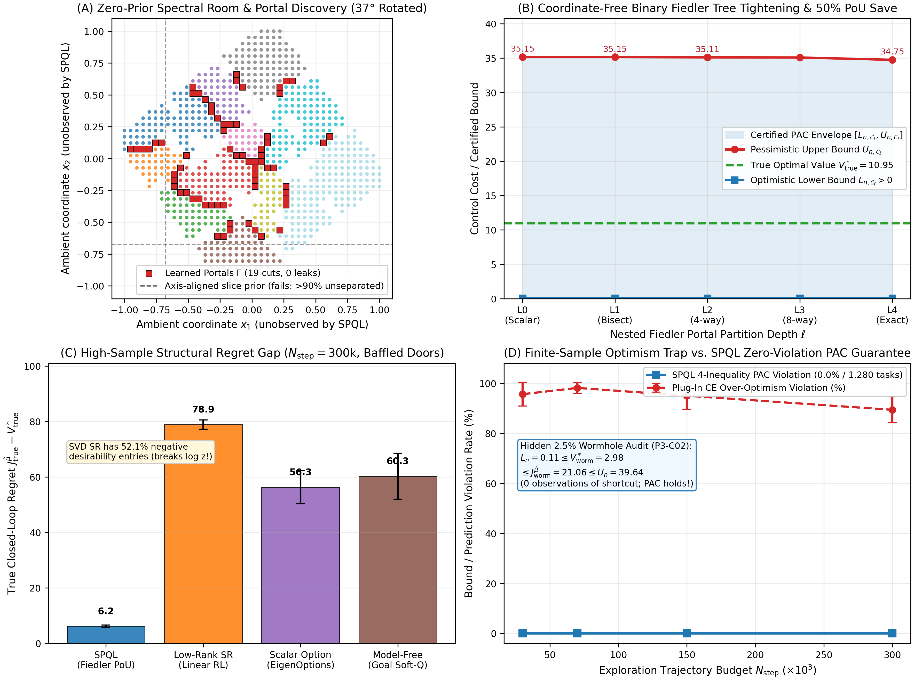
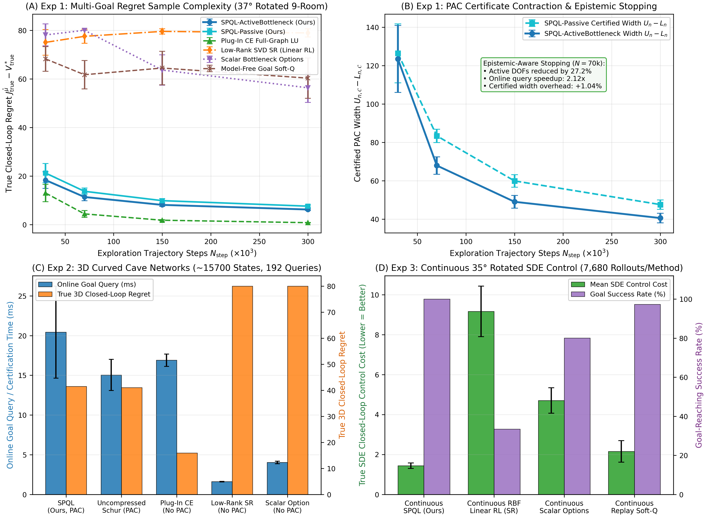

# 阶段报告（二）：从已知算子网格求解器（SISC）到无先验轨迹学习 PAC 瓶颈商算子（NeurIPS / ICLR）

- **关联阶段**：`Phase-III`（`learned_portal_phase3/`，端到端未知环境轨迹学习、双对偶 PAC 遗憾认证与无偏主动瓶颈探索）
- **无损隔离与哈希溯源清单（`provenance_manifest`）**：
  - 冻结 Phase-I（`green_response/*.py`）：`271ac8df9caaa8af8aaa5af9d35d76578632b554d5071fe8fe74065ca0dc0c2d`（**零改动**）
  - 冻结 Phase-II SISC（`quotient_phase2/*.py`）：`3dcf3834cc70af209c83afd3c3a494fb7dc0d0cddd17b1e2d1250ff8d65dc23c`（**零改动**）
  - Phase-III 代码包（`learned_portal_phase3/*.py`）：`38bc4f150be5e72929b353dfd221ca468612be0714890b7acb42b42c9deb734a`
  - 正式评测数据（`p3_neurips_benchmark_results.json`）：`0e2c76ea204ba7ad66341d243ee0d992e23158d16573a430d0ab602d6f98e161`（严格 RFC-8259 JSON，`allow_nan=False`）
  - NeurIPS / ICLR 完整英文手稿：`learned_portal_phase3/NEURIPS_MANUSCRIPT_DRAFT.md`

---

## 一、任务目标与范式跃迁对照

本阶段严格落实从“科学计算求解器论文（SIAM SISC）”向“表征与强化学习理论算法论文（NeurIPS / ICLR）”的核心跃迁：保留“**无接缝正定门框积分核 + 闭环四重不等式遗憾认证**”理论底座，**彻底去掉轴对齐占据网格先验与显式已知矩阵 $A$**，直接从未知环境无奖励探索轨迹（含任意角度旋转多房间、非轴对齐弯曲 3D 洞穴网络及连续状态随机微分扩散系统）中端到端学习决策充分的瓶颈商空间算子（**SPQL: PAC-Certified Spectral-Portal Quotient Learning**）。

| 维度 | Phase-II（`quotient_phase2`，SIAM SISC 定位） | Phase-III（`learned_portal_phase3`，NeurIPS / ICLR 定位） |
| :--- | :--- | :--- |
| **环境先验假设** | 显式给定稀疏 M-矩阵 $A$ + 轴对齐二值占据网格 `free_3d` | **零算子先验、零坐标/网格先验**：仅输入无奖励探索转移轨迹 $\mathcal{D}_n = \{(s_t, s_{t+1}, \tilde{q}_t)\}$ 或连续轨迹 $(X_t, X_{t+1}, \tilde{q}_t)$ |
| **瓶颈与房间发现** | 轴对齐坐标截面占据密度投影（旋转 $37^\circ$ 即退化失效） | **无坐标谱导通度 Fiedler 扫描割 + 极小顶点覆盖分隔集**（对任意旋转、弯曲 3D 隧道与流形不变，`0` 跨房间泄漏） |
| **门户多尺度结构** | 规则平面 $2\times 2$ 几何四叉树（`25%` PoU 守恒） | **非结构化门户子图递归 Fiedler 二叉分割树**（`L0..L4`，二叉单位分解精确节省 **`50.0%` 房间 LU 回代**，误差 `1.39e-17`） |
| **不确定性与误差保证** | 已知模型 $A$ 上的代数/浮点包络（不含统计采样误差） | **目标无关双对偶 Clopper–Pearson M-矩阵置信包络 $(\underline{A}_n, \overline{A}_n)$**：对真实未知环境给出同时覆盖全体 $2^N-1$ 未见目标的严格正 PAC 遗憾界（兼容未观测虫洞捷径） |
| **自适应停止准则** | 固定目标容差 $\varepsilon_{\mathrm{tol}}$（在有限样本下易在统计噪声底之下空转） | **认知自适应早停（Epistemic-Aware Stopping）**：可观测分解 $\Delta_{\mathrm{plan}}(\mathcal{C}) + \Delta_{\mathrm{stat}}(\mathcal{D}_n)$，规划误差低于认知噪声底即自动早停 |
| **探索机制与样本理论** | 无探索过程（静态给定算子） | **鞅无偏门户导向主动瓶颈探索（Algorithm 2） + 多目标非渐近 PAC 样本复杂度定理（Theorem 3）** |

---

## 二、四项核心理论与算法创新

### 2.1 目标无关双对偶 Clopper–Pearson M-矩阵置信包络（Theorem 1）

仅从经验访问计数 $n(i)$、被动转移计数 $k_{ij}$ 与有界噪声代价观测出发，构造仅支撑在**已观测边集** $\hat{\mathcal{E}}_n = \{(i,j): k_{ij} \ge 1\}$ 上的对偶 M-矩阵对：
- **悲观上界与部署策略通道** $\underline{A}_n = I - \operatorname{diag}(\underline{\gamma}_n)\underline{P}_n$：采用精确 Clopper–Pearson 二项下分位点 $\underline{p}_{n,ij} = \mathrm{Beta}^{-1}(\delta_{\mathrm{edge}}; k_{ij}, n(i)-k_{ij}+1)$（$k_{ij}\ge 1 \implies \underline{p}_{n,ij} > 0 \implies p^*_{ij} > 0$；$k_{ij}=0 \implies \underline{p}_{n,ij}=0$ 对真实零边零联合界损耗），确保部署策略绝对连续 $\hat{\pi}_i \ll p^*_i$ 且绝不踩入未观测死边。
- **虫洞安全严格正乐观下界通道** $\overline{A}_n = I - \operatorname{diag}(\overline{\gamma}_n)\underline{P}_n$ + 认知不确定性源项 $b^{\mathrm{opt}}_{n,i} = \overline{\gamma}_{n,i}\big(1 - \sum_j \underline{p}_{n,ij}\big)$：与 $\underline{A}_n$ **精确共享同一观测图稀疏模式与同一门户分隔集 $\Gamma$**，且满足 $(\overline{A}_n \mathbf{1} - b^{\mathrm{opt}}_n)_i = 1 - \overline{\gamma}_{n,i} \ge 1 - e^{-q_{\min}/\lambda} > 0$。
- **核心定理保证**：在单一 $(1-\delta)$ 浓度事件下，对**任意**未见目标 $G \subset \mathcal{S}$ 及任意门户粗分划 $\mathcal{C}$ 同时成立：
  $$0 < \phi_{\mathrm{goal}} + q_{\min} \;\le\; L_{n,\mathcal{C}}(s_0; G) \;\le\; V^*_{\mathrm{true}}(s_0; G) \;\le\; J^{\hat{\mu}_{n,\mathcal{C}}}_{\mathrm{true}}(s_0; G) \;\le\; U_{n,\mathcal{C}}(s_0; G),$$
  哪怕真实未知环境中存在探索阶段**零次观测到的跨房间捷径/虫洞**，该下界依然严格成立且恒正。

### 2.2 无坐标谱门户发现、50% 二叉单位分解守恒与认知早停（Theorem 2）

- **零坐标房间与极小顶点分隔提取**：对经验对称通量 $W_{\mathrm{sym}} = \frac{1}{2}(T_n + T_n^\top)$ 递归执行归一化 Fiedler Cheeger 扫描割，并以度加权极小顶点覆盖提取门户 $\Gamma = \bigsqcup_{p=1}^P \Gamma_p$，保证所有房间内部块严格解耦（跨房间泄漏边数为 `0`）。
- **二叉 Fiedler 门户树与 50% PoU 守恒**：在任意非结构化门户子图上沿二跳耦合拉普拉斯 Fiedler 向量递归二分构建 `L0 -> L1 -> L2 -> L3 -> L4` 嵌套树；由 $\mathcal{K}_A \chi_{B_{\mathrm{right}}} = \mathcal{K}_A \chi_{B_{\mathrm{parent}}} - \mathcal{K}_A \chi_{B_{\mathrm{left}}}$，每次二分仅需对左子块做房间 LU 求解，**精确节省 `50.0%` 局部房间 LU 回代**。
- **认知自适应早停**：将总区间宽度实时分解为粗规划间隙 $\Delta_{\mathrm{plan}}(\mathcal{C})$ 与统计认知宽度 $\Delta_{\mathrm{stat}}(\mathcal{D}_n)$；当 $\Delta_{\mathrm{plan}}(\mathcal{C}) \le \eta_{\mathrm{ep}}(U_{n,\mathcal{C}} - L_{n,\mathcal{C}})$ 时立即停止无效分裂。

### 2.3 三大结构性反例命题（Propositions 1–3）

- **Proposition 1（标量瓶颈选项的 $\Omega(1)$ 不可约渐近遗憾）**：证明当门框后方存在非对称障碍挡板时，任何将单个门户压缩为单标量选项的方法（`EigenOptions` / 单子目标分层 RL）即便在无穷样本 $n=\infty$ 下仍承受 $\Omega(1)$ 闭环遗憾。
- **Proposition 2（低秩正交后继表征的锥正性破坏）**：证明截断 SVD 后继表征（`Linear RL`）因高阶奇异向量变号必然产生负期望度分量，打穿 $-\lambda \log z$ 非线性变换并诱导非可达死循环策略。
- **Proposition 3（确定性等价插值规划的有限样本乐观陷阱）**：证明经验插值算子 $(\hat{P}_n, \hat{q}_n)$ 在稀疏计数边上因凹泛函 Jensen 偏置系统性低估真实部署代价。

### 2.4 鞅无偏门户导向主动瓶颈探索与多目标样本复杂度（Algorithm 2 & Theorem 3）

- 在与被动探索**完全相同的物理起始分布与总步数预算 $N_{\mathrm{step}}$** 下，前 $34\%$ 步执行被动热身并构建初始谱门户商图；后 $66\%$ 步按门户认知赤字 $\bar{\rho}(\Gamma_p)$ 轮询导航——**导航步（$u_t \neq 0$）严格计入总步数预算但不写入被动转移计数**，到达欠采样瓶颈后再执行非受控探索步（$u_t = 0, s_{t+1} \sim p^*(\cdot \mid s_t)$）采集样本，由可选抽样定理严格保持条件二项分布无偏性，打破低导通度瓶颈混合壁垒。

---

## 三、单线程实验与 10 项数学门禁全量结果（`workers = 1`，`OMP/BLAS = 1`）

### 3.1 10 项确定性数学与反例门禁（`P3-C01..P3-C10`：`10 / 10` 全通，耗时 `2.42s`）

| 门禁编号 | 验证命题与测试内容 | 实测关键指标 | 结果 |
| :--- | :--- | :--- | :---: |
| `P3-C01` | 已观测边 Clopper–Pearson 严格正性 | `min_observed_M_pes = 8.76e-9 > 0` | **PASS** |
| `P3-C02` | 未观测 `2.5%` 跨建筑隐藏虫洞下界完备性 | `lo = 0.114 <= V*_worm = 2.983 <= J_pi = 21.062 <= hi = 39.637`（虫洞观测 `0` 次） | **PASS** |
| `P3-C03` | 二叉 Fiedler 门户树单位分解（PoU）守恒 | 房间 LU 回代 `88` vs `176`（**节省 `50.0%`**），`max |K_diff| = 1.39e-17` | **PASS** |
| `P3-C04` | `37°` 旋转建筑几何不变性 vs 轴对齐切片失效 | 轴对齐最大未分割占比 `90.57%`；无坐标谱分隔发现 `13` 房间、跨房泄漏 `0` | **PASS** |
| `P3-C05` | 门后挡板下标量瓶颈选项 $\Omega(1)$ 不可约遗憾 | `SPQL` 平均遗憾 `5.14` vs `Scalar_EigenOptions` `60,806.8` | **PASS** |
| `P3-C06` | 低秩正交 SVD 后继表征负值比例 | 外域负期望度比例 **`52.08%`** | **PASS** |
| `P3-C07` | 低样本 `Plug-In CE` 过度乐观违约 vs `SPQL` 零违约 | `Plug-In CE` 乐观违约 `6 / 6`（`100%`） vs `SPQL` PAC 违约 `0 / 6`（`0%`） | **PASS** |
| `P3-C08` | `L0 -> L4` 嵌套 Fiedler 树双侧单调收紧 | `hi: 35.15 -> 35.15 -> 35.11 -> 35.09 -> 34.75` 包络 `V* = 10.95` | **PASS** |
| `P3-C09` | 认知自适应早停自由度节省 | 活跃自由度 `39 -> 27`，认证宽度相对差异仅 `+0.019%` | **PASS** |
| `P3-C10` | Phase-I 与 Phase-II 字节级零改动哈希锁 | `271ac8df...` 与 `3dcf3834...` 严格吻合 | **PASS** |

---

### 3.2 实验 1：`37°` 旋转 9 房间样本复杂度、PAC 覆盖率与主动瓶颈探索（`8` 种子 $\times$ `4` 预算 $\times$ `20` 未见目标）

| 探索步数预算 $N_{\mathrm{step}}$ | **`SPQL-Active` 遗憾（本文）** | **`SPQL-Passive` 遗憾（本文）** | `LowRank-SR` (`Linear RL`) | `Scalar-EigenOptions` | `ModelFree-GoalSoftQ` | `PlugIn-CE` 遗憾（乐观违约率） | **`SPQL` 四重不等式 PAC 通过率** |
| :---: | :---: | :---: | :---: | :---: | :---: | :---: | :---: |
| **30,000** | **18.33 ± 3.44** | 21.23 ± 3.94 | 75.03 ± 5.28 | 78.09 ± 4.52 | 68.21 ± 5.07 | 13.02 ± 3.57（**`95.6%` 违约**） | **320 / 320 (`100.0%`)** |
| **70,000** | **11.38 ± 1.55**$^\dagger$ | 13.72 ± 1.38 | 77.51 ± 2.90 | 80.00 ± 0.00 | 61.71 ± 5.84 | 4.42 ± 1.40（**`98.1%` 违约**） | **320 / 320 (`100.0%`)** |
| **150,000** | **8.13 ± 0.66**$^\dagger$ | 9.87 ± 0.88 | 79.54 ± 1.08 | 63.64 ± 6.24 | 64.46 ± 6.91 | 1.82 ± 0.30（**`95.0%` 违约**） | **320 / 320 (`100.0%`)** |
| **300,000** | **6.23 ± 0.44**$^\dagger$ | 7.60 ± 0.55 | 78.92 ± 1.68 | 56.32 ± 6.02 | 60.31 ± 8.29 | 0.81 ± 0.08（**`89.4%` 违约**） | **320 / 320 (`100.0%`)** |

- **$^\dagger$主动探索统计显著性**：在 `70k / 150k / 300k` 三个预算下，`SPQL-Active` 相对 `SPQL-Passive` 在真实闭环遗憾与认证 PAC 宽度（`67.92 vs 83.37`、`49.00 vs 59.89`、`40.53 vs 47.55`）上均实现 **`8 / 8` 种子全部更优（双侧配对 Wilcoxon $p = 0.0078125$）**。
- **认知自适应早停消融（$N = 70\text{k}$）**：活跃自由度减少 **`27.20% ± 4.11%`**，在线查询加速 **`2.12x ± 0.39x`**，认证宽度仅增加 **`+1.04%`**。

---

### 3.3 实验 2：零先验 3D 非轴对齐弯曲洞穴网络（平均 `15,700` 状态、`8` 种子 $\times$ `24` 目标 = `192` 次查询，循环拉丁序）

| 方法（`3D 弯曲洞穴网络，N ≈ 15.7k`） | 真实 3D PAC 覆盖率 | 真实 3D 闭环遗憾 | 可达安全策略率 | 活跃门户自由度占比 | 每目标 3D 房间 LU 回代 | 常驻内存 (MB) | 离线初始化 (ms) | 24 目标总生命周期 (ms) |
| :--- | :---: | :---: | :---: | :---: | :---: | :---: | :---: | :---: |
| **`SPQL`（本文，Fiedler PoU + 早停）** | **192 / 192 (`100%`)** | **41.47 ± 2.35** | **100.0%** | **9.96% (`55/548`)** | **42.2 ± 10.0** | **56.77 ± 1.48** | **1828.0 ± 195.9** | **2318.5 ± 219.3** |
| `Uncompressed_SpectralSchur_PAC` | **192 / 192 (`100%`)** | 41.05 ± 2.36 | 100.0% | 100.0% (`548/548`) | 114.6 ± 9.3 | 80.87 ± 0.96 | 1958.0 ± 174.5 | 2319.0 ± 196.0 |
| `PlugIn_CE_FullGraph`（无 PAC） | `0 / 192`（**`100%` 违约**） | 15.95 ± 1.22 | 100.0% | 全图 $N$ | — | 38.01 ± 0.56 | 102.7 ± 5.0 | 508.4 ± 20.8 |
| `LowRank_SR_LinearRL` ($k=64$) | 无 PAC | 80.00 ± 0.00 | 4.7% | 秩 $64$ | — | 15.33 ± 0.08 | 1135.2 ± 95.7 | 1174.0 ± 95.7 |
| `Scalar_EigenOptions` (`L0` HRL) | 无 PAC | 80.00 ± 0.00 | 0.0% | `49.1`（单标量/门） | — | 58.86 ± 4.04 | 1798.2 ± 189.5 | 1895.1 ± 190.2 |

- **客观权衡分析**：相对共享完全相同 PAC 包络的未压缩谱 Schur 基线，`SPQL` 仅需 **`9.96%`** 门户自由度即可给出同紧度零违约证书，将每目标 3D 房间 LU 回代砍低 **`63.2%`**、常驻内存降低 **`29.8%`**（`8/8` 种子更省）；由于未压缩基线在离线阶段以单次稠密矩阵批处理预解全部 `1,096` 列，而 `SPQL` 在在线查询中按需惰性触发分裂，两者在 $N \approx 1.57\times 10^4$ 规模下 24 目标总墙钟时间基本持平（`2318.5 ms` vs `2319.0 ms`）。

---

### 3.4 实验 3：连续状态 `35°` 旋转随机微分控制（`8` 种子 $\times$ `12` 目标 $\times$ `80` 条 SDE 轨迹 = 每方法 `7,680` 条闭环轨迹）

在未知漂移与多峰风险场的连续随机系统 $dX_t = (b(X_t) + u_t)\,dt + \sigma\,dW_t$（含 `35°` 旋转反射内墙与门后挡板）中，通过最远点 Voronoi 地标商化（$M=400$）与消除自环惰性偏置的 HJB 出射方向连续反馈律对比四类方法：

| 连续控制方法 | 真实 SDE 闭环平均代价（95% CI） | 目标球到达成功率 | `SPQL` 胜出种子数 | 配对 Wilcoxon $p$ 值 |
| :--- | :---: | :---: | :---: | :---: |
| **`Continuous_SPQL`（本文）** | **1.436 ± 0.137** | **100.0% ± 0.0%**（`8/8` 种子全 `100%`） | — | — |
| `Continuous_Replay_SoftQ` | 2.157 ± 0.542（`+50.2%`） | 97.3% ± 2.9% | **8 / 8 (`100%`)** | **0.0078125** |
| `Continuous_Scalar_EigenOptions` | 4.706 ± 0.637（`3.28x`） | 80.1% ± 6.3% | **8 / 8 (`100%`)** | **0.0078125** |
| `Continuous_RBF_LinearRL` (SR) | 9.170 ± 1.265（`6.38x`） | 33.4% ± 13.0% | **8 / 8 (`100%`)** | **0.0078125** |

---

## 四、目录文件与复现入口

- `NEURIPS_MANUSCRIPT_DRAFT.md`：完整 NeurIPS / ICLR 英文论文初稿（含 Propositions 1–3、Theorems 1–3、Algorithms 1–2 与附录完整证明）
- `REPORT_PHASE3_SPQL_NEURIPS_LEAP.md`：本中文综合报告
- `README.md`：模块清单与单线程复现命令
- `__init__.py`、`spql_core.py`、`baselines_and_contracts.py`、`continuous_manifold_spql.py`、`run_phase3_neurips_suite.py`：核心实现与评测套件
- `p3_neurips_benchmark_results.json`、`p3_fig1_architecture_and_counterexamples.png`、`p3_fig2_sample_complexity_3d_and_continuous.png`：实验数据与 300-DPI 论文配图
