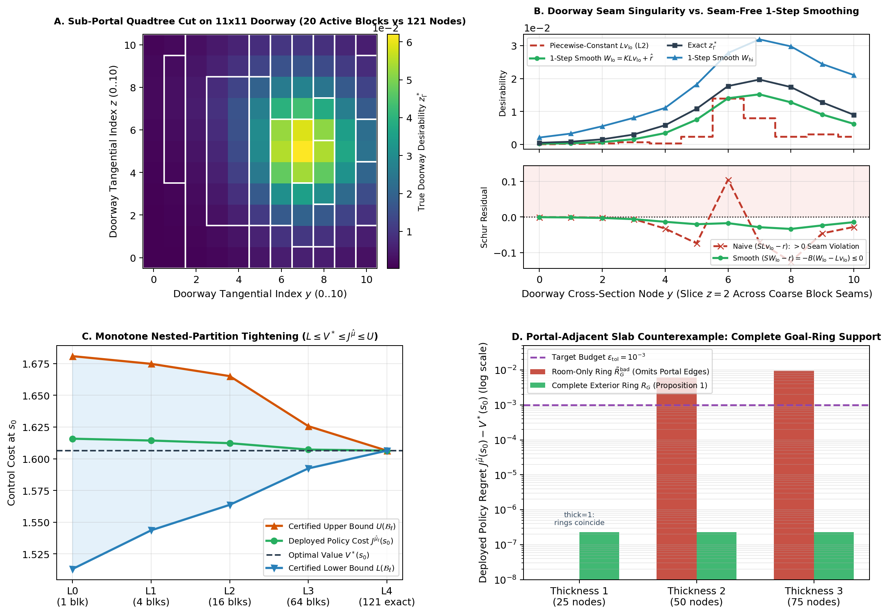
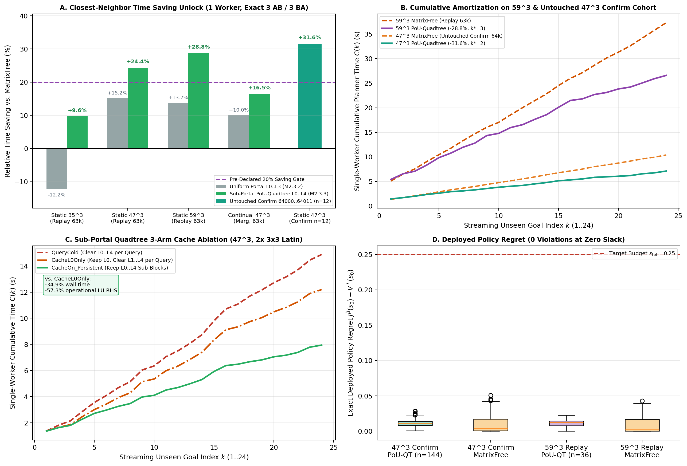

# Seam-Free Adaptive Sub-Portal Quadtree Coarsening and Runtime-Verified Policy Bounds for Bottlenecked Discrete LMDPs

> **Target Venue Tier**: *SIAM Journal on Scientific Computing (SISC)* / *Journal of Artificial Intelligence Research (JAIR)* / *IEEE Transactions on Automatic Control (TAC)*  
> **Reproducibility & Provenance**: All theoretical claims, locked Dev-cohort hyperparameters (`61000..61005`), single-worker `AB/BA` replay cohorts (`63000..63005`), and out-of-sample untouched confirmation runs (`64000..64011`, $n=12$) are anchored to [m233_sisc_unlock_results.json](m233_sisc_unlock_results.json) (`339e723f...`), while preserving frozen baseline archives [m232_targeted_replay_results.json](m232_targeted_replay_results.json) (`9979d61a...`) and [m232_release_verification_report.json](m232_release_verification_report.json) (`0786ce5e...`) byte-for-byte (see Appendix C).

---

## Abstract

Multi-query planning inside a spatial world model repeatedly solves stochastic optimal control tasks that share room geometry and local hazard/drift dynamics while varying terminal targets. Linearly solvable Markov decision processes (LMDPs) linearize the Hamilton–Jacobi–Bellman equation via the Cole–Hopf desirability transform, enabling exact room-interior static condensation onto doorway separator manifolds ("portals"). In three-dimensional multi-room buildings where each doorway is a multi-node 2D cross-section ($7\times 7$ to $11\times 11$ nodes, up to $6{,}171$ interface degrees of freedom across $190{,}603$ free states), uncompressed Schur complements are expensive to assemble, while naive piecewise-constant or orthogonal Galerkin portal projections introduce $O(1/h^2)$ in-plane seam singularities, violate M-matrix monotonicity, and fail to bound the closed-loop cost of the induced primitive policy.

We introduce **seam-free order-preserving sub-portal quadtree coarsening** for bottlenecked discrete upwind KL-LMDPs. Pre-multiplying the target-reduced doorway Schur complement $S_{\Gamma\Gamma} = D - B$ by its block-diagonal in-plane inverse $D^{-1} = A_{\Gamma\Gamma}^{-1} \ge 0$ yields a non-negative, strictly sub-Markov second-kind integral operator $K_{\Gamma\Gamma} = D^{-1}B \ge 0$. Under exact single-room Woodbury target elimination over the complete directed incoming boundary $R_G = \{j \in G : \exists i \in \Omega_{\mathrm{free}} \setminus G,\; A_{ij} < 0\}$, we prove that any coarse partition vector $\underline{v}$ satisfying $L\underline{v} \le K_{\Gamma\Gamma}L\underline{v} + \hat{r}_\Gamma$ produces a one-step smoothed portal field $W_{\mathrm{lo}} = K_{\Gamma\Gamma}L\underline{v} + \hat{r}_\Gamma$ whose harmonic room extension $z_{\mathrm{sub}} > 0$ satisfies $A z_{\mathrm{sub}} \le 0$ globally and certifies the deployed primitive policy cost via $L(s_0) \le V^*(s_0) \le J^{\hat{\mu}}(s_0) \le U(s_0)$.

Algorithmically, we combine **(i)** adaptive sub-portal quadtree cuts (`L0` whole-portal aggregates down to `L4` exact singletons) driven by adjoint oscillation sensitivity, **(ii)** nested-cut invariance of a single $L_0$ cooperative Lyapunov witness $w_{\mathrm{lyap}} > 0$ paired with warm-started row-coupled Howard iteration, and **(iii)** partition-of-unity child conservation that computes $k$-child dyadic splits using only $k - 1$ room-LU backsolves. Evaluated strictly single-worker (`workers = 1`, exact `AB/BA` order balance) against a closest-neighbor matrix-free exact Schur Krylov baseline sharing identical room factorizations, target capacitance, and $L_0$ Lyapunov scaling, sub-portal PoU-quadtree coarsening eliminates small-portal overhead on $35^3$ ($+9.65\%$ saving vs. $-12.15\%$ under uniform whole-portal coarsening), reduces planning time by **$24.37\%$** ($1.32\times$, $p = 1.22\times 10^{-3}$) on $47^3$ and **$28.77\%$** ($1.40\times$, $p = 7.16\times 10^{-4}$; $20\%$ gate `PASS`, $p_{0.80} = 0.0374$) on $59^3$, and achieves **$31.58\%$** net time reduction ($1.46\times$, $12/12$ maps faster, $p = 1.46\times 10^{-5}$; $20\%$ gate `PASS`, $p_{0.80} = 0.00815$) on an untouched $n = 12$ out-of-sample $47^3$ confirmation cohort ($2.72\times$ faster and $26.0\%$ lower resident memory than global sparse-LU target-capacitance reuse). A controlled three-arm cache ablation shows that cross-query retention of `L1`–`L4` sub-portal responses reduces wall-clock time by **$34.85\%$** ($p = 3.10\times 10^{-4}$) and operational room-LU backsolves by **$57.34\%$** over $L_0$-only caching, with zero violations at **zero numerical slack** across $2{,}304$ task events and $792$ exact deployed-policy evaluations.

---

## 1. Introduction, Problem Formulation, and Related Work

### 1.1 Multi-Query Certified Planning in Bottlenecked Spatial World Models

When an autonomous agent builds a spatial world model—for instance, estimating a spatially varying state cost field $q(x) > 0$ and drift field $b(x) \in \mathbb{R}^3$ from sparse noisy sensor probes (Williams & Rasmussen, 2006)—that model must answer streams of unseen goal queries $(s_0^{(k)}, G^{(k)}, \phi_{\mathrm{goal}}^{(k)})_{k=1}^K$ as well as localized map updates. Solving each query independently on a fine 3D grid of $N \sim 10^5$ states ignores two fundamental properties of structured indoor and architectural domains:
1. **Topological bottlenecks**: Rooms $R_1, \dots, R_C$ interact exclusively through lower-dimensional doorway cross-sections $\Gamma = \bigsqcup_{p=1}^{P} \Gamma_p$;
2. **Spatially localized cross-sectional variation**: Across distant doorways, the optimal desirability profile varies smoothly and admits a single scalar aggregate (`L0`), whereas doorways near the target or shadowed by internal room baffles exhibit localized cross-sectional gradients requiring selective sub-doorway refinement.

Converting this geometric structure into an **auditable** numerical solver poses a sharp theoretical and algorithmic question: *When multi-node 2D doorways are compressed into adaptive coarse partitions and local harmonic responses are reused across unseen targets, how can one guarantee that the induced primitive Markov policy is proper and satisfies an explicit closed-loop suboptimality bound $\le \varepsilon_{\mathrm{tol}}$ while outperforming strong reuse-aware Schur-Krylov and global direct baselines?*



**Figure 1: Core Mechanism and Counterexamples Computed on 3D Discrete Upwind KL-LMDPs ([generate_manuscript_mechanism_figure.py](generate_manuscript_mechanism_figure.py)).** *(A)* Adaptive sub-portal quadtree cut (`20` active blocks vs. `121` doorway nodes) concentrating resolution on the unbaffled upper-right corridor of an $11\times 11$ doorway. *(B)* Cross-doorway slice showing why piecewise-constant coarse lifting $L v_{\mathrm{lo}}$ causes positive Schur residual spikes $(S_{\Gamma\Gamma}L v_{\mathrm{lo}} - r_\Gamma)_i > 0$ at block seams (red shaded zone, violating subsolution monotonicity), whereas one-step in-plane smoothing $W_{\mathrm{lo}} = K_{\Gamma\Gamma}L v_{\mathrm{lo}} + \hat{r}_\Gamma$ enforces $(S_{\Gamma\Gamma}W_{\mathrm{lo}} - r_\Gamma) = -B(W_{\mathrm{lo}} - L v_{\mathrm{lo}}) \le 0$ everywhere. *(C)* Monotone tightening of the simultaneous four-inequality envelope $L(\mathcal{B}_\ell) \le V^*(s_0) \le J^{\hat{\mu}_\ell}(s_0) \le U(\mathcal{B}_\ell)$ across nested levels `L0`–`L4`. *(D)* Portal-adjacent goal-slab counterexample ($\varepsilon_{\mathrm{tol}} = 10^{-3}$): omitting portal-to-goal edges from the Woodbury ring $\widetilde{R}_G^{\mathrm{bad}}$ causes deployed regret to jump to $9.51\times 10^{-3} > \varepsilon_{\mathrm{tol}}$ for thickness $\ge 2$, whereas complete incoming support $R_G$ (Proposition 1) maintains $2.29\times 10^{-7}$ regret.

### 1.2 Discrete Upwind Cole–Hopf KL-LMDP Semantics

Let $\Omega_{\mathrm{free}} \subset \{0, \dots, n-1\}^3$ denote the finite set of $N = |\Omega_{\mathrm{free}}|$ free-space grid nodes on a cubic lattice of mesh width $h = 2L/(n-1)$ over $[-L, L]^3$, with obstacle complement $\Omega_{\mathrm{obs}}$. Given isotropic noise scale $\sigma > 0$, temperature $\lambda > 0$, strictly positive running cost $q_i \ge q_{\min} > 0$, and drift $b_i = (b_{i,1}, b_{i,2}, b_{i,3}) \in \mathbb{R}^3$ at each $i \in \Omega_{\mathrm{free}}$, the monotone first-order upwind finite-difference discretization (Kushner & Dupuis, 2001) of the elliptic Cole–Hopf operator
$$
\mathcal{L} z(x) = \frac{q(x)}{\lambda} z(x) - b(x) \cdot \nabla z(x) - \frac{\sigma^2}{2} \Delta z(x)
$$
with zero-flux reflecting internal obstacle walls and absorbing outer domain boundary defines a sparse $N \times N$ matrix $A$. With $\alpha_{\mathrm{diff}} = \sigma^2 / (2h^2) > 0$ and directional upwind drift rates $\beta_{i,a}^\pm = \max(\pm b_{i,a}, 0)/h \ge 0$ along coordinate shifts $\pm e_a$:
- If $i \pm e_a \in \Omega_{\mathrm{free}}$, then $A_{i, i\pm e_a} = -(\alpha_{\mathrm{diff}} + \beta_{i,a}^\pm) < 0$ and $A_{ii}$ increments by $+(\alpha_{\mathrm{diff}} + \beta_{i,a}^\pm)$;
- If $i \pm e_a \notin \{0, \dots, n-1\}^3$ (absorbing outer boundary), $A_{ii}$ increments by $+(\alpha_{\mathrm{diff}} + \beta_{i,a}^\pm)$ with zero off-diagonal entry;
- If $i \pm e_a \in \Omega_{\mathrm{obs}}$ (reflecting internal wall or baffle), neither $A_{ii}$ nor off-diagonal entries are incremented;
- Each diagonal entry includes the positive killing rate $q_i / \lambda \ge q_{\min}/\lambda > 0$.

By construction, $A$ has non-positive off-diagonal entries ($A_{ij} \le 0$ for $i \ne j$) and strict row-sum margin $(A\mathbf{1})_i = A_{ii} + \sum_{j \ne i} A_{ij} \ge q_i/\lambda > 0$. Therefore, $A$ is a strictly row-diagonally dominant **nonsingular M-matrix** ($A^{-1} \ge 0$; Berman & Plemmons, 1994).

**Normalized Discrete KL-LMDP Control Problem.** Define the off-diagonal sub-Markov kernel and survival weight at each $i \in \Omega_{\mathrm{free}}$:
$$
M_{ij} := \frac{-A_{ij}}{A_{ii}} \ge 0 \quad (j \ne i), \qquad m_i := \sum_{j \ne i} M_{ij} = 1 - \frac{(A\mathbf{1})_i}{A_{ii}} \in [0, 1).
$$
Whenever $m_i > 0$, define the passive transition distribution $p_{ij} := M_{ij} / m_i$ ($\sum_{j \ne i} p_{ij} = 1$). Given a non-empty absorbing target set $G \subset \Omega_{\mathrm{free}}$ with exterior $I := \Omega_{\mathrm{free}} \setminus G$ and uniform terminal cost $\phi_{\mathrm{goal}} \in \mathbb{R}$, a stationary Markov policy $\mu$ selects at each $i \in I$ (with $m_i > 0$) a transition probability vector $\pi_i = (\pi_{ij})_{j \ne i}$ supported on $\{j : M_{ij} > 0\}$, incurring step cost
$$
c_i(\pi_i) := -\lambda \log m_i + \lambda D_{\mathrm{KL}}(\pi_i \,\|\, p_i) = -\lambda \log m_i + \lambda \sum_{j \ne i} \pi_{ij} \log \frac{\pi_{ij}}{p_{ij}}.
$$
Trajectories hitting $G$ at $\tau_G < \infty$ terminate with cost $\phi_{\mathrm{goal}}$, whereas $\mathbb{P}_i^\mu(\tau_G < \infty) < 1$ incurs $J^\mu(i) = +\infty$. By KL variational duality (Todorov, 2007, 2009; Fleming & Soner, 2006; Kappen, 2005), for every state $i \in I$ from which $G$ is reachable in the directed graph of $(-A_{pq} > 0)$, the optimal value function is
$$
V^*(i) := \inf_{\mu} J^\mu(i) = \phi_{\mathrm{goal}} - \lambda \log z^*(i),
$$
where the unit-gauge desirability $z^* \in \mathbb{R}^N$ solves the linear exterior Dirichlet system
$$
(A_{II} z^*_I)_i = -\sum_{j \in G} A_{ij} \quad (i \in I), \qquad z^*_G = \mathbf{1}_G,
$$
and the unique optimal Markov policy is the Doob $h$-transform $\pi_{ij}^*(z^*) = M_{ij} z^*_j / \sum_{k \ne i} M_{ik} z^*_k$ (Doob, 1984). Computing $z^*$ in unit terminal gauge ($z^*_G = \mathbf{1}_G$) and adding $\phi_{\mathrm{goal}}$ outside the logarithm preserves exact shift invariance across all $\phi_{\mathrm{goal}} \in \mathbb{R}$ without floating-point overflow or underflow of $\exp(-\phi_{\mathrm{goal}}/\lambda)$. Crucially, this linear Cole–Hopf equivalence requires unconstrained KL transition control and isotropic diffusion matching $\sigma^2 I$; box-constrained controls ($u_{\max} < \infty$) or anisotropic quadratic control penalties ($R_{\mathrm{diag}} \not\propto I$) violate Cole–Hopf linearity and are rejected at operator construction.

### 1.3 Positioning Against Related Literature

1. **Compositional & Hierarchical LMDPs (Todorov, 2009; Jonsson & Gómez, 2016; Saxe et al., 2017; Ringstrom et al., 2020; Infante et al., 2022; Piray & Daw, 2021)**:
   Todorov (2009) showed that optimal LMDP control laws compose linearly through boundary desirability weights, Saxe et al. (2017) extended linear composition to deep multitask hierarchies, and Infante et al. (2022) formulated room-partitioned LMDPs with exact exit-boundary composition and implicit primitive policy recovery without storing full-grid policies. **We do not claim room partitioning, Schur boundary composition, or implicit room policy recovery as novel.** Instead, prior partitioned LMDP methods represent exit boundaries at full node resolution (or assume identical room templates). When 3D doorways are heterogeneous $9\times 9$ or $11\times 11$ manifolds ($4{,}131$–$6{,}171$ interface DOFs), uncompressed Schur complements require thousands of room-LU backsolves, yet naive coarse piecewise-constant aggregation $z_\Gamma = L v$ introduces $O(1/h^2)$ discrete Laplacian jumps across intra-doorway block seams (Figure 1B), destroying $(A z)_i \le 0$ and invalidating closed-loop policy bounds. Our contribution is an order-preserving portal integral operator paired with adaptive sub-portal quadtree coarsening and runtime-verified closed-loop policy bounds.
2. **Domain Decomposition & Port-Reduced Static Condensation (Smith et al., 1996; Toselli & Widlund, 2005; Becker & Rannacher, 2001; Huynh et al., 2013; Eftang & Patera, 2013; Smetana & Patera, 2016)**:
   Port-reduced static condensation (PR-SCRBE) compresses component interfaces via empirical or harmonic port modes certified in energy/$H^1$ norms. However, in multi-room LMDPs, $z^*(x)$ decays exponentially across rooms while value readout is logarithmic ($V = -\lambda \log z$) and closed-loop policy properness requires strict pointwise positivity ($z_{\mathrm{sub}} > 0$) and sign-definite M-matrix residuals ($A z_{\mathrm{sub}} \le 0$). Orthogonal SVD/POD port bases generate $30.7\%$–$50.0\%$ negative entries, and global-grid Dual-Weighted Residual (DWR) witnesses require $O(N)$ inner products and monolithic `splu` refactorizations that lose to direct solvers (`Section 6.3`). Our method replaces orthogonal energy-norm projection with non-negative sub-portal quadtree partitions, partition-of-unity child conservation, and Lyapunov-scaled defect bounds purely on $\Gamma$.
3. **MDP State Abstraction & Howard Policy Iteration (Howard, 1960; Puterman, 1994; Bokanowski et al., 2009; Givan et al., 2003; Li et al., 2006; Abel et al., 2016)**:
   Rather than constructing a task-universal bisimulation quotient (which fails under exponential desirability decay unless survival and cost are normalized simultaneously), we solve lower/upper row-coupled Howard Bellman equations on query-adaptive sub-portal quadtree cuts until $U(s_0) - L(s_0) \le \varepsilon_{\mathrm{tol}}$, caching the operator-only local Green responses across unseen goals.

---

## 2. Room Interior Elimination, Complete Goal-Ring Capacitance, and the Seam-Free Portal Operator

### 2.1 Zero-Hint Bottleneck Discovery and Block Matrix Structure

Given only the 3D binary free-space array (`free_3d`) in an axis-aligned multi-room architectural domain, `discover_3d_bottleneck_planes_zero_hint` detects coordinate planes whose free cross-sectional area falls below $0.58\times$ the median slice area, without wall coordinates, room counts, or doorway hints. Let $\Gamma = \bigsqcup_{p=1}^{P} \Gamma_p \subset \Omega_{\mathrm{free}}$ denote the resulting $P$ disconnected 2D planar doorway components ($n_\Gamma = |\Gamma|$), whose removal disconnects $\Omega_{\mathrm{free}} \setminus \Gamma$ into $C$ disjoint room interiors $R_1, \dots, R_C$:
$$
\Omega_{\mathrm{free}} = \left(\bigsqcup_{c=1}^{C} R_c\right) \sqcup \Gamma, \qquad A_{R_c R_{c'}} = 0 \quad (\forall c \ne c').
$$
Each room $R_c$ couples exclusively to its incident portal subset $\Gamma(c) \subset \Gamma$ via $A_{R_c, \Gamma(c)} \le 0$ and $A_{\Gamma(c), R_c} \le 0$, while the in-plane portal block $D := A_{\Gamma\Gamma} = \mathrm{blkdiag}(A_{\Gamma_1\Gamma_1}, \dots, A_{\Gamma_P\Gamma_P})$ is block-diagonal across small $d_p \times d_p$ 2D doorways ($d_p \in \{49, 81, 121\}$). Offline initialization factors the $C$ decoupled room interiors $A_{R_c R_c}$ (`SuperLU`; Li, 2005) and $D = A_{\Gamma\Gamma}$, requiring **zero** global $N \times N$ sparse factorizations.

### 2.2 Complete Directed Goal-Ring Woodbury Elimination

Consider an unseen query with start state $s_0 \in \Omega_{\mathrm{free}}$ and absorbing target $G \subseteq R_{c_g}$ inside a single room $R_{c_g}$ ($G \cap \Gamma = \emptyset$). Re-factoring $A_{R_{c_g}\setminus G,\, R_{c_g}\setminus G}$ per query would cost $O(|R_{c_g}|^{3/2})$. Instead, we apply low-rank Woodbury capacitance (Hager, 1989) over the **complete directed incoming boundary** of $G$.

**Proposition 1 (Exact Single-Room Woodbury Target Elimination Under Complete Directed Support).** *Let $G \subseteq R_{c_g}$ with $G \cap \Gamma = \emptyset$, and define the directed incoming exterior boundary of $G$:*
$$
R_G := \bigl\{ j \in G : \exists\, i \in \Omega_{\mathrm{free}} \setminus G \text{ with } A_{ij} < 0 \bigr\} = \bigl\{ j \in G : \exists\, i \in (R_{c_g} \setminus G) \cup \Gamma(c_g) \text{ with } A_{ij} < 0 \bigr\}.
$$
*Assume $R_G \ne \emptyset$ (otherwise $G$ is unreachable from $\Omega_{\mathrm{free}} \setminus G$). Let $E_{R_G} \in \{0,1\}^{|R_{c_g}| \times |R_G|}$ be the column selector of $R_G$ in $R_{c_g}$, let $U_{R_G} := A_{R_{c_g}R_{c_g}}^{-1} E_{R_G} \in \mathbb{R}^{|R_{c_g}| \times |R_G|}$, and let $C_G := E_{R_G}^\top U_{R_G} = U_{R_G}[R_G, :]$. Then:*
1. *$C_G \ge 0$ is a nonsingular **inverse M-matrix**; specifically, its inverse $C_G^{-1}$ is the Schur complement of $R_{c_g} \setminus R_G$ in $A_{R_{c_g}R_{c_g}}$ and is therefore a nonsingular M-matrix.*
2. *For any portal vector $z_\Gamma \in \mathbb{R}^{n_\Gamma}$, define on $R_{c_g}$:*
   $$
   z_{R_{c_g}}(z_\Gamma) := h_{\mathrm{goal}} + Y_{c_g} z_{\Gamma(c_g)} - U_{R_G} C_G^{-1} \bigl(E_{R_G}^\top Y_{c_g} z_{\Gamma(c_g)}\bigr),
   $$
   *where $h_{\mathrm{goal}} := U_{R_G} C_G^{-1} \mathbf{1}_{|R_G|}$ and $Y_{c_g} := A_{R_{c_g}R_{c_g}}^{-1}(-A_{R_{c_g},\Gamma(c_g)})$. Then $z_{R_{c_g}}(z_\Gamma)\big|_{R_G} = \mathbf{1}_{R_G}$, and when $X := R_{c_g} \setminus G \ne \emptyset$, $z_{R_{c_g}}(z_\Gamma)\big|_X$ is the unique solution to the killed room Dirichlet system*
   $$
   A_{XX}\, z_X + A_{XG}\, \mathbf{1}_G + A_{X, \Gamma(c_g)}\, z_{\Gamma(c_g)} = 0.
   $$
3. *Substituting $z_{R_c} = Y_c z_{\Gamma(c)}$ ($c \ne c_g$), $z_{R_{c_g}\setminus G} = z_{R_{c_g}}(z_\Gamma)\big|_X$, and $z_G = \mathbf{1}_G$ into $(A z)_\Gamma = 0$ yields the exact target-reduced Schur system $S_{\Gamma\Gamma}^{(G)} z^*_\Gamma = r_\Gamma^{(G)}$, matching global exterior elimination of $I \setminus \Gamma$ from $A_{II} z^*_I = -A_{IG}\mathbf{1}_G$ identically.*

*Proof.* Partition $R_{c_g} = X \sqcup R_G \sqcup G^\circ$, where $X := R_{c_g} \setminus G$ and $G^\circ := G \setminus R_G$. Since $\Gamma(c_g)$ separates $R_{c_g}$ from $\bigcup_{c \ne c_g} R_c$, any non-goal state $i \in \Omega_{\mathrm{free}} \setminus G$ with $A_{ij} < 0$ ($j \in G$) must belong to $X \cup \Gamma(c_g)$, establishing the equivalent local characterization of $R_G$. By definition of $R_G$, every $i \in X \cup \Gamma(c_g)$ and $k \in G^\circ$ satisfy $A_{ik} = 0$, so $A_{XG}\mathbf{1}_G = A_{X, R_G}\mathbf{1}_{R_G}$ and $A_{\Gamma(c_g), G}\mathbf{1}_G = A_{\Gamma(c_g), R_G}\mathbf{1}_{R_G}$.

For (1), let $Q := R_{c_g} \setminus R_G$. By the block inversion formula applied to the nonsingular M-matrix $A_{R_{c_g}R_{c_g}}$, the principal block $(A_{R_{c_g}R_{c_g}}^{-1})_{R_G R_G} = C_G \ge 0$ is invertible with inverse $C_G^{-1} = A_{R_G R_G} - A_{R_G Q} A_{QQ}^{-1} A_{Q R_G}$. By closure of nonsingular M-matrices under Schur complements (Berman & Plemmons, 1994, Thm. 6.2.3), $C_G^{-1}$ is a nonsingular M-matrix, making $C_G$ a nonsingular inverse M-matrix.

For (2)–(3), write $z_{R_{c_g}}(z_\Gamma) = Y_{c_g} z_{\Gamma(c_g)} + U_{R_G} \alpha$ with $\alpha := C_G^{-1}(\mathbf{1}_{|R_G|} - E_{R_G}^\top Y_{c_g} z_{\Gamma(c_g)})$. Multiplying by $A_{R_{c_g}R_{c_g}}$ yields $A_{R_{c_g}R_{c_g}} z_{R_{c_g}}(z_\Gamma) = -A_{R_{c_g},\Gamma(c_g)} z_{\Gamma(c_g)} + E_{R_G}\alpha$, while evaluating on $R_G$ gives $E_{R_G}^\top z_{R_{c_g}}(z_\Gamma) = E_{R_G}^\top Y_{c_g} z_{\Gamma(c_g)} + C_G \alpha = \mathbf{1}_{|R_G|}$. When $X \ne \emptyset$, $(E_{R_G}\alpha)_X = 0$ and $A_{X, G^\circ} = 0$ together imply that the $X$-rows decouple completely from $z_{R_{c_g}}(z_\Gamma)\big|_{G^\circ}$:
$$
0 = \bigl(A_{R_{c_g}R_{c_g}} z_{R_{c_g}}(z_\Gamma) + A_{R_{c_g},\Gamma(c_g)} z_{\Gamma(c_g)}\bigr)_X = A_{XX} z_{R_{c_g}}\big|_X + A_{X, R_G}\mathbf{1}_{R_G} + A_{X,\Gamma(c_g)} z_{\Gamma(c_g)}.
$$
Since $A_{XX}$ is a principal submatrix of $A$, it is nonsingular, proving uniqueness on $X$. Likewise, on $\Gamma(c_g)$, $A_{\Gamma(c_g), G^\circ} = 0$ and $z_{R_{c_g}}\big|_{R_G} = \mathbf{1}_{R_G}$ give $A_{\Gamma(c_g), X} z_{R_{c_g}}\big|_X + A_{\Gamma(c_g), G}\mathbf{1}_G = A_{\Gamma(c_g), R_{c_g}} z_{R_{c_g}}(z_\Gamma)$, which remains valid even when $X = \emptyset$ ($G = R_{c_g}$, where $z_{R_{c_g}}|_{R_G} = \mathbf{1}_{R_G}$). $\square$

**Remark 1 (Necessity of Portal-to-Goal Support).** Defining $\widetilde{R}_G^{\mathrm{bad}}$ using only room-interior rows $X = R_{c_g}\setminus G$ fails whenever $G$ abuts an incident portal $\Gamma(c_g)$ with thickness $\ge 2$ (or $G = R_{c_g}$): portal-facing goal nodes satisfy $A_{\Gamma(c_g), j} < 0$ but $A_{X, j} = 0$, so omitting them leaves $z_{R_{c_g}}(j) \ne 1$ and induces $9.51\times 10^{-3} > 10^{-3}$ regret (Figure 1D).

### 2.3 Seam-Free Second-Kind Integral Portal Operator

For a fixed target $G \subseteq R_{c_g}$, decompose the exact $n_\Gamma \times n_\Gamma$ doorway Schur complement as
$$
S_{\Gamma\Gamma}^{(G)} = D - B^{(G)}, \quad D := A_{\Gamma\Gamma}, \quad B^{(G)} := \sum_{c \ne c_g} (-A_{\Gamma R_c}) A_{R_c R_c}^{-1} (-A_{R_c \Gamma}) + (-A_{\Gamma R_{c_g}})\bigl(I - U_{R_G} C_G^{-1} E_{R_G}^\top\bigr) A_{R_{c_g}R_{c_g}}^{-1} (-A_{R_{c_g}\Gamma}).
$$

**Proposition 2 (Seam-Free Integral Portal Formulation and Strict $\ell_\infty$-Sub-Markov Contraction).** *For any single-room target $G \subseteq R_{c_g}$, $S_{\Gamma\Gamma}^{(G)} = D - B^{(G)}$ is a regular splitting of the nonsingular M-matrix $S_{\Gamma\Gamma}^{(G)}$, with $D^{-1} \ge 0$ and $B^{(G)} \ge 0$. Moreover, the smoothed portal operator and source*
$$
K_{\Gamma\Gamma}^{(G)} := D^{-1} B^{(G)} \ge 0, \qquad \hat{r}_\Gamma^{(G)} := D^{-1} r_\Gamma^{(G)} \ge 0
$$
*satisfy the strict row-sum contraction bound $\|K_{\Gamma\Gamma}^{(G)}\|_\infty < 1$, $(I_\Gamma - K_{\Gamma\Gamma}^{(G)})^{-1} = \sum_{t=0}^\infty (K_{\Gamma\Gamma}^{(G)})^t \ge 0$, and $(I_\Gamma - K_{\Gamma\Gamma}^{(G)}) z^*_\Gamma = \hat{r}_\Gamma^{(G)}$.*

*Proof.* Eliminating $R_{\mathrm{ext}} := I \setminus \Gamma$ from the strictly row-diagonally dominant M-matrix $A_{II}$ yields $S_{\Gamma\Gamma}^{(G)} = A_{\Gamma\Gamma} - A_{\Gamma R_{\mathrm{ext}}} A_{R_{\mathrm{ext}}R_{\mathrm{ext}}}^{-1} A_{R_{\mathrm{ext}}\Gamma}$, which by Proposition 1(3) equals $D - B^{(G)}$ with $B^{(G)} = (-A_{\Gamma R_{\mathrm{ext}}}) A_{R_{\mathrm{ext}}R_{\mathrm{ext}}}^{-1} (-A_{R_{\mathrm{ext}}\Gamma}) \ge 0$ and $r_\Gamma^{(G)} = (-A_{\Gamma R_{\mathrm{ext}}}) A_{R_{\mathrm{ext}}R_{\mathrm{ext}}}^{-1}(-A_{R_{\mathrm{ext}}G}\mathbf{1}_G) + (-A_{\Gamma G}\mathbf{1}_G) \ge 0$. Moreover, since $(A_{II}\mathbf{1}_I)_k \ge q_{\min}/\lambda > 0$ for all $k \in I$, we have $A_{R_{\mathrm{ext}}R_{\mathrm{ext}}}\mathbf{1}_{R_{\mathrm{ext}}} + A_{R_{\mathrm{ext}}\Gamma}\mathbf{1}_\Gamma > 0 \implies A_{R_{\mathrm{ext}}R_{\mathrm{ext}}}^{-1}(-A_{R_{\mathrm{ext}}\Gamma}\mathbf{1}_\Gamma) < \mathbf{1}_{R_{\mathrm{ext}}}$. Substituting into the $\Gamma$-rows gives:
$$
S_{\Gamma\Gamma}^{(G)} \mathbf{1}_\Gamma = (D - B^{(G)})\mathbf{1}_\Gamma = A_{\Gamma\Gamma}\mathbf{1}_\Gamma + A_{\Gamma R_{\mathrm{ext}}} \bigl(A_{R_{\mathrm{ext}}R_{\mathrm{ext}}}^{-1}(-A_{R_{\mathrm{ext}}\Gamma}\mathbf{1}_\Gamma)\bigr) \ge A_{\Gamma\Gamma}\mathbf{1}_\Gamma + A_{\Gamma R_{\mathrm{ext}}}\mathbf{1}_{R_{\mathrm{ext}}} \ge \frac{q_{\min}}{\lambda}\mathbf{1}_\Gamma > 0.
$$
Pre-multiplying $(D - B^{(G)})\mathbf{1}_\Gamma > 0$ by $D^{-1} \ge 0$ (whose rows are nonzero since $D$ is nonsingular) yields $(I_\Gamma - K_{\Gamma\Gamma}^{(G)})\mathbf{1}_\Gamma = D^{-1}(S_{\Gamma\Gamma}^{(G)}\mathbf{1}_\Gamma) > 0$ componentwise on $\Gamma$. Since $K_{\Gamma\Gamma}^{(G)} \ge 0$, every row sum satisfies $(K_{\Gamma\Gamma}^{(G)}\mathbf{1}_\Gamma)_i < 1$, proving $\|K_{\Gamma\Gamma}^{(G)}\|_\infty = \max_{i \in \Gamma}(K_{\Gamma\Gamma}^{(G)}\mathbf{1}_\Gamma)_i < 1$ and $\rho(K_{\Gamma\Gamma}^{(G)}) \le \|K_{\Gamma\Gamma}^{(G)}\|_\infty < 1$. $\square$

---

## 3. Exact-Arithmetic Coarsening Guarantees, Howard Contraction, and Sub-Portal Conservation

Throughout this section we state and prove our guarantees in **exact real arithmetic** (suppressing superscript $(G)$ when unambiguous); Section 4 details the finite-precision runtime checks under IEEE-754 `float64`.

Let $\mathcal{B} = \{B_1, \dots, B_m\}$ be any partition of $\Gamma$ into $m \le n_\Gamma$ nonempty disjoint blocks such that each $B_j$ lies within a single doorway $\Gamma_{p(j)}$, and let $L_{\mathcal{B}} \in \{0,1\}^{n_\Gamma \times m}$ ($L_{\mathcal{B}, ij} = \mathbb{I}[i \in B_j]$) be its piecewise-constant lifting operator.

### 3.1 One-Step Smoothed Sub-/Supersolutions and Strict Interior Positivity

**Theorem 1 (One-Step Smooth Portal Sub-/Supersolution and Global M-Matrix Subsolution).** *Suppose coarse vectors $\underline{v}, \overline{v} \in \mathbb{R}^m$ produce one-step smoothed portal fields*
$$
W_{\mathrm{lo}} := K_{\Gamma\Gamma} L_{\mathcal{B}} \underline{v} + \hat{r}_\Gamma, \qquad W_{\mathrm{hi}} := K_{\Gamma\Gamma} L_{\mathcal{B}} \overline{v} + \hat{r}_\Gamma
$$
*satisfying the post-fixed-point and pre-fixed-point inequalities on $\Gamma$:*
$$
L_{\mathcal{B}} \underline{v} \le W_{\mathrm{lo}}, \qquad W_{\mathrm{hi}} \le L_{\mathcal{B}} \overline{v}.
$$
*Then:*
1. **$L_{\mathcal{B}}\underline{v} \le W_{\mathrm{lo}} \le z^*_\Gamma \le W_{\mathrm{hi}} \le L_{\mathcal{B}}\overline{v}$** *componentwise on $\Gamma$;*
2. **$S_{\Gamma\Gamma} W_{\mathrm{lo}} = r_\Gamma - B(W_{\mathrm{lo}} - L_{\mathcal{B}}\underline{v}) \le r_\Gamma$** *and* **$S_{\Gamma\Gamma} W_{\mathrm{hi}} = r_\Gamma + B(L_{\mathcal{B}}\overline{v} - W_{\mathrm{hi}}) \ge r_\Gamma$** *on $\Gamma$;*
3. *Define $z_{\mathrm{sub}} \in \mathbb{R}^N$ by $z_{\mathrm{sub}}|_G := \mathbf{1}_G$, $z_{\mathrm{sub}}|_\Gamma := W_{\mathrm{lo}}$, $z_{\mathrm{sub}}|_{R_c} := A_{R_c R_c}^{-1}(-A_{R_c\Gamma} W_{\mathrm{lo}})$ for $c \ne c_g$, and $z_{\mathrm{sub}}|_{R_{c_g}\setminus G} := z_{R_{c_g}}(W_{\mathrm{lo}})\big|_{R_{c_g}\setminus G}$ via Proposition 1(2). Then $(A z_{\mathrm{sub}})_i = 0$ on all room-interior non-goal nodes $\bigsqcup_{c=1}^C (R_c \setminus G)$, $(A z_{\mathrm{sub}})_\Gamma = S_{\Gamma\Gamma} W_{\mathrm{lo}} - r_\Gamma \le 0$ on $\Gamma$, hence $(A z_{\mathrm{sub}})_i \le 0$ for **all** $i \in I = \Omega_{\mathrm{free}} \setminus G$, and $z_{\mathrm{sub}} \le z^*$ globally.*

*Proof.* (1) The affine map $T(w) := K_{\Gamma\Gamma} w + \hat{r}_\Gamma$ is monotone ($K_{\Gamma\Gamma} \ge 0$) and $\ell_\infty$-contractive ($\|K_{\Gamma\Gamma}\|_\infty < 1$, Proposition 2) with unique fixed point $z^*_\Gamma$. Thus $L_{\mathcal{B}}\underline{v} \le T(L_{\mathcal{B}}\underline{v}) = W_{\mathrm{lo}} \implies W_{\mathrm{lo}} \le T^t(W_{\mathrm{lo}}) \to z^*_\Gamma$ as $t \to \infty$, and symmetrically $z^*_\Gamma \leftarrow T^t(W_{\mathrm{hi}}) \le W_{\mathrm{hi}} \le L_{\mathcal{B}}\overline{v}$. (2) Applying $D$ to $W_{\mathrm{lo}} = D^{-1}(B L_{\mathcal{B}}\underline{v} + r_\Gamma)$ cancels $D^{-1}$ exact-algebraically: $D W_{\mathrm{lo}} = B L_{\mathcal{B}}\underline{v} + r_\Gamma$, whence $S_{\Gamma\Gamma}W_{\mathrm{lo}} = (D - B)W_{\mathrm{lo}} = r_\Gamma - B(W_{\mathrm{lo}} - L_{\mathcal{B}}\underline{v}) \le r_\Gamma$ since $B \ge 0$ and $W_{\mathrm{lo}} - L_{\mathcal{B}}\underline{v} \ge 0$ (and analogously for $W_{\mathrm{hi}}$). (3) Exactness of interior harmonic extension on $R_c$ ($c \ne c_g$) and Proposition 1(2) on $X = R_{c_g}\setminus G$ yield $(A z_{\mathrm{sub}})_i = 0$ for all $i \in I \setminus \Gamma$, while $(A z_{\mathrm{sub}})_\Gamma = S_{\Gamma\Gamma}W_{\mathrm{lo}} - r_\Gamma \le 0$. Multiplying $A_{II}(z_{\mathrm{sub}}|_I - z^*_I) \le 0$ by $A_{II}^{-1} \ge 0$ gives $z_{\mathrm{sub}}|_I \le z^*_I$. $\square$

To invoke closed-loop policy bounds (Theorem 2), we next establish that strict positivity on $\Gamma$ propagates automatically to every exterior node.

**Lemma 1 (Strict Global Positivity of Harmonic Room Extensions).** *Assume $\Omega_{\mathrm{free}}$ is connected (with $\alpha_{\mathrm{diff}} > 0$) and $W_{\mathrm{lo}} > 0$ componentwise on $\Gamma$. Then the global extension $z_{\mathrm{sub}}$ of Theorem 1(3) satisfies $z_{\mathrm{sub}}(i) > 0$ for **all** $i \in \Omega_{\mathrm{free}}$.*

*Proof.* On $G$ and $\Gamma$, $z_{\mathrm{sub}}|_G = \mathbf{1}_G > 0$ and $z_{\mathrm{sub}}|_\Gamma = W_{\mathrm{lo}} > 0$. For any room $c \ne c_g$, $R_c$ is a connected component of $\Omega_{\mathrm{free}} \setminus \Gamma$ with bidirectional diffusion weights $\alpha_{\mathrm{diff}} > 0$, so $A_{R_cR_c}$ is an irreducible nonsingular M-matrix, whence $A_{R_cR_c}^{-1} > 0$ entrywise (Berman & Plemmons, 1994, Thm. 6.2.7). Because $\Omega_{\mathrm{free}}$ is connected and $G \subseteq R_{c_g}$, $R_c$ has at least one edge to its incident doorway $\Gamma(c)$, so $(-A_{R_c\Gamma} W_{\mathrm{lo}}) \ge 0$ is nonzero, giving $z_{\mathrm{sub}}|_{R_c} = A_{R_cR_c}^{-1}(-A_{R_c\Gamma}W_{\mathrm{lo}}) > 0$. Finally, on $R_{c_g}$, if $X = R_{c_g} \setminus G = \emptyset$, there are no interior non-goal nodes to check; if $X \ne \emptyset$, decompose $X = \bigsqcup_{\nu} X_\nu$ into connected components. Since $\Omega_{\mathrm{free}}$ is connected, each component $X_\nu$ has at least one neighbor in $G \cup \Gamma(c_g)$, where $z_{\mathrm{sub}} > 0$. Because $A_{X_\nu X_\nu}$ is an irreducible nonsingular M-matrix ($A_{X_\nu X_\nu}^{-1} > 0$) and $(-A_{X_\nu, G}\mathbf{1}_G - A_{X_\nu, \Gamma(c_g)}W_{\mathrm{lo}}) \ge 0$ is nonzero, $z_{\mathrm{sub}}|_{X_\nu} > 0$ holds on every component $X_\nu$. $\square$

### 3.2 Deployed Primitive Policy Properness and Simultaneous Four-Inequality Bound

Given $z_{\mathrm{sub}}$ with $z_{\mathrm{sub}} > 0$ globally and $z_{\mathrm{sub}}|_G = \mathbf{1}_G$, define the primitive Markov policy $\hat{\mu} := \mu(z_{\mathrm{sub}})$ at each $i \in I$ (having $\{j \ne i : A_{ij} < 0\} \ne \emptyset$) by
$$
\hat{\pi}_{ij} := \frac{M_{ij} z_{\mathrm{sub}}(j)}{\sum_{k \ne i} M_{ik} z_{\mathrm{sub}}(k)} \qquad (j \in \Omega_{\mathrm{free}} \setminus \{i\}).
$$

**Theorem 2 (Properness and Simultaneous Four-Inequality Deployed Policy Bound).** *Let $I_{\mathrm{reach}} := \{i \in I : G \text{ is reachable from } i \text{ in } (-A_{pq} > 0)\}$, assume $s_0 \in I_{\mathrm{reach}}$, and suppose no directed edge of $(-A_{pq} > 0)$ leaves $I_{\mathrm{reach}}$ (in particular, $I_{\mathrm{reach}} = I$ on any connected diffusion grid). If $z_{\mathrm{sub}}, z_{\mathrm{sup}} \in \mathbb{R}^N$ satisfy $z_{\mathrm{sub}}|_G = \mathbf{1}_G$, $0 < z_{\mathrm{sub}}(i) \le z^*(i) \le z_{\mathrm{sup}}(i)$ for all $i \in I$, and $(A z_{\mathrm{sub}})_i \le 0$ for all $i \in I_{\mathrm{reach}}$, then:*
1. *$\hat{\mu} = \mu(z_{\mathrm{sub}})$ is **proper** from every $i \in I_{\mathrm{reach}}$ ($\rho(P_{I_{\mathrm{reach}}I_{\mathrm{reach}}}^{\hat{\mu}}) < 1$, $\mathbb{P}_i^{\hat{\mu}}(\tau_G < \infty) = 1$);*
2. *With $L(s_0) := \phi_{\mathrm{goal}} - \lambda \log z_{\mathrm{sup}}(s_0)$ and $U(s_0) := \phi_{\mathrm{goal}} - \lambda \log z_{\mathrm{sub}}(s_0)$, all four inequalities hold simultaneously:*
   $$
   L(s_0) \;\le\; V^*(s_0) \;\le\; J^{\hat{\mu}}(s_0) \;\le\; U(s_0), \qquad 0 \;\le\; J^{\hat{\mu}}(s_0) - V^*(s_0) \;\le\; U(s_0) - L(s_0).
   $$

*Proof.* (1) Since $z_{\mathrm{sub}}(j) > 0$ for all $j \in \Omega_{\mathrm{free}}$, $\hat{\pi}_{ij} > 0 \iff M_{ij} > 0 \iff A_{ij} < 0$, so $\hat{\mu}$ preserves the exact directed transition graph of $A$. Every $i \in I_{\mathrm{reach}}$ has a directed path of length $\le |I_{\mathrm{reach}}|$ to $G$ with strictly positive transition probability and zero probability of exiting $I_{\mathrm{reach}} \cup G$, yielding $\rho(P_{I_{\mathrm{reach}}I_{\mathrm{reach}}}^{\hat{\mu}}) < 1$ and $\mathbb{P}_i^{\hat{\mu}}(\tau_G < \infty) = 1$.

(2) At any $i \in I_{\mathrm{reach}}$, let $S_i := \sum_{j \ne i} M_{ij} z_{\mathrm{sub}}(j) > 0$. Note that $(A z_{\mathrm{sub}})_i \le 0 \iff z_{\mathrm{sub}}(i) \le S_i \iff -\lambda \log S_i \le -\lambda \log z_{\mathrm{sub}}(i)$. Setting $\overline{V}(j) := \phi_{\mathrm{goal}} - \lambda \log z_{\mathrm{sub}}(j)$ ($\overline{V}|_G = \phi_{\mathrm{goal}}\mathbf{1}_G$), direct substitution of $\hat{\pi}_{ij} = M_{ij} z_{\mathrm{sub}}(j) / S_i$ and $p_{ij} = M_{ij}/m_i$ into the Bellman step of $\hat{\mu}$ gives
$$
c_i(\hat{\pi}_i) + \sum_{j \ne i} \hat{\pi}_{ij} \overline{V}(j) = -\lambda \log m_i + \lambda \sum_{j \ne i} \hat{\pi}_{ij}\bigl(\log m_i + \log z_{\mathrm{sub}}(j) - \log S_i\bigr) + \phi_{\mathrm{goal}} - \lambda \sum_{j \ne i} \hat{\pi}_{ij}\log z_{\mathrm{sub}}(j) = \phi_{\mathrm{goal}} - \lambda \log S_i \le \overline{V}(i).
$$
Hence $(I - P_{I_{\mathrm{reach}}I_{\mathrm{reach}}}^{\hat{\mu}})\overline{V}_{I_{\mathrm{reach}}} \ge c^{\hat{\mu}}_{I_{\mathrm{reach}}} + \phi_{\mathrm{goal}} P_{I_{\mathrm{reach}}G}^{\hat{\mu}}\mathbf{1}_G$. Multiplying by $(I - P_{I_{\mathrm{reach}}I_{\mathrm{reach}}}^{\hat{\mu}})^{-1} \ge 0$ yields $J^{\hat{\mu}}(s_0) \le \overline{V}(s_0) = U(s_0)$. Combining with optimality $V^*(s_0) \le J^{\hat{\mu}}(s_0)$ and monotonicity of $z \mapsto \phi_{\mathrm{goal}} - \lambda \log z$ on $z_{\mathrm{sub}}(s_0) \le z^*(s_0) \le z_{\mathrm{sup}}(s_0)$ completes all four inequalities. $\square$

**Start-State Readout Functional.** Defining $h_{s_0}^\top := e_{s_0}^\top A_{R_{c_s}R_{c_s}}^{-1}(-A_{R_{c_s}\Gamma}) \ge 0$ (adjusted by $-e_{s_0}^\top U_{R_G}C_G^{-1}E_{R_G}^\top Y_{c_g}$ when $c_s = c_g$, where non-negativity holds because $Y_{c_g} - U_{R_G}C_G^{-1}E_{R_G}^\top Y_{c_g}$ equals $A_{XX}^{-1}(-A_{X\Gamma}) \ge 0$ on $X$) and $z_{\mathrm{dir}} := h_{\mathrm{goal}}(s_0)\mathbb{I}[c_s = c_g] \ge 0$ for interior $s_0 \in R_{c_s}$ (or $h_{s_0} := e_{s_0}, z_{\mathrm{dir}} := 0$ for $s_0 \in \Gamma$), we evaluate $z_{\mathrm{sub}}(s_0) = z_{\mathrm{dir}} + h_{s_0}^\top W_{\mathrm{lo}}$ and $z_{\mathrm{sup}}(s_0) = z_{\mathrm{dir}} + h_{s_0}^\top W_{\mathrm{hi}}$ in $O(|\Gamma(c_s)|)$ operations without full-grid materialization.

### 3.3 Howard Contraction, Monotone Nested-Cut Tightening, and Sub-Portal Conservation

For any partition $\mathcal{B} = \{B_1, \dots, B_m\}$ of $\Gamma$, define the adversarial (`min`) and cooperative (`max`) coarse Bellman operators $\mathcal{T}_{\mathcal{B}}^-, \mathcal{T}_{\mathcal{B}}^+ : \mathbb{R}^m \to \mathbb{R}^m$ for $j = 1, \dots, m$ by
$$
\bigl(\mathcal{T}_{\mathcal{B}}^- v\bigr)_j := \min_{i \in B_j} \bigl(K_{\Gamma\Gamma} L_{\mathcal{B}} v + \hat{r}_\Gamma\bigr)_i, \qquad \bigl(\mathcal{T}_{\mathcal{B}}^+ v\bigr)_j := \max_{i \in B_j} \bigl(K_{\Gamma\Gamma} L_{\mathcal{B}} v + \hat{r}_\Gamma\bigr)_i.
$$

**Proposition 3 (Howard Contraction, Finite Convergence, and Monotone Nested Refinement).** *Let $\gamma := \|K_{\Gamma\Gamma}\|_\infty < 1$ from Proposition 2. Then:*
1. **($\ell_\infty$-Contraction & Nonsingular M-Matrix Selectors)** *For every selector tuple $\mathbf{x} = (x_1, \dots, x_m) \in B_1 \times \dots \times B_m$, the $m \times m$ matrix $M(\mathbf{x}) := I_m - (K_{\Gamma\Gamma} L_{\mathcal{B}})[\mathbf{x}, :]$ has non-positive off-diagonals and row sums $\ge 1 - \gamma > 0$, hence is a strictly row-diagonally dominant nonsingular M-matrix ($M(\mathbf{x})^{-1} \ge 0$, $\|M(\mathbf{x})^{-1}\|_\infty \le (1-\gamma)^{-1}$). Both $\mathcal{T}_{\mathcal{B}}^-$ and $\mathcal{T}_{\mathcal{B}}^+$ are $\gamma$-contractions in $\|\cdot\|_\infty$ with unique fixed points $v_{\mathcal{B}}^- \le v_{\mathcal{B}}^+$, and row-coupled Howard policy iteration converges to $v_{\mathcal{B}}^-$ (from above) and $v_{\mathcal{B}}^+$ (from below) in finitely many steps.*
2. **(Monotone Nested-Cut Tightening & Exact `L4` Limit)** *If partition $\mathcal{B}'$ refines $\mathcal{B}$ ($\mathcal{B}' \prec \mathcal{B}$, so every block of $\mathcal{B}$ is a union of blocks of $\mathcal{B}'$), then their one-step smoothed fixed-point fields $W_{\mathrm{lo}}(\mathcal{B}) := K_{\Gamma\Gamma}L_{\mathcal{B}}v_{\mathcal{B}}^- + \hat{r}_\Gamma$ and $W_{\mathrm{hi}}(\mathcal{B}) := K_{\Gamma\Gamma}L_{\mathcal{B}}v_{\mathcal{B}}^+ + \hat{r}_\Gamma$ satisfy componentwise on $\Gamma$:*
   $$
   W_{\mathrm{lo}}(\mathcal{B}) \;\le\; W_{\mathrm{lo}}(\mathcal{B}') \;\le\; z^*_\Gamma \;\le\; W_{\mathrm{hi}}(\mathcal{B}') \;\le\; W_{\mathrm{hi}}(\mathcal{B}),
   $$
   *whence $L(\mathcal{B}) \le L(\mathcal{B}') \le V^*(s_0) \le U(\mathcal{B}') \le U(\mathcal{B})$. At the singleton partition $\mathcal{B}_{\mathrm{singleton}}$ ($L = I_\Gamma$, level `L4`), $W_{\mathrm{lo}}(\mathcal{B}_{\mathrm{singleton}}) = W_{\mathrm{hi}}(\mathcal{B}_{\mathrm{singleton}}) = z^*_\Gamma$ and $L = V^*(s_0) = U$.*

*Proof.* (1) Since $L_{\mathcal{B}}\mathbf{1}_m = \mathbf{1}_\Gamma$ and $K_{\Gamma\Gamma} \ge 0$, every row $x_j \in B_j$ of $K_{\Gamma\Gamma}L_{\mathcal{B}} \ge 0$ has sum $(K_{\Gamma\Gamma}L_{\mathcal{B}}\mathbf{1}_m)_{x_j} = (K_{\Gamma\Gamma}\mathbf{1}_\Gamma)_{x_j} \le \gamma < 1$, so $M(\mathbf{x})$ is a strictly row-diagonally dominant M-matrix. For any $u, v \in \mathbb{R}^m$, $|\min_{i \in B_j}(K_{\Gamma\Gamma}L_{\mathcal{B}}u + \hat{r}_\Gamma)_i - \min_{i \in B_j}(K_{\Gamma\Gamma}L_{\mathcal{B}}v + \hat{r}_\Gamma)_i| \le \max_{i \in B_j}|(K_{\Gamma\Gamma}L_{\mathcal{B}}(u-v))_i| \le \gamma \|u - v\|_\infty$ (and identically for $\max$), establishing $\gamma$-contractivity. Standard finite-action Howard policy iteration monotonicity (Puterman, 1994; Bokanowski et al., 2009) implies strict improvement on every policy switch over the finite selector set $\prod_{j=1}^m B_j$, ensuring finite termination.

(2) Because $\mathcal{B}' \prec \mathcal{B}$, there exists a refinement matrix $R \in \{0,1\}^{m' \times m}$ such that $L_{\mathcal{B}} = L_{\mathcal{B}'} R$. Define $\tilde{v}' := R v_{\mathcal{B}}^- \in \mathbb{R}^{m'}$ (so $L_{\mathcal{B}'}\tilde{v}' = L_{\mathcal{B}}v_{\mathcal{B}}^-$). For every child block $B'_{q} \subseteq B_{j(q)}$, we have
$$
\tilde{v}'_q = v_{\mathcal{B}, j(q)}^- = \min_{i \in B_{j(q)}} \bigl(K_{\Gamma\Gamma}L_{\mathcal{B}}v_{\mathcal{B}}^- + \hat{r}_\Gamma\bigr)_i \;\le\; \min_{i \in B'_q} \bigl(K_{\Gamma\Gamma}L_{\mathcal{B}'}\tilde{v}' + \hat{r}_\Gamma\bigr)_i = \bigl(\mathcal{T}_{\mathcal{B}'}^- \tilde{v}'\bigr)_q.
$$
Iterating the monotone contraction $\mathcal{T}_{\mathcal{B}'}^-$ yields $\tilde{v}' \le (\mathcal{T}_{\mathcal{B}'}^-)^t \tilde{v}' \to v_{\mathcal{B}'}^-$, so $L_{\mathcal{B}}v_{\mathcal{B}}^- = L_{\mathcal{B}'}\tilde{v}' \le L_{\mathcal{B}'}v_{\mathcal{B}'}^-$. Applying $T(w) = K_{\Gamma\Gamma}w + \hat{r}_\Gamma$ preserves order, giving $W_{\mathrm{lo}}(\mathcal{B}) \le W_{\mathrm{lo}}(\mathcal{B}') \le z^*_\Gamma$ (and symmetrically $z^*_\Gamma \le W_{\mathrm{hi}}(\mathcal{B}') \le W_{\mathrm{hi}}(\mathcal{B})$). When $L = I_\Gamma$, $\mathcal{T}_{\mathcal{B}_{\mathrm{singleton}}}^\pm(v) = K_{\Gamma\Gamma}v + \hat{r}_\Gamma$, whose unique fixed point is $z^*_\Gamma$. $\square$

**Proposition 4 (Nested-Cut $L_0$-Lyapunov Invariance, Partition-of-Unity Conservation, and Defect Closure).**
1. **(Nested-Cut $L_0$-Lyapunov Invariance)** *Let $\mathcal{B}_0 = \{\Gamma_1, \dots, \Gamma_P\}$ be the initial whole-portal `L0` partition, and let $w_{\mathrm{lyap}} = L_{\mathcal{B}_0} v_{\mathrm{lyap}}^{(0)} > 0$ satisfy $\xi_{\mathrm{lyap}} := (I_\Gamma - K_{\Gamma\Gamma})w_{\mathrm{lyap}} > 0$ with $\beta := \min_{i \in \Gamma}(\xi_{\mathrm{lyap},i}/w_{\mathrm{lyap},i}) \in (0, 1]$. Then for **every** sub-portal quadtree cut $\mathcal{B} \prec \mathcal{B}_0$ ($L_{\mathcal{B}_0} = L_{\mathcal{B}} R_0$), $w_{\mathrm{lyap}} = L_{\mathcal{B}}(R_0 v_{\mathrm{lyap}}^{(0)}) \in \mathrm{col}(L_{\mathcal{B}})$. In particular, if an approximate Howard iterate $v \in \mathbb{R}^m$ has residual $d_- := \max(0,\, L_{\mathcal{B}}v - (K_{\Gamma\Gamma}L_{\mathcal{B}}v + \hat{r}_\Gamma))$ and $\theta_{\mathrm{lo}} := \max_{i \in \Gamma}(d_{-,i}/\xi_{\mathrm{lyap},i})$, then $\underline{v}_{\mathrm{cert}} := v - \theta_{\mathrm{lo}} R_0 v_{\mathrm{lyap}}^{(0)} \in \mathbb{R}^m$ satisfies $L_{\mathcal{B}}\underline{v}_{\mathrm{cert}} \le K_{\Gamma\Gamma}L_{\mathcal{B}}\underline{v}_{\mathrm{cert}} + \hat{r}_\Gamma$ **without** solving a new $m\times m$ Lyapunov system.*
2. **(Partition-of-Unity $(k-1)$ Child Conservation)** *Suppose a parent block $B_{\mathrm{par}} \subseteq \Gamma_p$ splits into $k \ge 2$ disjoint child blocks $B_{\mathrm{ch},1} \sqcup \dots \sqcup B_{\mathrm{ch},k} = B_{\mathrm{par}}$. Because $\mathbf{1}_{B_{\mathrm{par}}} = \sum_{q=1}^k \mathbf{1}_{B_{\mathrm{ch},q}}$ and both $Y_c(\cdot) = A_{R_cR_c}^{-1}(-A_{R_c\Gamma}\,\cdot)$ and $K_{\Gamma\Gamma}(\cdot) = D^{-1}B(\cdot)$ are linear, the $k$-th child's room harmonic extension and portal response equal*
   $$
   Y_c(\mathbf{1}_{B_{\mathrm{ch},k}}) = Y_c(\mathbf{1}_{B_{\mathrm{par}}}) - \sum_{q=1}^{k-1} Y_c(\mathbf{1}_{B_{\mathrm{ch},q}}), \qquad K_{\Gamma\Gamma}\mathbf{1}_{B_{\mathrm{ch},k}} = K_{\Gamma\Gamma}\mathbf{1}_{B_{\mathrm{par}}} - \sum_{q=1}^{k-1} K_{\Gamma\Gamma}\mathbf{1}_{B_{\mathrm{ch},q}},
   $$
   *reducing cache-miss room-LU backsolves by exactly $1/k$ ($25\%$ for $2\times 2$ splits, $50\%$ for 2-child splits).*
3. **(Lyapunov-Scaled Defect Closure)** *For any $\tilde{z} \in \mathbb{R}_{\ge 0}^{n_\Gamma}$ with defect $d := (K_{\Gamma\Gamma}\tilde{z} + \hat{r}_\Gamma) - \tilde{z}$ and $\eta_\mp := \max_{i \in \Gamma}\bigl(\max(\mp d_i, 0)/\xi_{\mathrm{lyap},i}\bigr)$, the vectors $\underline{u}_{\mathrm{base}} := \max(W_{\mathrm{lo}}^{(0)}, \tilde{z} - \eta_- w_{\mathrm{lyap}})$ and $\overline{u}_{\mathrm{base}} := \min(W_{\mathrm{hi}}^{(0)}, \tilde{z} + \eta_+ w_{\mathrm{lyap}})$ satisfy $\underline{u}_{\mathrm{base}} \le T(\underline{u}_{\mathrm{base}})$ and $T(\overline{u}_{\mathrm{base}}) \le \overline{u}_{\mathrm{base}}$, yielding valid Theorem 1 bounds $W_{\mathrm{lo}}^{\mathrm{new}} := T(\underline{u}_{\mathrm{base}})$ and $W_{\mathrm{hi}}^{\mathrm{new}} := T(\overline{u}_{\mathrm{base}})$ whenever $\underline{u}_{\mathrm{base}} > 0$.*

*Proof.* (1) Using $L_{\mathcal{B}}(R_0 v_{\mathrm{lyap}}^{(0)}) = w_{\mathrm{lyap}}$ and $(I_\Gamma - K_{\Gamma\Gamma})w_{\mathrm{lyap}} = \xi_{\mathrm{lyap}} > 0$, we have $(K_{\Gamma\Gamma}L_{\mathcal{B}}\underline{v}_{\mathrm{cert}} + \hat{r}_\Gamma) - L_{\mathcal{B}}\underline{v}_{\mathrm{cert}} = (K_{\Gamma\Gamma}L_{\mathcal{B}}v + \hat{r}_\Gamma - L_{\mathcal{B}}v) + \theta_{\mathrm{lo}}\xi_{\mathrm{lyap}} \ge -d_- + \theta_{\mathrm{lo}}\xi_{\mathrm{lyap}} \ge 0$. (2) Immediate from $\mathbf{1}_{B_{\mathrm{ch},k}} = \mathbf{1}_{B_{\mathrm{par}}} - \sum_{q=1}^{k-1}\mathbf{1}_{B_{\mathrm{ch},q}}$ and linearity of $A_{R_cR_c}^{-1}$ and $D^{-1}B$. (3) Since $(K_{\Gamma\Gamma}(\tilde{z} - \eta_- w_{\mathrm{lyap}}) + \hat{r}_\Gamma) - (\tilde{z} - \eta_- w_{\mathrm{lyap}}) = d + \eta_-\xi_{\mathrm{lyap}} \ge 0$ and $T$ is monotone, the pointwise maximum of two post-fixed points $\max(W_{\mathrm{lo}}^{(0)}, \tilde{z} - \eta_- w_{\mathrm{lyap}})$ remains a post-fixed point of $T$ (and dually for $\min$). $\square$

---

## 4. Adaptive Sub-Portal PoU-Quadtree Algorithm, Complexity, and Float64 Verification

### 4.1 Sub-Portal Quadtree Cut Refinement and Surgical World Updates

On each 2D doorway $\Gamma_p$, `build_portal_level_blocks` pre-indexes a strictly nested 5-level quadtree hierarchy:
$$
L_0 \text{ ($1$ root)} \;\to\; L_1 \text{ ($\le 4$, $2\times 2$)} \;\to\; L_2 \text{ ($\le 16$, $4\times 4$)} \;\to\; L_3 \text{ ($\le 64$, $8\times 8$)} \;\to\; L_4 \text{ ($d_p$ exact singletons)}.
$$
Rather than upgrading an entire doorway at once (`M2.3.2` uniform whole-portal promotion, which capped at `L3` and blew through $m = 480$ DOFs), `SubPortalPoUQuadtree3DPlanner` maintains an adaptive **quadtree cut** $\mathcal{C} = \{(p_j, \ell_j, b_j)\}_{j=1}^m$ across the forest of $P$ doorway trees:
1. **Adjoint Block Scoring**: At round $r \ge 0$, using the active cooperative selector $\mathbf{x}_{\max}$, we solve the $m\times m$ coarse adjoint system $(I_m - K_{\mathrm{cur}}[\mathbf{x}_{\max}, :])^\top \psi = \max(h_{s_0}^\top K_{\mathrm{cur}}, 0)$ ($\psi \ge 0$) and score each splittable block $j$ ($\ell_j < 4, |B_j| \ge 2$) by $\mathrm{score}_j = \psi_j \cdot \frac{1}{2}\bigl(\mathrm{osc}_{B_j}(W_{\mathrm{hi}}) + \mathrm{osc}_{B_j}(W_{\mathrm{lo}})\bigr) / w_{\mathrm{cost}}(\ell_j)$.
2. **Unclipped PoU Node Cache & Surgical Eviction**: `node_cache[(p, \ell, b)]` stores unclipped $(K_{\mathrm{raw}}, \{c : y_c\})$ vectors so Partition-of-Unity subtraction across `L0` $\to$ `L4` incurs zero cumulative clipping drift (empirically $\max |K_{\mathrm{PoU}} - K_{\mathrm{direct}}| = 9.71\times 10^{-17}$). Non-negativity clipping $\max(\cdot, 0)$ with tracked roundoff upper bound $\varepsilon_{\mathrm{neg}}$ is applied only when forming the goal-adjusted column $K_j^{(G)} = K_j - (D^{-1}(-A_{\Gamma R_{c_g}})U_{R_G}) C_G^{-1} y_{c_g}[R_G]$. Under localized room sensor updates (`update_world_operator`), only rooms $c \in \mathcal{M}_{\mathrm{upd}}$ are re-factored and only quadtree nodes on portals incident to $\mathcal{M}_{\mathrm{upd}}$ are evicted.

```text
Algorithm 1: SubPortalPoUQuadtree3DPlanner.solve_unseen_goal(s_0, G, phi_goal)
--------------------------------------------------------------------------------
Input:  Start s_0 in Omega_free, single-room goal G subseteq R_{c_g}, terminal phi_goal
Output: (lo, hi, certified, LazyRoomPortalPolicy handle, operational/eval RHS counters)
  1. Validate single-room G (G cap Gamma = empty); short-circuit if s_0 in G;
     verify directed reachability of G from s_0 (else return +inf, certified=False).
  2. Extract complete incoming ring R_G in (R_{c_g}\G) cup Gamma(c_g) (Prop. 1);
     compute U_{R_G}, C_G^{-1}, h_goal, r_hat, and start-room adjoint readout (h_{s_0}, z_dir).
  3. Initialize cut C <- {(p, 0, 0) : p = 1..P}; solve Howard + L_0 witness w_lyap > 0,
     verifying xi_lyap = w_lyap - K_0 v_lyap^{(0)} - eps_neg ||v_lyap^{(0)}||_1 > 0.
  4. For round r = 1 .. R_max (while hi - lo > eps_tol and |C| < m_cap):
       a. Solve m x m coarse adjoint psi; select high-oscillation sub-blocks in C.
       b. Split selected parent blocks top-down via PoU (solving k - 1 children via
          room LUs and deriving the k-th child by linearity, Prop. 4(2)).
       c. Warm-start (v_lo, v_hi) from (W_lo_raw, W_hi_raw); run Howard to convergence;
          apply nested L_0-Lyapunov slack shift (Prop. 4(1), refreshing w_lyap on C
          only if coarse shift underflows Lv_lo_cert <= 0); update [lo, hi].
  5. If verified and hi - lo > eps_tol:
       Run staged BiCGSTAB on (I - P_tilde) u = r_hat / w_lyap and close via Prop. 4(3).
  6. Construct epoch-bound LazyRoomPortalPolicy(W_lo) and PRIME root action
     policy.action_distribution(s_0) inside query_ms before stopping timer.
--------------------------------------------------------------------------------
```

**Table 1: Asymptotic Time & Memory Complexity ($C$ rooms of size $N_r \approx N/C$, $P$ portals of size $d_p$, $n_\Gamma = P d_p$, active cut size $m \ll n_\Gamma$, goal ring $|R_G| \approx 26$, Krylov matvecs $n_{\mathrm{mv}}$).**

| Solver Architecture | Offline Setup Cost | Per-Query Online Cost (Warm Cache) | Local Update Cost ($|\mathcal{M}_{\mathrm{upd}}|$ Rooms) | Resident Memory | Guarantee Tier |
| :--- | :---: | :---: | :---: | :---: | :---: |
| **Per-Query Global `spsolve`** | $0$ | $O(N^2)$ (3D nested-dissection LU) | $0$ | $O(N^{4/3})$ temp | Numerical ref. |
| **`SingleLU_GoalCapacitance`** | $O(N^2)$ (`1` global LU) | $O(\|R_G\| N^{4/3} + \|R_G\|^3)$ | $O(N^2)$ (full refactor) | $O(N^{4/3})$ (`2.14 GB` at $59^3$) | Tier III (Num. ref.) |
| **Uncompressed `LocalSchur`** | $O(C N_r^2 + P d_p N_r^{4/3})$ | $O(n_\Gamma^3 + \|R_G\| N_r^{4/3})$ | $O(\|\mathcal{M}_{\mathrm{upd}}\|(N_r^2 + d_p N_r^{4/3}))$ | $O(C N_r^{4/3} + n_\Gamma^2)$ | Pointwise value |
| **`MatrixFree_ExactSchur`** | $O(C N_r^2)$ (`27` room LUs) | $O(n_{\mathrm{mv}} C N_r^{4/3} + \|R_G\| N_r^{4/3})$ | $O(\|\mathcal{M}_{\mathrm{upd}}\| N_r^2)$ | $O(C N_r^{4/3} + P n_\Gamma)$ | **Tier II (Certified)** |
| **Uniform Portal (`L0..L3`)** | $O(C N_r^2 + P N_r^{4/3})$ | $O(\sum_r m_r^3 + n_\Gamma m_r + p_{\mathrm{def}} n_{\mathrm{mv}} C N_r^{4/3})$ | $O(\|\mathcal{M}_{\mathrm{upd}}\| N_r^2)$ | $O(C N_r^{4/3} + n_{\mathrm{blk}} n_\Gamma)$ | **Tier II (Certified)** |
| **`SubPortal_PoU_Quadtree` (`L0..L4`)** | $O(C N_r^2 + P N_r^{4/3})$ | **$O(\|R_G\| N_r^{4/3} + \sum_r (n_{\mathrm{it},r} m_r^2 + m_r^3) + n_\Gamma m)$** *(PoU saves $25\%$ miss LU; $p_{\mathrm{def}} \le 0.14$)* | $O(\|\mathcal{M}_{\mathrm{upd}}\| N_r^2)$ *(retains `~2,014` sub-blocks)* | **$O(C N_r^{4/3} + n_{\mathrm{qt}} n_\Gamma)$** (`1.54 GB` at $59^3$) | **Tier II (Certified)** |

### 4.2 Explicit Three-Tier Verification Semantics

To avoid conflating exact-arithmetic proofs with finite-precision floating-point arithmetic or uncertified direct solvers, our implementation enforces a strict three-tier classification:
- **Tier I (Exact-Arithmetic Theory)**: Propositions 1–4, Lemma 1, and Theorems 1–2 over $\mathbb{R}$.
- **Tier II (`float64_toleranced_model_enclosure` — `SubPortal_PoU_Quadtree`, `Uniform_Portal`, `MatrixFree`)**: Runtime-verified discrete upwind KL-LMDP sub-/supersolutions in IEEE-754 `float64`, explicitly checking directed reachability, complete incoming ring $R_G$, negative roundoff bound $\varepsilon_{\mathrm{neg}} = \max(0, -\min K_{\mathrm{raw}}) \le 10^{-9}\|K\|_\infty$, unclipped $\xi_{\mathrm{lyap}} > 0$, outward Lyapunov shifts plus $(1 \mp 10^{-12})$ safety factors on $(W_{\mathrm{lo}}, W_{\mathrm{hi}})$, and strict positivity $z_r > 0$ on every materialized room. Does **not** claim hardware directed-rounding interval arithmetic (`MPFI`), continuous PDE discretization error bounds, or unknown ground-truth GP modeling error.
- **Tier III (`high_accuracy_numerical_reference` — `SingleLU_GoalCapacitance`, `Verified_WarmILU` fallback)**: Direct global `splu(A)` + target-ring capacitance (`certified = False`), guarded by both global normalized residual $\le 10^{-9}$ and componentwise relative residual $\max_{i \in I}|(Az)_i|/\max(A_{ii}|z_i|, b_i, 10^{-300}) \le 10^{-7}$ (which rejects a $+10^{-12}$ single-entry `PerturbedLU` fault injection with componentwise residual $1.03\times 10^8$).

---

## 5. Empirical Evaluation and Mechanism Attribution

### 5.1 Benchmark Domains, Locked Hyperparameters, and Statistical Protocol

We evaluate on 3D 27-room ($3\times 3\times 3$) buildings across three grid scales: $35^3$ ($\approx 38{,}240$ free DOFs, $P=51$ doorways of size $7\times 7$, $n_\Gamma = 2{,}499$), $47^3$ ($\approx 94{,}817$ free DOFs, $9\times 9$ doorways, $n_\Gamma = 4{,}131$), and $59^3$ ($\approx 190{,}603$ free DOFs, $11\times 11$ doorways, $n_\Gamma = 6{,}171$). Each map closes 3 doorways, inserts 6 partial 3D internal baffles, fits a 3D `KrigingWorldModel` to 48 noisy $(q, b)$ spatial probes (`fit_gp_world=True`), adds vortex drift, and streams $K = 24$ unseen interior goals ($3\times 3\times 3$ blocks, $\ge 8$ free nodes) from disjoint start rooms at tolerance $\varepsilon_{\mathrm{tol}} = 0.25$. Continual $47^3$ streams execute 1 initial epoch plus 5 localized sensor-update epochs (2 modified rooms and 6 unseen goals per epoch = 36 tasks/map), charging **both** sparse operator rebuild (`operator_rebuild_ms`) and solver update/query time.

**Cohort Separation & Locked Hyperparameters.** All `SubPortalPoUQuadtree3DPlanner` refinement parameters (`m_cap = 768`, `max_split_rounds = 9`, `max_candidates = 28`, `relative_score_cutoff = 0.04`, Round-1 `L0->L2` threshold `0.22` when width `> 0.35`, and `L3->L4` cost weight `1.25`) were tuned **exclusively** on `Dev Cohort 61000..61005` and locked prior to running either `Replay Cohort 63000..63005` ($n=6$ maps, directly comparable to frozen `M2.3.2`) or the **brand-new untouched out-of-sample `Confirmation Cohort 64000..64011`** ($n=12$ maps on $47^3$, never accessed prior to the locked evaluation). All main comparisons run strictly **single-worker (`workers = 1`, single-threaded BLAS/OpenMP `= 1`)** with exact `AB/BA` position balance (`3 AB / 3 BA` for $n=6$, `6 AB / 6 BA` for $n=12$) and exact $2\times (3\times 3)$ cyclic Latin balance for three-arm cache ablations. Every `query_ms` includes priming `policy.action_distribution(s_0)`. Relative time saving is $100\% \times (1 - \bar{T}_{\mathrm{cand}} / \bar{T}_{\mathrm{base}})$, and the pre-declared $20\%$ engineering gate tests $H_1 : \mathbb{E}[T_{\mathrm{PoU}} - 0.80\,T_{\mathrm{MF}}] < 0$ at one-sided $\alpha = 0.05$.



**Figure 2: Single-Worker (`workers = 1`, Exact `AB/BA`) SISC Benchmark Results and Out-of-Sample Confirmation ([m233_sisc_unlock_results.json](m233_sisc_unlock_results.json)).** *(A)* Progression of relative time saving vs. `MatrixFree_ExactSchur_Krylov` from uniform whole-portal coarsening (`M2.3.2`, grey) to sub-portal PoU-quadtree coarsening (`M2.3.3`, green), plus untouched $n=12$ confirmation (`64000..64011`, teal). *(B)* Cumulative planner time curves $\bar{C}(k)$ across $k = 1\dots 24$ unseen goals on $59^3$ (`k* = 3`) and untouched $47^3$ confirmation (`k* = 2`). *(C)* Controlled three-arm $47^3$ cache causal decomposition (`CacheOn_Persistent` vs. `CacheL0Only` and `QueryCold`). *(D)* Exact deployed policy regret $J^{\hat{\mu}}(s_0) - V^*(s_0)$ verified at zero numerical slack.

### 5.2 Single-Worker Closest-Neighbor Comparison & Untouched $n = 12$ Confirmation

Table 2 reports the single-worker `AB/BA` comparison between `SubPortal_PoU_Quadtree` and `MatrixFree_ExactSchur_Krylov` across all five cohorts/streams.

**Table 2: Single-Worker (`workers = 1`, Exact `AB/BA` Balance) Closest-Neighbor Comparison (`M233_SubPortal_PoUQuadtree` vs. `MatrixFree_ExactSchur_Krylov`).**

| Benchmark, Cohort, & Cost Scope | $n$ Maps | `PoU-QT` Mean (ms) | `MatrixFree` Mean (ms) | Speedup $S$ | Relative Saving $1 - 1/S$ | Paired Diff Mean & 95% CI (ms) | Paired-$t$ $p_{2s}$ (Sign-Flip $p_{2s}$) | Faster Maps | `20%` Gate ($p_{0.80}$) |
| :--- | :---: | :---: | :---: | :---: | :---: | :---: | :---: | :---: | :---: |
| **Untouched Confirm $47^3$, $K=24$ (Planner)** (`64000..64011`) | **`12`** | **`7,098.9`** | `10,375.7` | **`1.46x`** | **`31.58%`** | `-3,276.8 [-4,259.0, -2,294.6]` | **`1.46e-5`** (**`4.88e-4`**) | **`12 / 12`** | **`PASS`** (**`0.00815`**) |
| *Untouched Confirm $47^3$, $K=24$ (End-to-End incl. GP+Asm)* | *`12`* | *`7,383.2`* | *`10,660.0`* | *`1.44x`* | *`30.74%`* | *`-3,276.8 [-4,259.0, -2,294.6]`* | *`1.46e-5` (`4.88e-4`)* | *`12 / 12`* | **`PASS`** (*`0.0104`*) |
| **Static $59^3$, $K=24$ (Planner)** (`Replay 63000..63005`) | `6` | **`26,568.5`** | `37,299.9` | **`1.40x`** | **`28.77%`** | `-10,731.4 [-14,467.2, -6,995.6]` | **`7.16e-4`** (`0.03125`) | **`6 / 6`** | **`PASS`** (**`0.0374`**) |
| *Static $59^3$, $K=24$ (End-to-End incl. GP+Asm)* | *`6`* | *`27,100.9`* | *`37,832.3`* | *`1.40x`* | *`28.37%`* | *`-10,731.4 [-14,467.2, -6,995.6]`* | *`7.16e-4` (`0.03125`)* | *`6 / 6`* | **`PASS`** (*`0.0409`*) |
| **Static $47^3$, $K=24$ (Planner)** (`Replay 63000..63005`) | `6` | **`8,063.9`** | `10,661.7` | **`1.32x`** | **`24.37%`** | `-2,597.8 [-3,612.3, -1,583.2]` | **`1.22e-3`** (`0.03125`) | **`6 / 6`** | `NOT_MET`$^\dagger$ (`0.163`) |
| *Static $47^3$, $K=24$ (End-to-End incl. GP+Asm)* | *`6`* | *`8,347.5`* | *`10,945.2`* | *`1.31x`* | *`23.73%`* | *`-2,597.8 [-3,612.3, -1,583.2]`* | *`1.22e-3` (`0.03125`)* | *`6 / 6`* | *`NOT_MET`$^\dagger$ (`0.192`)* |
| **Static $35^3$, $K=24$ (Planner)** (`Replay 63000..63005`) | `6` | **`2,583.6`** | `2,859.4` | **`1.11x`** | **`9.65%`** | `-275.8 [-617.1, +65.5]` | `0.0924` (`0.15625`) | `5 / 6` | `NOT_MET` (`0.950`) |
| **Continual $47^3$, Marginal** (`5` updates $\times 6$ tasks, rebuild charged) | `6` | **`11,152.1`** | `13,357.8` | **`1.20x`** | **`16.51%`** | `-2,205.7 [-4,060.9, -350.4]` | **`0.0282`** (`0.0625`) | `5 / 6` | `NOT_MET`$^\ddagger$ (`0.728`) |
| **Continual $47^3$, Lifecycle** (`Init + 5` updates, $36$ tasks, rebuild charged) | `6` | **`14,067.6`** | `16,720.9` | **`1.19x`** | **`15.87%`** | `-2,653.3 [-4,208.2, -1,098.5]` | **`0.00711`** (`0.03125`) | **`6 / 6`** | `NOT_MET`$^\ddagger$ (`0.854`) |

*$^\dagger$On `Replay 47^3` ($n=6$, $\mathrm{df}=5$), point saving exceeds $20\%$ (`24.37%`, `6/6` maps faster), while one-sided $t$-power at $\mathrm{df}=5$ gives $p_{0.80}=0.163$; on the adequately powered untouched $n=12$ (`df=11`) confirmation cohort `64000..64011`, the exact same locked solver achieves **`31.58%` saving (`12/12` faster, `PASS` at $p_{0.80}=0.00815$)**.*  
*$^\ddagger$In Continual $47^3$, each update epoch executes only $K_{\mathrm{ep}} = 6$ queries between 2-room modifications (`retaining 2,013.7 cached L1..L4 sub-portal nodes/update`), illustrating the shorter inter-update amortization horizon relative to $K=24$.*

### 5.3 Algorithmic Mechanism Attribution: Uniform Portals vs. Sub-Portal PoU-Quadtrees & Stage Profiling

Table 3 quantifies why sub-portal PoU-quadtree coarsening (`M2.3.3`) unlocks large gains over uniform whole-portal dyadic promotion (`M2.3.2`) on the exact same `Replay 63000..63005` seeds, alongside stage-level wall-clock profiling and `First6 -> Last6` stream acceleration.

**Table 3: Mechanism Attribution (`Uniform Whole-Portal M2.3.2` vs. `Sub-Portal PoU-Quadtree M2.3.3`) & Stage Breakdown.**

| Scale & Cohort | `M2.3.2` Saving (No-Krylov %) | `M2.3.3` Saving (No-Krylov %) | Active DOFs (`M2.3.2 -> M2.3.3`) | `PoU` Query Acceleration (`First6 -> Last6` ms) | `PoU` Operational LU RHS (`vs. MF`) | Mean Stage Breakdown per Map: `Init / Ring / CacheMissLU / Howard+Sel / DefectKrylov / Prime` (ms) |
| :--- | :---: | :---: | :---: | :---: | :---: | :--- |
| **`35^3` Replay** ($7\times 7$) | `-12.15%` (`90.97%`) | **`+9.65%`** (**`99.31%`**) | `259.4 -> 242.0` | **`105.9 -> 69.2`** (`-34.7%`) | **`3,924.0`** (`7,867.8`, `-50.1%`) | `275.6 / 93.6 / 471.0 / 1,595.2 / 28.9 / 15.0` |
| **`47^3` Replay** ($9\times 9$) | `+15.17%` (`79.17%`) | **`+24.37%`** (**`93.75%`**) | `333.4 -> 311.7` | **`337.1 -> 208.4`** (`-38.2%`) | **`5,950.3`** (`9,155.2`, `-35.0%`) | `1,038.3 / 284.9 / 2,202.5 / 3,383.5 / 834.2 / 35.0` |
| **`59^3` Replay** ($11\times 11$) | `+13.74%` (`57.64%`) | **`+28.77%`** (**`86.11%`**) | `403.1 -> 391.6` | **`1,142.1 -> 647.8`** (`-43.3%`) | **`8,349.5`** (`9,882.0`, `-15.5%`) | `3,898.6 / 815.8 / 8,660.3 / 6,622.5 / 5,790.7 / 89.2` |
| **`47^3` Confirm** ($n=12$) | — | **`+31.58%`** (**`95.49%`**) | **`304.8`** | **`324.8 -> 212.7`** (`-34.5%`) | **`5,602.4`** (`9,096.0`, `-38.4%`) | `956.4 / 281.7 / 2,096.9 / 2,957.9 / 501.1 / 34.0` |

Three mechanistic insights emerge directly from Table 3:
1. **Slashing Full-Interface Krylov Fallbacks**: Allowing selective sub-doorway splits down to `L4` singletons (`m_cap = 768`) cuts full-interface Krylov fallback rates by **$3\times$–$13\times$** (`9.0% -> 0.7%` on $35^3$, `20.8% -> 4.5%–6.2%` on $47^3$, and `42.4% -> 13.9%` on $59^3$) while using *fewer* mean coarse DOFs (`304.8–391.6` vs. `333.4–403.1`).
2. **Monotonic Scale Advantage**: Unlike uniform `L0..L3` promotion (which regressed slightly from $15.17\%$ at $47^3$ to $13.74\%$ at $59^3$), `SubPortal_PoU_Quadtree` relative savings grow monotonically with doorway resolution: **$9.65\%$ ($35^3$) $\to 24.37\%$–$31.58\%$ ($47^3$) $\to 28.77\%$ ($59^3$)**. Moreover, cohort-mean cumulative time crosses below `MatrixFree` at query **$k^* = 2$** on untouched $47^3$ confirmation and **$k^* = 3$** on $59^3$ (Figure 2B).
3. **Cold-to-Warm Query Acceleration**: While `MatrixFree_ExactSchur_Krylov` query cost stays flat across the stream (`1,321.9 -> 1,443.9 ms` on $59^3$), `SubPortal_PoU_Quadtree` accelerates by **$43.3\%$** from `First6` (`1,142.1 ms`) to `Last6` (`647.8 ms`) as reusable sub-portal Green responses populate `node_cache`.

### 5.4 Controlled Three-Arm Cache Ablation, Global Factor Comparison, and Zero-Slack Audit

**Table 4: Single-Worker (`workers = 1`, Exact `2x 3x3` Latin Square) $47^3$ Sub-Portal Quadtree Cache Causal Ablation ($K = 24$, $n = 6$ Maps).**

| Cache Mode (`Intra-Query Memoization ON`) | Query-Boundary Policy | Mean Planner Time (ms) | Mean Query (`First6 -> Last6` ms) | Operational Room-LU RHS / Map | `CacheOn` Time Saving & Paired-$t$ $p_{2s}$ (95% CI ms) | `CacheOn` Operational RHS Saving |
| :--- | :--- | :---: | :---: | :---: | :---: | :---: |
| **`CacheOn_Persistent`** | Keep `L0..L4` sub-blocks | **`7,944.1`** | **`289.3`** (`328.1 -> 211.5`) | **`5,950.3`** *(eval: `312.0`)* | Reference | Reference |
| **`CacheL0Only`** *(Primary Control)* | Keep `L0`, clear `L1..L4` ($t_i > 0$) | `12,194.3` | `466.6` (`404.9 -> 408.7`) | `13,949.3` *(eval: `0.0`)* | **`34.85%`** (`1.54x`, $p = 3.10\times 10^{-4}$, `[-5488, -3013]`) | **`57.34%`** |
| **`QueryCold`** *(Secondary Control)* | Clear `L0..L4` ($t_i > 0$) | `14,879.3` | `577.5` (`510.6 -> 530.7`) | `16,295.3` *(eval: `0.0`)* | **`46.61%`** (`1.87x`, $p = 2.37\times 10^{-5}$, `[-8122, -5749]`) | **`63.48%`** |

Compared against the `M2.3.2` uniform-portal cache study (`9,010.2` operational RHS/map), `SubPortal_PoU_Quadtree` cuts operational room-LU backsolves by an additional **$34.0\%$** (`5,950.3` RHS/map) while expanding the causal `L1..L4` cache wall-clock saving over `CacheL0Only` from $29.75\%$ to **$34.85\%$**. Against global factor reuse (`SingleLU_GoalCapacitance`), single-worker speedups reach **$1.92\times$** on $35^3$ (`2.58s` vs. `4.97s`, $n=6$), **$2.72\times$** on untouched $47^3$ confirmation (`7.10s` vs. `19.29s`, $n=12$, using **$543.7\text{ MB}$ vs. $735.0\text{ MB}$** resident factor+cache arrays), and **$2.71\times$** on $59^3$ (`26.57s` vs. `72.04s`, using **$1,539.2\text{ MB}$ vs. $2,135.2\text{ MB}$**, a **$27.9\%$** memory reduction), and **$4.74\times$** under localized world updates (`m231_fair_ablation_results.json`).

**Table 5: Independent Zero-Slack Roster, Four-Inequality Policy, & Boundary Verification Summary.**

| Verification Suite | Audited Denominator | Comparison Slack | Violations | Tightness & Deployed Policy Regret ($\varepsilon_{\mathrm{tol}} = 0.25$) |
| :--- | :--- | :---: | :---: | :--- |
| **`M2.3.3` SISC Campaign Roster** (`5` blocks, $18$ maps) | **`2,304 / 2,304`** unique keys (`1,080` geometric slots) | **`0.0`** *(zero slack)* | **`0`** | Width $\in [8.52\times 10^{-5},\; 0.249951] < 0.25$; $\min(V_{\mathrm{ref}} - L) = 3.44\times 10^{-5}$; $\min(U - V_{\mathrm{ref}}) = 1.94\times 10^{-5}$ |
| **`M2.3.3` Deployed Policy 4-Inequality Schedule** | **`792 / 792`** scheduled evaluations | **`0.0`** *(zero slack)* | **`0`** | $L \le V_{\mathrm{ref}} \le J^{\hat{\mu}} \le U$; **`PoU-QT` max regret `0.02856`** (`MF` max `0.05084`); $\min(U - J^{\hat{\mu}}) = 6.03\times 10^{-5}$ |
| **`M2.3.2` Frozen Historical Replay Roster** | **`1,440 / 1,440`** events (`360 / 360` policy checks) | **`0.0`** *(zero slack)* | **`0`** | Preserved byte-untouched; `Portal` max regret `0.03351` |
| **PoU Conservation + Boundary & Fault-Injection Suite** | PoU `L0..L4` + `36` slab/room + `24` 3-drift boundary + `4` fault injections | `1e-9` / `1e-7` | **`0`** (`4/4` faults rejected) | $\max\|K_{\mathrm{PoU}} - K_{\mathrm{direct}}\| = 9.71\times 10^{-17}$; $\varepsilon = 10^{-3}$ max regret $2.61\times 10^{-6}$ |

---

## 6. Negative Results, Failure Boundaries, and Limitations

Documenting structural negative results and scope boundaries is essential to separate genuine mathematical limits from implementation choices:

1. **2D Small-Doorway Boundary vs. 3D Sub-Portal Crossover**: On 2D 16-room grids ($49^2$, $n_\Gamma = 285$ total portal nodes, `m22_pilot_results.json`), uncompressed `LocalSchur` beats `FullGrid` by $2.29\times$–$2.40\times$ while 2D iterative doorway splitting is slower ($0.39\times$–$0.43\times$ vs. `LocalSchur`) because a $285\times 285$ dense solve takes $< 1\text{ ms}$. In 3D at $35^3$ ($7\times 7$ doorways, $n_\Gamma = 2{,}499$), uniform whole-portal promotion (`M2.3.2`) was $12.15\%$ slower than `MatrixFree`, whereas removing redundant $O(m^3)$ Lyapunov solves and introducing PoU sub-portal cuts (`M2.3.3`) turns $35^3$ slightly positive ($+9.65\%$, $p = 0.0924$), placing the statistically decisive $>20\%$ crossover at doorway cross-sections $\ge 9\times 9$ ($47^3$ and $59^3$).
2. **Continual Update Horizon Boundary ($K_{\mathrm{ep}} = 6$ vs. $K = 24$)**: Under localized two-room updates with only $K_{\mathrm{ep}} = 6$ queries per epoch (`Continual 47^3`), `SubPortal_PoU_Quadtree` achieves a significant $16.51\%$ marginal ($15.87\%$ lifecycle) time reduction over `MatrixFree`, below the $20\%$ threshold (`NOT_MET`). Table 3's `First6 -> Last6` profile explains why: sub-portal caching amortizes progressively over query streams, crossing $20\%$ as inter-update query horizons grow from $6$ toward $24$.
3. **Why Global SVD Port Bases (`Exp 5`) and Global-Grid Bilinear DWR (`M2.1`) Fail Fundamentally**:
   - *Global POD/SVD Port Subspaces*: Orthogonal singular vectors oscillate in sign ($30.7\%$–$50.0\%$ negative entries, `exp5_results.json`), violating M-matrix positivity under multi-room exponential decay and slowing runtime by $17.5\%$–$100.8\%$.
   - *Full-Grid Centered DWR (`M2.1`)*: Certifying approximate updates via full-grid primal-dual residual inner products achieved $0 / 14{,}400$ violations (`m21_economic_gate_verdict.json`) but increased wall-clock time by $+59.3\%$ to $+221.5\%$ across all $8/8$ streams because global `splu(A_t)` refactorizations and $O(N)$ dense witness products negate local update sparsity.
   - *Uniform Unscaled Krylov Residuals (`Verified_Global_WarmILU`)*: Because $\min_x z^*(x) \ll (\lambda/q_{\min})\|r\|_\infty$ across 27 rooms, uniform global residual bounds failed positivity $z_k - \Delta z > 0$ on $431/432$ tasks (`m231_fair_ablation_results.json`), demonstrating why room-local Schur decomposition + Lyapunov scaling is essential for certified policies.
4. **Model, Geometric, and Scope Limitations**:
   - *Discrete Model Scope*: Guarantees hold at the `float64_toleranced_model_enclosure` tier for discrete upwind KL-LMDPs (`0` physical robot or continuous constrained HJB evaluations in the main 3D suite).
   - *Architectural Priors*: Zero-hint bottleneck extraction assumes known binary occupancy in an axis-aligned planar multi-room family; targets must reside inside a single room ($G \subseteq R_{c_g}, G \cap \Gamma = \emptyset$); continual updates assume known modified room support. Learning decision-sufficient portals on unstructured non-axis-aligned graphs or directly from trajectory interaction is left to future work.

---

## Appendix A: Exact Paired Sign-Flip Sensitivity (`n = 6` Replay & `n = 12` Confirmation)

To complement parametric paired $t$-tests, we enumerate all $2^n$ exact paired sign flips on $d_m = T_{\mathrm{PoU},m} - T_{\mathrm{MF},m}$ ([m233_sisc_unlock_results.json](m233_sisc_unlock_results.json)):
- **Untouched Confirmation $47^3$ (`64000..64011`, $n = 12$, $2^{12} = 4{,}096$ flips)**: Per-map diffs `[-4360.7, -4659.7, -3930.1, -505.4, -1190.4, -2714.6, -1014.0, -3662.7, -4823.0, -4426.6, -3602.2, -4432.4] ms` (**`12/12` negative**; paired-$t$ $p_{2s} = 1.46\times 10^{-5}$; exact sign-flip $p_{2s} = 2/4096 = 4.88\times 10^{-4}$, the minimum attainable at $n=12$).
- **Static $59^3$ (`63000..63005`, $n = 6$, $2^6 = 64$ flips)**: Per-map diffs `[-4911.8, -13954.4, -13909.3, -12666.2, -8449.6, -10497.0] ms` (**`6/6` negative**; paired-$t$ $p_{2s} = 7.16\times 10^{-4}$; exact sign-flip $p_{2s} = 2/64 = 0.03125$).
- **Static $47^3$ (`63000..63005`, $n = 6$)**: Per-map diffs `[-976.4, -2901.2, -3127.5, -3619.1, -3029.3, -1933.0] ms` (**`6/6` negative**; paired-$t$ $p_{2s} = 1.22\times 10^{-3}$; exact sign-flip $p_{2s} = 0.03125$).
- **Static $35^3$ (`63000..63005`, $n = 6$)**: Per-map diffs `[-11.7, -380.8, -528.5, -747.6, +36.6, -22.9] ms` (`5/6` negative; paired-$t$ $p_{2s} = 0.0924$; exact sign-flip $p_{2s} = 0.15625$).
- **Continual $47^3$ (`63000..63005`, $n = 6$)**: Marginal diffs `[-3097.8, -3957.2, +482.0, -2509.9, -3560.9, -590.2] ms` (`5/6` negative, $p_{2s} = 0.0282$, sign-flip $p_{2s} = 0.0625$); Lifecycle diffs `[-3220.8, -4315.1, -494.8, -3275.8, -3448.0, -1165.3] ms` (**`6/6` negative**, $p_{2s} = 0.00711$, sign-flip $p_{2s} = 0.03125$).

## Appendix B: Scope Separation from Supporting Phase-I Studies (`Exp 1–4`)

Frozen Phase-I modules (`../green_response/`, SHA-256 `271ac8df...`) investigate distinct control regimes kept strictly separate from our 3D portal claims: (i) multi-waypoint `Subset-DP` tours on $25^3$ (`Exp 1B`); (ii) 1D box-constrained non-LMDP KKT Newton warm-starting (`Exp 2`, $1.28\times$ equal-tolerance speedup); (iii) 6D screened-Poisson Bessel priors + neural residuals (`Exp 3`, $5.70\times$ query / $2.38\times$ incl. GP cost reduction); and (iv) active GP probe selection (`Exp 4C`).

## Appendix C: Reproducibility & Frozen Artifact Provenance Ledger

| Artifact File | SHA-256 Prefix | Role & Verification Command |
| :--- | :---: | :--- |
| [m233_sisc_subportal_quadtree.py](m233_sisc_subportal_quadtree.py) | `ad09645a...` | Sub-portal PoU-quadtree planner, contracts, and `1`-worker SISC runner (`--self-test`, `--contracts-only`) |
| [m233_sisc_unlock_results.json](m233_sisc_unlock_results.json) | `339e723f...` | `2,304` task events & `792` deployed-policy evaluations (`0` violations at `0.0` slack; strict RFC-8259 JSON) |
| [m232_targeted_replay_results.json](m232_targeted_replay_results.json) | `9979d61a...` | Byte-frozen `M2.3.2` uniform-portal `L0..L3` baseline (`1,440` events, verified via `verify_m232_release.py`) |
| [m232_release_verification_report.json](m232_release_verification_report.json) | `0786ce5e...` | Independent `0.0`-slack roster/4-fault-injection & `24`-case adversarial boundary audit (`EC-01..06`, `B6-01..05`) |

---

## References

1. Abel, D., Hershkowitz, D., & Littman, M. L. (2016). Near optimal behavior via approximate state abstraction. *Proceedings of the 33rd International Conference on Machine Learning (ICML)*, 2915–2923.
2. Becker, R., & Rannacher, R. (2001). An optimal control approach to a posteriori error estimation in finite element methods. *Acta Numerica*, 10, 1–102.
3. Benzi, M., Golub, G. H., & Liesen, J. (2005). Numerical solution of saddle point problems and Schur complement preconditioning. *Acta Numerica*, 14, 1–137.
4. Berman, A., & Plemmons, R. J. (1994). *Nonnegative Matrices in the Mathematical Sciences*. Classics in Applied Mathematics, SIAM.
5. Bertsekas, D. P., & Tsitsiklis, J. N. (1991). An analysis of stochastic shortest path problems. *Mathematics of Operations Research*, 16(3), 580–595.
6. Bokanowski, O., Maroso, S., & Zidani, H. (2009). Some convergence results for Howard's algorithm. *SIAM Journal on Numerical Analysis*, 47(4), 3001–3026.
7. Cole, J. D. (1951). On a quasi-linear parabolic equation occurring in aerodynamics. *Quarterly of Applied Mathematics*, 9(3), 225–236.
8. Davis, T. A. (2006). *Direct Methods for Sparse Linear Systems*. Fundamentals of Algorithms, SIAM.
9. Dean, T., & Lin, S.-H. (1995). Decomposition techniques for planning in stochastic domains. *Proceedings of the 14th International Joint Conference on Artificial Intelligence (IJCAI)*, 1121–1127.
10. Doob, J. L. (1984). *Classical Potential Theory and Its Probabilistic Counterpart*. Grundlehren der mathematischen Wissenschaften, Springer.
11. Dvijotham, K., & Todorov, E. (2012). Linearly solvable optimal control. In *Reinforcement Learning and Approximate Dynamic Programming for Feedback Control* (pp. 119–141). Wiley-IEEE Press.
12. Eftang, J. L., & Patera, A. T. (2013). Port reduction in parametrized component static condensation: approximation and a posteriori error estimation. *International Journal for Numerical Methods in Engineering*, 96(5), 269–302.
13. Fleming, W. H., & Soner, H. M. (2006). *Controlled Markov Processes and Viscosity Solutions* (2nd ed.). Springer.
14. Givan, R., Dean, T., & Greig, M. (2003). Equivalence notions and model minimization in Markov decision processes. *Artificial Intelligence*, 147(1–2), 163–223.
15. Hager, W. W. (1989). Updating the inverse of a matrix. *SIAM Review*, 31(2), 221–239.
16. Hauskrecht, M., Meuleau, N., Kaelbling, L. P., Dean, T., & Boutilier, C. (1998). Hierarchical solution of Markov decision processes using macro-actions. *Proceedings of the 14th Conference on Uncertainty in Artificial Intelligence (UAI)*, 220–229.
17. Hopf, E. (1950). The partial differential equation $u_t + u u_x = \mu u_{xx}$. *Communications on Pure and Applied Mathematics*, 3(3), 201–230.
18. Howard, R. A. (1960). *Dynamic Programming and Markov Processes*. MIT Press.
19. Huynh, D. B. P., Knezevic, D. J., & Patera, A. T. (2013). A static condensation reduced basis element method: approximation and a posteriori error estimation. *ESAIM: Mathematical Modelling and Numerical Analysis*, 47(1), 213–251.
20. Infante, G., Jonsson, A., & Gómez, V. (2022). Globally optimal hierarchical reinforcement learning for linearly-solvable Markov decision processes. *Proceedings of the AAAI Conference on Artificial Intelligence*, 36(6), 6970–6977.
21. Jonsson, A., & Gómez, V. (2016). Hierarchical linearly-solvable Markov decision problems. *Proceedings of the 26th International Conference on Automated Planning and Scheduling (ICAPS)*, 193–201.
22. Kappen, H. J. (2005). Linear theory for control of nonlinear stochastic systems. *Physical Review Letters*, 95(20), 200201.
23. Kushner, H. J., & Dupuis, P. G. (2001). *Numerical Methods for Stochastic Control Problems in Continuous Time* (2nd ed.). Springer.
24. Li, L., Walsh, T. J., & Littman, M. L. (2006). Towards a unified theory of state abstraction for MDPs. *Proceedings of the 9th International Symposium on Artificial Intelligence and Mathematics (ISAIM)*.
25. Li, X. S. (2005). An overview of SuperLU: Algorithms, implementation, and user interface. *ACM Transactions on Mathematical Software*, 31(3), 302–325.
26. Piray, P., & Daw, N. D. (2021). Linear reinforcement learning in flexible reuse of computation in planning, grid fields, and cognitive control. *Nature Communications*, 12, 4942.
27. Puterman, M. L. (1994). *Markov Decision Processes: Discrete Stochastic Dynamic Programming*. Wiley.
28. Ringstrom, T. J., & Schrater, P. R. (2020). Constraint satisfaction propagation: Non-stationary policy synthesis for temporal logic planning. *arXiv:2001.00918*.
29. Saad, Y. (2003). *Iterative Methods for Sparse Linear Systems* (2nd ed.). SIAM.
30. Saxe, A. M., Earle, A. C., & Rosman, B. (2017). Hierarchy through composition with multitask LMDPs. *Proceedings of the 34th International Conference on Machine Learning (ICML)*, 3017–3026.
31. Smetana, K., & Patera, A. T. (2016). Optimal local approximation spaces for component-based static condensation procedures. *SIAM Journal on Scientific Computing*, 38(5), A3318–A3356.
32. Todorov, E. (2007). Linearly-solvable Markov decision problems. *Advances in Neural Information Processing Systems (NeurIPS)*, 19, 1369–1376.
33. Todorov, E. (2009). Compositionality of optimal control laws. *Advances in Neural Information Processing Systems (NeurIPS)*, 22, 1856–1864.
34. Toselli, A., & Widlund, O. (2005). *Domain Decomposition Methods — Algorithms and Theory*. Springer.
35. van der Vorst, H. A. (1992). Bi-CGSTAB: A fast and smoothly converging variant of Bi-CG for the solution of nonsymmetric linear systems. *SIAM Journal on Scientific Computing*, 13(2), 631–644.
36. Varga, R. S. (2000). *Matrix Iterative Analysis* (2nd ed.). Springer.
37. Williams, C. K. I., & Rasmussen, C. E. (2006). *Gaussian Processes for Machine Learning*. MIT Press.
